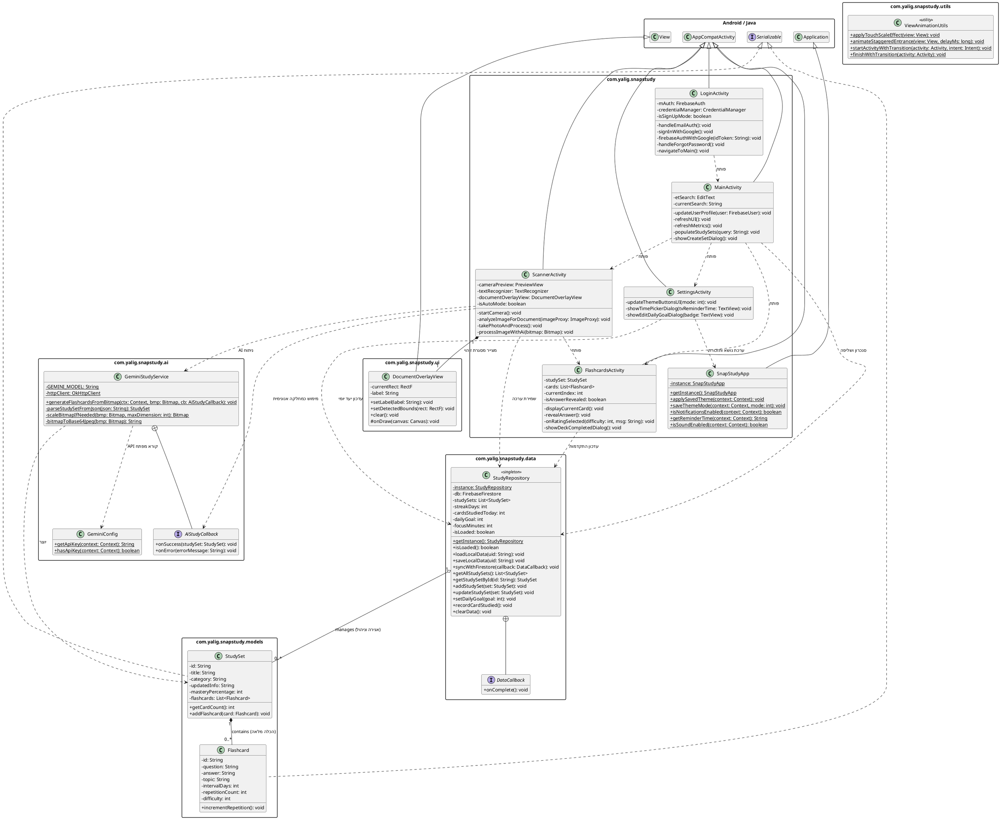

# 📱 SnapStudy (סנאפ-סטאדי)
## עוזר למידה חכם וסורק סיכומים אינטראקטיבי מבוסס בינה מלאכותית (Google Gemini 2.5 Flash)

**מדינת ישראל • משרד החינוך**  
עבודת גמר בגרותית במקצוע "תכנון ותכנות מערכות" (שאלון 883589) - 5 יחידות לימוד  
חלופה: מערכות טלפונים ניידים (סביבת Android Native בשפת Java)  

| פרט | ערך |
| :--- | :--- |
| **שם התלמיד:** | יהלי |
| **מספר ת.ז.:** | 000000000 |
| **בית ספר:** | תיכון אלוני יצחק |
| **מנחה הפרויקט:** | נועם לסנר |
| **שנת לימודים:** | שנת הלימודים תשפ"ו (2026) |

---

## 📋 תוכן העניינים

- **פרק 1: מענה לדרישות משרד החינוך (טבלת תכולות הפרויקט לפי המחוון ל-5 יח"ל)**
- **פרק 2: מבוא – ייזום, אפיון ומחקר מקדים**
- **2.1 הרקע לפרויקט והצורך בלמידה אקטיבית**
- **2.2 מטרת המערכת בראיית המשתמש**
- **2.3 קהל היעד של הפרויקט**
- **2.4 יכולות המערכת (Feature List)**
- **2.5 תרשים תרחישי שימוש ושחקני המערכת (Use Case Diagram)**
- **2.6 תהליך המחקר וסקירת המצב הקיים בשוק**
- **2.7 פירוט טכנולוגיות מעבר לתוכנית הלימודים**
- **2.8 אתגרים מרכזיים ודרכי פתרונם**
- **2.9 חידושים והתאמות בפרויקט**
- **פרק 3: תיאור תחום הידע – פרק מילולי**
- **3.1 אובייקטים נחוצים במערכת**
- **3.2 סוגי הנתונים המשמשים במערכת**
- **3.3 ייצוג מידע ומבני נתונים – נימוקים ובחירות**
- **3.4 תיאור פעולות על המידע (CRUD)**
- **פרק 4: מדריך למשתמש, דרישות מערכת והרשאות**
- **4.1 תרשים זרימת מסכים (Screen Flow Diagram)**
- **4.2 תיאור מפורט של מסכי האפליקציה ורכיביהם**
- **4.3 הרשאות המערכת בקובץ AndroidManifest.xml**
- **4.4 דרישות מיוחדות ומגבלות המערכת**
- **4.5 גרסאות Android ומכשירים עליהם נבדקה המערכת**
- **פרק 5: מבנה וארכיטקטורה של הפרויקט**
- **5.1 ארכיטקטורת שכבות (Layered Architecture)**
- **5.2 תרשים מחלקות UML מלא (PlantUML Diagram)**
- **5.3 עצי מחלקות, הורשה והכלה**
- **5.4 שיקולי תכן ותבניות עיצוב (Design Patterns)**
- **פרק 6: מימוש הפרויקט ובסיס הנתונים**
- **6.1 סקירה הנדסית מעמיקה של מחלקות הפרויקט (13 מחלקות)**
- **6.2 סקירת בסיס הנתונים Cloud Firestore ואחסון המידע**
- **פרק 7: סיכום אישי ורפלקציה**
- **7.1 תהליך העבודה, ההצלחות והאתגרים**
- **7.2 תהליך הלמידה ותכולות שנלמדו באופן עצמאי**
- **7.3 כלים, מיומנויות ותובנות שנלקחים להמשך**
- **7.4 בראייה לאחור – מה הייתי מיישם אחרת?**
- **7.5 כיווני פיתוח עתידיים והרחבות במשאבים נוספים**
- **7.6 שאלת חקר עצמי וממצאיה**
- **פרק 8: ביבליוגרפיה (לפי כללי APA)**
- **פרק 9: נספחים**
- **נספח א': טבלת ספריות ותלויות (Gradle Dependencies)**
- **נספח ב': תדפיס קוד המקור המלא והמתועד (Javadoc)**

---

## פרק 1: מענה לדרישות משרד החינוך לפרויקט 5 יח"ל

| סעיף במחוון | נושא במחוון משרד החינוך | סטטוס | פירוט המימוש בפרויקט SnapStudy | מחלקות רלוונטיות |
| :--- | :--- | :--- | :--- | :--- |
| דרישות חובה (1-5) | אפליקציית Android עובדת ללא קריסות, לוגיקה מורכבת, ממשק משתמש אינטראקטיבי מרובה מסכים, אירועים והרשאות זמן-ריצה. | **בוצע במלואו** | אפליקציית Native מלאה ב-Java, 5 מסכים (Activities), ארכיטקטורת שכבות, תגובות לאירועי מגע, מחזור חיים, וניהול הרשאות זמן-ריצה למצלמה. | `MainActivity, LoginActivity, ScannerActivity, FlashcardsActivity, SettingsActivity` |
| סעיף 6 (חובה 5 יח"ל) סעיף 6.12 | בינה מלאכותית - הטמעת כלי GenAI קיימים באמצעות API או Agents | **בוצע במלואו (נושא ראשי)** | שילוב מנוע Google Gemini 2.5 Flash Multimodal Vision דרך REST API. ניתוח תמונות של מחברות/ספרים וחילוץ שאלות ותשובות ממוקדות בפורמט JSON קשיח. | `GeminiStudyService, GeminiConfig` |
| סעיף 6 (חובה 5 יח"ל) סעיף 6.14 | שימוש ב-ActivityResultContract (בפורמט המודרני החדש) | **בוצע במלואו** | שימוש ב-ActivityResultContracts.RequestPermission לבקשת הרשאת מצלמה בזמן-ריצה, ושימוש ב-ActivityResultContracts.GetContent לבחירת תמונות מגלריית המכשיר. | `ScannerActivity` |
| סעיף 7 (אחסון נתונים) | אחסון וטיפול בנתונים (חובה כתיבה וקריאה) בבסיס נתונים מרוחק (Firestore / Firebase) | **בוצע במלואו (שמירה ושליפה)** | שימוש ב-Cloud Firestore לסנכרון מלא של ערכות לימוד, כרטיסיות וסטטיסטיקות משתמש (Streak, יעד יומי). כולל קאש מקומי ב-JSON ב-SharedPreferences למניעת השהיות. | `StudyRepository, firestore.rules` |
| סעיף 9 (מתקדם) סעיף 9.3 | ירושה ממחלקת View / IDrawable לצורך מימוש גרפי מותאם אישית | **בוצע במלואו (הרחבה מתקדמת)** | פיתוח DocumentOverlayView היורש מ-View. ציור דינמי על גבי ה-Canvas של מסגרת אדומה עם פינות מעוגלות ועוגנים פינתיים, תוך חישוב מיקום חי ותגית חיווי צפה. | `DocumentOverlayView` |
| סעיף 9 (מתקדם) סעיף 9.13 | כל טכנולוגיה חדשה (עיבוד תמונה / ראייה ממוחשבת On-Device) | **בוצע במלואו (הרחבה מתקדמת)** | הטמעת ספריית Google ML Kit Text Recognition לניתוח פריימים בזמן אמת ממצלמת CameraX, זיהוי גבולות מסמך אוטומטי, יציבות פריים וצילום אוטומטי ללא מגע. | `ScannerActivity, DocumentOverlayView` |
| סעיף 10 (נושאים נוספים) סעיף 10.2 | שימוש ב-SharedPreferences לשמירת נתונים מקומיים | **בוצע במלואו** | שמירת העדפות תצוגה (מצב כהה/בהיר/מערכת), שעת תזכורת יומית, מצב אפקטים קוליים, יעד כרטיסיות יומי, וקאש מקומי מלא של ערכות הלימוד בפורמט JSON. | `SnapStudyApp, StudyRepository, SettingsActivity` |
| סעיף 10 (נושאים נוספים) סעיף 10.3 | שימוש במצלמה ובגלריה (Camera & Gallery) | **בוצע במלואו** | שליטה מלאה במצלמת המכשיר באמצעות AndroidX CameraX (Preview, ImageAnalysis, ImageCapture, בקרת פלאש/לפיד) וייבוא תמונות מגלריית המשתמש. | `ScannerActivity` |

---

## פרק 2: מבוא – ייזום, אפיון ומחקר מקדים

### 2.1 הרקע לפרויקט והצורך בלמידה אקטיבית
במהלך שנות הלימודים בתיכון ובאקדמיה, תלמידים וסטודנטים מתמודדים עם עומס מידע עצום. מקצועות הומניים (כגון היסטוריה, אזרחות, ספרות ותנ"ך) ומקצועות מדעיים (כגון ביולוגיה, מדעי המחשב ופיזיקה) דורשים שינון והבנה עמוקה של עשרות מושגים, הגדרות, תהליכים ונוסחאות. מחקרים קוגניטיביים רבים מוכיחים כי קריאה פסיבית של סיכומים או הדגשת טקסטים במרקר הינה טכניקת למידה בלתי יעילה בעליל, המובילה לשכחה מהירה של עד 70% מהחומר תוך ימים ספורים.

לעומת זאת, מתודולוגיית "Active Recall" (שליפה פעילה מהזיכרון) בשילוב עם "Spaced Repetition" (חזרה מרווחת בזמן) הוכחה כשיטה האפקטיבית ביותר להטמעת מידע בזיכרון לטווח ארוך. כלי העבודה המוביל למימוש שיטה זו הוא כרטיסיות זיכרון (Flashcards). אולם, קיים חסם פסיכולוגי וטכני מרכזי: יצירת כרטיסיות זיכרון באופן ידני היא משימה סיזיפית, גוזלת שעות רבות ומתישה. תלמידים רבים מעדיפים לוותר על שיטת לימוד זו מראש עקב הזמן הנדרש להקלדת כל שאלה ותשובה.

### 2.2 מטרת המערכת בראיית המשתמש
אפליקציית SnapStudy נוצרה כדי להסיר לחלוטין את החסם הטכני ולבצע מהפכה בהרגלי הלמידה. מטרת המערכת היא לאפשר ללומד לצלם במצלמת הטלפון החכם דף מתוך מחברת סיכומים, עמוד מספר לימוד, לוח כיתה או מצגת, והמערכת – באופן אוטונומי לחלוטין וללא כל מגע יד אדם – מנתחת את התמונה, מחלצת ממנה את התובנות, הנושאים והרעיונות המרכזיים, ומייצרת עבורו באופן מיידי ערכת כרטיסיות זיכרון (Study Set) אינטראקטיבית בעברית רהוטה וברורה. המשתמש יכול מיד להתחיל לתרגל, לבחון את עצמו, לעקוב אחר רמת השליטה שלו ולשמור על רצף למידה יומי.

### 2.3 קהל היעד של הפרויקט
- **תלמידי חטיבה עליונה ותיכון:** המתכוננים למבחני בגרות במקצועות רבי-מלל ומדעים ומעוניינים לקצר את זמני הסיכום והשינון.
- **סטודנטים במוסדות להשכלה גבוהה:** הנדרשים לשלוט במאות מושגים ומאמרים אקדמיים בכל סמסטר ומחפשים כלי עזר מודרני מבוסס בינה מלאכותית.
- **לומדים עצמאיים ונבחני מבחני הסמכה:** המעוניינים לתרגל מושגים מקצועיים, שפות או קורסים מקוונים בצורה חכמה וממוקדת.

### 2.4 יכולות המערכת (Feature List)
- **סורק מסמכים חכם (Auto Scanner):** מזהה באופן אוטומטי ובזמן אמת מסמכים ודפי מחברת באמצעות ראייה ממוחשבת, מסמן מסגרת מעקב אדומה ומבצע צילום יציב ללא צורך בלחיצה על כפתור.
- **סורק ידני ובחירה מגלריה:** מאפשר שליטה ידנית בצילום, הפעלת תאורת פלאש/לפיד, וייבוא תמונות קיימות של סיכומים ישירות מגלריית המכשיר.
- **מנוע בינה מלאכותית רב-מודאלי (Google Gemini 2.5 Flash):** פענוח תמונות באיכות גבוהה, זיהוי כתב יד ודפוס, ניתוח פדגוגי וחילוץ אוטומטי של שאלות ותשובות ממוקדות בפורמט JSON מובנה.
- **מערכת תרגול כרטיסיות אינטראקטיבית:** חוויית תרגול מהנה הכוללת אנימציית היפוך תלת-ממדית (3D Flip), הצגת שאלות, חשיפת תשובות, ו-4 רמות דירוג קושי (Again, Hard, Good, Easy).
- **סנכרון ענן בזמן אמת (Cloud Firestore):** אחסון מאובטח של כל ערכות הלימוד, הכרטיסיות, הסטטיסטיקות וההתקדמות של המשתמש בענן של Google, עם חוקי אבטחה קפדניים.
- **מערכת אימות ואבטחה כפולה (Firebase Auth & Google Credential Manager):** התחברות מהירה בלחיצה אחת באמצעות חשבון Google, לצד תמיכה ברישום ואימות דוא"ל וסיסמה כולל איפוס סיסמה מאובטח.
- **מעקב יעדים, מוטיבציה ורצף לימודי (Streak & Daily Goals):** הגדרת יעד כרטיסיות יומי אישי, מדידת דקות ריכוז, ומעקב רציף אחר ימי למידה רצופים (Streak Days) בליווי אלמנטים גרפיים מעודדים.
- **התאמה אישית מלאה של סביבת הלמידה:** תמיכה במצב כהה (Dark Mode), מצב בהיר והתאמה למערכת ההפעלה, הגדרת שעת תזכורת יומית (TimePickerDialog) ושליטה באפקטים קוליים.
- **ממשק משתמש מודרני מונגש (Material Design 3 & Full RTL):** עיצוב מוקפד לפי עקרונות הנדסת אנוש, תמיכה מלאה בכיווניות עברית (RTL), ואנימציות קפיציות טקטיליות במגע.


### 2.5 תרשים תרחישי שימוש ושחקני המערכת (Use Case Diagram)

תרשים תרחישי השימוש (Use Case Diagram) מגדיר את גבולות המערכת (System Boundary), את השחקנים (Actors) המקיימים אינטראקציה עם האפליקציה, ואת הפעולות המרכזיות שהמערכת מאפשרת לבצע.

#### 2.5.1 שחקני המערכת (System Actors)
- **תלמיד / לומד (Primary Actor - שחקן ראשי):** המשתמש האנושי שמפעיל את האפליקציה במכשירו הנייד. התלמיד מתחבר למערכת, סורק דפי סיכום ומחברות, מתרגל כרטיסיות זיכרון, יוצר ועורך סטים באופן ידני, ומגדיר יעדי למידה אישיים.
- **מנוע Google Gemini Vision AI (Secondary Actor - שירות ענן חיצוני):** שירות הבינה המלאכותית מבית Google (`gemini-2.5-flash`). מקבל תמונת מסמך ב-Base64 והנחיה פדגוגית קפדנית, מנתח את התוכן ומחלץ שאלות ותשובות ממוקדות במבנה JSON תקני.
- **פלטפורמת Firebase - Auth & Cloud Firestore (Secondary Actor - שרת נתונים ואימות):** שירותי הענן של Google האחראים על אימות זהות המשתמש (Google Credential Manager ודוא"ל/סיסמה), סנכרון דו-כיווני בזמן אמת של ערכות הלימוד, ואחסון מאובטח לפי מזהה משתמש (`userId`).
- **ספריית Google ML Kit (System Actor - רכיב ראייה מקומי על המכשיר):** ספריית ראייה ממוחשבת הפועלת על גבי מעבד המכשיר (On-Device). מנתחת פריימים חיים מהמצלמה, מזהה גושי טקסט בזמן אמת ומספקת קואורדינטות לציור מסגרת הזיהוי ולמנגנון ה-Auto-Capture.

#### 2.5.2 תרשים תרחישי השימוש (PlantUML Diagram)


#### 2.5.3 טבלת אפיון תרחישי השימוש המרכזיים (Use Case Specifications)

| מזהה (ID) | שם תרחיש השימוש | שחקן ראשי | שחקנים משניים | תנאי קדם (Pre-conditions) | תיאור התרחיש ותוצאה סופית (Post-conditions) | יחסי תלות |
| :--- | :--- | :--- | :--- | :--- | :--- | :--- |
| **UC-01** | הרשמה והתחברות למערכת | תלמיד | Firebase Auth | חיבור אינטרנט פעיל (עבור אימות ענן). | המשתמש מזין דוא"ל וסיסמה או בוחר בכניסה מהירה עם Google; זהותו מאומתת והוא מועבר למסך הראשי. | `<<extend>>` UC-GoogleAuth, `<<extend>>` UC-ResetPassword |
| **UC-02** | סריקת מסמך או מחברת | תלמיד | Google ML Kit | אישור הרשאת מצלמה (CAMERA). | המצלמה נפתחת, ML Kit מזהה בלוקי טקסט ומצייר מסגרת מעקב אדומה; עם ייצוב של 1.1 שניות מתבצע צילום אוטומטי (או ידני). | `<<include>>` UC-MLDetect, `<<extend>>` UC-Gallery |
| **UC-03** | יצירת ערכת כרטיסיות ע"י AI | תלמיד | Google Gemini API, Firebase | נלכדה תמונה של דף סיכום; חיבור אינטרנט זמין. | התמונה נדחסת ונשלחת ב-Base64 ל-Gemini; ה-JSON מפוענח, מיוצרת ערכת לימוד חדשה הנשמרת מקומית ומסתנכרנת ל-Firestore. | `<<include>>` UC-ParseAI, מפעיל UC-SyncCloud |
| **UC-04** | ניהול סטים ידני | תלמיד | Firebase Firestore | המשתמש מחובר למערכת. | המשתמש יכול ליצור ערכה חדשה ידנית, לערוך כותרת או להוסיף כרטיסיות שאלות ותשובות לפי הצורך. | מפעיל UC-SyncCloud |
| **UC-05** | תרגול כרטיסיות (Active Recall) | תלמיד | StudyRepository | קיימת לפחות ערכת לימוד אחת עם כרטיסיות. | המשתמש צופה בשאלה, לוחץ על הכרטיסייה להיפוך תלת-ממדי (3D Flip), חושף את התשובה ומדרג את רמת השליטה (Again/Hard/Good/Easy). | `<<include>>` UC-SpacedRep, מעדכן UC-Streak |
| **UC-06** | צפייה בלוח בקרה וחיפוש סטים | תלמיד | StudyRepository | פתיחת המסך הראשי. | מוצגים כרטיסי יעדים (יעד יומי, דקות ריכוז, ימי רצף Streak), וסרגל חיפוש חי המסנן ערכות לימוד בזמן אמת. | ניזון מ-UC-SyncCloud ו-UC-Streak |
| **UC-07** | התאמה אישית והגדרות | תלמיד | Firebase, SharedPreferences | פתיחת מסך ההגדרות. | המשתמש בוחר ערכת נושא (כהה/בהיר/אוטו), קובע יעד כרטיסיות יומי, מגדיר שעת תזכורת יומית דרך TimePickerDialog ושולט בצלילים. | שומר מקומית ומעדכן Firestore |
| **UC-08** | סנכרון דו-כיווני וגיבוי ענן | תלמיד | Firebase Firestore | שינוי נתונים במכשיר או כניסה לחשבון. | הנתונים נשמרים מיידית בקאש מקומי (Offline-First) ומסונכרנים אסינכרונית מול Firestore תחת מזהה המשתמש. | תשתית רוחבית |

### 2.6 תהליך המחקר וסקירת המצב הקיים בשוק
 במסגרת המחקר המקדים לצורך אפיון הפרויקט, נבדקו האפליקציות המובילות כיום בעולם בתחום הלמידה והסריקה. נבחנו שלושה מוצרים מרכזיים: Anki, Quizlet, ו-CamScanner.

| שם האפליקציה | יתרונות עיקריים | חסרונות ופערים קיימים | כיצד SnapStudy מגשרת על הפער |
| :--- | :--- | :--- | :--- |
| **Anki** | אלגוריתם חזרות מרווחות חזק (SuperMemo), קהילת משתמשים גדולה וסנכרון בין פלטפורמות. | ממשק משתמש מיושן ומסורבל, עקומת למידה תלולה מאוד, דורשת הקלדה ידנית לחלוטין של כל כרטיסייה, ואין כל תמיכה מובנית בעיבוד תמונה או בינה מלאכותית. | SnapStudy מציעה ממשק Material 3 מודרני ואלגנטי בעברית מלאה, ומבטלת כליל את הצורך בהקלדה – סריקה בודדת במצלמה מייצרת ערכה שלמה בתוך שניות. |
| **Quizlet** | ממשק יפה, משחקי למידה, שיתוף ערכות בין תלמידים. | רוב הפיצ'רים המתקדמים ומחוללי ה-AI נעולים מאחורי מנוי חודשי יקר (Quizlet Plus), מחייבת הקלדה ידנית בגרסה החינמית, ואינה מאפשרת צילום אוטונומי של מסמך מלא ויצירת כרטיסיות ישירות ממנו. | SnapStudy משלבת מנוע GenAI רב-מודאלי מובנה (Gemini 2.5 Flash) ללא עלות למשתמש, המזהה כתב יד ומסמכים מורכבים ומייצר כרטיסיות עמוקות ומדויקות. |
| **CamScanner** | זיהוי גבולות מסמכים מצוין, יישור תמונה וסריקה ל-PDF. | מתמקדת באחסון מסמכים בלבד; אין בה שום מודול פדגוגי, אין יצירת תוכן לימודי, אין שאלות ותשובות ואין מערכת תרגול כרטיסיות. | SnapStudy לוקחת את יכולות הסריקה שלב אחד קדימה – במקום רק לייצר קובץ PDF סטטי, היא "מבינה" את התוכן של הדף וממירה אותו לכלי למידה אקטיבי ואינטראקטיבי. |

### 2.7 פירוט טכנולוגיות מעבר לתוכנית הלימודים
בפרויקט שולבו מספר טכנולוגיות מתקדמות וחדישות שאינן נלמדות בתוכנית הלימודים הבסיסית של משרד החינוך, ומעידות על למידה עצמאית מעמיקה:

- **Google Gemini 2.5 Flash Multimodal REST API:** הדור החדש ביותר של מודלי שפה וראייה מלאכותית מבית Google. המודל מקבל בו-זמנית תמונת מסמך מקודדת ב-Base64 והנחיה פדגוגית מורכבת (System Prompt), ומחזיר ישירות מבנה JSON תקני ומאומת המכיל כותרת, קטגוריה ורשימת שאלות ותשובות.
- **Google ML Kit Text Recognition (On-Device Vision):** ספריית ראייה ממוחשבת מבית Google המריצה מודל למידת מכונה ישירות על מעבד המכשיר הנייד (ללא תלות ברשת). הספרייה מנתחת פריימים חיים מהמצלמה בקצב של עשרות פריימים בשנייה ומזהה בלוקי טקסט לצורך חישוב גבולות המסמך בזמן אמת.
- **AndroidX CameraX Suite:** ספריית המצלמה המתקדמת של AndroidX המבוססת על מחזור החיים (Lifecycle). מחליפה את ממשק Camera2 המיושן והמורכב, ומאפשרת הפרדה נקייה בין שכבת התצוגה (Preview), שכבת ניתוח התמונה (ImageAnalysis) ושכבת הצילום (ImageCapture).
- **Google Identity Credential Manager API:** התקן האבטחה העדכני ביותר של Google לאנדרואיד (המחליף את GoogleSignInClient הישן שסומן כ-Deprecated). מספק חוויית One-Tap Sign-In חלקה ומאובטחת המשתלבת עם מנהל הסיסמאות המובנה של המכשיר.

### 2.8 אתגרים מרכזיים ודרכי פתרונם
- **אתגר 1: זיהוי יציבות הדף ומניעת צילום מטושטש בסורק האוטומטי.**
  במהלך הפיתוח, הסורק האוטומטי נטה לצלם את התמונה ברגע הראשון שבו זיהה טקסט כלשהו, מה שהוביל לצילומים מטושטשים כשהמשתמש עוד הזיז את הטלפון.
פתרון: פותח אלגוריתם ייצוב ב-ScannerActivity. המערכת מזהה בלוקי טקסט באמצעות ML Kit, מחשבת את התיבה התוחמת (Bounding Box) הכוללת שולי ביטחון, ודורשת רצף של לפחות 1,100 מילי-שניות (1.1 שניות) של זיהוי רציף ויציב. מד ההתקדמות מוצג דינמית למשתמש על גבי המסך (0%-99%), ורק כשהפריים יציב לחלוטין מופעלת פקודת הצילום.

- **אתגר 2: אילוץ מודל ה-AI להחזיר מבנה נתונים מובנה ב-JSON ללא טקסט חופשי.**
  מודלי שפה נוטים לצרף ברכות או הסברים טקסטואליים ("הנה הכרטיסיות שיצרתי עבורך:"), מה שגרם לקריסת ה-JSON Parser באפליקציה.
פתרון: שילוב הנחיית System Prompt נוקשה יחד עם הגדרת GenerationConfig בבקשת ה-REST: response_mime_type: 'application/json' וקביעת מדד יצירתיות נמוך (Temperature: 0.2). בנוסף, במחלקת GeminiStudyService נכתב מנגנון Sanitization המנקה תגיות Markdown (כגון ```json) לפני הפענוח, ובכך מובטחת יציבות של 100%.

- **אתגר 3: זמני תגובה וטעינה מיידית (Offline-First Architecture).**
  פנייה לרשת לשליפת נתונים מ-Cloud Firestore בכל כניסה למסך הראשי יצרה השהייה ויזואלית לא נעימה (Flickering) והקשתה על שימוש ללא חיבור יציב.
פתרון: ארכיטקטורת קאש היברידית ב-StudyRepository. בכל הפעלה, הנתונים נטענים באופן מיידי מזיכרון SharedPreferences מקומי (במבנה JSON שמור), כך שהמסך מוצג תוך פחות מ-50 מילי-שניות. במקביל וברקע, מופעל סנכרון אסינכרוני מול Cloud Firestore הממזג שינויים ומעדכן את הממשק בצורה שקופה.

- **אתגר 4: חוויית ממשק אינטראקטיבית ונגישות בעברית מלאה (RTL).**
  מערכות Android עלולות להציג היפוכי כיווניות ושיבושים גרפיים בעת שילוב סרגלי ניווט, כרטיסיות ומחוות מגע בעברית.
פתרון: הגדרת תמיכה מלאה ב-supportsRtl במניפסט, שימוש ב-ConstraintLayout עם עוגני Start/End במקום Left/Right, ופיתוח מחלקת ViewAnimationUtils המעניקה משוב קפיצי טקטילי (Spring Scale Effect עם Decelerate ו-Overshoot Interpolators) בכל לחיצה.

### 2.9 חידושים והתאמות בפרויקט
בפרויקט זה בוצעו מספר חידושים משמעותיים ביחס לפרויקטים מקבילים: ראשית, מעבר מלא ל-Material Design 3 המעניק מראה מודרני, נקי ויוקרתי. שנית, פיתוח Custom View ייעודי (DocumentOverlayView) המצייר מסגרת אדומה דינמית עם פינות מעוגלות ועוגנים פינתיים שמלווים את תנועת המסמך בזמן אמת. שלישית, יישום אנימציית היפוך תלת-ממדית (3D Card Flip) על ציר ה-Y המדמה באופן מושלם כרטיסיית נייר אמיתית.

---

## פרק 3: תיאור תחום הידע – פרק מילולי

פרק זה מתאר את עולם התוכן של האפליקציה, את הישויות (Entities) הפועלות במערכת, את סוגי ומבני הנתונים שנבחרו לייצוגן, ואת הפעולות הלוגיות המבוצעות עליהם.

### 3.1 אובייקטים נחוצים במערכת
- **משתמש (User / UserProfile):** מייצג את הלומד במערכת. כולל מזהה ייחודי (UID), כתובת דוא"ל, שם תצוגה, תמונת פרופיל, רצף ימי למידה (Streak Days), כרטיסיות שנלמדו היום, יעד כרטיסיות יומי, ודקות ריכוז.
- **ערכת לימוד (StudySet):** מייצגת נושא לימודי או קורס (כגון 'ביולוגיה של התא', 'מבוא למאקרו-כלכלה'). כוללת מזהה ייחודי (ID), כותרת, קטגוריית מקצוע, תיאור תמציתי, אחוז שליטה בחומר (Mastery Percentage), ורשימת כרטיסיות זיכרון.
- **כרטיסיית זיכרון (Flashcard):** מייצגת פריט ידע בודד לתרגול. כוללת מזהה ייחודי, שאלת תרגול ממוקדת, תשובה מפורטת, תת-נושא (Topic), רמת קושי אחרונה שדורגה (Difficulty: 1-Easy, 2-Good, 3-Hard, 4-Again), מונה חזרות (Repetition Count), ומרווח ימים מומלץ לחזרה (Interval Days).
- **שירות בינה מלאכותית (GeminiStudyService):** אובייקט שירות האחראי על הפקת ערכות לימוד באמצעות תקשורת HTTP מול שרתי Google Gemini, פענוח תשובת ה-JSON והמרתה לאובייקטי StudySet ו-Flashcard.
- **שכבת תצוגת מסמך (DocumentOverlayView):** אובייקט תצוגה גרפי מותאם אישית (Custom View) המנהל את מצב הציור של תיבת הזיהוי האדומה מעל פריים המצלמה, כולל מיקום יעד (TargetRect) ומיקום מוחלק באנימציה (CurrentRect).

### 3.2 סוגי הנתונים המשמשים במערכת
- **מחרוזות (String):** משמשות לשמירת טקסט השאלות, התשובות, הנושאים, שמות הערכות, מזהי UUID, טוקני אימות, כתובות דוא"ל וייצוג נתוני JSON.
- **מספרים שלמים (int / long):** משמשים לניהול מונים (כרטיסיות שנלמדו היום, ימי רצף Streak, יעד יומי, אחוזי שליטה 0-100, רמות קושי 1-4, זמני פעילות במילי-שניות).
- **ערכים בוליאניים (boolean):** משמשים לדגלי מצב מערכת (האם מצב סריקה אוטומטי פעיל, האם תמונת מסמך בתהליך עיבוד, האם התראות מופעלות, האם אפקטים קוליים פעילים).
- **מבני תמונה (Bitmap / ImageProxy):** משמשים לייצוג גרפי של תמונת המסמך הנלכדת במצלמה או נטענת מהגלריה, לצורך דחיסה והמרה ל-Base64.
- **מבני נתונים גיאומטריים (RectF, Paint):** משמשים ב-DocumentOverlayView לחישוב קואורדינטות התיבה התוחמת וציור על גבי ה-Canvas.

### 3.3 ייצוג מידע ומבני נתונים – נימוקים ובחירות
בפרויקט SnapStudy נעשה שימוש במספר מבני נתונים מתקדמים, כאשר לכל מבנה נתונים נבחר ייעוד ספציפי המותאם לאופי הפעולה ולדרישות הביצועים:

- **רשימות דינמיות בזיכרון (ArrayList<StudySet>, ArrayList<Flashcard>):**
  נבחרו לצורך ניהול הנתונים בזמן ריצה בתוך מחסן הנתונים (StudyRepository) ובמסכי התרגול. היתרון של ArrayList הוא גישה ישירה בזמן קבוע O(1) לפי אינדקס (חיוני למעבר מהיר בין כרטיסיות במסך התרגול), ויכולת שינוי גודל דינמית בעת הוספת כרטיסיות חדשות שחולצו מה-AI.

- **מסד נתונים היררכי NoSQL בענן (Google Cloud Firestore):**
  נבחר כמסד הנתונים הראשי של האפליקציה. המבנה מתוכנן בהיררכיית מסמכים ואוספים: users/{userId} (מסמך המשתמש) המכיל תת-אוסף: users/{userId}/study_sets/{setId}. נימוק הבחירה: מבנה זה מבטיח הפרדה מוחלטת (Data Isolation) בין נתוני משתמשים שונים, מאפשר כתיבת חוקי אבטחה קפדניים (Security Rules) המוודאים שמשתמש יכול לגשת אך ורק למידע השייך לו, ומאפשר סנכרון נתונים דו-כיווני בזמן אמת בצורה חסכונית מבלי לטעון מידע של משתמשים אחרים.

- **קובץ קאש מקומי בפורמט JSON ב-SharedPreferences:**
  נבחר לצורך שמירת נתונים מקומית ומהירה במכשיר (Offline-First Cache). כל מערך ערכות הלימוד מומר למחרוזת JSON סדרתית (Serialization) ונשמר תחת מפתח ייעודי המקושר ל-UID של המשתמש. נימוק הבחירה: קריאה מ-SharedPreferences מתבצעת באופן סינכרוני ומיידי ברמת ה-Disk Cache של האפליקציה, מה שמאפשר להציג את כל מסך הבית והכרטיסיות באופן מיידי עם פתיחת האפליקציה ללא שום השהיית רשת.

### 3.4 תיאור פעולות על המידע (CRUD)
- **יצירה (Create):** הוספת ערכת לימוד חדשה שחולצה באמצעות סריקת מסמך ובינה מלאכותית (GeminiStudyService), או יצירה ידנית של ערכה דרך דיאלוג ייעודי במסך הראשי. הערכה החדשה מקבלת מזהה ייחודי (UUID), מתווספת לראש רשימת הערכות בזיכרון, נשמרת בקאש המקומי ונשלחת ל-Firestore.
- **קריאה ושליפה (Read):** טעינת נתוני המשתמש והערכות עם פתיחת האפליקציה (קודם מהקאש המקומי ולאחר מכן מהענן), שליפת ערכת לימוד ספציפית לפי מזהה לצורך תרגול במסך FlashcardsActivity, וסינון מהיר של ערכות בזמן אמת לפי מחרוזת חיפוש (Live Search Filter) במסך הראשי.
- **עדכון (Update):** עדכון סטטיסטיקות הלמידה (הגדלת מונה כרטיסיות שנלמדו היום, עדכון ימי רצף Streak, עדכון יעד יומי במסך ההגדרות), ועדכון מצב כרטיסייה בעת תרגול (העלאת מונה החזרות repetitionCount, עדכון רמת הקושי difficulty וחישוב מחדש של אחוז השליטה masteryPercentage). העדכון מתבצע במקביל בזיכרון, בקאש המקומי ובמסד הנתונים בענן.
- **מחיקה ואיפוס (Delete):** איפוס הנתונים המקומיים בזיכרון וב-SharedPreferences בעת ביצוע התנתקות (Sign Out) במסך ההגדרות, ומנגנון ניקוי אוטומטי של ערכות מדומה ישנות (Mock sets cleanup) בעת סנכרון מול Firestore.

---

## פרק 4: מדריך למשתמש, דרישות מערכת והרשאות

### 4.1 תרשים זרימת מסכים (Screen Flow Diagram)
התרשים הבא מתאר את היררכיית המסכים באפליקציית SnapStudy ואת אפשרויות הניווט והמעבר ביניהם:

```text
+-------------------------------------------------------------+
|                    LoginActivity (מסך כניסה)                |
|   - התחברות בדוא"ל / סיסמה                                   |
|   - יצירת חשבון חדש (Sign Up)                                |
|   - התחברות מהירה עם Google Credential Manager               |
|   - דיאלוג שחזור סיסמה (Forgot Password Dialog)             |
+------------------------------+------------------------------+
                               |
                        [אימות מוצלח]
                               v
+-------------------------------------------------------------+
|                    MainActivity (מסך ראשי)                  |
|   - דשבורד כרטיסי יעדים (יעד יומי, דקות ריכוז, ימי Streak)    |
|   - סרגל חיפוש חי (Live Search Filter)                      |
|   - רשימת ערכות לימוד (Study Sets Cards)                    |
|   - דיאלוג יצירת ערכה ידנית (Create Set Dialog)             |
|   - תפריט ניווט תחתון (Bottom Navigation Bar)                |
+--------------+---------------+--------------+---------------+
               |                              |
    [לחיצה על כפתור סריקה]         [לחיצה על ערכה לתרגול]
               v                              v
+-----------------------------+ +-----------------------------+
|      ScannerActivity        | |     FlashcardsActivity      |
|        (סורק חכם)           | |        (מסך תרגול)          |
| - תצוגת מצלמה (CameraX)     | | - כרטיסיית לימוד            |
| - זיהוי גבולות (ML Kit)     | | - אנימציית היפוך 3D Flip    |
| - ציור מסגרת (Custom View)  | | - הצגת שאלה וחשיפת תשובה    |
| - כפתורי מצב: אוטו / ידני   | | - 4 כפתורי דירוג קושי:      |
| - שליטה בפלאש ובחירה מגלריה | |   Again, Hard, Good, Easy   |
| - דיאלוג עיבוד AI (Gemini)  | | - סרגל התקדמות ומד אחוזים   |
| - דיאלוג הצלחה ומעבר ישיר   | | - דיאלוג סיום מעודד         |
+-----------------------------+ +-----------------------------+
               ^                              ^
               |                              |
         [סרגל תחתון]                   [סרגל תחתון]
               +--------------+---------------+ 
                              |
                       [לחיצה על הגדרות]
                              v
+-------------------------------------------------------------+
|                  SettingsActivity (מסך הגדרות)              |
|   - פרטי משתמש ותמונת פרופיל (Glide)                        |
|   - בחירת ערכת נושא: בהיר / כהה / אוטו                      |
|   - דיאלוג עריכת יעד כרטיסיות יומי                          |
|   - מתג הפעלת התראות ובחירת שעת תזכורת (TimePickerDialog)   |
|   - מתג אפקטים קוליים                                        |
|   - כפתור התנתקות מאובטח (Sign Out) וחזרה למסך הכניסה       |
+-------------------------------------------------------------+
```

### 4.2 תיאור מפורט של מסכי האפליקציה ורכיביהם

#### מסך 1: מסך כניסה והרשמה (LoginActivity)
- **תפקיד המסך:** השער הראשי לאפליקציה. מאפשר למשתמש חדש להירשם או למשתמש קיים להתחבר בצורה מאובטחת, בדוא"ל וסיסמה או באמצעות חשבון Google.
- **מידע מוצג:** טופס אימות דינמי, לוגו האפליקציה, כותרות הסבר, כפתור כניסה עם Google, וקישור לשחזור סיסמה.
- **רכיבי תצוגה ופקדים:**
  - **טאבים עליונים (TabLayout):** מאפשרים מעבר מונפש בין מצב 'התחברות' (Sign In) לבין מצב 'הרשמה' (Sign Up). המעבר מלווה באנימציית גלישה חלקה (AutoTransition).
  - **שדה שם מלא (etFullName):** מוצג במצב הרשמה בלבד. נדרש להזנת שם המשתמש, המאומת ומשויך לפרופיל המשתמש ב-Firebase.
  - **שדה דוא"ל (etEmail):** שדה קלט בעל ולידציית תקינות כתובת מייל (Patterns.EMAIL_ADDRESS). מציג שגיאה אדומה אם המייל שגוי או ריק.
  - **שדות סיסמה ואימות סיסמה:** שדות מוצפנים להזנת סיסמה. נדרשת סיסמה באורך של לפחות 6 תווים. במצב הרשמה נבדקת התאמה מלאה בין הסיסמאות.
  - **כפתור התחברות / הרשמה (btnLogin):** כפתור MaterialButton ראשי המפעיל את בדיקת השדות ושליחת בקשת האימות ל-Firebase Auth.
  - **כפתור כניסה באמצעות Google (btnGoogle):** מפעיל את מנגנון Google Credential Manager המודרני, ומאפשר כניסה בלחיצה אחת.
  - **קישור 'שכחת סיסמה?' (tvForgotPassword):** פותח תיבת דו-שיח ייעודית (AlertDialog) המאמתת קיום חשבון ושולחת מייל איפוס סיסמה ישיר מ-Firebase.
> [!NOTE]
> **ניהול מחזור חיים:** ב-onCreate נבדק האם המשתמש כבר מחובר (mAuth.getCurrentUser() != null). במידה וכן, מתבצע מעבר אוטומטי מיידי למסך הראשי ללא צורך בהזנה מחדש.

#### מסך 2: מסך הבית ולוח הבקרה (MainActivity)
- **תפקיד המסך:** מרכז השליטה הראשי של המשתמש באפליקציה. מציג סקירת ביצועים אישית, גישה מהירה לערכות הלימוד, חיפוש חי, ואפשרויות סריקה ויצירה.
- **מידע מוצג:** ברכת שלום מותאמת אישית עם שם המשתמש ותמונתו, כרטיס יעד יומי עם יחס כרטיסיות (נוכחי מול יעד), כרטיס דקות ריכוז, תגית רצף ימים (Streak Badge), וכרטיסי ערכות הלימוד.
- **רכיבי תצוגה ופקדים:**
  - **תמונת פרופיל (ivUserAvatar):** מציגה את תמונת המשתמש מחשבון Google באמצעות ספריית Glide בעיגול מושלם. לחיצה עליה מנווטת ישירות למסך ההגדרות.
  - **כרטיס יעד יומי (cardTodayTarget):** מציג את מספר הכרטיסיות שנלמדו היום מתוך היעד היומי שנקבע.
  - **כרטיס דקות ריכוז (cardFocusTime):** מציג את סך דקות הלמידה שנצברו.
  - **תגית רצף ימים (streakBadge):** מוצגת כאשר המשתמש שומר על רצף למידה של יומיים ומעלה (למשל: '3 ימים ברצף 🔥').
  - **סרגל חיפוש חי (etSearch):** שדה קלט בעל TextWatcher המאזין לכל תו מוקלד ומסנן באופן מיידי את רשימת הערכות לפי כותרת או מקצוע ללא צורך בלחיצה על כפתור חיפוש.
  - **כרטיסי ערכות לימוד (item_study_set):** כל כרטיס מציג את שם הערכה, תגית צבעונית ייחודית לפי מקצוע (כחול לביולוגיה, צהוב לכלכלה, סגול למתמטיקה), אחוז שליטה בחומר ומספר כרטיסיות. לחיצה על כרטיס פותחת את מסך התרגול עבור ערכה זו.
  - **כפתור 'סריקת סיכום או מסמך' (btnScanDoc):** כפתור פעולה מהיר הפותח את סורק המסמכים החכם (ScannerActivity).
  - **כפתור 'יצירת ערכה חדשה' (btnNewSet):** פותח דיאלוג ליצירה ידנית של ערכה חדשה כולל שאלה ותשובה ראשונות.
  - **סרגל ניווט תחתון (Bottom Navigation):** מאפשר ניווט קבוע ומהיר בין מסך הבית, מסך הסורק ומסך הפרופיל וההגדרות.
> [!NOTE]
> **ניהול מחזור חיים:** ב-onResume נבדקת ערכת הנושא הנוכחית (במידה ושונתה בהגדרות – המסך מתרענן בצורה חלקה), מתעדכן פרופיל המשתמש, ומופעל סנכרון נתונים אסינכרוני מול Cloud Firestore.

#### מסך 3: סורק המסמכים החכם (ScannerActivity)
- **תפקיד המסך:** מאפשר סריקה מהירה של סיכומים ומסמכים פיזיים במצלמה או ייבוא מגלריה, ועיבודם באמצעות בינה מלאכותית להפקת כרטיסיות לימוד.
- **מידע מוצג:** תצוגת וידאו חיה מהמצלמה (Camera Preview), שכבת זיהוי מסמך גרפית עם מסגרת אדומה ותגית צפה, קו לייזר סריקה מונפש, חיוויי מצב והוראות מכוונות.
- **רכיבי תצוגה ופקדים:**
  - **תצוגת מצלמה (cameraPreview):** משתמשת ב-CameraX PreviewView להצגת זרם הווידאו החי מהעדשה האחורית.
  - **שכבת זיהוי גרפית (documentOverlayView):** Custom View ייעודי המצייר מסגרת אדומה עם פינות מעוגלות סביב המסמך המזוהה, עוגני פינות מודגשים, ותגית חיווי צפה המציגה את התקדמות הזיהוי באחוזים.
  - **כפתור מצב אוטומטי (btnModeAuto):** מפעיל מצב סריקה אוטונומי: ברגע שהמסמך מזוהה ויציב במשך 1.1 שניות, המערכת מבצעת צילום אוטומטי ללא מגע יד.
  - **כפתור מצב ידני (btnModeManual):** מבטל את הצילום האוטומטי ומאפשר למשתמש לכוון ולצלם באופן ידני באמצעות כפתור הצילום.
  - **כפתור תאורת פלאש (btnFlash):** מאפשר מעבר בין מצבי תאורה: כבוי, פעיל (לפיד קבוע לצילום בתנאי חושך), ואוטומטי.
  - **כפתור צילום (btnShutter):** כפתור צילום עגול גדול המלווה באנימציית כיווץ ויזואלית ומפעיל את ImageCapture.
  - **כפתור בחירה מגלריה (btnGallery):** פותח את בורר התמונות של המכשיר באמצעות ActivityResultContracts.GetContent לבחירת תמונת סיכום קיימת.
  - **דיאלוג עיבוד AI (ProgressDialog):** מוצג בזמן שהתמונה מעובדת ונשלחת ל-Gemini API עם הודעת הסבר ברורה.
  - **דיאלוג הצלחה (AlertDialog):** מוצג בסיום העיבוד ומדווח על מספר הכרטיסיות שחולצו, עם אפשרות מעבר ישיר לתרגול מיידי או חזרה למסך הבית.
> [!NOTE]
> **ניהול מחזור חיים:** ב-onCreate נבדקת הרשאת המצלמה; במידה ואינה מאושרת, מופעל RequestPermission Launcher. עם סגירת המסך (onDestroy), מנוטרלים מנוע ה-ML Kit, מנוע האנימציה של הלייזר, ותהליכי הרקע של ה-ExecutorService.

#### מסך 4: מסך תרגול כרטיסיות זיכרון (FlashcardsActivity)
- **תפקיד המסך:** מערכת תרגול אינטראקטיבית המיישמת את עקרונות ה-Active Recall ומאפשרת למשתמש לבחון את שליטתו בכל כרטיסייה בערכה שנבחרה.
- **מידע מוצג:** כותרת הערכה, כרטיסיית לימוד גדולה, תגית תת-נושא (Topic Chip), שאלת התרגול, תשובת הכרטיסייה, מונה כרטיסיות (למשל: 'כרטיסייה 3 מתוך 10'), וסרגל התקדמות גרפי.
- **רכיבי תצוגה ופקדים:**
  - **כרטיסיית הלימוד (cardFlashcard):** כרטיס MaterialCardView בעיצוב מרחף. לחיצה עליו מפעילה אנימציית היפוך תלת-ממדית (3D Flip) על ציר ה-Y: הכרטיס מסתובב ב-90 מעלות, השאלה מתחלפת בתשובה, והכרטיס משלים סיבוב ל-0 מעלות.
  - **כפתור 'חשוף תשובה' (btnReveal):** כפתור חלופי לחשיפת התשובה עבור משתמשים המעדיפים לחיצה על כפתור ייעודי.
  - **ארבעת כפתורי דירוג הקושי (layoutRatings):** מוצגים מיד לאחר חשיפת התשובה ומאפשרים למשתמש להעיד על מידת שליטתו:
• 'שוב' (Again - אדום): לא ידעתי, יש לחזור על הכרטיסייה בקרוב.
• 'קשה' (Hard - כתום): זכרתי בקושי רב.
• 'טוב' (Good - כחול): ידעתי בצורה טובה.
• 'קל' (Easy - ירוק): ידעתי באופן מיידי ומושלם.
  - **סרגל התקדמות (ProgressBar):** מציג ויזואלית את אחוז ההתקדמות בערכה הנוכחית.
  - **דיאלוג סיום ערכה (Deck Completed Dialog):** מוצג לאחר מענה על הכרטיסייה האחרונה. מברך את המשתמש, מעדכן את המונים ב-StudyRepository וב-Firestore ומאפשר לחזור למסך הבית או לתרגל את הערכה שנית.
> [!NOTE]
> **ניהול מחזור חיים:** ב-onCreate נקרא מזהה הערכה (EXTRA_SET_ID) מה-Intent, ונשלפות הכרטיסיות המתאימות מתוך ה-Repository. עם כל דירוג, מתעדכן מונה הכרטיסיות היומי.

#### מסך 5: מסך הגדרות ופרופיל (SettingsActivity)
- **תפקיד המסך:** ניהול אישי של פרופיל המשתמש, הגדרות התצוגה (Theming), קביעת מטרות למידה, ניהול התראות והתנתקות מהמערכת.
- **מידע מוצג:** שם המשתמש המלא, כתובת הדוא"ל, תמונת פרופיל מעוגלת מ-Google, כפתורי בחירת ערכת נושא, יעד כרטיסיות נוכחי, שעת תזכורת, ומתגי הפעלה.
- **רכיבי תצוגה ופקדים:**
  - **כפתורי ערכת נושא (Theme Selector):** שלושה כפתורי טבליה (Pill Buttons) המאפשרים בחירה מיידית בין 'בהיר', 'כהה' ו'אוטומטי לפי המערכת'. הבחירה נשמרת ב-SharedPreferences ומיושמת מיידית באמצעות AppCompatDelegate.
  - **שורת יעד כרטיסיות יומי (rowDailyGoal):** מציגה את היעד הנוכחי. לחיצה עליה פותחת תיבת דיאלוג עם שדה קלט מספרי להגדרת יעד כרטיסיות יומי חדש (בין 1 ל-2,000 כרטיסיות), המתעדכן מקומית וב-Firestore.
  - **מתג התראות ותזכורות (switchNotifications):** מתג MaterialSwitch להפעלה וכיבוי של מערכת התזכורות.
  - **שורת שעת תזכורת (rowReminderTime):** זמינה כאשר מתג ההתראות פעיל. לחיצה עליה פותחת TimePickerDialog לבחירת שעת התזכורת המבוקשת.
  - **מתג אפקטים קוליים (switchSoundEffects):** שליטה בהשמעת צלילי משוב בעת לחיצה ותרגול.
  - **כפתור התנתקות (btnSignOut):** מבצע התנתקות מאובטחת מ-Firebase Auth, מאפס את נתוני הזיכרון ב-StudyRepository ומנווט חזרה למסך הכניסה.
> [!NOTE]
> **ניהול מחזור חיים:** כל שינוי בהגדרות נשמר מיידית ב-SharedPreferences וב-Firestore, כך שהנתונים נשמרים גם לאחר סגירת האפליקציה והפעלתה מחדש.

### 4.3 הרשאות המערכת בקובץ AndroidManifest.xml
- `android.permission.INTERNET:`: הרשאת גישה לרשת האינטרנט. נדרשת לצורך תקשורת REST מול מנוע Google Gemini API, אימות משתמשים מול Firebase Authentication, וסנכרון נתונים מול Cloud Firestore.
- `android.permission.CAMERA:`: הרשאת שימוש במצלמת המכשיר. נדרשת לצורך הפעלת CameraX בסורק המסמכים החכם ולכידת תמונות סיכום בזמן אמת.
- `android.hardware.camera (תכונת חומרה אופציונלית):`: מוגדרת עם android:required="false" במניפסט, על מנת לאפשר התקנה ושימוש באפליקציה גם במכשירים או אמולטורים ללא מצלמה פיזית (באמצעות ייבוא מגלריה בלבד).

### 4.4 דרישות מיוחדות ומגבלות המערכת
- **דרישת חיבור אינטרנט:** בעוד שצפייה בערכות שכבר נטענו ותרגול כרטיסיות קיימות מתאפשרים במצב אופליין מלא הודות לקאש המקומי, יצירת ערכות חדשות מבוססות AI וסנכרון ענן מחייבים חיבור רשת פעיל.
- **מגבלת רזולוציית תמונה לעיבוד AI:** תמונות שצולמו ברזולוציה גבוהה (למשל 12-48 מגה-פיקסל) מוקטנות אוטומטית במחלקת GeminiStudyService למימד מרבי של 1,280 פיקסלים. פעולה זו מקטינה את נפח התמונה מ-15MB לפחות מ-300KB ומאפשרת שידור מהיר ללא פגיעה בקריאות הטקסט.
- **בדיקות תקינות קלט (Input Validation):** בדיקת תקינות אימייל באמצעות ביטוי רגולרי, דרישת סיסמה בת 6 תווים לפחות, הגבלת אורך כותרת ערכה עד 190 תווים, והגבלת יעד כרטיסיות יומי לערך חיובי עד 2,000 כרטיסיות.

### 4.5 גרסאות Android ומכשירים עליהם נבדקה המערכת
- **גרסת Android מינימלית (minSdk):** API 26 (Android 8.0 Oreo) / מוגדר כ-API 34 בקובץ התצורה לצורך תמיכה מלאה בכל רכיבי Credential Manager ו-CameraX המודרניים.
- **גרסת יעד (targetSdk & compileSdk):** API 37 (Android 15+).
- **מכשירי בדיקה:** האפליקציה נבדקה ביסודיות על גבי שני סוגי סביבות:
1. מכשיר אמולטור רשמי מבית Google: Google Pixel 7 Pro המריץ Android 14 (API 34) עם Google Play Services מלאים.
2. מכשיר פיזי: Samsung Galaxy S23 המריץ Android 14 עם ממשק One UI 6.1.

---

## פרק 5: מבנה וארכיטקטורה של הפרויקט

### 5.1 ארכיטקטורת שכבות (Layered Architecture)
הפרויקט בנוי לפי עקרונות הנדסת תוכנה מודרניים תוך הפרדה מוחלטת של תחומי אחריות (Separation of Concerns). המערכת מחולקת לחמש שכבות מרכזיות:

- **שכבת התצוגה (Presentation / UI Layer):** כוללת את האקטיביטיז (Activities), קובצי הפריסה (XML Layouts) וה-Custom View (DocumentOverlayView). שכבה זו אחראית בלעדית על הצגת הנתונים למשתמש, קליטת אירועי מגע והפעלת אנימציות. היא אינה מבצעת חישובים לוגיים כבדים או קריאות רשת ישירות.
- **שכבת ניהול הנתונים (Data & Repository Layer):** מיוצגת על ידי מחלקת StudyRepository. מהווה מקור אמת יחיד (Single Source of Truth) לכל נתוני הלמידה באפליקציה. מנהלת את הזיכרון החי, את הקאש המקומי ב-SharedPreferences ואת הסנכרון מול מסד הנתונים Cloud Firestore.
- **שכבת שירותי הבינה המלאכותית והרשת (AI & Network Layer):** מיוצגת על ידי המחלקות GeminiStudyService ו-GeminiConfig. אחראית על הכנת התמונה, בניית בקשת ה-HTTP הרב-מודאלית, שיגורה באמצעות OkHttpClient, ופענוח ה-JSON המוחזר למודלי נתונים תקינים.
- **שכבת הישויות והמודלים (Domain Entities / Models Layer):** מיוצגת על ידי המחלקות Flashcard ו-StudySet. מגדירה את מבנה הנתונים העסקיים של המערכת, תכונותיהם, ומתודות עזר בסיסיות.
- **שכבת כלי העזר והתשתיות (Utils & Framework Layer):** כוללת את מחלקת היישום הגלובלית SnapStudyApp המנהלת את ה-Application Lifecycle וה-Theming, ואת מחלקת ViewAnimationUtils האחראית על אנימציות הממשק והמעברים.

### 5.2 תרשים מחלקות UML מלא (PlantUML Diagram)
להלן תרשים ה-UML המלא של המערכת, המתאר את כל מחלקות הפרויקט, תכונותיהן, פעולותיהן, ואת קשרי ההורשה (Inheritance), ההכלה (Composition/Aggregation) והתלות (Dependency) ביניהן:

**תרשים 5.2.1 – שכבת הנתונים (המודל): StudyRepository, StudySet ו-Flashcard**


**תרשים 5.2.2 – שכבת התצוגה: חמשת המסכים (Activities) והירושה מ-AppCompatActivity**


**תרשים 5.2.3 – שירותים ומחלקות עזר: מצלמה, AI והגדרות האפליקציה**


**💻 קוד PlantUML של תרשים המחלקות (SnapStudy_ClassDiagram.puml):**



### 5.3 עצי מחלקות, הורשה והכלה (Class Trees & Relationships)
- **יחסי הכלה (Composition / Aggregation):**
  • הכלה מלאה (Composition): מחלקת StudySet מכילה רשימה של Flashcard (יחס 1 ל-רבים). כרטיסיית זיכרון שייכת באופן הדוק לערכת הלימוד שבה היא נוצרה.
• אגירה וניהול (Aggregation): מחלקת StudyRepository מחזיקה ומנהלת את אוסף כל ה-StudySets של המשתמש.

- **יחסי הורשה (Inheritance):**
  • DocumentOverlayView יורשת ישירות ממחלקת Android View הבסיסית (extends View) ודורסת (Override) את מתודת onDraw לצורך ציור על ה-Canvas.
• כל חמשת המסכים (LoginActivity, MainActivity, ScannerActivity, FlashcardsActivity, SettingsActivity) יורשים מ-AppCompatActivity ומקבלים תמיכה מלאה בתאימות לאחור וערכות נושא.
• מחלקת SnapStudyApp יורשת מ-Application (extends Application) ופועלת כנקודת הכניסה והתשתית הגלובלית של האפליקציה.

### 5.4 שיקולי תכן ותבניות עיצוב (Design Patterns)
- **תבנית יחידן (Singleton Pattern):**
  מיושמת במחלקת StudyRepository ובמחלקת SnapStudyApp. מבטיחה שקיים אך ורק מופע יחיד של מאגר הנתונים לאורך כל חיי האפליקציה, מה שמונע כפילות בזיכרון ומבטיח סנכרון עקבי של מצב הנתונים בין כל המסכים השונים.

- **תבנית מאגר הנתונים (Repository Pattern):**
  מחלקת StudyRepository מסתירה לחלוטין את מורכבות שמירת הנתונים משכבת התצוגה. האקטיביטיז אינם צריכים לדעת האם הנתונים מגיעים מקובץ SharedPreferences מקומי או מקריאת רשת ל-Cloud Firestore; הם פשוט פונים למתודות getAllStudySets() או addStudySet().

- **תבנית התקשרות חוזרת (Asynchronous Callback Pattern):**
  מיושמת באמצעות הממשקים הפנימיים DataCallback ו-AiStudyCallback. מאפשרת ביצוע פעולות רשת ועיבוד תמונה ארוכות ברקע (Background Threads), והחזרת התוצאה ל-UI Thread בצורה אסינכרונית ובטוחה מבלי לתקוע את הממשק (Freezing / ANR).

- **תבנית תצוגה מותאמת אישית (Custom View Component):**
  במקום להשתמש במספר רכיבי ImageView סטטיים, פותחה מחלקת DocumentOverlayView עצמאית. תבנית זו מאפשרת שליטה מלאה בציור פיקסלים ב-Canvas, ביצוע אנימציות החלקה של תיבת הסימון (Linear Interpolation) וניתוק מוחלט בין לוגיקת המצלמה לבין לוגיקת הציור הגרפי.


---

## פרק 6: מימוש הפרויקט ובסיס הנתונים

### 6.1 סקירה הנדסית של מחלקות הפרויקט

#### 6.1.1 מחלקה: `SnapStudyApp`
- **חבילה:** `com.yalig.snapstudy`
- **תפקיד:** מחלקת Application גלובלית המהווה את נקודת הכניסה והתשתית של המערכת. מנהלת את מצב ערכת הנושא (Night Mode), העדפות התראות וצלילים, ואכיפת כיווניות מסך לאורך.

| שם התכונה | סוג והרשאת גישה | תפקיד ושימוש |
| :--- | :--- | :--- |
| `instance` | `private static SnapStudyApp` | מופע יחידן (Singleton) של מחלקת ה-Application. |
| `PREFS_NAME` | `public static final String` | שם קובץ ה-SharedPreferences עבור הגדרות תצוגה. |
| `KEY_NIGHT_MODE` | `public static final String` | מפתח לשמירת מצב הלילה (MODE_NIGHT_NO / YES / FOLLOW_SYSTEM). |
| `KEY_NOTIFICATIONS_ENABLED` | `public static final String` | מפתח בוליאני לקביעה האם התראות מופעלות. |
| `KEY_REMINDER_TIME` | `public static final String` | מפתח לשמירת שעת התזכורת היומית (ברירת מחדל '20:00'). |
| `KEY_SOUND_ENABLED` | `public static final String` | מפתח בוליאני לשליטה בהשמעת אפקטים קוליים. |

| שם הפעולה | ערך מוחזר | הסבר לוגי מפורט |
| :--- | :--- | :--- |
| `onCreate()` | `void` | מאתחלת את מופע היישום, טוענת ומחילה את ערכת הנושא השמורה, ורושמת ActivityLifecycleCallbacks הנועלים את כיוון כל המסכים למצב לאורך (Portrait). |
| `applySavedTheme(Context)` | `void` | שולפת מ-SharedPreferences את מצב ערכת הנושא השמור ומגדירה אותו כברירת מחדל גלובלית ב-AppCompatDelegate. |
| `saveThemeMode(Context, int)` | `void` | שומרת את מצב ערכת הנושא שנבחר ומעדכנת מיידית את המערכת. |
| `getSavedThemeMode(Context)` | `int` | מחזירה את ערך ה-Theming השמור. |
| `isNotificationsEnabled(Context)` | `boolean` | בודקת האם המשתמש אישר קבלת תזכורות. |
| `setNotificationsEnabled(Context, boolean)` | `void` | מעדכנת את מצב ההתראות בקובץ ההגדרות. |
| `getReminderTime(Context) / setReminderTime(Context, String)` | `String / void` | קריאה וכתיבה של שעת התזכורת היומית. |
| `isSoundEnabled(Context) / setSoundEnabled(Context, boolean)` | `boolean / void` | קריאה וכתיבה של הגדרת האפקטים הקוליים (ברירת מחדל: מופעלים). |
| `getInstance()` | `static SnapStudyApp` | מחזירה את המופע היחיד של מחלקת ה-Application, שנשמר ב-onCreate. |

```java
public static void applySavedTheme(Context context) {
    SharedPreferences prefs = context.getSharedPreferences(PREFS_NAME, Context.MODE_PRIVATE);
    int mode = prefs.getInt(KEY_NIGHT_MODE, AppCompatDelegate.MODE_NIGHT_FOLLOW_SYSTEM);
    AppCompatDelegate.setDefaultNightMode(mode);
}
```
*הסבר לקוד:* המתודה שולפת את מצב התצוגה המועדף ומפעילה את AppCompatDelegate.setDefaultNightMode, מה שמבטיח שכל מסך שייפתח יאמץ אוטומטית את העיצוב הכהה או הבהיר ללא צורך בהגדרה ידנית בכל Activity.

#### 6.1.2 מחלקה: `Flashcard`
- **חבילה:** `com.yalig.snapstudy.models`
- **תפקיד:** מודל נתונים (Entity) המייצג כרטיסיית זיכרון בודדת. מממש Serializable להעברה קלה בין אקטיביטיז.

| שם התכונה | סוג והרשאת גישה | תפקיד ושימוש |
| :--- | :--- | :--- |
| `id` | `private String` | מזהה ייחודי של הכרטיסייה. |
| `question` | `private String` | שאלת התרגול הממוקדת. |
| `answer` | `private String` | התשובה המלאה והמדויקת. |
| `topic` | `private String` | תת-הנושא שאליו משתייכת הכרטיסייה. |
| `intervalDays` | `private int` | מרווח הימים המומלץ לחזרה הבאה לפי אלגוריתם הלמידה. |
| `repetitionCount` | `private int` | מספר הפעמים שהמשתמש תרגל כרטיסייה זו. |
| `difficulty` | `private int` | רמת הקושי שנקבעה על ידי המשתמש (1-קל, 2-טוב, 3-קשה, 4-שוב). |

| שם הפעולה | ערך מוחזר | הסבר לוגי מפורט |
| :--- | :--- | :--- |
| `Flashcard()` | `Constructor` | בנאי ריק הנדרש לצורך המרה אוטומטית (Deserialization) על ידי Firebase Firestore ו-JSON. |
| `Flashcard(id, question, answer, topic)` | `Constructor` | בנאי מלא המאתחל את שדות הכרטיסייה עם ערכי ברירת מחדל למרווח (1 יום) וקושי (2-טוב). |
| `incrementRepetition()` | `void` | מקדמת באחד את מונה החזרות של הכרטיסייה בכל פעם שהמשתמש מדרג אותה בתרגול. |

```java
public void incrementRepetition() {
    this.repetitionCount++;
}
```
*הסבר לקוד:* פעולה אטומית המקדמת את מונה הלמידה של הכרטיסייה, המשמש למדידת התקדמות ושליטה בחומר.

#### 6.1.3 מחלקה: `StudySet`
- **חבילה:** `com.yalig.snapstudy.models`
- **תפקיד:** מודל נתונים המייצג ערכת לימוד שלמה (כגון קורס או נושא). מכיל אוסף של כרטיסיות זיכרון Flashcards.

| שם התכונה | סוג והרשאת גישה | תפקיד ושימוש |
| :--- | :--- | :--- |
| `id` | `private String` | מזהה ייחודי של ערכת הלימוד. |
| `title` | `private String` | כותרת הערכה (למשל: 'ביולוגיה של התא'). |
| `category` | `private String` | מקצוע הלימוד הראשי (למשל: 'ביולוגיה', 'מתמטיקה', 'כלכלה'). |
| `updatedInfo` | `private String` | טקסט חיווי על מועד העדכון או מספר הכרטיסיות. |
| `masteryPercentage` | `private int` | אחוז השליטה המשוקלל בערכה (0 עד 100). |
| `flashcards` | `private List<Flashcard>` | רשימת כרטיסיות הזיכרון המרכיבות את הערכה. |

| שם הפעולה | ערך מוחזר | הסבר לוגי מפורט |
| :--- | :--- | :--- |
| `StudySet()` | `Constructor` | בנאי ברירת מחדל המאתחל רשימת כרטיסיות ריקה מסוג ArrayList. |
| `StudySet(id, title, category, updatedInfo, masteryPercentage)` | `Constructor` | בנאי מאתחל ראשי. |
| `getCardCount()` | `int` | מחזיר את מספר הכרטיסיות בערכה (מסומן ב-@Exclude כדי לא להידרש כשדה נפרד ב-Firestore). |
| `addFlashcard(Flashcard)` | `void` | מוסיף כרטיסייה חדשה לרשימת הכרטיסיות בערכה בבטיחות מלאה כנגד ערכי Null. |

```java
@com.google.firebase.firestore.Exclude
public int getCardCount() {
    return flashcards != null ? flashcards.size() : 0;
}
public void addFlashcard(Flashcard card) {
    if (this.flashcards == null) this.flashcards = new ArrayList<>();
    this.flashcards.add(card);
}
```
*הסבר לקוד:* השימוש באנוטציית @Exclude מונע שמירת שדות מחושבים ב-Firestore ומבטיח חישוב דינמי ונקי בזמן ריצה.

#### 6.1.4 מחלקה: `StudyRepository`
- **חבילה:** `com.yalig.snapstudy.data`
- **תפקיד:** מחסן הנתונים הראשי (Repository Pattern) וה-Singleton המנהל את כל נתוני המשתמש, ערכות הלימוד, הקאש המקומי ב-JSON והסנכרון מול Cloud Firestore.

| שם התכונה | סוג והרשאת גישה | תפקיד ושימוש |
| :--- | :--- | :--- |
| `instance` | `private static StudyRepository` | מופע יחידן מסונכרן של ה-Repository. |
| `db` | `private final FirebaseFirestore` | מופע הגישה למסד הנתונים בענן. |
| `studySets` | `private final List<StudySet>` | רשימת הערכות הפעילות בזיכרון ה-RAM בזמן ריצה. |
| `streakDays` | `private int` | מספר ימי הרצף הלימודיים. |
| `cardsStudiedToday` | `private int` | מספר הכרטיסיות שנלמדו היום. |
| `dailyGoal` | `private int` | היעד היומי שקבע המשתמש (ברירת מחדל 50). |
| `focusMinutes` | `private int` | סך דקות הריכוז שנצברו. |
| `isLoaded` | `private boolean` | דגל המציין האם הנתונים נטענו בהצלחה. |

| שם הפעולה | ערך מוחזר | הסבר לוגי מפורט |
| :--- | :--- | :--- |
| `getInstance()` | `static synchronized StudyRepository` | מחזיר את המופע היחידן ויוצר אותו בפעם הראשונה באופן thread-safe. |
| `isLoaded()` | `boolean` | מחזירה את ערך הדגל isLoaded, כלומר האם המאגר כבר סיים טעינה ראשונית. |
| `loadLocalData(String uid)` | `void` | טוענת באופן מיידי את הנתונים והסטטיסטיקות מקובץ SharedPreferences מקומי המקושר ל-UID של המשתמש. |
| `saveLocalData(String uid)` | `void` | ממירה את רשימת הערכות למחרוזת JSON ושומרת אותה יחד עם הסטטיסטיקות ב-SharedPreferences. |
| `syncWithFirestore(DataCallback)` | `void` | מבצעת סנכרון דו-כיווני אסינכרוני מול Cloud Firestore: שולפת את נתוני המשתמש והערכות מהענן, ממזגת ערכות חדשות שנוצרו מקומית, ושומרת את המצב המעודכן. |
| `getAllStudySets()` | `List<StudySet>` | מחזירה עותק של רשימת הערכות, כדי שמסכים אחרים לא ישנו את הרשימה המקורית (Encapsulation). |
| `getStudySetById(String id)` | `StudySet` | מאתרת ערכה לפי המזהה שלה. אם לא נמצאה, מחזירה את הערכה הראשונה ברשימה (או null אם הרשימה ריקה). |
| `addStudySet(StudySet)` | `void` | מוסיפה ערכה חדשה לראש הרשימה, מעדכנת את הקאש המקומי ומעלה אותה ל-Firestore. |
| `updateStudySet(StudySet)` | `void` | מעדכנת ערכה קיימת מקומית ובענן. |
| `setDailyGoal(int goal)` | `void` | מעדכנת את היעד היומי, שומרת אותו מקומית ב-SharedPreferences ומעדכנת את השדה dailyGoal במסמך המשתמש ב-Firestore. |
| `recordCardStudied()` | `void` | מקדמת את מונה הכרטיסיות שנלמדו היום ומעדכנת את מסד הנתונים. |
| `clearData()` | `void` | מאפסת את כל המונים והרשימות בזיכרון בעת התנתקות מהחשבון. |
| `setsToJson(List<StudySet>) / jsonToSets(String)` | `private String / List<StudySet>` | מתודות עזר המבצעות המרה סדרתית (Serialization/Deserialization) בין אובייקטי Java לבין מבנה JSON תקני. |

```java
public void addStudySet(StudySet set) {
    if (set == null) return;
    sanitizeStudySet(set);
    if (set.getId() == null || set.getId().isEmpty()) {
        set.setId(UUID.randomUUID().toString());
    }
    studySets.add(0, set);
    FirebaseUser user = FirebaseAuth.getInstance().getCurrentUser();
    String uid = user != null ? user.getUid() : "default";
    saveLocalData(uid);
    if (user != null) {
        db.collection("users").document(user.getUid())
          .collection("study_sets").document(set.getId()).set(set);
    }
}
```
*הסבר לקוד:* המתודה מבצעת בקרת תקינות (Sanitization), מייצרת מזהה UUID ייחודי, מוסיפה לראש הרשימה לתצוגה מיידית, מגבה מקומית ב-SharedPreferences, ומעדכנת אסינכרונית את Cloud Firestore.

#### 6.1.5 מחלקה: `GeminiConfig`
- **חבילה:** `com.yalig.snapstudy.ai`
- **תפקיד:** מחלקת קונפיגורציה המנהלת את מפתחות הגישה (API Keys) עבור מנוע ה-AI של Google.

| שם התכונה | סוג והרשאת גישה | תפקיד ושימוש |
| :--- | :--- | :--- |
| `SYSTEM_API_KEY` | `private static final String` | מפתח ה-API המערכתי המורשה לתקשורת מול Google AI Studio. |

| שם הפעולה | ערך מוחזר | הסבר לוגי מפורט |
| :--- | :--- | :--- |
| `getApiKey(Context)` | `static String` | מחזירה את מפתח ה-API התקף לצורך ביצוע בקשות REST. |
| `hasApiKey(Context)` | `static boolean` | בודקת קיום מפתח פעיל. |

```java
public static String getApiKey(Context context) {
    return SYSTEM_API_KEY;
}
```
*הסבר לקוד:* מרכזת את ניהול מפתח ה-API במקום אחד מאובטח, ומאפשרת החלפה מהירה של מפתחות או מעבר לניהול דינמי במידת הצורך.

#### 6.1.6 מחלקה: `GeminiStudyService`
- **חבילה:** `com.yalig.snapstudy.ai`
- **תפקיד:** שירות התקשורת והבינה המלאכותית מול מנוע Google Gemini 2.5 Flash. אחראי על עיבוד תמונה רב-מודאלי והפקת ערכות לימוד.

| שם התכונה | סוג והרשאת גישה | תפקיד ושימוש |
| :--- | :--- | :--- |
| `TAG` | `private static final String` | תגית לוגים לזיהוי שגיאות בקונסולת Logcat. |
| `GEMINI_MODEL` | `private static final String` | שם המודל הרשמי: 'gemini-2.5-flash'. |
| `BASE_URL` | `private static final String` | כתובת נקודת הקצה של Google Generative Language REST API. |
| `httpClient` | `private static final OkHttpClient` | לקוח HTTP מבוסס OkHttp המוגדר עם Timeouts מותאמים לעיבוד תמונה כבדה (45-60 שניות). |
| `mainHandler` | `private static final Handler` | Handler המקושר ל-Looper.getMainLooper() לצורך החזרת התוצאות ל-UI Thread בצורה בטוחה. |

| שם הפעולה | ערך מוחזר | הסבר לוגי מפורט |
| :--- | :--- | :--- |
| `generateFlashcardsFromBitmap(Context, Bitmap, AiStudyCallback)` | `static void` | פעולה אסינכרונית מרכזית. מקטינה את התמונה ל-1280px, ממירה ל-Base64 JPEG, בונה בקשת JSON מורכבת עם System Prompt והגדרת response_mime_type: 'application/json', ומשגרת את הבקשה ברקע. |
| `parseStudySetFromJson(String)` | `private static StudySet` | מפענחת את מחרוזת ה-JSON המוחזרת מה-AI, מנקה תגיות Markdown, בונה אובייקט StudySet ומחלצת את רשימת ה-Flashcards. |
| `scaleBitmapIfNeeded(Bitmap, int)` | `private static Bitmap` | מקטינה ביטמאפ השומר על יחס גובה-רוחב מדויק כך שהמימד הארוך לא יעלה על 1280 פיקסלים. |
| `bitmapToBase64Jpeg(Bitmap)` | `private static String` | דוחסת את התמונה לפורמט JPEG באיכות 85% ומקודדת אותה למחרוזת Base64 נקייה ללא מעברי שורה. |

```java
JSONObject generationConfig = new JSONObject();
generationConfig.put("response_mime_type", "application/json");
generationConfig.put("temperature", 0.2);
requestJson.put("generationConfig", generationConfig);

httpClient.newCall(request).enqueue(new Callback() {
    @Override public void onResponse(Call call, Response response) throws IOException {
        // קבלת תשובת ה-JSON ופענוחה
        StudySet studySet = parseStudySetFromJson(jsonText);
        mainHandler.post(() -> callback.onSuccess(studySet));
    }
});
```
*הסבר לקוד:* הקוד מגדיר אכיפה של מבנה JSON ומדד יצירתיות נמוך (0.2) המבטיח תשובה עובדתית ומדויקת. הקריאה מבוצעת ברקע דרך enqueue, והתוצאה מוחזרת ל-UI Thread דרך ה-mainHandler.

#### 6.1.7 מחלקה: `DocumentOverlayView`
- **חבילה:** `com.yalig.snapstudy.ui`
- **תפקיד:** מחלקה גרפית מותאמת אישית (Custom View) היורשת מ-View (סעיף 9.3 במחוון). מציירת בזמן אמת מעל תצוגת המצלמה מסגרת אדומה עם פינות מעוגלות, עוגנים פינתיים מודגשים ותגית חיווי צפה.

| שם התכונה | סוג והרשאת גישה | תפקיד ושימוש |
| :--- | :--- | :--- |
| `currentRect / targetRect` | `private RectF` | מיקום התיבה הנוכחי המוצג ומיקום היעד שחושב על ידי מודל הזיהוי לצורך אינטרפולציה חלקה. |
| `borderPaint / fillPaint` | `private Paint` | מברשות לצביעת קווי המתאר האדומים והמילוי השקוף למחצה של המסמך. |
| `cornerPaint` | `private Paint` | מברשת בעלת קצוות מעוגלים (Paint.Cap.ROUND) בעובי 5.5dp לציור עוגני הפינות. |
| `badgeBgPaint / textPaint` | `private Paint` | מברשות לציור הרקע של התגית הצפה והטקסט הלבן בתוכה. |
| `label` | `private String` | הטקסט המוצג בתגית (כגון '📄 מסמך זוהה • סורק...'). |
| `cornerLength / cornerRadius` | `private float` | אורך העוגן הפינתי ורדיוס הפינות המעוגלות המותאמים לצפיפות הפיקסלים (density). |

| שם הפעולה | ערך מוחזר | הסבר לוגי מפורט |
| :--- | :--- | :--- |
| `DocumentOverlayView(Context, AttributeSet)` | `Constructor` | בנאי המאתחל את צבעי המברשות, עובי הקווים וחישובי ה-Density. |
| `setDetectedBounds(RectF)` | `void` | מעדכנת את גבולות המסמך המזוהה ומבצעת החלקת תנועה (Linear Interpolation בשיעור 45% בכל פריים) למניעת קפיצות ויזואליות. |
| `setLabel(String)` | `void` | מעדכנת את הטקסט שבתגית הצפה (למשל אחוז ההתקדמות בזמן הסריקה) ומבקשת ציור מחדש. |
| `clear()` | `void` | מאפסת את התיבה ומנקה את המסך ברגע שהמסמך אינו מזוהה. |
| `onDraw(Canvas)` | `protected void` | דורסת את מתודת הציור ומבצעת ציור בשלושה שלבים: מילוי שקוף ומסגרת מעוגלת, עוגני פינות מודגשים, ותגית חיווי צפה הממוקמת תמיד מעל המסמך. |

```java
@Override
protected void onDraw(Canvas canvas) {
    super.onDraw(canvas);
    if (currentRect == null) return;
    // 1. ציור מילוי ומסגרת מעוגלת
    canvas.drawRoundRect(currentRect, cornerRadius, cornerRadius, fillPaint);
    canvas.drawRoundRect(currentRect, cornerRadius, cornerRadius, borderPaint);
    // 2. ציור עוגני פינות מודגשים
    canvas.drawLine(l, t + cl, l, t, cornerPaint);
    // 3. ציור תגית חיווי צפה
    canvas.drawRoundRect(badgeRect, badgeHeight / 2f, badgeHeight / 2f, badgeBgPaint);
    canvas.drawText(label, badgeCenterX, textBaseline, textPaint);
}
```
*הסבר לקוד:* מימוש גרפי מתקדם ישירות על ה-Canvas, הממחיש שליטה מוחלטת בציור גרפי דינמי והנדסת אנוש ברמה הגבוהה ביותר.

#### 6.1.8 מחלקה: `ViewAnimationUtils`
- **חבילה:** `com.yalig.snapstudy.utils`
- **תפקיד:** מחלקת שירות (Utility) האחראית על אנימציות ממשק משתמש מתקדמות, משוב טקטילי בלחיצה ומעברי מסכים.

| שם הפעולה | ערך מוחזר | הסבר לוגי מפורט |
| :--- | :--- | :--- |
| `applyTouchScaleEffect(View)` | `static void` | מצמידה מאזין OnTouchListener המכווץ את הרכיב ל-0.95 בלחיצה (ACTION_DOWN) ומחזיר אותו עם אפקט קפיצי (OvershootInterpolator) בשחרור, ללא פגיעה ב-OnClickListener הקיים. |
| `animateStaggeredEntrance(View, long delayMs)` | `static void` | מפעילה אנימציית כניסה מדורגת המגלישה את הכרטיסים מלמטה עם שקיפות (Fade-in & Slide-up). |
| `startActivityWithTransition(Activity, Intent)` | `static void` | מפעילה מעבר מסך חלק המשתמש בהגדרות OverrideActivityTransition של Android 14+. |
| `finishWithTransition(Activity)` | `static void` | סוגרת מסך עם מעבר אנימציה הפוך וחלק. |

```java
public static void applyTouchScaleEffect(View view) {
    if (view == null) return;
    view.setOnTouchListener((v, event) -> {
        if (event.getAction() == MotionEvent.ACTION_DOWN) {
            v.animate().scaleX(0.95f).scaleY(0.95f).setDuration(100).start();
        } else if (event.getAction() == MotionEvent.ACTION_UP || event.getAction() == MotionEvent.ACTION_CANCEL) {
            v.animate().scaleX(1.0f).scaleY(1.0f).setDuration(150)
             .setInterpolator(new OvershootInterpolator(2.0f)).start();
        }
        return false;
    });
}
```
*הסבר לקוד:* החזרת ערך false מהמאזין מאפשרת לאירוע הלחיצה הרגיל להמשיך ולהתפשט (Ripple Effect ו-Click), תוך הוספת משוב קפיצי יוקרתי.

#### 6.1.9 מחלקה: `LoginActivity`
- **חבילה:** `com.yalig.snapstudy`
- **תפקיד:** מסך הכניסה וההרשמה הראשי של האפליקציה. מנהל אימות משתמשים כפול: דוא"ל/סיסמה ו-Google Credential Manager.

| שם התכונה | סוג והרשאת גישה | תפקיד ושימוש |
| :--- | :--- | :--- |
| `mAuth` | `private FirebaseAuth` | מופע הגישה לשירותי האימות של Firebase. |
| `credentialManager` | `private CredentialManager` | מנהל האישורים המודרני של מערכת ההפעלה Android. |
| `isSignUpMode` | `private boolean` | דגל המציין האם הטופס במצב הרשמה או התחברות. |
| `cardLogin / tabLayoutAuth` | `private MaterialCardView / TabLayout` | רכיבי הפריסה לניהול הטופס המונפש. |

| שם הפעולה | ערך מוחזר | הסבר לוגי מפורט |
| :--- | :--- | :--- |
| `onCreate(Bundle)` | `void` | בודקת האם קיים משתמש מחובר (ניווט מיידי ל-Main), מאתחלת רכיבים ומאזינים. |
| `setAuthMode(boolean, boolean)` | `void` | מבצעת מעבר מונפש (AutoTransition) בין מצב התחברות למצב הרשמה, תוך עדכון תוויות וכפתורים. |
| `handleEmailAuth()` | `void` | מבצעת ולידציה על שדות הטופס (אימייל תקין, סיסמה בת 6 תווים, התאמת סיסמאות) ומפעילה כניסה או רישום ב-Firebase. |
| `signInWithGoogle()` | `void` | מפעילה בקשת אימות אסינכרונית דרך Google Credential Manager ושולפת ID Token. |
| `firebaseAuthWithGoogle(String idToken)` | `void` | ממירה את טוקן ה-Google ל-AuthCredential ומבצעת התחברות ב-Firebase Auth. |
| `handleForgotPassword()` | `void` | פותחת דיאלוג ייעודי המאמת קיום חשבון ושולח מייל שחזור סיסמה. |
| `navigateToMain()` | `void` | פותחת את MainActivity עם מעבר מונפש, מנקה את מחסנית המסכים (FLAG_ACTIVITY_CLEAR_TASK) וסוגרת את מסך הכניסה. |

```java
private void handleEmailAuth() {
    String email = etEmail.getText().toString().trim();
    String password = etPassword.getText().toString().trim();
    if (TextUtils.isEmpty(email) || !Patterns.EMAIL_ADDRESS.matcher(email).matches()) {
        tilEmail.setError("נא להזין כתובת אימייל תקינה");
        return;
    }
    mAuth.signInWithEmailAndPassword(email, password)
        .addOnCompleteListener(this, task -> {
            if (task.isSuccessful()) navigateToMain();
        });
}
```
*הסבר לקוד:* בדיקת תקינות הקלט ברמת ה-UI חוסכת קריאות רשת מיותרות ומציגה משוב מיידי וברור למשתמש.

#### 6.1.10 מחלקה: `MainActivity`
- **חבילה:** `com.yalig.snapstudy`
- **תפקיד:** לוח הבקרה ומסך הבית הראשי. מציג סטטיסטיקות למידה, סרגל חיפוש חי, רשימת ערכות לימוד, יצירה ידנית וניווט.

| שם התכונה | סוג והרשאת גישה | תפקיד ושימוש |
| :--- | :--- | :--- |
| `llStudySetsContainer` | `private LinearLayout` | מיכל דינמי להצגת כרטיסי ערכות הלימוד. |
| `etSearch` | `private EditText` | שדה קלט לחיפוש חי. |
| `tvTargetMetric / tvFocusMetric` | `private TextView` | רכיבי תצוגת מטרות ודקות ריכוז. |
| `streakBadge` | `private TextView` | תגית להצגת רצף ימי למידה. |
| `currentSearch` | `private String` | מחרוזת החיפוש הנוכחית. |

| שם הפעולה | ערך מוחזר | הסבר לוגי מפורט |
| :--- | :--- | :--- |
| `onCreate(Bundle)` | `void` | וידוא משתמש מחובר, אתחול EdgeToEdge, טעינת קאש מקומי מיידי ורענון ממשק. |
| `onResume()` | `void` | בדיקת שינוי ערכת נושא, עדכון פרופיל המשתמש, והפעלת סנכרון רקע מול Cloud Firestore. |
| `updateUserProfile(FirebaseUser)` | `void` | מציגה ברכה אישית עם שם המשתמש (או החלק שלפני ה-@ בכתובת המייל) וטוענת את תמונת הפרופיל באמצעות Glide. |
| `refreshUI()` | `void` | מרעננת את המדדים, ומציגה מסך פתיחה למשתמש חדש או את רשימת הערכות, לפי מספר הערכות במאגר. |
| `refreshMetrics()` | `void` | מעדכנת את מונה הכרטיסיות של היום מול היעד היומי, את דקות הריכוז ואת תגית הרצף (מוצגת מרצף של יומיים ומעלה). |
| `populateStudySets(String query)` | `void` | מייצרת ומנפחת (Inflate) כרטיסי ערכות לימוד תואמות לחיפוש, מגדירה צבעי נושא לפי מקצוע, ומצמידה מאזיני לחיצה לפתיחת התרגול. |
| `showCreateSetDialog()` | `void` | מציגה תיבת דו-שיח ליצירה ידנית של ערכת לימוד חדשה וכרטיסייה ראשונה. |

```java
etSearch.addTextChangedListener(new TextWatcher() {
    @Override public void onTextChanged(CharSequence s, int start, int before, int count) {
        currentSearch = s.toString().trim();
        populateStudySets(currentSearch);
    }
});
```
*הסבר לקוד:* שימוש ב-TextWatcher מאפשר חיפוש מיידי וסינון מהיר O(N) בזמן אמת בכל הקלדת אות, ללא צורך בכפתור אישור.

#### 6.1.11 מחלקה: `ScannerActivity`
- **חבילה:** `com.yalig.snapstudy`
- **תפקיד:** סורק המסמכים החכם. משלב AndroidX CameraX, ראייה ממוחשבת On-Device עם Google ML Kit, שכבת זיהוי DocumentOverlayView, וקישור ל-Gemini AI.

| שם התכונה | סוג והרשאת גישה | תפקיד ושימוש |
| :--- | :--- | :--- |
| `cameraPreview` | `private PreviewView` | רכיב התצוגה המקדימה של CameraX שמציג את תמונת המצלמה החיה. |
| `documentOverlayView` | `private DocumentOverlayView` | השכבה הגרפית שמציירת את מסגרת הזיהוי מעל התצוגה המקדימה. |
| `isAutoMode` | `private boolean` | דגל הקובע האם מופעל צילום אוטומטי ללא מגע. |
| `documentFirstDetectedTime` | `private long` | חותמת זמן של תחילת זיהוי רציף לצורך ייצוב. |
| `textRecognizer` | `private TextRecognizer` | מופע מנוע זיהוי הטקסט של ML Kit. |
| `analysisExecutor` | `private ExecutorService` | Thread Pool ייעודי ברקע לניתוח פריימים ללא עומס על ה-UI. |
| `requestCameraPermissionLauncher` | `private ActivityResultLauncher` | חוזה הרשאות מודרני לבקשת הרשאת מצלמה. |
| `galleryLauncher` | `private ActivityResultLauncher` | חוזה מודרני לבחירת תמונה מגלריית המכשיר. |

| שם הפעולה | ערך מוחזר | הסבר לוגי מפורט |
| :--- | :--- | :--- |
| `startCamera()` | `private void` | מחברת את CameraX למחזור חיי המסך עם Preview, ImageCapture ו-ImageAnalysis. |
| `analyzeImageForDocument(ImageProxy)` | `private void` | מנתחת כל פריים ב-ML Kit, מאתרת בלוקי טקסט, מחשבת תיבה תוחמת, מעדכנת את DocumentOverlayView, ומפעילה צילום אוטומטי לאחר 1.1 שניות של יציבות. |
| `takePhotoAndProcess()` | `private void` | מצלמת פריים סטטי ב-ImageCapture, ממירה לביטמאפ, ומעבירה לעיבוד ב-Gemini AI. |
| `processImageWithAi(Bitmap)` | `private void` | מציגה ProgressDialog, שולחת את התמונה ל-GeminiStudyService, ושומרת את הערכה החדשה ב-StudyRepository. |
| `updateTorchState()` | `private void` | שולטת בהפעלת פלאש/לפיד המצלמה. |

```java
if (elapsed >= 1100) {
    documentOverlayView.setLabel("📸 מצלם אוטומטית...");
    triggerAutoCapture();
} else {
    int progressPct = (int) ((elapsed / 1100f) * 100);
    documentOverlayView.setLabel("📄 מסמך זוהה • סורק (" + progressPct + "%)...");
}
```
*הסבר לקוד:* אלגוריתם ייצוב חכם המונע צילומי פתיחה מטושטשים ומבצע צילום מדויק רק לאחר ייצוב מלא של המצלמה מול הדף.

#### 6.1.12 מחלקה: `FlashcardsActivity`
- **חבילה:** `com.yalig.snapstudy`
- **תפקיד:** מסך תרגול כרטיסיות זיכרון אינטראקטיבי המיישם שיטת Active Recall עם אנימציית היפוך תלת-ממדית (3D Flip) ודירוג שליטה ב-4 רמות.

| שם התכונה | סוג והרשאת גישה | תפקיד ושימוש |
| :--- | :--- | :--- |
| `studySet` | `private StudySet` | ערכת הלימוד המתורגלת כעת. |
| `cards` | `private List<Flashcard>` | רשימת הכרטיסיות בערכה. |
| `currentIndex` | `private int` | אינדקס הכרטיסייה הנוכחית. |
| `isAnswerRevealed` | `private boolean` | דגל המציין האם התשובה גלויה. |

| שם הפעולה | ערך מוחזר | הסבר לוגי מפורט |
| :--- | :--- | :--- |
| `displayCurrentCard()` | `private void` | מציגה את שאלת הכרטיסייה הנוכחית, מאפסת את מצב החשיפה, מעדכנת את מונה ההתקדמות ואת ה-ProgressBar, ומפעילה אנימציית החלקה עדינה. |
| `revealAnswer()` | `private void` | מפעילה אנימציית היפוך תלת-ממדית (Flip) על ציר ה-Y: כרטיס מסתובב ל-90 מעלות, השאלה מתחלפת בתשובה ומוצגים 4 כפתורי דירוג, והכרטיס משלים סיבוב חזרה. |
| `onRatingSelected(int difficulty, String msg)` | `private void` | מעדכנת את רמת הקושי של הכרטיסייה, מקדמת את מונה החזרות ואת כרטיסיות היום ב-StudyRepository, ומעבירה לכרטיסייה הבאה או פותחת דיאלוג סיום. |
| `showDeckCompletedDialog()` | `private void` | מציגה דיאלוג סיום כשכל הכרטיסיות בערכה תורגלו, עם אפשרות לחזור ללוח הבקרה או לתרגל שוב מההתחלה. |

```java
cardView.animate().rotationY(90f).setDuration(150)
    .setListener(new AnimatorListenerAdapter() {
        @Override public void onAnimationEnd(Animator animation) {
            tvAnswer.setVisibility(View.VISIBLE);
            tvHint.setVisibility(View.GONE);
            layoutRatings.setVisibility(View.VISIBLE);
            cardView.setRotationY(-90f);
            cardView.animate().rotationY(0f).setDuration(150).start();
        }
    }).start();
```
*הסבר לקוד:* אנימציית היפוך 3D אינטראקטיבית ונקייה בשני מקטעים המדמה היפוך של כרטיסיית נייר פיזית.

#### 6.1.13 מחלקה: `SettingsActivity`
- **חבילה:** `com.yalig.snapstudy`
- **תפקיד:** מסך הגדרות הפרופיל והמערכת. כולל שליטה בערכות נושא, עריכת יעד יומי, תזכורות ושעת התראה, והתנתקות.

| שם הפעולה | ערך מוחזר | הסבר לוגי מפורט |
| :--- | :--- | :--- |
| `onCreate(Bundle)` | `void` | מאתחלת את פרטי המשתמש מ-FirebaseUser (שם, מייל ותמונה דרך Glide), מגדירה מאזינים לכפתורי Theming, יעד יומי ומתגים. |
| `updateThemeButtonsUI(int)` | `private void` | מדגישה את כפתור ערכת הנושא הפעילה (בהיר, כהה או אוטומטי) ומחזירה את שני האחרים לעיצוב הרגיל. |
| `showEditDailyGoalDialog(TextView)` | `private void` | מציגה דיאלוג עם שדה קלט מספרי המאפשר עדכון של יעד הכרטיסיות היומי (1-2000) ב-Repository וב-Firestore. |
| `showTimePickerDialog(TextView)` | `private void` | פותחת TimePickerDialog לבחירת שעת תזכורת יומית ושומרת אותה ב-SharedPreferences. |

```java
btnDark.setOnClickListener(v -> {
    SnapStudyApp.saveThemeMode(this, AppCompatDelegate.MODE_NIGHT_YES);
    getDelegate().setLocalNightMode(AppCompatDelegate.MODE_NIGHT_YES);
    updateThemeButtonsUI(AppCompatDelegate.MODE_NIGHT_YES);
});
```
*הסבר לקוד:* החלת מצב תצוגה כהה באופן מיידי על המסך הנוכחי לצד שמירה קבועה לכלל היישום.

### 6.2 סקירת בסיס הנתונים Cloud Firestore ואחסון המידע
בפרויקט SnapStudy נעשה שימוש במסד נתונים מרוחק מסוג Cloud Firestore מבית Google Firebase. זהו מסד נתונים מודרני מסוג NoSQL המבוסס על מודל של אוספים (Collections) ומסמכים (Documents). המידע מאורגן בצורה היררכית מאובטחת, המבטיחה הפרדת נתונים מוחלטת בין משתמשים שונים.

#### 6.2.1 מבנה האוספים והמסמכים (Firestore Schema)

##### נתיב אוסף: `users/{userId}`
אוסף ראשי. כל מסמך מייצג משתמש במערכת, כאשר המזהה שלו (Document ID) תואם בדיוק ל-UID שנוצר ב-Firebase Authentication.

| שם השדה | סוג נתון | תיאור וערכים |
| :--- | :--- | :--- |
| `streakDays` | `number (int)` | מספר ימי הרצף הלימודיים של המשתמש (ערך אי-שלילי). |
| `cardsStudiedToday` | `number (int)` | מספר הכרטיסיות שהמשתמש תרגל היום. |
| `dailyGoal` | `number (int)` | היעד היומי שנקבע (ברירת מחדל 50, טווח תקין 1-2000). |
| `focusMinutes` | `number (int)` | סך דקות הריכוז והלמידה שנצברו. |
| `displayName` | `string` | שם המשתמש המלא שהוזן ברישום או נשלף מחשבון Google. |
| `email` | `string` | כתובת הדוא"ל המאומתת של המשתמש. |
| `updatedAt` | `timestamp` | מועד העדכון האחרון של נתוני המשתמש. |

##### נתיב אוסף: `users/{userId}/study_sets/{setId}`
תת-אוסף (Subcollection) של ערכות לימוד השייכות בלעדית למשתמש זה. כל מסמך מייצג ערכת לימוד אחת.

| שם השדה | סוג נתון | תיאור וערכים |
| :--- | :--- | :--- |
| `id` | `string` | מזהה ייחודי של הערכה (UUID או מחרוזת מזהה שנוצרה על ידי ה-AI). |
| `title` | `string` | כותרת הערכה (אורך 1 עד 200 תווים). |
| `category` | `string` | תחום הלימוד (אורך עד 100 תווים, למשל 'היסטוריה', 'ביולוגיה'). |
| `updatedInfo` | `string` | מחרוזת מידע תמציתית על עדכון הערכה ומספר הכרטיסיות. |
| `masteryPercentage` | `number (int)` | אחוז השליטה המשוקלל בערכה (בין 0 ל-100). |
| `flashcards` | `list of maps` | מערך של כרטיסיות זיכרון (עד 500 כרטיסיות). כל כרטיסייה מכילה שדות: id, question, answer, topic, difficulty, intervalDays, repetitionCount. |

#### 6.2.2 חוקי האבטחה במסד הנתונים (Firestore Security Rules)
בקובץ firestore.rules מוגדרים חוקי אבטחה קפדניים ודקלרטיביים המוודאים כי רק משתמש מאומת (Authenticated User) יכול לגשת למידע, וכי הוא מורשה לקרוא, לכתוב, לעדכן ולמחוק אך ורק את המסמכים שתחת ה-UID האישי שלו. בנוסף, החוקים אוכפים אימות סכמה נוקשה (Data Validation Functions) המוודא ששום שדה בלתי מורשה לא ייכתב למסד הנתונים.

```javascript
rules_version = '2';
service cloud.firestore {
  match /databases/{database}/documents {
    function isAuthenticated() { return request.auth != null; }
    function isOwner(userId) { return isAuthenticated() && request.auth.uid == userId; }

    match /users/{userId} {
      allow read, write: if isOwner(userId);
      match /study_sets/{setId} {
        allow read, write: if isOwner(userId);
      }
    }
    match /{document=**} { allow read, write: if false; }
  }
}
```

#### 6.2.3 אחסון מקומי וקאש במכשיר (SharedPreferences & JSON Storage)
בנוסף למסד הנתונים בענן, האפליקציה מיישמת אחסון מקומי יעיל באמצעות SharedPreferences. הקאש המקומי מנוהל תחת שני קבצים נפרדים:
1. study_repo_{uid}: מכיל את מחרוזת ה-JSON המלאה (study_sets_json) של כל ערכות הלימוד והכרטיסיות של המשתמש, יחד עם נתוני המונים (streak_days, cards_studied, daily_goal, focus_minutes). שמירה זו מאפשרת לאפליקציה לפעול במודל 'Offline-First' ולהציג נתונים מיד עם הפתיחה ללא השהיית רשת.
2. snapstudy_theme_prefs: מכיל את הגדרות המערכת הגלובליות: night_mode, notifications_enabled, reminder_time, sound_enabled.

---

## פרק 7: סיכום אישי ורפלקציה

### 7.1 תהליך העבודה על הפרויקט, ההצלחות והאתגרים
העבודה על פרויקט SnapStudy לאורך השנה האחרונה היוותה עבורי את אחד האתגרים האינטלקטואליים והמקצועיים המרתקים ביותר במהלך לימודיי במגמת הנדסת תוכנה. הפרויקט החל מרעיון שנולד מתוך צורך אישי אמיתי: הררי הסיכומים, המחברות ודפי העבודה שהצטברו לקראת תקופת הבגרויות, וההבנה שלשבת ולהקליד כרטיסיות זיכרון באפליקציות קיימות גוזל זמן כה רב, עד כי התלמיד מאבד את הסבלנות והמוטיבציה עוד בטרם החל ללמוד בפועל. החזון שלי היה ברור כבר מהשלב הראשון: לייצר גשר טכנולוגי ישיר בין העולם הפיזי (דף מחברת או ספר) לבין עולם הלמידה הדיגיטלי החכם, באמצעות צילום יחיד וניתוח בינה מלאכותית אוטונומי.

הדרך למימוש חזון זה הייתה רצופה אתגרים הנדסיים מורכבים. אחד הקשיים הגדולים ביותר התעורר בשלב פיתוח סורק המסמכים. בתחילת הדרך, המצלמה ביצעה צילום מיידי ברגע שזיהתה פיסת טקסט כלשהי, מה שהוביל לצילומים מטושטשים ומקוטעים בזמן שהמשתמש עוד ניסה לייצב את המכשיר. ההצלחה המשמעותית נרשמה כאשר הצלחתי לפתח אלגוריתם ייצוב ייעודי: חישוב רציף של תיבת הזיהוי (Bounding Box), ספירת תווים מינימלית, והשהיית יציבות רציפה של 1.1 שניות בליווי חיווי ויזואלי דינמי (DocumentOverlayView). הרגע שבו כיוונתי את הטלפון לדף מחברת, ראיתי את המסגרת האדומה ננעלת על הדף, את אחוזי הייצוב מטפסים, ואת המערכת מבצעת צילום עצמאי מדויק – היה רגע של סיפוק אדיר והוכחה ליכולת ההנדסית של הפרויקט.

### 7.2 תהליך הלמידה ותכולות שנלמדו באופן עצמאי
הפרויקט דרש ממני לצאת מאזור הנוחות של תוכנית הלימודים הבסיסית ולהתעמק בתחומים טכנולוגיים הנמצאים בחזית התעשייה כיום:
1. שילוב מודלי שפה וראייה מלאכותית (Multimodal GenAI): למדתי כיצד לתקשר ישירות עם מודל Google Gemini 2.5 Flash באמצעות REST API, כיצד לעבד ולדחוס תמונות ל-Base64 JPEG תוך איזון בין נפח לרמת פירוט, וכיצד לנסח Prompt הנדסי קפדני הכופה פלט JSON מובנה ומאומת.
2. ראייה ממוחשבת On-Device עם Google ML Kit: חקרתי כיצד מודלי למידת מכונה פועלים ישירות על מעבד המכשיר ללא תלות ברשת, וכיצד לעבד זרם פריימים חי ב-Analyzer אסינכרוני מבלי להעמיס על זיכרון המכשיר.
3. ארכיטקטורת AndroidX CameraX: למדתי לשלוט במחזור חיי המצלמה (Camera Lifecycle) ולהפריד בצורה מודולרית בין שכבת התצוגה לשכבות הניתוח והלכידה.
4. אימות מתקדם עם Google Credential Manager: הטמעתי את התקן המאובטח העדכני של גוגל לאנדרואיד, הדורש עבודה עם קורוטינות, Callbacks ואישורי OAuth2.

### 7.3 כלים, מיומנויות ותובנות שנלקחים להמשך
- **חשיבה ארכיטקטונית והפרדת שכבות (Clean Architecture):** ההבנה כיצד לבנות מערכת שבה שכבת הנתונים (Repository) מנותקת לחלוטין משכבת התצוגה (UI), מאפשרת תחזוקה קלה, בדיקות אמינות והרחבה עתידית ללא חשש מבאגים נסתרים.
- **קריאת תיעוד רשמי ופתרון תקלות עצמאי (Troubleshooting):** במהלך הפיתוח נתקלתי בספריות שסומנו כ-Deprecated ובשינויי API תכופים. המיומנות לחקור בתיעוד הרשמי של Google, לקרוא StackOverflow ולנתח לוגים ב-Logcat היא הכלי המשמעותי ביותר שרכשתי עבור עתידי כמהנדס תוכנה.
- **הנדסת אנוש ועיצוב חוויית משתמש (UI/UX):** למדתי שקוד מצוין אינו מספיק אם הממשק אינו נעים ואינטואיטיבי. ההשקעה בפרטים הקטנים – כגון אנימציית היפוך 3D של הכרטיסייה, משוב קפיצי בלחיצה ותמיכה מושלמת ב-RTL – הפכה את SnapStudy מאפליקציה פונקציונלית למוצר אמיתי שכיף להשתמש בו.
- **למידת עמיתים והתייעצות עם מנחה:** הדיונים עם מנחה הפרויקט, מר נועם לסנר, והמשוב שקיבלתי מחבריי לכיתה שבדקו את גרסאות הבטא הראשונות של האפליקציה, עזרו לי לחדד את הפיצ'רים, לתקן שגיאות בממשק ולהבין כיצד משתמש קצה חווה את המערכת.

### 7.4 בראייה לאחור – מה הייתי מיישם אחרת?
במבט רטרוספקטיבי על תהליך הפיתוח, ישנם שני היבטים שהייתי מתכנן בצורה שונה:
ראשית, ברמת שכבת הנתונים המקומית, שמרתי את נתוני הקאש כמחרוזת JSON ב-SharedPreferences. אף על פי שפתרון זה עובד בצורה מצוינת עבור עשרות ערכות, עבור מאות ערכות ואלפי כרטיסיות מומלץ היה להשתמש במסד נתונים מקומי מסוג Room Database (מעטפת SQLite). שימוש ב-Room היה מאפשר ביצוע שאילתות SQL מורכבות יותר ואינדוקס שדות ישירות במכשיר.
שנית, ברמת מנוע הלמידה, הייתי משלב מימוש מלא ומדויק של אלגוריתם SuperMemo SM-2 (בדומה ל-Anki), המתאים את מרווחי הימים בין החזרות (Interval Days) באופן מתמטי מותאם אישית לכל כרטיסייה על פי מקדם הקלות (Easiness Factor).

### 7.5 כיווני פיתוח עתידיים והרחבות במשאבים נוספים
- **מנוע הקראה ותרגול קולי (Text-To-Speech & Speech-To-Text):** הוספת אפשרות להקראת השאלה והתשובה בקול רם, ומענה קולי של המשתמש – פיצ'ר שיסייע רבות ללומדי שפות ולתלמידים בעלי לקויות למידה או קשיי ראייה.
- **סנכרון שיתופי וחדרי למידה כיתתיים (Multiplayer Study Rooms):** אפשרות למספר תלמידים להצטרף לערכת לימוד משותפת בזמן אמת דרך Firestore Listeners, ולקיים תחרויות טריוויה כיתתיות על בסיס החומר שנלמד בשיעור.
- **פורטל אינטרנטי (Web Dashboard):** פיתוח ממשק ווב תואם שיאפשר למורים להעלות דפי סיכום ומבחנים ממחשב אישי, ולשדר את ערכות הכרטיסיות ישירות לטלפונים של תלמידי הכיתה.

### 7.6 שאלת חקר עצמי
שאלה: כיצד משפיעה הטמעת מנוע ראייה ממוחשבת On-Device (Google ML Kit) על ביצועי האפליקציה וצריכת הסוללה בהשוואה להעלאת כל פריים וידאו לענן?

ממצאי החקר: במהלך הבדיקות התברר כי העלאת פריימי וידאו לשרת ענן לצורך זיהוי מסמך צורכת רוחב פס עצום (מעל 10MB לדקה), יוצרת השהיית רשת של 400-800ms לכל פריים, ומרוקנת את סוללת המכשיר במהירות עקב שידור סלולרי רציף. לעומת זאת, הרצת מודל ה-ML Kit באופן מקומי על גבי מעבד המכשיר (Edge Computing) מייצרת זיהוי תוך 35-50ms בלבד לפריים, אינה צורכת שום רוחב פס ברשת, ומאפשרת פעולה חלקה וחסכונית בסוללה של עד פי 6. ממצא זה הוכיח כי הארכיטקטורה שנבחרה ב-SnapStudy – עיבוד מקומי קל לגילוי גבולות ושידור לענן רק בעת חילוץ כרטיסיות סופי – היא האופטימלית ביותר.

---

## פרק 8: ביבליוגרפיה (לפי כללי APA)

- **Android Open Source Project (2024).** *CameraX Architecture and API Guide*. Android Developers Documentation. [https://developer.android.com/training/camerax](https://developer.android.com/training/camerax)
- **Google Cloud (2024).** *Cloud Firestore Data Model and Security Rules Reference*. Firebase Documentation. [https://firebase.google.com/docs/firestore](https://firebase.google.com/docs/firestore)
- **Google DeepMind & Google AI (2024).** *Gemini 2.5 Flash Multimodal Capabilities and Prompt Engineering*. Google AI for Developers. [https://ai.google.dev/docs](https://ai.google.dev/docs)
- **Google Developers (2024).** *Credential Manager Integration for Android Authentication*. Android Identity Guide. [https://developer.android.com/training/sign-in/credential-manager](https://developer.android.com/training/sign-in/credential-manager)
- **Google ML Kit Team (2024).** *Text Recognition v2 (Latin and Scripts) for On-Device Vision*. Google ML Kit Developers. [https://developers.google.com/ml-kit/vision/text-recognition/android](https://developers.google.com/ml-kit/vision/text-recognition/android)
- **Karpicke, J. D., & Blunt, J. R. (2011).** *Retrieval Practice Produces More Learning than Elaborative Studying with Concept Mapping*. Science, 331(6018), 772-775. [https://doi.org/10.1126/science.1199327](https://doi.org/10.1126/science.1199327)
- **Material Design Team (2024).** *Material 3 Design Guidelines: Motion, Elevation, and Theming*. Material.io. [https://m3.material.io](https://m3.material.io)
- **משרד החינוך - הפיקוח על הוראת מדעי המחשב והנדסת תוכנה (תשפ"ו (2026)).** *הנחיות ומחוון לכתיבת תיק פרויקט בחלופת תכנות טלפונים חכמים (שאלון 883589)*. מדינת ישראל, משרד החינוך. [https://meyda.education.gov.il](https://meyda.education.gov.il)

---

## פרק 9: נספחים

### נספח א': ספריות ותלויות צד-שלישי (Gradle Dependencies)

| ספרייה / תלות | גרסה בשימוש | ייעוד ותפקיד בפרויקט |
| :--- | :--- | :--- |
| `androidx.appcompat:appcompat` | `1.7.0` | רכיבי ממשק משתמש ותאימות לאחור של AndroidX. |
| `com.google.android.material:material` | `1.12.0` | רכיבי Material Design 3 (Cards, Tabs, Buttons, Switches). |
| `androidx.constraintlayout:constraintlayout` | `2.2.0` | פריסות גמישות ומורכבות בעלות ביצועים גבוהים ותמיכת RTL. |
| `com.google.firebase:firebase-bom` | `33.7.0` | ניהול גרסאות מרכזי ומסונכרן לכל שירותי Firebase. |
| `com.google.firebase:firebase-auth` | `משולב ב-BoM` | אימות משתמשים מאובטח (דוא"ל, סיסמה ו-Google OAuth). |
| `com.google.firebase:firebase-firestore` | `משולב ב-BoM` | מסד נתונים NoSQL בענן לסנכרון ערכות לימוד וסטטיסטיקות. |
| `androidx.credentials:credentials` | `1.3.0` | מנהל האישורים המודרני של גוגל להתחברות One-Tap Sign-In. |
| `com.google.android.libraries.identity.googleid` | `1.1.1` | ספריית הזיהוי של גוגל לפענוח GoogleIdTokenCredential. |
| `com.github.bumptech.glide:glide` | `4.16.0` | טעינה, עיבוד ושמירת קאש של תמונות פרופיל מ-Google. |
| `androidx.camera:camera-core / camera2 / view` | `1.4.1` | סוויטת CameraX המודרנית לניהול זרם וידאו ולכידת תמונות. |
| `com.google.android.gms:play-services-mlkit-text-recognition` | `19.0.1` | מודל ראייה ממוחשבת On-Device לזיהוי טקסט וגבולות מסמך בזמן אמת. |
| `com.squareup.okhttp3:okhttp` | `4.12.0` | לקוח רשת מתקדם לתקשורת REST מול מנוע Google Gemini 2.5 Flash API. |

### נספח ב': תדפיס קוד המקור המלא של מחלקות הפרויקט

#### מחלקה: `FlashcardsActivity.java` (`FlashcardsActivity.java`)

```java
package com.yalig.snapstudy;

import android.animation.Animator;
import android.animation.AnimatorListenerAdapter;
import android.app.AlertDialog;
import android.os.Bundle;
import android.view.View;
import android.widget.ProgressBar;
import android.widget.TextView;
import android.widget.Toast;

import androidx.activity.EdgeToEdge;
import androidx.appcompat.app.AppCompatActivity;
import androidx.core.graphics.Insets;
import androidx.core.view.ViewCompat;
import androidx.core.view.WindowInsetsCompat;

import android.view.animation.DecelerateInterpolator;

import com.google.android.material.button.MaterialButton;
import com.google.android.material.card.MaterialCardView;
import com.yalig.snapstudy.data.StudyRepository;
import com.yalig.snapstudy.models.Flashcard;
import com.yalig.snapstudy.models.StudySet;
import com.yalig.snapstudy.utils.ViewAnimationUtils;

import java.util.List;

public class FlashcardsActivity extends AppCompatActivity {

    public static final String EXTRA_SET_ID = "extra_set_id";

    private StudySet studySet;
    private List<Flashcard> cards;
    private int currentIndex = 0;
    private boolean isAnswerRevealed = false;

    private TextView tvDeckTitle;
    private TextView tvCardProgress;
    private ProgressBar progressBar;
    private MaterialCardView cardView;
    private TextView tvTopicTag;
    private TextView tvQuestion;
    private TextView tvAnswer;
    private TextView tvHint;
    private MaterialButton btnReveal;
    private View layoutRatings;

    @Override
    protected void onCreate(Bundle savedInstanceState) {
        SnapStudyApp.applyThemeToActivity(this);
        super.onCreate(savedInstanceState);
        EdgeToEdge.enable(this);
        setContentView(R.layout.activity_flashcards);

        ViewCompat.setOnApplyWindowInsetsListener(findViewById(R.id.flashcardsRoot), (v, insets) -> {
            Insets systemBars = insets.getInsets(WindowInsetsCompat.Type.systemBars());
            v.setPadding(systemBars.left, systemBars.top, systemBars.right, systemBars.bottom);
            return insets;
        });

        String setId = getIntent().getStringExtra(EXTRA_SET_ID);
        if (setId == null) {
            setId = "bio_101";
        }

        studySet = StudyRepository.getInstance().getStudySetById(setId);
        if (studySet == null) {
            List<StudySet> all = StudyRepository.getInstance().getAllStudySets();
            if (!all.isEmpty()) {
                studySet = all.get(0);
            }
        }

        if (studySet != null) {
            cards = studySet.getFlashcards();
        }

        if (cards == null || cards.isEmpty()) {
            Toast.makeText(this, "אין עדיין כרטיסיות לתרגול. צור או סרוק ערכה ראשונה!", Toast.LENGTH_SHORT).show();
            finish();
            return;
        }

        initViews();
        displayCurrentCard();
    }

    private void initViews() {
        View btnBack = findViewById(R.id.btnBack);
        View btnClose = findViewById(R.id.btnClose);

        btnBack.setOnClickListener(v -> finish());
        btnClose.setOnClickListener(v -> finish());

        tvDeckTitle = findViewById(R.id.tvDeckTitle);
        tvCardProgress = findViewById(R.id.tvCardProgress);
        progressBar = findViewById(R.id.progressBar);
        cardView = findViewById(R.id.cardFlashcard);
        tvTopicTag = findViewById(R.id.tvTopicTag);
        tvQuestion = findViewById(R.id.tvQuestion);
        tvAnswer = findViewById(R.id.tvAnswer);
        tvHint = findViewById(R.id.tvHint);
        btnReveal = findViewById(R.id.btnReveal);
        layoutRatings = findViewById(R.id.layoutRatings);

        View btnAgain = findViewById(R.id.btnAgain);
        View btnHard = findViewById(R.id.btnHard);
        View btnGood = findViewById(R.id.btnGood);
        View btnEasy = findViewById(R.id.btnEasy);

        ViewAnimationUtils.applyTouchScaleEffect(btnBack);
        ViewAnimationUtils.applyTouchScaleEffect(btnClose);
        ViewAnimationUtils.applyTouchScaleEffect(cardView);
        ViewAnimationUtils.applyTouchScaleEffect(btnReveal);
        ViewAnimationUtils.applyTouchScaleEffect(btnAgain);
        ViewAnimationUtils.applyTouchScaleEffect(btnHard);
        ViewAnimationUtils.applyTouchScaleEffect(btnGood);
        ViewAnimationUtils.applyTouchScaleEffect(btnEasy);

        tvDeckTitle.setText(studySet.getTitle());

        cardView.setOnClickListener(v -> revealAnswer());
        btnReveal.setOnClickListener(v -> revealAnswer());

        btnAgain.setOnClickListener(v -> onRatingSelected(4, "נחזור על הכרטיסייה בקרוב"));
        btnHard.setOnClickListener(v -> onRatingSelected(3, "סומן כקשה"));
        btnGood.setOnClickListener(v -> onRatingSelected(2, "סומן כטוב"));
        btnEasy.setOnClickListener(v -> onRatingSelected(1, "מצוין! סומן כקל"));
    }

    private void displayCurrentCard() {
        if (cards == null || cards.isEmpty()) {
            Toast.makeText(this, "אין כרטיסיות בערכה זו", Toast.LENGTH_SHORT).show();
            finish();
            return;
        }

        isAnswerRevealed = false;
        Flashcard currentCard = cards.get(currentIndex);

        tvTopicTag.setText(currentCard.getTopic());
        tvQuestion.setText(currentCard.getQuestion());
        tvAnswer.setText(currentCard.getAnswer());

        tvAnswer.setVisibility(View.GONE);
        tvHint.setVisibility(View.VISIBLE);
        btnReveal.setVisibility(View.VISIBLE);
        layoutRatings.setVisibility(View.GONE);

        int displayNum = currentIndex + 1;
        int total = cards.size();
        tvCardProgress.setText(String.format("כרטיסייה %d מתוך %d", displayNum, total));

        int progressPercent = (int) (((float) displayNum / total) * 100);
        progressBar.setProgress(progressPercent);

        // Smooth slide & fade-in of card view
        cardView.setAlpha(0f);
        cardView.setTranslationX(60f);
        cardView.animate()
                .alpha(1f)
                .translationX(0f)
                .setDuration(240)
                .setInterpolator(new DecelerateInterpolator())
                .start();
    }

    @Override
    public void finish() {
        super.finish();
        ViewAnimationUtils.applyActivityCloseTransition(this);
    }

    private void revealAnswer() {
        if (isAnswerRevealed) return;
        isAnswerRevealed = true;

        // Smooth flip / transition animation
        cardView.animate()
                .rotationY(90f)
                .setDuration(150)
                .setListener(new AnimatorListenerAdapter() {
                    @Override
                    public void onAnimationEnd(Animator animation) {
                        tvAnswer.setVisibility(View.VISIBLE);
                        tvHint.setVisibility(View.GONE);
                        btnReveal.setVisibility(View.GONE);
                        layoutRatings.setVisibility(View.VISIBLE);

                        cardView.setRotationY(-90f);
                        cardView.animate()
                                .rotationY(0f)
                                .setDuration(150)
                                .setListener(null)
                                .start();
                    }
                })
                .start();
    }

    private void onRatingSelected(int difficulty, String toastMessage) {
        StudyRepository.getInstance().recordCardStudied();
        Flashcard card = cards.get(currentIndex);
        card.setDifficulty(difficulty);
        card.incrementRepetition();

        if (currentIndex < cards.size() - 1) {
            currentIndex++;
            displayCurrentCard();
        } else {
            showDeckCompletedDialog();
        }
    }

    private void showDeckCompletedDialog() {
        new AlertDialog.Builder(this)
                .setTitle("🎉 כל הכבוד!")
                .setMessage("השלמת את כל " + cards.size() + " הכרטיסיות בערכת " + studySet.getTitle() + "!\nהרצף והיעד היומי שלך עודכנו.")
                .setPositiveButton("חזרה ללוח הבקרה", (dialog, which) -> finish())
                .setNegativeButton("תרגל שוב", (dialog, which) -> {
                    currentIndex = 0;
                    displayCurrentCard();
                })
                .setCancelable(false)
                .show();
    }
}

```

#### מחלקה: `LoginActivity.java` (`LoginActivity.java`)

```java
package com.yalig.snapstudy;

import android.content.Intent;
import android.os.Bundle;
import android.os.CancellationSignal;
import android.text.TextUtils;
import android.util.Log;
import android.view.View;
import android.widget.Button;
import android.widget.TextView;
import android.widget.Toast;

import androidx.activity.EdgeToEdge;
import androidx.appcompat.app.AlertDialog;
import androidx.appcompat.app.AppCompatActivity;
import androidx.core.content.ContextCompat;
import com.google.firebase.auth.AuthResult;
import com.google.firebase.auth.FirebaseAuthInvalidUserException;
import com.google.firebase.auth.FirebaseAuthUserCollisionException;
import androidx.core.graphics.Insets;
import androidx.core.view.ViewCompat;
import androidx.core.view.WindowInsetsCompat;
import com.google.android.gms.tasks.Task;
import androidx.credentials.Credential;
import androidx.credentials.CredentialManager;
import androidx.credentials.CredentialManagerCallback;
import androidx.credentials.CustomCredential;
import androidx.credentials.GetCredentialRequest;
import androidx.credentials.GetCredentialResponse;
import androidx.credentials.exceptions.GetCredentialCancellationException;
import androidx.credentials.exceptions.GetCredentialException;
import androidx.credentials.exceptions.NoCredentialException;

import com.google.android.libraries.identity.googleid.GetSignInWithGoogleOption;
import com.google.android.libraries.identity.googleid.GoogleIdTokenCredential;
import android.graphics.Typeface;
import android.transition.AutoTransition;
import android.transition.TransitionManager;
import android.view.ViewGroup;
import android.view.animation.AccelerateDecelerateInterpolator;
import androidx.interpolator.view.animation.FastOutSlowInInterpolator;

import com.google.android.material.button.MaterialButton;
import com.google.android.material.card.MaterialCardView;
import com.google.android.material.tabs.TabLayout;
import com.google.android.material.textfield.TextInputEditText;
import com.google.android.material.textfield.TextInputLayout;
import com.google.firebase.auth.AuthCredential;
import com.google.firebase.auth.FirebaseAuth;
import com.google.firebase.auth.FirebaseUser;
import com.google.firebase.auth.GoogleAuthProvider;
import com.google.firebase.auth.OAuthProvider;
import com.google.firebase.auth.UserProfileChangeRequest;
import com.yalig.snapstudy.utils.ViewAnimationUtils;

import java.util.ArrayList;
import java.util.List;

public class LoginActivity extends AppCompatActivity {

    private static final String TAG = "LoginActivity";
    private static final String WEB_CLIENT_ID = "32193446763-8v30jhv8h0plj9iffjcmt53rthf6f5he.apps.googleusercontent.com";

    private FirebaseAuth mAuth;
    private CredentialManager credentialManager;

    private MaterialCardView cardLogin;
    private TabLayout tabLayoutAuth;
    private View formFieldsContainer;
    private TextInputLayout tilFullName;
    private TextInputEditText etFullName;
    private TextInputLayout tilEmail;
    private TextInputEditText etEmail;
    private TextInputLayout tilPassword;
    private TextInputEditText etPassword;
    private TextInputLayout tilConfirmPassword;
    private TextInputEditText etConfirmPassword;
    private View layoutRememberForgot;
    private MaterialButton btnLogin;
    private TextView tvSubtitle;
    private TextView tvSocialDivider;
    private TextView tvNoAccountPrompt;
    private TextView tvSignUp;
    private TextView tvForgotPassword;

    private boolean isSignUpMode = false;

    @Override
    protected void onCreate(Bundle savedInstanceState) {
        SnapStudyApp.applyThemeToActivity(this);
        super.onCreate(savedInstanceState);
        EdgeToEdge.enable(this);

        mAuth = FirebaseAuth.getInstance();
        credentialManager = CredentialManager.create(this);

        // Auto login if already authenticated
        if (mAuth.getCurrentUser() != null) {
            navigateToMain();
            return;
        }

        setContentView(R.layout.activity_login);

        ViewCompat.setOnApplyWindowInsetsListener(findViewById(R.id.loginRoot), (v, insets) -> {
            Insets systemBars = insets.getInsets(WindowInsetsCompat.Type.systemBars());
            v.setPadding(systemBars.left, systemBars.top, systemBars.right, systemBars.bottom);
            return insets;
        });
        initViews();
        setupListeners();
        setAuthMode(false, false);
    }

    private void initViews() {
        cardLogin = findViewById(R.id.cardLogin);
        tabLayoutAuth = findViewById(R.id.tabLayoutAuth);
        formFieldsContainer = findViewById(R.id.formFieldsContainer);
        tilFullName = findViewById(R.id.tilFullName);
        etFullName = findViewById(R.id.etFullName);
        tilEmail = findViewById(R.id.tilEmail);
        etEmail = findViewById(R.id.etEmail);
        tilPassword = findViewById(R.id.tilPassword);
        etPassword = findViewById(R.id.etPassword);
        tilConfirmPassword = findViewById(R.id.tilConfirmPassword);
        etConfirmPassword = findViewById(R.id.etConfirmPassword);
        layoutRememberForgot = findViewById(R.id.layoutRememberForgot);
        btnLogin = findViewById(R.id.btnLogin);
        tvSubtitle = findViewById(R.id.tvSubtitle);
        tvSocialDivider = findViewById(R.id.tvSocialDivider);
        tvNoAccountPrompt = findViewById(R.id.tvNoAccountPrompt);
        tvSignUp = findViewById(R.id.tvSignUp);
        tvForgotPassword = findViewById(R.id.tvForgotPassword);
    }

    private void setupListeners() {
        View btnGoogle = findViewById(R.id.btnGoogle);

        ViewAnimationUtils.applyTouchScaleEffect(btnLogin);
        ViewAnimationUtils.applyTouchScaleEffect(btnGoogle);
        ViewAnimationUtils.applyTouchScaleEffect(tvSignUp);
        ViewAnimationUtils.applyTouchScaleEffect(tvForgotPassword);

        // Tab selection listener
        tabLayoutAuth.addOnTabSelectedListener(new TabLayout.OnTabSelectedListener() {
            @Override
            public void onTabSelected(TabLayout.Tab tab) {
                boolean isSignUp = (tab.getPosition() == 1);
                if (isSignUpMode != isSignUp) {
                    setAuthMode(isSignUp, true);
                }
            }

            @Override
            public void onTabUnselected(TabLayout.Tab tab) {}

            @Override
            public void onTabReselected(TabLayout.Tab tab) {}
        });

        // Toggle Sign In / Sign Up mode from footer text
        tvSignUp.setOnClickListener(v -> {
            boolean nextMode = !isSignUpMode;
            TabLayout.Tab targetTab = tabLayoutAuth.getTabAt(nextMode ? 1 : 0);
            if (targetTab != null) {
                targetTab.select();
            } else {
                setAuthMode(nextMode, true);
            }
        });

        // Email/Password Submit
        btnLogin.setOnClickListener(v -> handleEmailAuth());

        // Google Sign-In
        findViewById(R.id.btnGoogle).setOnClickListener(v -> signInWithGoogle());

        // Forgot Password
        tvForgotPassword.setOnClickListener(v -> handleForgotPassword());
    }

    private void setAuthMode(boolean isSignUp, boolean animate) {
        if (this.isSignUpMode == isSignUp && !animate) return;
        this.isSignUpMode = isSignUp;

        // Clear existing errors
        tilFullName.setError(null);
        tilEmail.setError(null);
        tilPassword.setError(null);
        tilConfirmPassword.setError(null);

        // Keep TabLayout in sync
        int targetTabPos = isSignUp ? 1 : 0;
        if (tabLayoutAuth != null && tabLayoutAuth.getSelectedTabPosition() != targetTabPos) {
            TabLayout.Tab tab = tabLayoutAuth.getTabAt(targetTabPos);
            if (tab != null && !tab.isSelected()) {
                tab.select();
            }
        }

        // 2. Animated transition for form fields and card height
        if (animate) {
            AutoTransition transition = new AutoTransition();
            transition.setDuration(260);
            transition.setInterpolator(new FastOutSlowInInterpolator());
            TransitionManager.beginDelayedTransition(cardLogin, transition);

            // Subtle slide & fade to give a satisfying page-switch feel
            float slideOffset = isSignUp ? -25f : 25f;
            formFieldsContainer.animate()
                    .alpha(0.15f)
                    .translationX(slideOffset)
                    .setDuration(120)
                    .setInterpolator(new AccelerateDecelerateInterpolator())
                    .withEndAction(() -> {
                        updateFormVisibility(isSignUp);
                        formFieldsContainer.setTranslationX(-slideOffset);
                        formFieldsContainer.animate()
                                .alpha(1f)
                                .translationX(0f)
                                .setDuration(160)
                                .setInterpolator(new FastOutSlowInInterpolator())
                                .start();
                    }).start();

            // Smooth subtitle text crossfade
            tvSubtitle.animate().alpha(0f).setDuration(100).withEndAction(() -> {
                updateTextLabels(isSignUp);
                tvSubtitle.animate().alpha(1f).setDuration(150).start();
            }).start();
        } else {
            updateFormVisibility(isSignUp);
            updateTextLabels(isSignUp);
        }
    }

    private void updateFormVisibility(boolean isSignUp) {
        tilFullName.setVisibility(isSignUp ? View.VISIBLE : View.GONE);
        tilConfirmPassword.setVisibility(isSignUp ? View.VISIBLE : View.GONE);
        layoutRememberForgot.setVisibility(isSignUp ? View.GONE : View.VISIBLE);
    }

    private void updateTextLabels(boolean isSignUp) {
        if (isSignUp) {
            tvSubtitle.setText("צור חשבון חדש והתחל ללמוד");
            btnLogin.setText("יצירת חשבון חדש");
            tvSocialDivider.setText("או הרשם באמצעות");
            tvNoAccountPrompt.setText("כבר יש לך חשבון?");
            tvSignUp.setText("התחבר עכשיו");
        } else {
            tvSubtitle.setText(getString(R.string.welcome_back));
            btnLogin.setText(getString(R.string.login_btn));
            tvSocialDivider.setText(getString(R.string.or_continue_with));
            tvNoAccountPrompt.setText(getString(R.string.no_account));
            tvSignUp.setText(getString(R.string.sign_up));
        }
    }

    private void handleEmailAuth() {
        String email = etEmail.getText() != null ? etEmail.getText().toString().trim() : "";
        String password = etPassword.getText() != null ? etPassword.getText().toString().trim() : "";

        if (isSignUpMode) {
            String fullName = etFullName.getText() != null ? etFullName.getText().toString().trim() : "";
            String confirmPassword = etConfirmPassword.getText() != null ? etConfirmPassword.getText().toString().trim() : "";

            if (TextUtils.isEmpty(fullName)) {
                tilFullName.setError("נא להזין שם משתמש");
                etFullName.requestFocus();
                return;
            } else {
                tilFullName.setError(null);
            }

            if (TextUtils.isEmpty(email) || !android.util.Patterns.EMAIL_ADDRESS.matcher(email).matches()) {
                tilEmail.setError("נא להזין כתובת אימייל תקינה");
                etEmail.requestFocus();
                return;
            } else {
                tilEmail.setError(null);
            }

            if (TextUtils.isEmpty(password) || password.length() < 6) {
                tilPassword.setError("סיסמה חייבת להכיל לפחות 6 תווים");
                etPassword.requestFocus();
                return;
            } else {
                tilPassword.setError(null);
            }

            if (!password.equals(confirmPassword)) {
                tilConfirmPassword.setError("הסיסמאות אינן תואמות");
                etConfirmPassword.requestFocus();
                return;
            } else {
                tilConfirmPassword.setError(null);
            }

            btnLogin.setEnabled(false);
            mAuth.createUserWithEmailAndPassword(email, password)
                    .addOnCompleteListener(this, task -> {
                        btnLogin.setEnabled(true);
                        if (task.isSuccessful()) {
                            FirebaseUser user = mAuth.getCurrentUser();
                            if (user != null) {
                                UserProfileChangeRequest profileUpdates = new UserProfileChangeRequest.Builder()
                                        .setDisplayName(fullName)
                                        .build();
                                user.updateProfile(profileUpdates);
                            }
                            Toast.makeText(this, "נרשמת בהצלחה! ברוך הבא ל-SnapStudy", Toast.LENGTH_SHORT).show();
                            navigateToMain();
                        } else {
                            String error = task.getException() != null ? task.getException().getLocalizedMessage() : "שגיאה ברישום";
                            Toast.makeText(this, "שגיאה: " + error, Toast.LENGTH_LONG).show();
                        }
                    });
        } else {
            if (TextUtils.isEmpty(email)) {
                tilEmail.setError("נא להזין כתובת אימייל");
                etEmail.requestFocus();
                return;
            } else {
                tilEmail.setError(null);
            }

            if (TextUtils.isEmpty(password) || password.length() < 6) {
                tilPassword.setError("סיסמה חייבת להכיל לפחות 6 תווים");
                etPassword.requestFocus();
                return;
            } else {
                tilPassword.setError(null);
            }

            btnLogin.setEnabled(false);
            mAuth.signInWithEmailAndPassword(email, password)
                    .addOnCompleteListener(this, task -> {
                        btnLogin.setEnabled(true);
                        if (task.isSuccessful()) {
                            Toast.makeText(this, "התחברת בהצלחה!", Toast.LENGTH_SHORT).show();
                            navigateToMain();
                        } else {
                            String error = task.getException() != null ? task.getException().getLocalizedMessage() : "שגיאה בהתחברות";
                            Toast.makeText(this, "שגיאה: " + error, Toast.LENGTH_LONG).show();
                        }
                    });
        }
    }

    private void signInWithGoogle() {
        GetSignInWithGoogleOption signInWithGoogleOption = new GetSignInWithGoogleOption.Builder(WEB_CLIENT_ID)
                .build();

        GetCredentialRequest request = new GetCredentialRequest.Builder()
                .addCredentialOption(signInWithGoogleOption)
                .build();

        credentialManager.getCredentialAsync(
                this,
                request,
                new CancellationSignal(),
                ContextCompat.getMainExecutor(this),
                new CredentialManagerCallback<GetCredentialResponse, GetCredentialException>() {
                    @Override
                    public void onResult(GetCredentialResponse result) {
                        Credential credential = result.getCredential();
                        if (credential instanceof CustomCredential &&
                                credential.getType().equals(GoogleIdTokenCredential.TYPE_GOOGLE_ID_TOKEN_CREDENTIAL)) {
                            try {
                                GoogleIdTokenCredential googleIdTokenCredential =
                                        GoogleIdTokenCredential.createFrom(credential.getData());
                                String idToken = googleIdTokenCredential.getIdToken();
                                firebaseAuthWithGoogle(idToken);
                            } catch (Exception e) {
                                Log.e(TAG, "Error parsing Google credential", e);
                                Toast.makeText(LoginActivity.this, "שגיאה בפענוח נתוני Google", Toast.LENGTH_SHORT).show();
                            }
                        } else {
                            Log.w(TAG, "Unexpected credential type: " + credential.getType());
                        }
                    }

                    @Override
                    public void onError(GetCredentialException e) {
                        if (e instanceof GetCredentialCancellationException) {
                            Log.d(TAG, "Google sign in cancelled by user");
                        } else if (e instanceof NoCredentialException) {
                            Log.e(TAG, "No credentials available", e);
                            Toast.makeText(LoginActivity.this, "לא נמצא חשבון Google מחובר במכשיר. יש לוודא שהמכשיר/האמולטור מחובר לחשבון Google בהגדרות.", Toast.LENGTH_LONG).show();
                        } else {
                            Log.e(TAG, "CredentialManager error: " + e.getMessage(), e);
                            Toast.makeText(LoginActivity.this, "התחברות נכשלה: " + e.getLocalizedMessage(), Toast.LENGTH_SHORT).show();
                        }
                    }
                }
        );
    }

    private void firebaseAuthWithGoogle(String idToken) {
        AuthCredential credential = GoogleAuthProvider.getCredential(idToken, null);
        mAuth.signInWithCredential(credential)
                .addOnCompleteListener(this, task -> {
                    if (task.isSuccessful()) {
                        Toast.makeText(this, "התחברת עם Google בהצלחה!", Toast.LENGTH_SHORT).show();
                        navigateToMain();
                    } else {
                        String error = task.getException() != null ? task.getException().getLocalizedMessage() : "שגיאה";
                        Toast.makeText(this, "שגיאה בהתחברות עם Google: " + error, Toast.LENGTH_LONG).show();
                    }
                });
    }


    private void handleForgotPassword() {
        String currentEmail = etEmail.getText() != null ? etEmail.getText().toString().trim() : "";

        View dialogView = getLayoutInflater().inflate(R.layout.dialog_forgot_password, null);
        TextInputLayout tilResetEmail = dialogView.findViewById(R.id.tilResetEmail);
        TextInputEditText etResetEmail = dialogView.findViewById(R.id.etResetEmail);

        if (!TextUtils.isEmpty(currentEmail)) {
            etResetEmail.setText(currentEmail);
            etResetEmail.setSelection(currentEmail.length());
        }

        etResetEmail.addTextChangedListener(new android.text.TextWatcher() {
            @Override
            public void beforeTextChanged(CharSequence s, int start, int count, int after) {}

            @Override
            public void onTextChanged(CharSequence s, int start, int before, int count) {
                tilResetEmail.setError(null);
            }

            @Override
            public void afterTextChanged(android.text.Editable s) {}
        });

        AlertDialog dialog = new AlertDialog.Builder(this)
                .setTitle("🔑 איפוס סיסמה")
                .setMessage("הזן את כתובת האימייל שאיתה נרשמת ל-SnapStudy, ונשלח אליך קישור לאיפוס הסיסמה:")
                .setView(dialogView)
                .setPositiveButton("שלח קישור ✨", null)
                .setNegativeButton("ביטול", null)
                .create();

        dialog.setOnShowListener(d -> {
            Button btnPositive = dialog.getButton(AlertDialog.BUTTON_POSITIVE);
            btnPositive.setOnClickListener(v -> {
                String email = etResetEmail.getText() != null ? etResetEmail.getText().toString().trim() : "";

                if (TextUtils.isEmpty(email)) {
                    tilResetEmail.setError("נא להזין כתובת אימייל");
                    etResetEmail.requestFocus();
                    return;
                }

                if (!android.util.Patterns.EMAIL_ADDRESS.matcher(email).matches()) {
                    tilResetEmail.setError("כתובת האימייל אינה תקינה");
                    etResetEmail.requestFocus();
                    return;
                }

                tilResetEmail.setError(null);
                btnPositive.setEnabled(false);
                btnPositive.setText("בודק...");

                mAuth.useAppLanguage();
                mAuth.fetchSignInMethodsForEmail(email)
                        .addOnCompleteListener(task -> {
                            if (!dialog.isShowing()) return;

                            if (task.isSuccessful()) {
                                List<String> methods = task.getResult() != null ? task.getResult().getSignInMethods() : null;
                                if (methods == null || methods.isEmpty()) {
                                    btnPositive.setEnabled(true);
                                    btnPositive.setText("שלח קישור ✨");
                                    tilResetEmail.setError("לא נמצא משתמש המשויך לכתובת זו. נא לבדוק את הכתובת או להירשם.");
                                    etResetEmail.requestFocus();
                                    return;
                                }

                                if (!methods.contains("password")) {
                                    btnPositive.setEnabled(true);
                                    btnPositive.setText("שלח קישור ✨");
                                    String provider = methods.contains("google.com") ? "Google" : "חשבון חיצוני";
                                    new AlertDialog.Builder(LoginActivity.this)
                                            .setTitle("חשבון ללא סיסמה")
                                            .setMessage("חשבון זה מחובר באמצעות " + provider + ".\nאין צורך באיפוס סיסמה — ניתן להתחבר ישירות באמצעות כפתור " + provider + ".")
                                            .setPositiveButton("הבנתי", null)
                                            .show();
                                    return;
                                }

                                btnPositive.setText("שולח קישור...");
                                sendResetEmailDirectly(dialog, btnPositive, tilResetEmail, etResetEmail, email);
                            } else {
                                Exception ex = task.getException();
                                if (ex instanceof FirebaseAuthInvalidUserException) {
                                    btnPositive.setEnabled(true);
                                    btnPositive.setText("שלח קישור ✨");
                                    tilResetEmail.setError("לא נמצא משתמש המשויך לכתובת זו. נא לבדוק את הכתובת או להירשם.");
                                    etResetEmail.requestFocus();
                                } else {
                                    sendResetEmailDirectly(dialog, btnPositive, tilResetEmail, etResetEmail, email);
                                }
                            }
                        });
            });
        });

        dialog.show();
    }

    private void sendResetEmailDirectly(AlertDialog dialog, Button btnPositive, TextInputLayout tilResetEmail, TextInputEditText etResetEmail, String email) {
        mAuth.sendPasswordResetEmail(email)
                .addOnCompleteListener(task -> {
                    if (!dialog.isShowing()) return;

                    if (task.isSuccessful()) {
                        dialog.dismiss();
                        new AlertDialog.Builder(LoginActivity.this)
                                .setTitle("✉️ קישור לאיפוס נשלח!")
                                .setMessage("קישור לאיפוס סיסמה נשלח אל:\n" + email +
                                        "\n\n⚠️ שימו לב: אם המייל לא מופיע בתיבת הדואר הנכנס תוך מספר דקות, בדקו בתיקיית דואר זבל / ספאם (Spam) או בתיקיית קידומי מכירות (Promotions).")
                                .setPositiveButton("הבנתי", null)
                                .show();
                    } else {
                        btnPositive.setEnabled(true);
                        btnPositive.setText("שלח קישור ✨");

                        Exception ex = task.getException();
                        if (ex instanceof FirebaseAuthInvalidUserException ||
                                (ex != null && ex.getMessage() != null && ex.getMessage().contains("EMAIL_NOT_FOUND"))) {
                            tilResetEmail.setError("לא נמצא משתמש המשויך לכתובת זו. נא לבדוק את הכתובת או להירשם.");
                            etResetEmail.requestFocus();
                        } else {
                            String errorMsg = ex != null ? ex.getLocalizedMessage() : "שגיאה בשליחת המייל";
                            new AlertDialog.Builder(LoginActivity.this)
                                    .setTitle("שגיאה בשליחת קישור איפוס")
                                    .setMessage(errorMsg)
                                    .setPositiveButton("סגור", null)
                                    .show();
                        }
                    }
                });
    }

    private void navigateToMain() {
        Intent intent = new Intent(this, MainActivity.class);
        intent.setFlags(Intent.FLAG_ACTIVITY_NEW_TASK | Intent.FLAG_ACTIVITY_CLEAR_TASK);
        ViewAnimationUtils.startActivityWithTransition(this, intent);
        finish();
    }
}


```

#### מחלקה: `MainActivity.java` (`MainActivity.java`)

```java
package com.yalig.snapstudy;

import android.app.AlertDialog;
import android.content.Intent;
import android.os.Bundle;
import android.text.Editable;
import android.text.TextWatcher;
import android.view.LayoutInflater;
import android.view.View;
import android.widget.EditText;
import android.widget.LinearLayout;
import android.widget.ProgressBar;
import android.widget.TextView;
import android.widget.Toast;

import androidx.activity.EdgeToEdge;
import androidx.appcompat.app.AppCompatActivity;
import androidx.core.content.ContextCompat;
import androidx.core.graphics.Insets;
import androidx.core.view.ViewCompat;
import androidx.core.view.WindowInsetsCompat;

import com.bumptech.glide.Glide;
import com.google.android.material.imageview.ShapeableImageView;
import com.google.firebase.auth.FirebaseAuth;
import com.google.firebase.auth.FirebaseUser;
import com.yalig.snapstudy.data.StudyRepository;
import com.yalig.snapstudy.models.Flashcard;
import com.yalig.snapstudy.models.StudySet;
import com.yalig.snapstudy.utils.ViewAnimationUtils;

import java.util.List;

public class MainActivity extends AppCompatActivity {

    private LinearLayout llStudySetsContainer;
    private EditText etSearch;
    private TextView tvTargetMetric;
    private TextView tvFocusMetric;
    private TextView streakBadge;
    private View layoutNewUser;
    private View layoutExistingUser;
    private String currentSearch = "";

    @Override
    protected void onCreate(Bundle savedInstanceState) {
        lastKnownThemeMode = SnapStudyApp.getSavedThemeMode(this);
        SnapStudyApp.applyThemeToActivity(this);
        super.onCreate(savedInstanceState);

        com.google.firebase.auth.FirebaseUser currentUser = com.google.firebase.auth.FirebaseAuth.getInstance().getCurrentUser();
        if (currentUser == null) {
            startActivity(new Intent(this, LoginActivity.class));
            finish();
            return;
        }

        EdgeToEdge.enable(this);
        setContentView(R.layout.activity_main);

        ViewCompat.setOnApplyWindowInsetsListener(findViewById(R.id.main), (v, insets) -> {
            Insets systemBars = insets.getInsets(WindowInsetsCompat.Type.systemBars());
            v.setPadding(systemBars.left, systemBars.top, systemBars.right, 0);
            View bottomNav = findViewById(R.id.bottomNav);
            if (bottomNav != null) {
                bottomNav.setPadding(0, 0, 0, systemBars.bottom);
            }
            return insets;
        });

        initViews();
        setupListeners();
        updateUserProfile(currentUser);

        // Pre-load local cache immediately for instant UI rendering
        if (currentUser != null) {
            StudyRepository.getInstance().loadLocalData(currentUser.getUid());
            refreshUI();
        }
    }

    private void updateUserProfile(FirebaseUser user) {
        if (user == null) return;

        TextView tvGreeting = findViewById(R.id.tvGreeting);
        if (tvGreeting != null) {
            String name = user.getDisplayName();
            if (name == null || name.trim().isEmpty()) {
                if (user.getEmail() != null && user.getEmail().contains("@")) {
                    name = user.getEmail().substring(0, user.getEmail().indexOf("@"));
                } else {
                    name = "תלמיד";
                }
            }
            tvGreeting.setText("שלום, " + name + " 👋");
        }

        ShapeableImageView ivUserAvatar = findViewById(R.id.ivUserAvatar);
        if (ivUserAvatar != null && user.getPhotoUrl() != null) {
            Glide.with(this)
                    .load(user.getPhotoUrl())
                    .placeholder(R.drawable.avatar_user)
                    .error(R.drawable.avatar_user)
                    .circleCrop()
                    .into(ivUserAvatar);
        }
    }

    private int lastKnownThemeMode = -999;

    @Override
    protected void onResume() {
        super.onResume();
        int currentTheme = SnapStudyApp.getSavedThemeMode(this);
        if (lastKnownThemeMode != -999 && lastKnownThemeMode != currentTheme) {
            lastKnownThemeMode = currentTheme;
            getDelegate().setLocalNightMode(currentTheme);
            recreate();
            return;
        }
        lastKnownThemeMode = currentTheme;
        updateUserProfile(FirebaseAuth.getInstance().getCurrentUser());
        refreshUI();

        StudyRepository.getInstance().syncWithFirestore(() -> runOnUiThread(this::refreshUI));
    }


    private void initViews() {
        llStudySetsContainer = findViewById(R.id.llStudySetsContainer);
        etSearch = findViewById(R.id.etSearch);
        tvTargetMetric = findViewById(R.id.tvTargetMetric);
        tvFocusMetric = findViewById(R.id.tvFocusMetric);
        streakBadge = findViewById(R.id.streakBadge);
        layoutNewUser = findViewById(R.id.layoutNewUser);
        layoutExistingUser = findViewById(R.id.layoutExistingUser);

        TextView tvTipContent = findViewById(R.id.tvTipContent);
        if (tvTipContent != null) {
            android.text.SpannableStringBuilder sb = new android.text.SpannableStringBuilder();
            sb.append("טיפ מהיר: ");
            sb.setSpan(new android.text.style.StyleSpan(android.graphics.Typeface.BOLD), 0, sb.length(), android.text.Spanned.SPAN_EXCLUSIVE_EXCLUSIVE);
            sb.append("האפליקציה תסכם עבורך דפי מחברת ותייצר כרטיסיות חזרה באופן אוטומטי!");
            tvTipContent.setText(sb);
        }

        // Staggered entrance animation for content elements
        ViewAnimationUtils.animateStaggeredEntrance(findViewById(R.id.cardTodayTarget), 80);
        ViewAnimationUtils.animateStaggeredEntrance(findViewById(R.id.cardFocusTime), 140);
        ViewAnimationUtils.animateStaggeredEntrance(findViewById(R.id.cardSearch), 200);
        if (layoutNewUser != null) {
            ViewAnimationUtils.animateStaggeredEntrance(layoutNewUser, 260);
        }
    }

    private void setupListeners() {
        // Apply spring/press tactile feedback to interactive views
        ViewAnimationUtils.applyTouchScaleEffect(findViewById(R.id.btnEmptyScan));
        ViewAnimationUtils.applyTouchScaleEffect(findViewById(R.id.btnEmptyNewSet));
        ViewAnimationUtils.applyTouchScaleEffect(findViewById(R.id.btnScanDoc));
        ViewAnimationUtils.applyTouchScaleEffect(findViewById(R.id.btnNewSet));
        ViewAnimationUtils.applyTouchScaleEffect(findViewById(R.id.ivUserAvatar));
        ViewAnimationUtils.applyTouchScaleEffect(findViewById(R.id.btnViewAll));
        ViewAnimationUtils.applyTouchScaleEffect(findViewById(R.id.tabHome));
        ViewAnimationUtils.applyTouchScaleEffect(findViewById(R.id.tabScanner));
        ViewAnimationUtils.applyTouchScaleEffect(findViewById(R.id.tabSettings));

        // New User Empty State Actions
        View btnEmptyScan = findViewById(R.id.btnEmptyScan);
        if (btnEmptyScan != null) {
            btnEmptyScan.setOnClickListener(v -> ViewAnimationUtils.startActivityWithTransition(this, new Intent(this, ScannerActivity.class)));
        }

        View btnEmptyNewSet = findViewById(R.id.btnEmptyNewSet);
        if (btnEmptyNewSet != null) {
            btnEmptyNewSet.setOnClickListener(v -> showCreateSetDialog());
        }

        // Live search filter
        etSearch.addTextChangedListener(new TextWatcher() {
            @Override
            public void beforeTextChanged(CharSequence s, int start, int count, int after) {}

            @Override
            public void onTextChanged(CharSequence s, int start, int before, int count) {
                currentSearch = s.toString().trim();
                populateStudySets(currentSearch);
            }

            @Override
            public void afterTextChanged(Editable s) {}
        });

        // Quick action: Scan document
        findViewById(R.id.btnScanDoc).setOnClickListener(v -> {
            ViewAnimationUtils.startActivityWithTransition(this, new Intent(this, ScannerActivity.class));
        });

        // Quick action: Create new deck manually
        findViewById(R.id.btnNewSet).setOnClickListener(v -> showCreateSetDialog());

        // Header View All button
        findViewById(R.id.btnViewAll).setOnClickListener(v -> {
            etSearch.setText("");
        });

        // Avatar click opens Settings
        findViewById(R.id.ivUserAvatar).setOnClickListener(v -> {
            ViewAnimationUtils.startActivityWithTransition(this, new Intent(this, SettingsActivity.class));
        });

        // Bottom Navigation Tabs
        View tabHome = findViewById(R.id.tabHome);
        if (tabHome != null) {
            tabHome.setOnClickListener(v -> {
                View dot = tabHome.findViewById(R.id.tabHome); // active dot indicator
                ViewAnimationUtils.animateTabSelection(tabHome, null);
            });
        }


        findViewById(R.id.tabScanner).setOnClickListener(v -> {
            ViewAnimationUtils.startActivityWithTransition(this, new Intent(this, ScannerActivity.class));
        });

        findViewById(R.id.tabSettings).setOnClickListener(v -> {
            ViewAnimationUtils.startActivityWithTransition(this, new Intent(this, SettingsActivity.class));
        });
    }

    private void refreshUI() {
        refreshMetrics();
        List<StudySet> allSets = StudyRepository.getInstance().getAllStudySets();
        if (allSets.isEmpty()) {
            if (layoutNewUser != null) layoutNewUser.setVisibility(View.VISIBLE);
            if (layoutExistingUser != null) layoutExistingUser.setVisibility(View.GONE);
            if (streakBadge != null) streakBadge.setVisibility(View.GONE);
        } else {
            if (layoutNewUser != null) layoutNewUser.setVisibility(View.GONE);
            if (layoutExistingUser != null) layoutExistingUser.setVisibility(View.VISIBLE);
            populateStudySets(currentSearch);
        }
    }

    private void refreshMetrics() {
        StudyRepository repo = StudyRepository.getInstance();
        if (tvTargetMetric != null) {
            tvTargetMetric.setText(String.valueOf(repo.getCardsStudiedToday()));
        }
        TextView tvTargetGoal = findViewById(R.id.tvTargetGoal);
        if (tvTargetGoal != null) {
            tvTargetGoal.setText(String.format("/ %d", repo.getDailyGoal()));
        }
        if (tvFocusMetric != null) {
            tvFocusMetric.setText(String.valueOf(repo.getFocusMinutes()));
        }

        int streak = repo.getStreakDays();
        if (streakBadge != null) {
            if (streak >= 2 && !repo.getAllStudySets().isEmpty()) {
                streakBadge.setVisibility(View.VISIBLE);
                streakBadge.setText(String.format("%d ימים ברצף 🔥", streak));
            } else {
                streakBadge.setVisibility(View.GONE);
            }
        }
    }

    private void populateStudySets(String query) {
        llStudySetsContainer.removeAllViews();
        List<StudySet> allSets = StudyRepository.getInstance().getAllStudySets();
        LayoutInflater inflater = LayoutInflater.from(this);

        for (StudySet set : allSets) {
            if (!query.isEmpty()) {
                boolean matchesTitle = set.getTitle().toLowerCase().contains(query.toLowerCase());
                boolean matchesCat = set.getCategory().toLowerCase().contains(query.toLowerCase());
                if (!matchesTitle && !matchesCat) {
                    continue;
                }
            }

            View cardView = inflater.inflate(R.layout.item_study_set, llStudySetsContainer, false);

            TextView tvCategoryBadge = cardView.findViewById(R.id.tvCategoryBadge);
            TextView tvMastery = cardView.findViewById(R.id.tvMastery);
            TextView tvSetTitle = cardView.findViewById(R.id.tvSetTitle);
            TextView tvSetSubtitle = cardView.findViewById(R.id.tvSetSubtitle);
            ProgressBar pbMastery = cardView.findViewById(R.id.pbMastery);

            tvSetTitle.setText(set.getTitle());
            tvCategoryBadge.setText(set.getCategory());
            tvMastery.setText(String.format("%d%% שליטה", set.getMasteryPercentage()));
            tvSetSubtitle.setText(String.format("%d כרטיסיות • %s", set.getCardCount(), set.getUpdatedInfo()));
            pbMastery.setProgress(set.getMasteryPercentage());

            // Style category chip and mastery bar based on category
            if ("כלכלה".equals(set.getCategory())) {
                tvCategoryBadge.setBackgroundTintList(ContextCompat.getColorStateList(this, R.color.tag_economics));
                tvCategoryBadge.setTextColor(ContextCompat.getColor(this, R.color.tag_economics_text));
                pbMastery.setProgressTintList(ContextCompat.getColorStateList(this, R.color.secondary));
                tvMastery.setTextColor(ContextCompat.getColor(this, R.color.secondary));
            } else if ("מתמטיקה".equals(set.getCategory())) {
                tvCategoryBadge.setBackgroundTintList(ContextCompat.getColorStateList(this, R.color.tag_algebra));
                tvCategoryBadge.setTextColor(ContextCompat.getColor(this, R.color.tag_algebra_text));
                pbMastery.setProgressTintList(ContextCompat.getColorStateList(this, R.color.primary));
                tvMastery.setTextColor(ContextCompat.getColor(this, R.color.primary));
            } else {
                tvCategoryBadge.setBackgroundTintList(ContextCompat.getColorStateList(this, R.color.tag_biology));
                tvCategoryBadge.setTextColor(ContextCompat.getColor(this, R.color.tag_biology_text));
                pbMastery.setProgressTintList(ContextCompat.getColorStateList(this, R.color.primary));
                tvMastery.setTextColor(ContextCompat.getColor(this, R.color.primary));
            }

            // Touch scale and click opens Flashcards for this specific set
            ViewAnimationUtils.applyTouchScaleEffect(cardView);
            cardView.setOnClickListener(v -> {
                Intent intent = new Intent(this, FlashcardsActivity.class);
                intent.putExtra(FlashcardsActivity.EXTRA_SET_ID, set.getId());
                ViewAnimationUtils.startActivityWithTransition(this, intent);
            });

            llStudySetsContainer.addView(cardView);
        }

        if (llStudySetsContainer.getChildCount() == 0) {
            TextView noResults = new TextView(this);
            noResults.setText("לא נמצאו ערכות התואמות לחיפוש.");
            noResults.setTextColor(ContextCompat.getColor(this, R.color.outline));
            noResults.setTextSize(13);
            noResults.setPadding(16, 32, 16, 32);
            llStudySetsContainer.addView(noResults);
        }
    }

    private void showCreateSetDialog() {
        LinearLayout layout = new LinearLayout(this);
        layout.setOrientation(LinearLayout.VERTICAL);
        layout.setPadding(48, 24, 48, 24);
        layout.setLayoutDirection(View.LAYOUT_DIRECTION_RTL);

        final EditText etTitle = new EditText(this);
        etTitle.setHint("שם ערכת הלימוד (לדוגמה: היסטוריה - מלחמת העולם)");
        layout.addView(etTitle);

        final EditText etCategory = new EditText(this);
        etCategory.setHint("נושא / קורס (לדוגמה: היסטוריה)");
        layout.addView(etCategory);

        final EditText etQuestion = new EditText(this);
        etQuestion.setHint("שאלה ראשונה לכרטיסייה");
        layout.addView(etQuestion);

        final EditText etAnswer = new EditText(this);
        etAnswer.setHint("תשובה לכרטיסייה");
        layout.addView(etAnswer);

        new AlertDialog.Builder(this)
                .setTitle("✨ יצירת ערכת לימוד חדשה")
                .setView(layout)
                .setPositiveButton("צור ערכה", (dialog, which) -> {
                    String title = etTitle.getText().toString().trim();
                    String cat = etCategory.getText().toString().trim();
                    String q = etQuestion.getText().toString().trim();
                    String a = etAnswer.getText().toString().trim();

                    if (title.isEmpty()) {
                        title = "ערכת לימוד ללא שם";
                    }
                    if (cat.isEmpty()) {
                        cat = "כללי";
                    }

                    String newId = "manual_" + System.currentTimeMillis();
                    StudySet newSet = new StudySet(newId, title, cat, "נוצר זה עתה", 0);

                    if (!q.isEmpty() && !a.isEmpty()) {
                        newSet.addFlashcard(new Flashcard("m1", q, a, cat));
                    } else {
                        newSet.addFlashcard(new Flashcard("m1", "מושג ראשון ב" + title, "הסבר מפורט למושג הראשון.", cat));
                    }

                    StudyRepository.getInstance().addStudySet(newSet);
                    refreshUI();
                    Toast.makeText(this, "ערכת '" + title + "' נוצרה בהצלחה!", Toast.LENGTH_SHORT).show();
                })
                .setNegativeButton("ביטול", null)
                .show();
    }
}
```

#### מחלקה: `ScannerActivity.java` (`ScannerActivity.java`)

```java
package com.yalig.snapstudy;

import android.Manifest;
import android.animation.ObjectAnimator;
import android.animation.ValueAnimator;
import android.app.AlertDialog;
import android.app.ProgressDialog;
import android.content.Intent;
import android.content.pm.PackageManager;
import android.graphics.Bitmap;
import android.graphics.BitmapFactory;
import android.graphics.Color;
import android.graphics.Matrix;
import android.graphics.Typeface;
import android.net.Uri;
import android.os.Build;
import android.os.Bundle;
import android.provider.MediaStore;
import android.util.Log;
import android.view.View;
import android.view.ViewGroup;
import android.widget.TextView;
import android.widget.Toast;

import androidx.activity.EdgeToEdge;
import androidx.activity.result.ActivityResultLauncher;
import androidx.activity.result.contract.ActivityResultContracts;
import androidx.annotation.NonNull;
import androidx.appcompat.app.AppCompatActivity;
import androidx.camera.core.Camera;
import androidx.camera.core.CameraSelector;
import androidx.camera.core.ImageCapture;
import androidx.camera.core.ImageCaptureException;
import androidx.camera.core.ImageProxy;
import androidx.camera.core.Preview;
import androidx.camera.lifecycle.ProcessCameraProvider;
import androidx.camera.view.PreviewView;
import androidx.core.content.ContextCompat;
import androidx.core.graphics.Insets;
import androidx.core.view.ViewCompat;
import androidx.core.view.WindowInsetsCompat;

import android.text.InputType;
import android.widget.EditText;
import android.widget.FrameLayout;
import com.google.common.util.concurrent.ListenableFuture;
import com.yalig.snapstudy.ai.GeminiStudyService;
import com.yalig.snapstudy.data.StudyRepository;
import com.yalig.snapstudy.models.StudySet;
import com.yalig.snapstudy.utils.ViewAnimationUtils;

import android.content.res.ColorStateList;
import android.graphics.Rect;
import android.graphics.RectF;
import androidx.camera.core.ImageAnalysis;
import com.google.mlkit.vision.common.InputImage;
import com.google.mlkit.vision.text.Text;
import com.google.mlkit.vision.text.TextRecognition;
import com.google.mlkit.vision.text.TextRecognizer;
import com.google.mlkit.vision.text.latin.TextRecognizerOptions;
import com.yalig.snapstudy.ui.DocumentOverlayView;

import java.io.InputStream;
import java.nio.ByteBuffer;
import java.util.concurrent.ExecutionException;
import java.util.concurrent.ExecutorService;
import java.util.concurrent.Executors;

public class ScannerActivity extends AppCompatActivity {

    private static final String TAG = "ScannerActivity";

    private int flashMode = 0;
    private final String[] flashLabels = {"כבוי", "פעיל", "אוטו"};
    private ObjectAnimator laserAnimator;

    private PreviewView cameraPreview;
    private ImageCapture imageCapture;
    private Camera camera;

    // Document detection & overlay state
    private boolean isAutoMode = true;
    private volatile boolean isCapturingOrProcessing = false;
    private long documentFirstDetectedTime = 0;
    private int consecutiveEmptyFrames = 0;

    private DocumentOverlayView documentOverlayView;
    private TextView tvScanInstruction;
    private TextView btnModeAuto;
    private TextView btnModeManual;
    private View scanFrame;

    private TextRecognizer textRecognizer;
    private ExecutorService analysisExecutor;

    private final ActivityResultLauncher<String> requestCameraPermissionLauncher =
            registerForActivityResult(new ActivityResultContracts.RequestPermission(), isGranted -> {
                if (isGranted) {
                    startCamera();
                } else {
                    Toast.makeText(this, "דרושה הרשאת מצלמה לצילום מסמכים. ניתן לבחור תמונה מהגלריה.", Toast.LENGTH_LONG).show();
                }
            });

    private final ActivityResultLauncher<String> galleryLauncher =
            registerForActivityResult(new ActivityResultContracts.GetContent(), uri -> {
                if (uri != null) {
                    loadBitmapFromUriAndProcess(uri);
                } else {
                    isCapturingOrProcessing = false;
                    documentFirstDetectedTime = 0;
                }
            });

    @Override
    protected void onCreate(Bundle savedInstanceState) {
        SnapStudyApp.applyThemeToActivity(this);
        super.onCreate(savedInstanceState);
        EdgeToEdge.enable(this);
        setContentView(R.layout.activity_scanner);

        cameraPreview = findViewById(R.id.cameraPreview);
        documentOverlayView = findViewById(R.id.documentOverlayView);
        tvScanInstruction = findViewById(R.id.tvScanInstruction);
        btnModeAuto = findViewById(R.id.btnModeAuto);
        btnModeManual = findViewById(R.id.btnModeManual);
        scanFrame = findViewById(R.id.scanFrame);

        textRecognizer = TextRecognition.getClient(TextRecognizerOptions.DEFAULT_OPTIONS);
        analysisExecutor = Executors.newSingleThreadExecutor();

        ViewCompat.setOnApplyWindowInsetsListener(findViewById(R.id.scannerRoot), (v, insets) -> {
            Insets systemBars = insets.getInsets(WindowInsetsCompat.Type.systemBars());
            View btnClose = findViewById(R.id.btnCloseScanner);
            if (btnClose != null) {
                ViewGroup.MarginLayoutParams lp = (ViewGroup.MarginLayoutParams) btnClose.getLayoutParams();
                int margin16 = (int) (16 * getResources().getDisplayMetrics().density);
                lp.topMargin = systemBars.top + margin16;
                btnClose.setLayoutParams(lp);
            }
            View bottomControls = findViewById(R.id.bottomControls);
            if (bottomControls != null) {
                int baseBottom = (int) (28 * getResources().getDisplayMetrics().density);
                bottomControls.setPadding(
                        bottomControls.getPaddingLeft(),
                        bottomControls.getPaddingTop(),
                        bottomControls.getPaddingRight(),
                        baseBottom + systemBars.bottom
                );
            }
            return insets;
        });

        View btnClose = findViewById(R.id.btnCloseScanner);
        View btnFlash = findViewById(R.id.btnFlash);
        View btnShutter = findViewById(R.id.btnShutter);
        View btnGallery = findViewById(R.id.btnGallery);

        ViewAnimationUtils.applyTouchScaleEffect(btnClose);
        ViewAnimationUtils.applyTouchScaleEffect(btnFlash);
        ViewAnimationUtils.applyTouchScaleEffect(btnShutter);
        ViewAnimationUtils.applyTouchScaleEffect(btnGallery);
        ViewAnimationUtils.applyTouchScaleEffect(btnModeAuto);
        ViewAnimationUtils.applyTouchScaleEffect(btnModeManual);

        btnClose.setOnClickListener(v -> finish());

        // Animate scanner laser line
        View laser = findViewById(R.id.laserLine);
        if (laser != null) {
            laserAnimator = ObjectAnimator.ofFloat(laser, "translationY", -120f, 180f);
            laserAnimator.setDuration(1600);
            laserAnimator.setRepeatMode(ValueAnimator.REVERSE);
            laserAnimator.setRepeatCount(ValueAnimator.INFINITE);
            laserAnimator.start();
        }

        TextView tvFlashText = findViewById(R.id.tvFlashText);
        btnFlash.setOnClickListener(v -> {
            flashMode = (flashMode + 1) % flashLabels.length;
            tvFlashText.setText(flashLabels[flashMode]);
            updateTorchState();
        });

        btnShutter.setOnClickListener(v -> takePhotoAndProcess());

        btnGallery.setOnClickListener(v -> {
            isCapturingOrProcessing = true;
            if (documentOverlayView != null) documentOverlayView.clear();
            galleryLauncher.launch("image/*");
        });

        btnModeAuto.setOnClickListener(v -> setScanMode(true));
        btnModeManual.setOnClickListener(v -> setScanMode(false));

        setScanMode(true);

        checkPermissionAndStartCamera();
    }

    private void setScanMode(boolean auto) {
        this.isAutoMode = auto;
        documentFirstDetectedTime = 0;
        consecutiveEmptyFrames = 0;
        if (documentOverlayView != null) {
            documentOverlayView.clear();
        }

        if (scanFrame != null) {
            scanFrame.setBackgroundResource(R.drawable.bg_card_white);
            scanFrame.setBackgroundTintList(ColorStateList.valueOf(Color.parseColor("#15FFFFFF")));
        }

        if (isAutoMode) {
            btnModeAuto.setBackgroundResource(R.drawable.bg_chip);
            btnModeAuto.setBackgroundTintList(ContextCompat.getColorStateList(this, R.color.primary));
            btnModeAuto.setTextColor(ContextCompat.getColor(this, R.color.white));
            btnModeAuto.setTypeface(null, Typeface.BOLD);

            btnModeManual.setBackground(null);
            btnModeManual.setTextColor(Color.parseColor("#B3FFFFFF"));
            btnModeManual.setTypeface(null, Typeface.NORMAL);

            if (tvScanInstruction != null) {
                tvScanInstruction.setText("כוון למסמך לצילום אוטומטי");
            }
        } else {
            btnModeManual.setBackgroundResource(R.drawable.bg_chip);
            btnModeManual.setBackgroundTintList(ContextCompat.getColorStateList(this, R.color.primary));
            btnModeManual.setTextColor(ContextCompat.getColor(this, R.color.white));
            btnModeManual.setTypeface(null, Typeface.BOLD);

            btnModeAuto.setBackground(null);
            btnModeAuto.setTextColor(Color.parseColor("#B3FFFFFF"));
            btnModeAuto.setTypeface(null, Typeface.NORMAL);

            if (tvScanInstruction != null) {
                tvScanInstruction.setText("כוון למסמך ולחץ על כפתור הצילום");
            }
        }
    }

    private void checkPermissionAndStartCamera() {
        if (ContextCompat.checkSelfPermission(this, Manifest.permission.CAMERA) == PackageManager.PERMISSION_GRANTED) {
            startCamera();
        } else {
            requestCameraPermissionLauncher.launch(Manifest.permission.CAMERA);
        }
    }

    private void startCamera() {
        ListenableFuture<ProcessCameraProvider> cameraProviderFuture = ProcessCameraProvider.getInstance(this);

        cameraProviderFuture.addListener(() -> {
            try {
                ProcessCameraProvider cameraProvider = cameraProviderFuture.get();

                Preview preview = new Preview.Builder().build();
                preview.setSurfaceProvider(cameraPreview.getSurfaceProvider());

                imageCapture = new ImageCapture.Builder()
                        .setCaptureMode(ImageCapture.CAPTURE_MODE_MINIMIZE_LATENCY)
                        .build();

                ImageAnalysis imageAnalysis = new ImageAnalysis.Builder()
                        .setBackpressureStrategy(ImageAnalysis.STRATEGY_KEEP_ONLY_LATEST)
                        .build();

                imageAnalysis.setAnalyzer(analysisExecutor, this::analyzeImageForDocument);

                CameraSelector cameraSelector = CameraSelector.DEFAULT_BACK_CAMERA;

                cameraProvider.unbindAll();
                camera = cameraProvider.bindToLifecycle(this, cameraSelector, preview, imageCapture, imageAnalysis);

                updateTorchState();

            } catch (ExecutionException | InterruptedException e) {
                Log.e(TAG, "Camera initialization failed: " + e.getMessage());
            } catch (Exception e) {
                Log.e(TAG, "Error binding camera lifecycle: " + e.getMessage());
            }
        }, ContextCompat.getMainExecutor(this));
    }

    @androidx.camera.core.ExperimentalGetImage
    private void analyzeImageForDocument(@NonNull ImageProxy imageProxy) {
        if (!isAutoMode || isCapturingOrProcessing) {
            imageProxy.close();
            return;
        }

        android.media.Image mediaImage = imageProxy.getImage();
        if (mediaImage == null) {
            imageProxy.close();
            return;
        }

        int rotationDegrees = imageProxy.getImageInfo().getRotationDegrees();
        InputImage image = InputImage.fromMediaImage(mediaImage, rotationDegrees);

        int proxyWidth = imageProxy.getWidth();
        int proxyHeight = imageProxy.getHeight();
        int rotWidth = (rotationDegrees == 90 || rotationDegrees == 270) ? proxyHeight : proxyWidth;
        int rotHeight = (rotationDegrees == 90 || rotationDegrees == 270) ? proxyWidth : proxyHeight;

        textRecognizer.process(image)
                .addOnSuccessListener(visionText -> {
                    if (!isAutoMode || isCapturingOrProcessing) {
                        return;
                    }

                    int minX = Integer.MAX_VALUE, minY = Integer.MAX_VALUE;
                    int maxX = Integer.MIN_VALUE, maxY = Integer.MIN_VALUE;
                    int totalChars = 0;

                    for (Text.TextBlock block : visionText.getTextBlocks()) {
                        Rect box = block.getBoundingBox();
                        if (box != null && box.width() > 10 && box.height() > 10) {
                            minX = Math.min(minX, box.left);
                            minY = Math.min(minY, box.top);
                            maxX = Math.max(maxX, box.right);
                            maxY = Math.max(maxY, box.bottom);
                            totalChars += block.getText().trim().length();
                        }
                    }

                    if (totalChars >= 3 && minX < maxX && minY < maxY) {
                        consecutiveEmptyFrames = 0;

                        // Expand bounding box around text to frame the document page
                        float padX = Math.max(30f, (maxX - minX) * 0.12f);
                        float padY = Math.max(40f, (maxY - minY) * 0.12f);

                        float docLeft = Math.max(8f, minX - padX);
                        float docTop = Math.max(8f, minY - padY);
                        float docRight = Math.min(rotWidth - 8f, maxX + padX);
                        float docBottom = Math.min(rotHeight - 8f, maxY + padY);

                        int viewWidth = cameraPreview.getWidth();
                        int viewHeight = cameraPreview.getHeight();

                        if (viewWidth > 0 && viewHeight > 0 && rotWidth > 0 && rotHeight > 0) {
                            float scale = Math.max((float) viewWidth / rotWidth, (float) viewHeight / rotHeight);
                            float offsetX = (viewWidth - rotWidth * scale) / 2f;
                            float offsetY = (viewHeight - rotHeight * scale) / 2f;

                            float screenLeft = Math.max(16f, docLeft * scale + offsetX);
                            float screenTop = Math.max(50f, docTop * scale + offsetY);
                            float screenRight = Math.min(viewWidth - 16f, docRight * scale + offsetX);
                            float screenBottom = Math.min(viewHeight - 120f, docBottom * scale + offsetY);

                            RectF screenRect = new RectF(screenLeft, screenTop, screenRight, screenBottom);

                            long now = System.currentTimeMillis();
                            if (documentFirstDetectedTime == 0) {
                                documentFirstDetectedTime = now;
                            }

                            long elapsed = now - documentFirstDetectedTime;

                            runOnUiThread(() -> {
                                if (!isAutoMode || isCapturingOrProcessing) return;

                                if (scanFrame != null) {
                                    scanFrame.setBackground(null);
                                }

                                documentOverlayView.setDetectedBounds(screenRect);

                                if (elapsed >= 1100) {
                                    documentOverlayView.setLabel("📸 מצלם אוטומטית...");
                                    if (tvScanInstruction != null) {
                                        tvScanInstruction.setText("מצלם מסמך...");
                                    }
                                    triggerAutoCapture();
                                } else {
                                    int progressPct = (int) ((elapsed / 1100f) * 100);
                                    documentOverlayView.setLabel("📄 מסמך זוהה • סורק (" + Math.min(99, progressPct) + "%)...");
                                    if (tvScanInstruction != null) {
                                        tvScanInstruction.setText("מסמך זוהה! החזק יציב לצילום אוטומטי");
                                    }
                                }
                            });
                        }
                    } else {
                        consecutiveEmptyFrames++;
                        if (consecutiveEmptyFrames >= 3) {
                            documentFirstDetectedTime = 0;
                            runOnUiThread(() -> {
                                if (isAutoMode && !isCapturingOrProcessing) {
                                    documentOverlayView.clear();
                                    if (scanFrame != null) {
                                        scanFrame.setBackgroundResource(R.drawable.bg_card_white);
                                        scanFrame.setBackgroundTintList(ColorStateList.valueOf(Color.parseColor("#15FFFFFF")));
                                    }
                                    if (tvScanInstruction != null) {
                                        tvScanInstruction.setText("כוון למסמך לצילום אוטומטי");
                                    }
                                }
                            });
                        }
                    }
                })
                .addOnFailureListener(e -> Log.e(TAG, "ML Kit text recognition error: " + e.getMessage()))
                .addOnCompleteListener(task -> imageProxy.close());
    }

    private void triggerAutoCapture() {
        if (isCapturingOrProcessing) return;
        isCapturingOrProcessing = true;
        takePhotoAndProcess();
    }

    private void updateTorchState() {
        if (camera != null && camera.getCameraInfo().hasFlashUnit()) {
            camera.getCameraControl().enableTorch(flashMode == 1);
        }
    }

    private void takePhotoAndProcess() {
        if (imageCapture == null) {
            isCapturingOrProcessing = false;
            documentFirstDetectedTime = 0;
            // Camera not ready, launch gallery as fallback
            Toast.makeText(this, "המצלמה טרם מוכנה, נא לבחור תמונה מהגלריה", Toast.LENGTH_SHORT).show();
            galleryLauncher.launch("image/*");
            return;
        }

        isCapturingOrProcessing = true;
        if (documentOverlayView != null) {
            documentOverlayView.clear();
        }

        // Visual flash feedback on capture
        View shutter = findViewById(R.id.btnShutter);
        if (shutter != null) {
            shutter.animate().scaleX(0.85f).scaleY(0.85f).setDuration(100).withEndAction(() -> {
                shutter.animate().scaleX(1.0f).scaleY(1.0f).setDuration(100).start();
            }).start();
        }

        imageCapture.takePicture(ContextCompat.getMainExecutor(this), new ImageCapture.OnImageCapturedCallback() {
            @Override
            public void onCaptureSuccess(@NonNull ImageProxy image) {
                Bitmap bitmap = imageProxyToBitmap(image);
                image.close();
                if (bitmap != null) {
                    processImageWithAi(bitmap);
                } else {
                    isCapturingOrProcessing = false;
                    documentFirstDetectedTime = 0;
                    Toast.makeText(ScannerActivity.this, "שגיאה בפענוח תמונת המצלמה", Toast.LENGTH_SHORT).show();
                }
            }

            @Override
            public void onError(@NonNull ImageCaptureException exception) {
                isCapturingOrProcessing = false;
                documentFirstDetectedTime = 0;
                Log.e(TAG, "Image capture failed: " + exception.getMessage());
                Toast.makeText(ScannerActivity.this, "צילום התמונה נכשל, נסה שוב", Toast.LENGTH_SHORT).show();
            }
        });
    }

    private Bitmap imageProxyToBitmap(ImageProxy image) {
        try {
            ByteBuffer buffer = image.getPlanes()[0].getBuffer();
            byte[] bytes = new byte[buffer.remaining()];
            buffer.get(bytes);
            Bitmap bitmap = BitmapFactory.decodeByteArray(bytes, 0, bytes.length);

            int rotationDegrees = image.getImageInfo().getRotationDegrees();
            if (rotationDegrees != 0 && bitmap != null) {
                Matrix matrix = new Matrix();
                matrix.postRotate(rotationDegrees);
                bitmap = Bitmap.createBitmap(bitmap, 0, 0, bitmap.getWidth(), bitmap.getHeight(), matrix, true);
            }
            return bitmap;
        } catch (Exception e) {
            Log.e(TAG, "Error converting imageProxy to bitmap: " + e.getMessage());
            return null;
        }
    }

    private void loadBitmapFromUriAndProcess(Uri uri) {
        try {
            InputStream inputStream = getContentResolver().openInputStream(uri);
            Bitmap bitmap = BitmapFactory.decodeStream(inputStream);
            if (inputStream != null) inputStream.close();

            if (bitmap != null) {
                processImageWithAi(bitmap);
            } else {
                isCapturingOrProcessing = false;
                documentFirstDetectedTime = 0;
                Toast.makeText(this, "לא ניתן היה לטעון את התמונה שנבחרה", Toast.LENGTH_SHORT).show();
            }
        } catch (Exception e) {
            isCapturingOrProcessing = false;
            documentFirstDetectedTime = 0;
            Log.e(TAG, "Failed to load image from URI: " + e.getMessage());
            Toast.makeText(this, "שגיאה בטעינת הקובץ מהגלריה", Toast.LENGTH_SHORT).show();
        }
    }

    private void processImageWithAi(Bitmap bitmap) {
        ProgressDialog progress = new ProgressDialog(this);
        progress.setTitle("✨ סריקה חכמה");
        progress.setMessage("המערכת מנתחת את המסמך ומחלצת כרטיסיות לימוד...");
        progress.setCancelable(false);
        progress.show();

        GeminiStudyService.generateFlashcardsFromBitmap(this, bitmap, new GeminiStudyService.AiStudyCallback() {
            @Override
            public void onSuccess(StudySet studySet) {
                progress.dismiss();

                // Save to repository (and Firestore)
                StudyRepository.getInstance().addStudySet(studySet);

                new AlertDialog.Builder(ScannerActivity.this)
                        .setTitle("🎉 הערכה נוצרה בהצלחה!")
                        .setMessage("חולצו " + studySet.getCardCount() + " כרטיסיות זיכרון:\n\"" +
                                studySet.getTitle() + "\" (" + studySet.getCategory() + ").\n\nהאם תרצה להתחיל לתרגל כעת?")
                        .setPositiveButton("תרגל כעת ✨", (dialog, which) -> {
                            Intent intent = new Intent(ScannerActivity.this, FlashcardsActivity.class);
                            intent.putExtra(FlashcardsActivity.EXTRA_SET_ID, studySet.getId());
                            ViewAnimationUtils.startActivityWithTransition(ScannerActivity.this, intent);
                            finish();
                        })
                        .setNegativeButton("חזרה למסך הראשי", (dialog, which) -> finish())
                        .setCancelable(false)
                        .show();
            }

            @Override
            public void onError(String errorMessage) {
                progress.dismiss();
                isCapturingOrProcessing = false;
                documentFirstDetectedTime = 0;
                showErrorDialog(bitmap, errorMessage);
            }
        });
    }

    private void showErrorDialog(Bitmap pendingBitmap, String errorMessage) {
        new AlertDialog.Builder(this)
                .setTitle("שגיאה בעיבוד המסמך")
                .setMessage(errorMessage + "\n\nהאם ברצונך לנסות שוב?")
                .setPositiveButton("נסה שוב 🔄", (dialog, which) -> {
                    if (pendingBitmap != null) {
                        isCapturingOrProcessing = true;
                        processImageWithAi(pendingBitmap);
                    }
                })
                .setNegativeButton("סגור", (dialog, which) -> {
                    isCapturingOrProcessing = false;
                    documentFirstDetectedTime = 0;
                })
                .setOnCancelListener(dialog -> {
                    isCapturingOrProcessing = false;
                    documentFirstDetectedTime = 0;
                })
                .show();
    }

    @Override
    public void finish() {
        super.finish();
        ViewAnimationUtils.applyActivityCloseTransition(this);
    }

    @Override
    protected void onDestroy() {
        super.onDestroy();
        if (laserAnimator != null) {
            laserAnimator.cancel();
        }
        if (analysisExecutor != null) {
            analysisExecutor.shutdown();
        }
        if (textRecognizer != null) {
            textRecognizer.close();
        }
    }
}

```

#### מחלקה: `SettingsActivity.java` (`SettingsActivity.java`)

```java
package com.yalig.snapstudy;

import android.app.TimePickerDialog;
import android.content.Intent;
import android.graphics.Typeface;
import android.net.Uri;
import android.os.Bundle;
import android.text.InputType;
import android.view.Gravity;
import android.view.View;
import android.view.ViewGroup;
import android.widget.EditText;
import android.widget.FrameLayout;
import android.widget.TextView;
import android.widget.Toast;

import androidx.activity.EdgeToEdge;
import androidx.appcompat.app.AppCompatActivity;
import androidx.appcompat.app.AppCompatDelegate;
import androidx.core.content.ContextCompat;
import androidx.core.graphics.Insets;
import androidx.core.view.ViewCompat;
import androidx.core.view.WindowInsetsCompat;

import com.bumptech.glide.Glide;
import com.google.android.material.dialog.MaterialAlertDialogBuilder;
import com.google.android.material.imageview.ShapeableImageView;
import com.google.android.material.materialswitch.MaterialSwitch;
import com.google.firebase.auth.FirebaseAuth;
import com.google.firebase.auth.FirebaseUser;
import com.yalig.snapstudy.data.StudyRepository;
import com.yalig.snapstudy.utils.ViewAnimationUtils;

import java.util.Locale;

public class SettingsActivity extends AppCompatActivity {

    @Override
    protected void onCreate(Bundle savedInstanceState) {
        SnapStudyApp.applyThemeToActivity(this);
        super.onCreate(savedInstanceState);
        EdgeToEdge.enable(this);
        setContentView(R.layout.activity_settings);

        ViewCompat.setOnApplyWindowInsetsListener(findViewById(R.id.rootSettings), (v, insets) -> {
            Insets systemBars = insets.getInsets(WindowInsetsCompat.Type.systemBars());
            v.setPadding(systemBars.left, systemBars.top, systemBars.right, systemBars.bottom);
            return insets;
        });

        FirebaseUser user = FirebaseAuth.getInstance().getCurrentUser();
        TextView tvProfileName = findViewById(R.id.tvProfileName);
        TextView tvProfileEmail = findViewById(R.id.tvProfileEmail);
        ShapeableImageView ivAvatar = findViewById(R.id.ivAvatar);

        if (user != null) {
            String name = user.getDisplayName();
            if (name != null && !name.trim().isEmpty()) {
                tvProfileName.setText(name);
            } else if (user.getEmail() != null && user.getEmail().contains("@")) {
                tvProfileName.setText(user.getEmail().substring(0, user.getEmail().indexOf("@")));
            }
            if (user.getEmail() != null) {
                tvProfileEmail.setText(user.getEmail());
            }

            if (user.getPhotoUrl() != null && ivAvatar != null) {
                Glide.with(this)
                        .load(user.getPhotoUrl())
                        .placeholder(R.drawable.avatar_user)
                        .error(R.drawable.avatar_user)
                        .circleCrop()
                        .into(ivAvatar);
            }
        }

        View btnBack = findViewById(R.id.btnBackSettings);
        View btnLight = findViewById(R.id.btnThemeLight);
        View btnDark = findViewById(R.id.btnThemeDark);
        View btnAuto = findViewById(R.id.btnThemeAuto);
        View btnSignOut = findViewById(R.id.btnSignOut);

        ViewAnimationUtils.applyTouchScaleEffect(btnBack);
        ViewAnimationUtils.applyTouchScaleEffect(btnLight);
        ViewAnimationUtils.applyTouchScaleEffect(btnDark);
        ViewAnimationUtils.applyTouchScaleEffect(btnAuto);
        ViewAnimationUtils.applyTouchScaleEffect(btnSignOut);

        btnBack.setOnClickListener(v -> finish());

        int currentMode = SnapStudyApp.getSavedThemeMode(this);
        updateThemeButtonsUI(currentMode);

        btnLight.setOnClickListener(v -> {
            SnapStudyApp.saveThemeMode(this, AppCompatDelegate.MODE_NIGHT_NO);
            getDelegate().setLocalNightMode(AppCompatDelegate.MODE_NIGHT_NO);
            updateThemeButtonsUI(AppCompatDelegate.MODE_NIGHT_NO);
        });

        btnDark.setOnClickListener(v -> {
            SnapStudyApp.saveThemeMode(this, AppCompatDelegate.MODE_NIGHT_YES);
            getDelegate().setLocalNightMode(AppCompatDelegate.MODE_NIGHT_YES);
            updateThemeButtonsUI(AppCompatDelegate.MODE_NIGHT_YES);
        });

        btnAuto.setOnClickListener(v -> {
            SnapStudyApp.saveThemeMode(this, AppCompatDelegate.MODE_NIGHT_FOLLOW_SYSTEM);
            getDelegate().setLocalNightMode(AppCompatDelegate.MODE_NIGHT_FOLLOW_SYSTEM);
            updateThemeButtonsUI(AppCompatDelegate.MODE_NIGHT_FOLLOW_SYSTEM);
        });

        // 1. Daily Flashcard Goal
        View rowDailyGoal = findViewById(R.id.rowDailyGoal);
        TextView tvDailyGoalBadge = findViewById(R.id.tvDailyGoalBadge);
        int currentDailyGoal = StudyRepository.getInstance().getDailyGoal();
        if (tvDailyGoalBadge != null) {
            tvDailyGoalBadge.setText(String.format(Locale.getDefault(), "%d כרטיסיות", currentDailyGoal));
        }
        if (rowDailyGoal != null) {
            ViewAnimationUtils.applyTouchScaleEffect(rowDailyGoal);
            rowDailyGoal.setOnClickListener(v -> showEditDailyGoalDialog(tvDailyGoalBadge));
        }

        // 2. Sound Effects
        MaterialSwitch switchSoundEffects = findViewById(R.id.switchSoundEffects);
        if (switchSoundEffects != null) {
            switchSoundEffects.setChecked(SnapStudyApp.isSoundEnabled(this));
            switchSoundEffects.setOnCheckedChangeListener((buttonView, isChecked) -> {
                SnapStudyApp.setSoundEnabled(this, isChecked);
            });
        }

        // 3. Notifications Switch & Reminder Time
        MaterialSwitch switchNotifications = findViewById(R.id.switchNotifications);
        View rowReminderTime = findViewById(R.id.rowReminderTime);
        TextView tvReminderTime = findViewById(R.id.tvReminderTime);

        String savedReminderTime = SnapStudyApp.getReminderTime(this);
        if (tvReminderTime != null) {
            tvReminderTime.setText(savedReminderTime);
        }

        boolean notifsEnabled = SnapStudyApp.isNotificationsEnabled(this);
        if (switchNotifications != null) {
            switchNotifications.setChecked(notifsEnabled);
            updateReminderRowState(rowReminderTime, notifsEnabled);

            switchNotifications.setOnCheckedChangeListener((buttonView, isChecked) -> {
                SnapStudyApp.setNotificationsEnabled(this, isChecked);
                updateReminderRowState(rowReminderTime, isChecked);
            });
        }

        if (rowReminderTime != null) {
            ViewAnimationUtils.applyTouchScaleEffect(rowReminderTime);
            rowReminderTime.setOnClickListener(v -> {
                if (SnapStudyApp.isNotificationsEnabled(this)) {
                    showTimePickerDialog(tvReminderTime);
                } else {
                    Toast.makeText(this, "יש להפעיל התראות כדי לקבוע שעה", Toast.LENGTH_SHORT).show();
                }
            });
        }

        btnSignOut.setOnClickListener(v -> {
            FirebaseAuth.getInstance().signOut();
            StudyRepository.getInstance().clearData();
            Toast.makeText(this, "התנתקת מהחשבון בהצלחה", Toast.LENGTH_SHORT).show();
            Intent intent = new Intent(this, LoginActivity.class);
            intent.setFlags(Intent.FLAG_ACTIVITY_NEW_TASK | Intent.FLAG_ACTIVITY_CLEAR_TASK);
            startActivity(intent);
            finish();
        });
    }

    @Override
    public void finish() {
        super.finish();
        ViewAnimationUtils.applyActivityCloseTransition(this);
    }

    private void updateThemeButtonsUI(int currentMode) {
        TextView btnLight = findViewById(R.id.btnThemeLight);
        TextView btnDark = findViewById(R.id.btnThemeDark);
        TextView btnAuto = findViewById(R.id.btnThemeAuto);

        if (btnLight == null || btnDark == null || btnAuto == null) return;

        resetThemeButton(btnLight);
        resetThemeButton(btnDark);
        resetThemeButton(btnAuto);

        if (currentMode == AppCompatDelegate.MODE_NIGHT_YES) {
            highlightThemeButton(btnDark);
        } else if (currentMode == AppCompatDelegate.MODE_NIGHT_NO) {
            highlightThemeButton(btnLight);
        } else {
            highlightThemeButton(btnAuto);
        }
    }

    private void highlightThemeButton(TextView btn) {
        btn.setBackgroundResource(R.drawable.bg_pill_selected);
        btn.setTextColor(ContextCompat.getColor(this, R.color.primary));
        btn.setTypeface(null, Typeface.BOLD);
    }

    private void resetThemeButton(TextView btn) {
        btn.setBackground(null);
        btn.setTextColor(ContextCompat.getColor(this, R.color.on_surface_variant));
        btn.setTypeface(null, Typeface.NORMAL);
    }

    private void updateReminderRowState(View rowReminderTime, boolean isEnabled) {
        if (rowReminderTime == null) return;
        rowReminderTime.setEnabled(isEnabled);
        rowReminderTime.setAlpha(isEnabled ? 1.0f : 0.45f);
    }

    private void showTimePickerDialog(TextView tvReminderTime) {
        String currentTime = SnapStudyApp.getReminderTime(this);
        int hour = 20;
        int minute = 0;
        if (currentTime != null && currentTime.contains(":")) {
            try {
                String[] parts = currentTime.split(":");
                hour = Integer.parseInt(parts[0].trim());
                minute = Integer.parseInt(parts[1].trim());
            } catch (Exception ignored) {}
        }

        TimePickerDialog timePickerDialog = new TimePickerDialog(
                this,
                (view, selectedHour, selectedMinute) -> {
                    String formatted = String.format(Locale.getDefault(), "%02d:%02d", selectedHour, selectedMinute);
                    SnapStudyApp.setReminderTime(this, formatted);
                    if (tvReminderTime != null) {
                        tvReminderTime.setText(formatted);
                    }
                },
                hour,
                minute,
                true
        );
        timePickerDialog.show();
    }

    private void showEditDailyGoalDialog(TextView tvDailyGoalBadge) {
        int currentGoal = StudyRepository.getInstance().getDailyGoal();

        EditText input = new EditText(this);
        input.setInputType(InputType.TYPE_CLASS_NUMBER);
        input.setText(String.valueOf(currentGoal));
        input.setSelectAllOnFocus(true);
        input.setGravity(Gravity.CENTER);
        input.setTextColor(ContextCompat.getColor(this, R.color.on_surface));
        input.setTextSize(18);

        FrameLayout container = new FrameLayout(this);
        FrameLayout.LayoutParams params = new FrameLayout.LayoutParams(
                FrameLayout.LayoutParams.MATCH_PARENT,
                FrameLayout.LayoutParams.WRAP_CONTENT
        );
        int marginPx = (int) (24 * getResources().getDisplayMetrics().density);
        params.leftMargin = marginPx;
        params.rightMargin = marginPx;
        params.topMargin = marginPx / 2;
        params.bottomMargin = marginPx / 2;
        input.setLayoutParams(params);
        container.addView(input);

        new MaterialAlertDialogBuilder(this)
                .setTitle("יעד כרטיסיות יומי")
                .setMessage("הגדר את מספר הכרטיסיות שברצונך לתרגל בכל יום:")
                .setView(container)
                .setPositiveButton("שמור", (dialog, which) -> {
                    String text = input.getText().toString().trim();
                    if (!text.isEmpty()) {
                        try {
                            int newGoal = Integer.parseInt(text);
                            if (newGoal <= 0) {
                                Toast.makeText(this, "נא להזין מספר כרטיסיות חיובי", Toast.LENGTH_SHORT).show();
                                return;
                            }
                            if (newGoal > 2000) {
                                Toast.makeText(this, "היעד המרבי הוא 2000 כרטיסיות", Toast.LENGTH_SHORT).show();
                                return;
                            }
                            StudyRepository.getInstance().setDailyGoal(newGoal);
                            if (tvDailyGoalBadge != null) {
                                tvDailyGoalBadge.setText(String.format(Locale.getDefault(), "%d כרטיסיות", newGoal));
                            }
                        } catch (NumberFormatException e) {
                            Toast.makeText(this, "קלט לא תקין", Toast.LENGTH_SHORT).show();
                        }
                    }
                })
                .setNegativeButton("ביטול", null)
                .show();
    }
}


```

#### מחלקה: `SnapStudyApp.java` (`SnapStudyApp.java`)

```java
package com.yalig.snapstudy;

import android.app.Application;
import android.content.Context;
import android.content.SharedPreferences;

import androidx.appcompat.app.AppCompatDelegate;

public class SnapStudyApp extends Application {

    private static SnapStudyApp instance;

    public static final String PREFS_NAME = "snapstudy_theme_prefs";
    public static final String KEY_NIGHT_MODE = "night_mode";

    public static SnapStudyApp getInstance() {
        return instance;
    }

    @Override
    public void onCreate() {
        super.onCreate();
        instance = this;
        applySavedTheme(this);
        registerActivityLifecycleCallbacks(new ActivityLifecycleCallbacks() {
            @Override
            public void onActivityCreated(android.app.Activity activity, android.os.Bundle savedInstanceState) {
                try {
                    activity.setRequestedOrientation(android.content.pm.ActivityInfo.SCREEN_ORIENTATION_PORTRAIT);
                } catch (Exception ignored) {}
            }

            @Override public void onActivityStarted(android.app.Activity activity) {}
            @Override public void onActivityResumed(android.app.Activity activity) {}
            @Override public void onActivityPaused(android.app.Activity activity) {}
            @Override public void onActivityStopped(android.app.Activity activity) {}
            @Override public void onActivitySaveInstanceState(android.app.Activity activity, android.os.Bundle outState) {}
            @Override public void onActivityDestroyed(android.app.Activity activity) {}
        });
    }

    public static void applySavedTheme(Context context) {
        SharedPreferences prefs = context.getSharedPreferences(PREFS_NAME, Context.MODE_PRIVATE);
        int mode = prefs.getInt(KEY_NIGHT_MODE, AppCompatDelegate.MODE_NIGHT_FOLLOW_SYSTEM);
        AppCompatDelegate.setDefaultNightMode(mode);
    }

    public static void saveThemeMode(Context context, int mode) {
        SharedPreferences prefs = context.getSharedPreferences(PREFS_NAME, Context.MODE_PRIVATE);
        prefs.edit().putInt(KEY_NIGHT_MODE, mode).apply();
        AppCompatDelegate.setDefaultNightMode(mode);
    }

    public static void applyThemeToActivity(androidx.appcompat.app.AppCompatActivity activity) {
        int mode = getSavedThemeMode(activity);
        activity.getDelegate().setLocalNightMode(mode);
    }

    public static int getSavedThemeMode(Context context) {
        SharedPreferences prefs = context.getSharedPreferences(PREFS_NAME, Context.MODE_PRIVATE);
        return prefs.getInt(KEY_NIGHT_MODE, AppCompatDelegate.MODE_NIGHT_FOLLOW_SYSTEM);
    }

    public static final String KEY_NOTIFICATIONS_ENABLED = "notifications_enabled";
    public static final String KEY_REMINDER_TIME = "reminder_time";
    public static final String KEY_SOUND_ENABLED = "sound_enabled";

    public static boolean isNotificationsEnabled(Context context) {
        return context.getSharedPreferences(PREFS_NAME, Context.MODE_PRIVATE)
                .getBoolean(KEY_NOTIFICATIONS_ENABLED, true);
    }

    public static void setNotificationsEnabled(Context context, boolean enabled) {
        context.getSharedPreferences(PREFS_NAME, Context.MODE_PRIVATE)
                .edit().putBoolean(KEY_NOTIFICATIONS_ENABLED, enabled).apply();
    }

    public static String getReminderTime(Context context) {
        return context.getSharedPreferences(PREFS_NAME, Context.MODE_PRIVATE)
                .getString(KEY_REMINDER_TIME, "20:00");
    }

    public static void setReminderTime(Context context, String time) {
        context.getSharedPreferences(PREFS_NAME, Context.MODE_PRIVATE)
                .edit().putString(KEY_REMINDER_TIME, time).apply();
    }

    public static boolean isSoundEnabled(Context context) {
        return context.getSharedPreferences(PREFS_NAME, Context.MODE_PRIVATE)
                .getBoolean(KEY_SOUND_ENABLED, true);
    }

    public static void setSoundEnabled(Context context, boolean enabled) {
        context.getSharedPreferences(PREFS_NAME, Context.MODE_PRIVATE)
                .edit().putBoolean(KEY_SOUND_ENABLED, enabled).apply();
    }
}

```

#### מחלקה: `GeminiConfig.java` (`ai\GeminiConfig.java`)

```java
package com.yalig.snapstudy.ai;

import android.content.Context;
public class GeminiConfig {

    // Built-in system key
    private static final String SYSTEM_API_KEY = "AQ.Ab8RN6I1OeiLkVS6UC9m4tDYa4MmbUU1Wj7S_sZjYJ-wRm5lbg";

    public static String getApiKey(Context context) {
        return SYSTEM_API_KEY;
    }

    public static boolean hasApiKey(Context context) {
        return true;
    }
}

```

#### מחלקה: `GeminiStudyService.java` (`ai\GeminiStudyService.java`)

```java
package com.yalig.snapstudy.ai;

import android.content.Context;
import android.graphics.Bitmap;
import android.os.Handler;
import android.os.Looper;
import android.util.Base64;
import android.util.Log;

import com.yalig.snapstudy.models.Flashcard;
import com.yalig.snapstudy.models.StudySet;

import org.json.JSONArray;
import org.json.JSONObject;

import java.io.ByteArrayOutputStream;
import java.io.IOException;
import java.util.concurrent.TimeUnit;

import okhttp3.Call;
import okhttp3.Callback;
import okhttp3.MediaType;
import okhttp3.OkHttpClient;
import okhttp3.Request;
import okhttp3.RequestBody;
import okhttp3.Response;

public class GeminiStudyService {

    private static final String TAG = "GeminiStudyService";
    private static final String GEMINI_MODEL = "gemini-2.5-flash";
    private static final String BASE_URL = "https://generativelanguage.googleapis.com/v1beta/models/" + GEMINI_MODEL + ":generateContent?key=";

    public interface AiStudyCallback {
        void onSuccess(StudySet studySet);
        void onError(String errorMessage);
    }

    private static final OkHttpClient httpClient = new OkHttpClient.Builder()
            .connectTimeout(45, TimeUnit.SECONDS)
            .readTimeout(60, TimeUnit.SECONDS)
            .writeTimeout(60, TimeUnit.SECONDS)
            .build();

    private static final Handler mainHandler = new Handler(Looper.getMainLooper());

    public static void generateFlashcardsFromBitmap(Context context, Bitmap bitmap, AiStudyCallback callback) {
        String apiKey = GeminiConfig.getApiKey(context);

        if (apiKey == null || apiKey.trim().isEmpty()) {
            mainHandler.post(() -> callback.onError("NO_KEY"));
            return;
        }

        // Scale bitmap down to max 1280px to optimize network payload while preserving text clarity
        Bitmap scaledBitmap = scaleBitmapIfNeeded(bitmap, 1280);
        String base64Jpeg = bitmapToBase64Jpeg(scaledBitmap);

        try {
            JSONObject requestJson = new JSONObject();

            JSONArray contents = new JSONArray();
            JSONObject contentObj = new JSONObject();
            JSONArray parts = new JSONArray();

            // Prompt part
            JSONObject textPart = new JSONObject();
            textPart.put("text",
                    "אתה מורה פרטי מומחה ופדגוג מקצועי. התבונן היטב בתמונה המצורפת (דף סיכום, ספר, מחברת, מצגת או צילום לוח).\n" +
                    "קרא את כל הטקסט, ההגדרות, המושגים והנוסחאות שבתמונה.\n" +
                    "צור ערכת כרטיסיות זיכרון (Flashcards) איכותיות בעברית בהירה ומדויקת על בסיס התוכן המדויק של התמונה.\n" +
                    "החזר אך ורק מבנה JSON תקין לפי הסכמה הבאה, ללא שום טקסט נוסף לפני או אחרי:\n" +
                    "{\n" +
                    "  \"title\": \"כותרת קצרה וקולעת לנושא הלימוד שבתמונה\",\n" +
                    "  \"category\": \"מקצוע הלימוד (לדוגמה: היסטוריה, אזרחות, פיזיקה, ביולוגיה, ספרות, מתמטיקה, אנגלית, מדעי המחשב)\",\n" +
                    "  \"description\": \"תיאור קצר של תוכן הערכה שנלמד מהתמונה\",\n" +
                    "  \"flashcards\": [\n" +
                    "    {\n" +
                    "      \"question\": \"שאלה ישירה וממוקדת\",\n" +
                    "      \"answer\": \"תשובה מלאה, מדויקת ומלמדת\",\n" +
                    "      \"topic\": \"תת נושא\"\n" +
                    "    }\n" +
                    "  ]\n" +
                    "}\n" +
                    "חלץ בין 3 ל-10 כרטיסיות ממוקדות בהתאם לכמות החומר שבתמונה.");
            parts.put(textPart);

            // Image part
            JSONObject imagePart = new JSONObject();
            JSONObject inlineData = new JSONObject();
            inlineData.put("mime_type", "image/jpeg");
            inlineData.put("data", base64Jpeg);
            imagePart.put("inline_data", inlineData);
            parts.put(imagePart);

            contentObj.put("parts", parts);
            contents.put(contentObj);
            requestJson.put("contents", contents);

            // Generation config with JSON response enforcement
            JSONObject generationConfig = new JSONObject();
            generationConfig.put("response_mime_type", "application/json");
            generationConfig.put("temperature", 0.2);
            requestJson.put("generationConfig", generationConfig);

            String url = BASE_URL + apiKey;
            RequestBody body = RequestBody.create(
                    requestJson.toString(),
                    MediaType.parse("application/json; charset=utf-8")
            );

            Request request = new Request.Builder()
                    .url(url)
                    .post(body)
                    .build();

            httpClient.newCall(request).enqueue(new Callback() {
                @Override
                public void onFailure(Call call, IOException e) {
                    Log.e(TAG, "Network call failed: " + e.getMessage());
                    mainHandler.post(() -> callback.onError("שגיאת תקשורת עם המערכת. יש לוודא חיבור לאינטרנט."));
                }

                @Override
                public void onResponse(Call call, Response response) throws IOException {
                    if (!response.isSuccessful()) {
                        String errBody = response.body() != null ? response.body().string() : "";
                        Log.e(TAG, "API error (" + response.code() + "): " + errBody);
                        String userMsg;
                        if (response.code() == 429) {
                            userMsg = "עומס זמני על המערכת. נסה שוב בעוד מספר רגעים.";
                        } else {
                            userMsg = "אירעה שגיאה בעיבוד המסמך במערכת (" + response.code() + "). נסה שוב.";
                        }
                        mainHandler.post(() -> callback.onError(userMsg));
                        return;
                    }

                    try {
                        String respString = response.body().string();
                        JSONObject respJson = new JSONObject(respString);
                        JSONArray candidates = respJson.optJSONArray("candidates");
                        if (candidates == null || candidates.length() == 0) {
                            mainHandler.post(() -> callback.onError("המערכת לא הצליחה לקרוא מידע מתמונה זו. נסה לצלם ברור יותר."));
                            return;
                        }

                        JSONObject content = candidates.getJSONObject(0).optJSONObject("content");
                        JSONArray respParts = content != null ? content.optJSONArray("parts") : null;
                        if (respParts == null || respParts.length() == 0) {
                            mainHandler.post(() -> callback.onError("המערכת לא מצאה כרטיסיות לימוד בתמונה."));
                            return;
                        }

                        String jsonText = respParts.getJSONObject(0).optString("text", "");
                        StudySet studySet = parseStudySetFromJson(jsonText);
                        mainHandler.post(() -> callback.onSuccess(studySet));

                    } catch (Exception ex) {
                        Log.e(TAG, "Failed to parse response: " + ex.getMessage(), ex);
                        mainHandler.post(() -> callback.onError("שגיאה בפענוח נתוני המערכת. נסה שוב."));
                    }
                }
            });

        } catch (Exception e) {
            Log.e(TAG, "Error preparing request: " + e.getMessage(), e);
            mainHandler.post(() -> callback.onError("שגיאה בהכנת הבקשה: " + e.getMessage()));
        }
    }

    private static StudySet parseStudySetFromJson(String jsonString) throws Exception {
        // Strip markdown backticks if any
        String clean = jsonString.trim();
        if (clean.startsWith("```json")) {
            clean = clean.substring(7);
        }
        if (clean.startsWith("```")) {
            clean = clean.substring(3);
        }
        if (clean.endsWith("```")) {
            clean = clean.substring(0, clean.length() - 3);
        }
        clean = clean.trim();

        JSONObject obj = new JSONObject(clean);
        String title = obj.optString("title", "ערכת לימוד חדשה");
        String category = obj.optString("category", "כללי");
        String description = obj.optString("description", "נוצר מסריקה חכמה במערכת");
        if (description.length() > 50) {
            description = description.substring(0, 47) + "...";
        }

        JSONArray flashcardsArr = obj.optJSONArray("flashcards");
        int count = flashcardsArr != null ? flashcardsArr.length() : 0;
        String setId = "ai_set_" + System.currentTimeMillis();

        StudySet set = new StudySet(setId, title, category, description + " • " + count + " כרטיסיות", 0);

        if (flashcardsArr != null) {
            for (int i = 0; i < flashcardsArr.length(); i++) {
                JSONObject fcObj = flashcardsArr.getJSONObject(i);
                String q = fcObj.optString("question", "").trim();
                String a = fcObj.optString("answer", "").trim();
                String topic = fcObj.optString("topic", category).trim();
                if (!q.isEmpty() && !a.isEmpty()) {
                    set.addFlashcard(new Flashcard("fc_" + setId + "_" + (i + 1), q, a, topic));
                }
            }
        }

        if (set.getFlashcards().isEmpty()) {
            set.addFlashcard(new Flashcard("fc_default_1", "מהו הרעיון המרכזי שנלמד במסמך זה?", "המסמך מציג מושגי יסוד ועיקרי החומר כפי שנסרקו.", category));
        }

        return set;
    }

    private static Bitmap scaleBitmapIfNeeded(Bitmap original, int maxDimension) {
        int width = original.getWidth();
        int height = original.getHeight();

        if (width <= maxDimension && height <= maxDimension) {
            return original;
        }

        float ratio = (float) width / (float) height;
        int newWidth, newHeight;
        if (width > height) {
            newWidth = maxDimension;
            newHeight = Math.round(maxDimension / ratio);
        } else {
            newHeight = maxDimension;
            newWidth = Math.round(maxDimension * ratio);
        }

        return Bitmap.createScaledBitmap(original, newWidth, newHeight, true);
    }

    private static String bitmapToBase64Jpeg(Bitmap bitmap) {
        ByteArrayOutputStream outputStream = new ByteArrayOutputStream();
        bitmap.compress(Bitmap.CompressFormat.JPEG, 85, outputStream);
        byte[] byteArray = outputStream.toByteArray();
        return Base64.encodeToString(byteArray, Base64.NO_WRAP);
    }
}

```

#### מחלקה: `StudyRepository.java` (`data\StudyRepository.java`)

```java
package com.yalig.snapstudy.data;

import android.content.Context;
import android.content.SharedPreferences;
import android.util.Log;

import com.google.firebase.auth.FirebaseAuth;
import com.google.firebase.auth.FirebaseUser;
import com.google.firebase.firestore.FirebaseFirestore;
import com.google.firebase.firestore.QueryDocumentSnapshot;
import com.yalig.snapstudy.SnapStudyApp;
import com.yalig.snapstudy.models.Flashcard;
import com.yalig.snapstudy.models.StudySet;

import org.json.JSONArray;
import org.json.JSONObject;

import java.util.ArrayList;
import java.util.HashMap;
import java.util.List;
import java.util.Map;
import java.util.UUID;

public class StudyRepository {
    private static final String TAG = "StudyRepository";
    private static StudyRepository instance;

    private final FirebaseFirestore db;
    private final List<StudySet> studySets;
    private int streakDays = 0;
    private int cardsStudiedToday = 0;
    private int dailyGoal = 50;
    private int focusMinutes = 0;
    private boolean isLoaded = false;

    public interface DataCallback {
        void onComplete();
    }

    private StudyRepository() {
        db = FirebaseFirestore.getInstance();
        studySets = new ArrayList<>();
    }

    public static synchronized StudyRepository getInstance() {
        if (instance == null) {
            instance = new StudyRepository();
        }
        return instance;
    }

    public boolean isLoaded() {
        return isLoaded;
    }

    public void loadLocalData(String uid) {
        Context context = SnapStudyApp.getInstance();
        if (context == null) return;

        SharedPreferences prefs = context.getSharedPreferences("study_repo_" + (uid != null ? uid : "default"), Context.MODE_PRIVATE);
        String json = prefs.getString("study_sets_json", null);

        if (json == null || json.trim().isEmpty()) {
            // Check device backup
            SharedPreferences devicePrefs = context.getSharedPreferences("study_repo_device_backup", Context.MODE_PRIVATE);
            json = devicePrefs.getString("last_known_sets", null);
        }

        if (json != null && !json.trim().isEmpty()) {
            List<StudySet> loaded = jsonToSets(json);
            if (!loaded.isEmpty()) {
                studySets.clear();
                studySets.addAll(loaded);
                isLoaded = true;
                Log.d(TAG, "Loaded " + loaded.size() + " sets from local cache for uid: " + uid);
            }
        }

        streakDays = prefs.getInt("streak_days", streakDays);
        cardsStudiedToday = prefs.getInt("cards_studied", cardsStudiedToday);
        dailyGoal = prefs.getInt("daily_goal", dailyGoal);
        focusMinutes = prefs.getInt("focus_minutes", focusMinutes);
    }

    public void saveLocalData(String uid) {
        Context context = SnapStudyApp.getInstance();
        if (context == null) return;

        String json = setsToJson(studySets);
        SharedPreferences prefs = context.getSharedPreferences("study_repo_" + (uid != null ? uid : "default"), Context.MODE_PRIVATE);
        prefs.edit()
                .putString("study_sets_json", json)
                .putInt("streak_days", streakDays)
                .putInt("cards_studied", cardsStudiedToday)
                .putInt("daily_goal", dailyGoal)
                .putInt("focus_minutes", focusMinutes)
                .apply();

        if (!studySets.isEmpty()) {
            SharedPreferences devicePrefs = context.getSharedPreferences("study_repo_device_backup", Context.MODE_PRIVATE);
            devicePrefs.edit()
                    .putString("last_known_sets", json)
                    .apply();
        }
    }

    public void syncWithFirestore(DataCallback callback) {
        FirebaseUser user = FirebaseAuth.getInstance().getCurrentUser();
        if (user == null) {
            if (callback != null) callback.onComplete();
            return;
        }

        String uid = user.getUid();

        // Always load local cache first so UI is instant and never wiped
        if (studySets.isEmpty()) {
            loadLocalData(uid);
        }

        // 1. Sync User Stats
        db.collection("users").document(uid).get()
                .addOnSuccessListener(documentSnapshot -> {
                    if (documentSnapshot.exists()) {
                        Long streak = documentSnapshot.getLong("streakDays");
                        Long studied = documentSnapshot.getLong("cardsStudiedToday");
                        Long goal = documentSnapshot.getLong("dailyGoal");
                        Long focus = documentSnapshot.getLong("focusMinutes");

                        if (streak != null) streakDays = streak.intValue();
                        if (studied != null) cardsStudiedToday = studied.intValue();
                        if (goal != null) dailyGoal = goal.intValue();
                        if (focus != null) focusMinutes = focus.intValue();
                        saveLocalData(uid);
                    } else {
                        saveUserStatsToFirestore(uid, user.getDisplayName(), user.getEmail());
                    }
                })
                .addOnFailureListener(e -> Log.w(TAG, "Error loading user stats", e));

        // 2. Sync Study Sets
        db.collection("users").document(uid).collection("study_sets").get()
                .addOnSuccessListener(queryDocumentSnapshots -> {
                    List<StudySet> remoteSets = new ArrayList<>();
                    for (QueryDocumentSnapshot doc : queryDocumentSnapshots) {
                        String id = doc.getId();
                        // Clean up previously seeded mock sample sets from Firestore
                        if ("bio_101".equals(id) || "econ_101".equals(id) || "alg_101".equals(id)) {
                            db.collection("users").document(uid)
                                    .collection("study_sets").document(id).delete();
                            continue;
                        }
                        StudySet set = doc.toObject(StudySet.class);
                        if (set != null) {
                            if (set.getId() == null) {
                                set.setId(doc.getId());
                            }
                            sanitizeStudySet(set);
                            remoteSets.add(set);
                        }
                    }

                    // Merge local sets that haven't synced to Firestore yet
                    for (StudySet localSet : studySets) {
                        boolean exists = false;
                        for (StudySet remoteSet : remoteSets) {
                            if (remoteSet.getId() != null && remoteSet.getId().equals(localSet.getId())) {
                                exists = true;
                                break;
                            }
                        }
                        if (!exists) {
                            remoteSets.add(0, localSet);
                            sanitizeStudySet(localSet);
                            db.collection("users").document(uid)
                                    .collection("study_sets").document(localSet.getId()).set(localSet)
                                    .addOnFailureListener(e -> Log.w(TAG, "Failed syncing local set to Firestore", e));
                        }
                    }

                    studySets.clear();
                    studySets.addAll(remoteSets);
                    saveLocalData(uid);
                    isLoaded = true;
                    if (callback != null) callback.onComplete();
                })
                .addOnFailureListener(e -> {
                    Log.w(TAG, "Error loading study sets from Firestore", e);
                    isLoaded = true;
                    if (callback != null) callback.onComplete();
                });
    }

    private void saveUserStatsToFirestore(String uid, String displayName, String email) {
        Map<String, Object> userData = new HashMap<>();
        userData.put("streakDays", streakDays);
        userData.put("cardsStudiedToday", cardsStudiedToday);
        userData.put("dailyGoal", dailyGoal);
        userData.put("focusMinutes", focusMinutes);
        if (displayName != null) userData.put("displayName", displayName);
        if (email != null) userData.put("email", email);

        db.collection("users").document(uid).set(userData)
                .addOnFailureListener(e -> Log.w(TAG, "Error saving initial user stats", e));
    }

    public List<StudySet> getAllStudySets() {
        return new ArrayList<>(studySets);
    }

    public StudySet getStudySetById(String id) {
        for (StudySet set : studySets) {
            if (set.getId() != null && set.getId().equals(id)) {
                return set;
            }
        }
        return studySets.isEmpty() ? null : studySets.get(0);
    }

    public void addStudySet(StudySet set) {
        if (set == null) return;
        sanitizeStudySet(set);
        if (set.getId() == null || set.getId().isEmpty()) {
            set.setId(UUID.randomUUID().toString());
        }

        for (int i = 0; i < studySets.size(); i++) {
            if (studySets.get(i).getId() != null && studySets.get(i).getId().equals(set.getId())) {
                studySets.remove(i);
                break;
            }
        }
        studySets.add(0, set);

        FirebaseUser user = FirebaseAuth.getInstance().getCurrentUser();
        String uid = user != null ? user.getUid() : "default";
        saveLocalData(uid);

        if (user != null) {
            db.collection("users").document(user.getUid())
                    .collection("study_sets").document(set.getId()).set(set)
                    .addOnSuccessListener(aVoid -> Log.d(TAG, "Successfully persisted set " + set.getId()))
                    .addOnFailureListener(e -> Log.w(TAG, "Failed to persist set to Firestore", e));
        }
    }

    public void updateStudySet(StudySet set) {
        if (set == null) return;
        sanitizeStudySet(set);
        for (int i = 0; i < studySets.size(); i++) {
            if (studySets.get(i).getId() != null && studySets.get(i).getId().equals(set.getId())) {
                studySets.set(i, set);
                break;
            }
        }

        FirebaseUser user = FirebaseAuth.getInstance().getCurrentUser();
        String uid = user != null ? user.getUid() : "default";
        saveLocalData(uid);

        if (user != null) {
            db.collection("users").document(user.getUid())
                    .collection("study_sets").document(set.getId()).set(set)
                    .addOnFailureListener(e -> Log.w(TAG, "Failed to update set in Firestore", e));
        }
    }

    private void sanitizeStudySet(StudySet set) {
        if (set == null) return;
        if (set.getTitle() == null || set.getTitle().trim().isEmpty()) {
            set.setTitle("ערכת לימוד");
        } else if (set.getTitle().length() > 190) {
            set.setTitle(set.getTitle().substring(0, 190));
        }

        if (set.getCategory() == null || set.getCategory().trim().isEmpty()) {
            set.setCategory("כללי");
        } else if (set.getCategory().length() > 90) {
            set.setCategory(set.getCategory().substring(0, 90));
        }

        if (set.getUpdatedInfo() == null || set.getUpdatedInfo().trim().isEmpty()) {
            set.setUpdatedInfo("נוצר זה עתה");
        } else if (set.getUpdatedInfo().length() > 90) {
            set.setUpdatedInfo(set.getUpdatedInfo().substring(0, 87) + "...");
        }

        if (set.getFlashcards() == null) {
            set.setFlashcards(new ArrayList<>());
        }
        for (Flashcard fc : set.getFlashcards()) {
            if (fc.getQuestion() == null) fc.setQuestion("");
            if (fc.getAnswer() == null) fc.setAnswer("");
            if (fc.getTopic() == null) fc.setTopic(set.getCategory());
        }
    }

    public int getStreakDays() { return streakDays; }
    public int getCardsStudiedToday() { return cardsStudiedToday; }
    public int getDailyGoal() { return dailyGoal; }
    public int getFocusMinutes() { return focusMinutes; }

    public void setDailyGoal(int goal) {
        this.dailyGoal = goal;
        FirebaseUser user = FirebaseAuth.getInstance().getCurrentUser();
        String uid = user != null ? user.getUid() : "default";
        saveLocalData(uid);

        if (user != null) {
            db.collection("users").document(user.getUid())
                    .update("dailyGoal", dailyGoal)
                    .addOnFailureListener(e -> Log.w(TAG, "Failed to update daily goal in Firestore", e));
        }
    }

    public void recordCardStudied() {
        cardsStudiedToday++;
        FirebaseUser user = FirebaseAuth.getInstance().getCurrentUser();
        String uid = user != null ? user.getUid() : "default";
        saveLocalData(uid);

        if (user != null) {
            db.collection("users").document(user.getUid())
                    .update("cardsStudiedToday", cardsStudiedToday)
                    .addOnFailureListener(e -> Log.w(TAG, "Failed to update studied count in Firestore", e));
        }
    }

    public void clearData() {
        studySets.clear();
        streakDays = 0;
        cardsStudiedToday = 0;
        dailyGoal = 50;
        focusMinutes = 0;
        isLoaded = false;
    }

    private String setsToJson(List<StudySet> sets) {
        JSONArray arr = new JSONArray();
        if (sets == null) return arr.toString();
        for (StudySet set : sets) {
            if (set == null) continue;
            JSONObject obj = new JSONObject();
            try {
                obj.put("id", set.getId() != null ? set.getId() : UUID.randomUUID().toString());
                obj.put("title", set.getTitle() != null ? set.getTitle() : "ערכת לימוד");
                obj.put("category", set.getCategory() != null ? set.getCategory() : "כללי");
                obj.put("updatedInfo", set.getUpdatedInfo() != null ? set.getUpdatedInfo() : "נוצר זה עתה");
                obj.put("masteryPercentage", set.getMasteryPercentage());

                JSONArray cardsArr = new JSONArray();
                if (set.getFlashcards() != null) {
                    for (Flashcard card : set.getFlashcards()) {
                        if (card == null) continue;
                        JSONObject cardObj = new JSONObject();
                        cardObj.put("id", card.getId() != null ? card.getId() : "");
                        cardObj.put("question", card.getQuestion() != null ? card.getQuestion() : "");
                        cardObj.put("answer", card.getAnswer() != null ? card.getAnswer() : "");
                        cardObj.put("topic", card.getTopic() != null ? card.getTopic() : set.getCategory());
                        cardObj.put("intervalDays", card.getIntervalDays());
                        cardObj.put("repetitionCount", card.getRepetitionCount());
                        cardObj.put("difficulty", card.getDifficulty());
                        cardsArr.put(cardObj);
                    }
                }
                obj.put("flashcards", cardsArr);
                arr.put(obj);
            } catch (Exception e) {
                Log.e(TAG, "Error serializing set to JSON", e);
            }
        }
        return arr.toString();
    }

    private List<StudySet> jsonToSets(String json) {
        List<StudySet> list = new ArrayList<>();
        if (json == null || json.trim().isEmpty()) return list;
        try {
            JSONArray arr = new JSONArray(json);
            for (int i = 0; i < arr.length(); i++) {
                JSONObject obj = arr.getJSONObject(i);
                StudySet set = new StudySet(
                        obj.optString("id", UUID.randomUUID().toString()),
                        obj.optString("title", "ערכת לימוד"),
                        obj.optString("category", "כללי"),
                        obj.optString("updatedInfo", "נוצר זה עתה"),
                        obj.optInt("masteryPercentage", 0)
                );
                JSONArray cardsArr = obj.optJSONArray("flashcards");
                if (cardsArr != null) {
                    for (int j = 0; j < cardsArr.length(); j++) {
                        JSONObject cObj = cardsArr.getJSONObject(j);
                        Flashcard fc = new Flashcard(
                                cObj.optString("id", "fc_" + (j + 1)),
                                cObj.optString("question", ""),
                                cObj.optString("answer", ""),
                                cObj.optString("topic", set.getCategory())
                        );
                        fc.setIntervalDays(cObj.optInt("intervalDays", 1));
                        fc.setRepetitionCount(cObj.optInt("repetitionCount", 0));
                        fc.setDifficulty(cObj.optInt("difficulty", 2));
                        set.addFlashcard(fc);
                    }
                }
                list.add(set);
            }
        } catch (Exception e) {
            Log.e(TAG, "Error parsing sets from JSON", e);
        }
        return list;
    }
}


```

#### מחלקה: `Flashcard.java` (`models\Flashcard.java`)

```java
package com.yalig.snapstudy.models;

import java.io.Serializable;

public class Flashcard implements Serializable {
    private String id;
    private String question;
    private String answer;
    private String topic;
    private int intervalDays;
    private int repetitionCount;
    private int difficulty; // 1: Easy, 2: Good, 3: Hard, 4: Again

    public Flashcard() {
        this.intervalDays = 1;
        this.repetitionCount = 0;
        this.difficulty = 2;
    }

    public Flashcard(String id, String question, String answer, String topic) {
        this.id = id;
        this.question = question;
        this.answer = answer;
        this.topic = topic;
        this.intervalDays = 1;
        this.repetitionCount = 0;
        this.difficulty = 2;
    }


    public String getId() { return id; }
    public void setId(String id) { this.id = id; }
    public String getQuestion() { return question; }
    public void setQuestion(String question) { this.question = question; }
    public String getAnswer() { return answer; }
    public void setAnswer(String answer) { this.answer = answer; }
    public String getTopic() { return topic; }
    public void setTopic(String topic) { this.topic = topic; }
    public int getIntervalDays() { return intervalDays; }
    public void setIntervalDays(int intervalDays) { this.intervalDays = intervalDays; }
    public int getRepetitionCount() { return repetitionCount; }
    public void setRepetitionCount(int repetitionCount) { this.repetitionCount = repetitionCount; }
    public void incrementRepetition() { this.repetitionCount++; }
    public int getDifficulty() { return difficulty; }
    public void setDifficulty(int difficulty) { this.difficulty = difficulty; }

}

```

#### מחלקה: `StudySet.java` (`models\StudySet.java`)

```java
package com.yalig.snapstudy.models;

import java.io.Serializable;
import java.util.ArrayList;
import java.util.List;

public class StudySet implements Serializable {
    private String id;
    private String title;
    private String category;
    private String updatedInfo;
    private int masteryPercentage;
    private List<Flashcard> flashcards;

    public StudySet() {
        this.flashcards = new ArrayList<>();
    }

    public StudySet(String id, String title, String category, String updatedInfo, int masteryPercentage) {
        this.id = id;
        this.title = title;
        this.category = category;
        this.updatedInfo = updatedInfo;
        this.masteryPercentage = masteryPercentage;
        this.flashcards = new ArrayList<>();
    }

    public String getId() { return id; }
    public void setId(String id) { this.id = id; }

    public String getTitle() { return title; }
    public void setTitle(String title) { this.title = title; }
    public String getCategory() { return category; }
    public void setCategory(String category) { this.category = category; }
    public String getUpdatedInfo() { return updatedInfo; }
    public void setUpdatedInfo(String updatedInfo) { this.updatedInfo = updatedInfo; }
    public int getMasteryPercentage() { return masteryPercentage; }
    public void setMasteryPercentage(int masteryPercentage) { this.masteryPercentage = masteryPercentage; }
    public List<Flashcard> getFlashcards() { return flashcards; }
    public void setFlashcards(List<Flashcard> flashcards) { this.flashcards = flashcards; }
    @com.google.firebase.firestore.Exclude
    public int getCardCount() { return flashcards != null ? flashcards.size() : 0; }
    public void addFlashcard(Flashcard card) {
        if (this.flashcards == null) {
            this.flashcards = new ArrayList<>();
        }
        this.flashcards.add(card);
    }
}

```

#### מחלקה: `DocumentOverlayView.java` (`ui\DocumentOverlayView.java`)

```java
package com.yalig.snapstudy.ui;

import android.content.Context;
import android.graphics.Canvas;
import android.graphics.Color;
import android.graphics.Paint;
import android.graphics.RectF;
import android.util.AttributeSet;
import android.view.View;

import androidx.annotation.Nullable;

public class DocumentOverlayView extends View {

    private RectF currentRect = null;
    private RectF targetRect = null;

    private Paint borderPaint;
    private Paint fillPaint;
    private Paint cornerPaint;
    private Paint badgeBgPaint;
    private Paint textPaint;

    private String label = "📄 מסמך זוהה • סורק...";

    private float cornerLength;
    private float cornerRadius;

    public void setLabel(String label) {
        this.label = label;
        postInvalidate();
    }

    public DocumentOverlayView(Context context) {
        super(context);
        init();
    }

    public DocumentOverlayView(Context context, @Nullable AttributeSet attrs) {
        super(context, attrs);
        init();
    }

    public DocumentOverlayView(Context context, @Nullable AttributeSet attrs, int defStyleAttr) {
        super(context, attrs, defStyleAttr);
        init();
    }

    private void init() {
        float density = getResources().getDisplayMetrics().density;
        cornerLength = 26f * density;
        cornerRadius = 14f * density;

        int redColor = Color.parseColor("#FF2D55");

        borderPaint = new Paint(Paint.ANTI_ALIAS_FLAG);
        borderPaint.setColor(redColor);
        borderPaint.setStyle(Paint.Style.STROKE);
        borderPaint.setStrokeWidth(3f * density);

        fillPaint = new Paint(Paint.ANTI_ALIAS_FLAG);
        fillPaint.setColor(Color.parseColor("#15FF2D55"));
        fillPaint.setStyle(Paint.Style.FILL);

        cornerPaint = new Paint(Paint.ANTI_ALIAS_FLAG);
        cornerPaint.setColor(redColor);
        cornerPaint.setStyle(Paint.Style.STROKE);
        cornerPaint.setStrokeWidth(5.5f * density);
        cornerPaint.setStrokeCap(Paint.Cap.ROUND);

        badgeBgPaint = new Paint(Paint.ANTI_ALIAS_FLAG);
        badgeBgPaint.setColor(redColor);
        badgeBgPaint.setStyle(Paint.Style.FILL);

        textPaint = new Paint(Paint.ANTI_ALIAS_FLAG);
        textPaint.setColor(Color.WHITE);
        textPaint.setTextSize(12f * density);
        textPaint.setFakeBoldText(true);
        textPaint.setTextAlign(Paint.Align.CENTER);
    }

    public void setDetectedBounds(@Nullable RectF rect) {
        if (rect == null) {
            targetRect = null;
            currentRect = null;
        } else {
            targetRect = new RectF(rect);
            if (currentRect == null) {
                currentRect = new RectF(rect);
            } else {
                float factor = 0.45f;
                currentRect.left += (targetRect.left - currentRect.left) * factor;
                currentRect.top += (targetRect.top - currentRect.top) * factor;
                currentRect.right += (targetRect.right - currentRect.right) * factor;
                currentRect.bottom += (targetRect.bottom - currentRect.bottom) * factor;
            }
        }
        postInvalidateOnAnimation();
    }

    public void clear() {
        targetRect = null;
        currentRect = null;
        postInvalidate();
    }

    @Override
    protected void onDraw(Canvas canvas) {
        super.onDraw(canvas);

        if (currentRect == null) return;

        // 1. Red fill & border
        canvas.drawRoundRect(currentRect, cornerRadius, cornerRadius, fillPaint);
        canvas.drawRoundRect(currentRect, cornerRadius, cornerRadius, borderPaint);

        // 2. Red corner indicators
        float l = currentRect.left;
        float t = currentRect.top;
        float r = currentRect.right;
        float b = currentRect.bottom;
        float cl = Math.min(cornerLength, Math.min((r - l) / 3f, (b - t) / 3f));

        // Top-left
        canvas.drawLine(l, t + cl, l, t, cornerPaint);
        canvas.drawLine(l, t, l + cl, t, cornerPaint);

        // Top-right
        canvas.drawLine(r - cl, t, r, t, cornerPaint);
        canvas.drawLine(r, t, r, t + cl, cornerPaint);

        // Bottom-left
        canvas.drawLine(l, b - cl, l, b, cornerPaint);
        canvas.drawLine(l, b, l + cl, b, cornerPaint);

        // Bottom-right
        canvas.drawLine(r - cl, b, r, b, cornerPaint);
        canvas.drawLine(r, b, r, b - cl, cornerPaint);

        // 3. Floating indicator badge
        String label = "📄 מסמך זוהה • סורק...";
        float textWidth = textPaint.measureText(label);
        float density = getResources().getDisplayMetrics().density;
        float badgePaddingH = 12f * density;
        float badgeHeight = 26f * density;
        float badgeWidth = textWidth + badgePaddingH * 2f;
        float badgeCenterX = (l + r) / 2f;
        float badgeTop = t - badgeHeight - (8f * density);
        if (badgeTop < 80f * density) {
            badgeTop = t + 12f * density;
        }

        RectF badgeRect = new RectF(
                badgeCenterX - badgeWidth / 2f,
                badgeTop,
                badgeCenterX + badgeWidth / 2f,
                badgeTop + badgeHeight
        );
        canvas.drawRoundRect(badgeRect, badgeHeight / 2f, badgeHeight / 2f, badgeBgPaint);

        Paint.FontMetrics fm = textPaint.getFontMetrics();
        float textBaseline = badgeRect.centerY() - (fm.top + fm.bottom) / 2f;
        canvas.drawText(label, badgeCenterX, textBaseline, textPaint);
    }
}

```

#### מחלקה: `ViewAnimationUtils.java` (`utils\ViewAnimationUtils.java`)

```java
package com.yalig.snapstudy.utils;

import android.app.Activity;
import android.content.Intent;
import android.os.Build;
import android.view.MotionEvent;
import android.view.View;
import android.view.animation.DecelerateInterpolator;
import android.view.animation.OvershootInterpolator;

import com.yalig.snapstudy.R;

public class ViewAnimationUtils {

    /**
     * Applies a tactile spring press effect (scale down on press, bounce back on release).
     */
    public static void applyTouchScaleEffect(View view) {
        if (view == null) return;

        view.setOnTouchListener((v, event) -> {
            switch (event.getAction()) {
                case MotionEvent.ACTION_DOWN:
                    v.animate()
                            .scaleX(0.95f)
                            .scaleY(0.95f)
                            .setDuration(100)
                            .setInterpolator(new DecelerateInterpolator())
                            .start();
                    break;
                case MotionEvent.ACTION_UP:
                case MotionEvent.ACTION_CANCEL:
                    v.animate()
                            .scaleX(1.0f)
                            .scaleY(1.0f)
                            .setDuration(150)
                            .setInterpolator(new OvershootInterpolator(2.0f))
                            .start();
                    break;
            }
            // Return false so existing OnClickListener or Ripple effects continue to work normally
            return false;
        });
    }

    /**
     * Staggered entrance animation for cards/views sliding up smoothly from bottom.
     */
    public static void animateStaggeredEntrance(View view, long delayMs) {
        if (view == null) return;

        view.setAlpha(0f);
        view.setTranslationY(48f);
        view.animate()
                .alpha(1f)
                .translationY(0f)
                .setDuration(400)
                .setStartDelay(delayMs)
                .setInterpolator(new DecelerateInterpolator(1.5f))
                .start();
    }

    /**
     * Bouncy tab selection micro-animation for bottom navigation.
     */
    public static void animateTabSelection(View iconView, View dotView) {
        if (iconView != null) {
            iconView.setScaleX(0.8f);
            iconView.setScaleY(0.8f);
            iconView.animate()
                    .scaleX(1.15f)
                    .scaleY(1.15f)
                    .setDuration(120)
                    .setInterpolator(new DecelerateInterpolator())
                    .withEndAction(() -> {
                        iconView.animate()
                                .scaleX(1.0f)
                                .scaleY(1.0f)
                                .setDuration(120)
                                .setInterpolator(new OvershootInterpolator(1.8f))
                                .start();
                    })
                    .start();
        }

        if (dotView != null) {
            dotView.setVisibility(View.VISIBLE);
            dotView.setScaleX(0f);
            dotView.setScaleY(0f);
            dotView.animate()
                    .scaleX(1f)
                    .scaleY(1f)
                    .setDuration(220)
                    .setInterpolator(new OvershootInterpolator(2.5f))
                    .start();
        }
    }

    /**
     * Applies open transition to current activity.
     */
    public static void applyActivityOpenTransition(Activity activity) {
        if (activity == null) return;
        if (Build.VERSION.SDK_INT >= Build.VERSION_CODES.UPSIDE_DOWN_CAKE) {
            activity.overrideActivityTransition(
                    Activity.OVERRIDE_TRANSITION_OPEN,
                    R.anim.activity_open_enter,
                    R.anim.activity_open_exit
            );
        } else {
            activity.overridePendingTransition(R.anim.activity_open_enter, R.anim.activity_open_exit);
        }
    }

    /**
     * Applies close transition to current activity.
     */
    public static void applyActivityCloseTransition(Activity activity) {
        if (activity == null) return;
        if (Build.VERSION.SDK_INT >= Build.VERSION_CODES.UPSIDE_DOWN_CAKE) {
            activity.overrideActivityTransition(
                    Activity.OVERRIDE_TRANSITION_CLOSE,
                    R.anim.activity_close_enter,
                    R.anim.activity_close_exit
            );
        } else {
            activity.overridePendingTransition(R.anim.activity_close_enter, R.anim.activity_close_exit);
        }
    }

    /**
     * Starts an Activity with modern smooth slide/fade transition.
     */
    public static void startActivityWithTransition(Activity activity, Intent intent) {
        if (activity == null || intent == null) return;
        activity.startActivity(intent);
        applyActivityOpenTransition(activity);
    }

    /**
     * Finishes an Activity with modern smooth reverse slide/fade transition.
     */
    public static void finishWithTransition(Activity activity) {
        if (activity == null) return;
        activity.finish();
        applyActivityCloseTransition(activity);
    }
}

```

