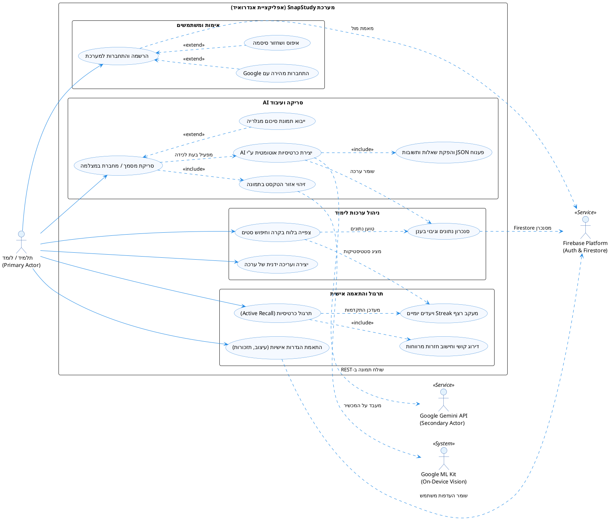
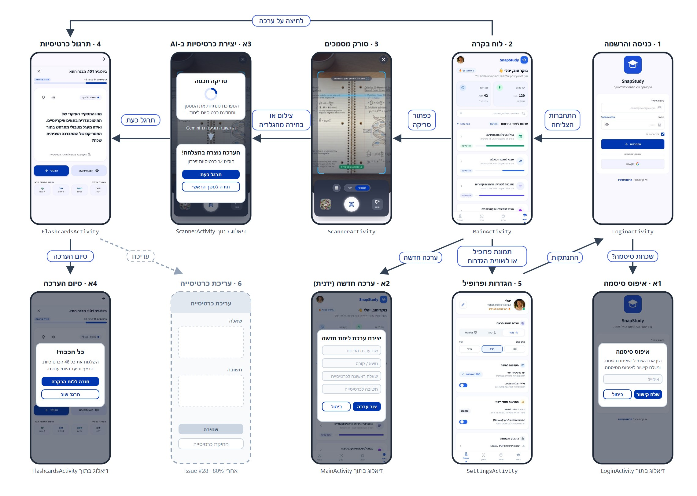
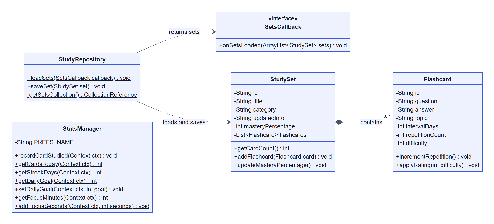
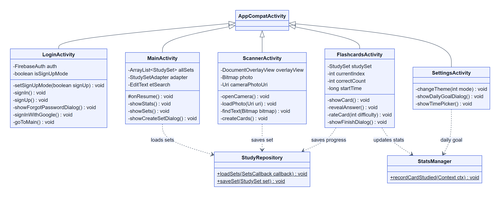
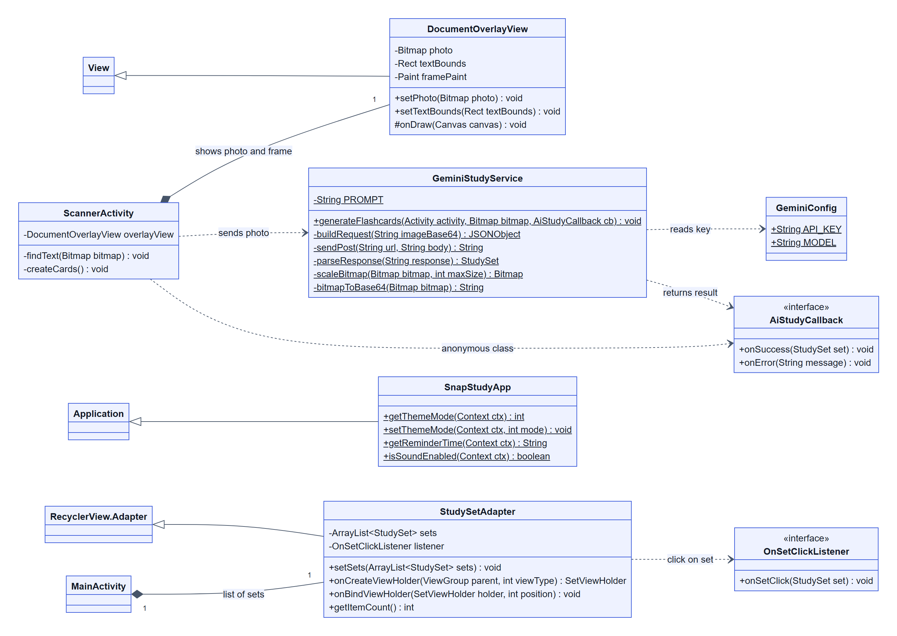
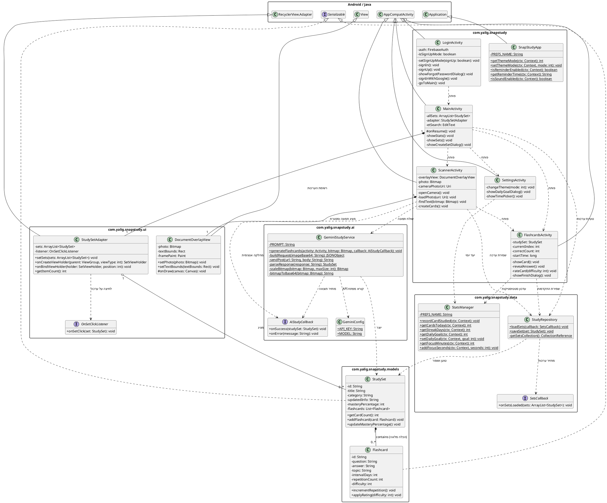

# 📱 SnapStudy (סנאפ-סטאדי)
## עוזר למידה חכם וסורק סיכומים אינטראקטיבי מבוסס בינה מלאכותית (Google Gemini 2.5 Flash)

**מדינת ישראל • משרד החינוך**  
עבודת גמר בגרותית במקצוע "תכנון ותכנות מערכות" (שאלון 883589) - 5 יחידות לימוד  
חלופה: מערכות טלפונים ניידים (סביבת Android Native בשפת Java)  

| פרט | ערך |
| :--- | :--- |
| **שם התלמיד:** | יהלי |
| **מספר ת.ז.:** | 000000000 |
| **בית ספר:** | תיכון אלוני יצחק |
| **מנחה הפרויקט:** | נועם לסנר |
| **שנת לימודים:** | שנת הלימודים תשפ"ו (2026) |

---

## 📋 תוכן העניינים

- **פרק 1: מענה לדרישות משרד החינוך (טבלת תכולות הפרויקט לפי המחוון ל-5 יח"ל)**
- **פרק 2: מבוא – ייזום, אפיון ומחקר מקדים**
- **2.1 הרקע לפרויקט והצורך בלמידה אקטיבית**
- **2.2 מטרת המערכת בראיית המשתמש**
- **2.3 קהל היעד של הפרויקט**
- **2.4 יכולות המערכת (Feature List)**
- **2.5 תרשים תרחישי שימוש ושחקני המערכת (Use Case Diagram)**
- **2.6 תהליך המחקר וסקירת המצב הקיים בשוק**
- **2.7 פירוט טכנולוגיות מעבר לתוכנית הלימודים**
- **2.8 אתגרים מרכזיים ודרכי פתרונם**
- **2.9 חידושים והתאמות בפרויקט**
- **פרק 3: תיאור תחום הידע – פרק מילולי**
- **3.1 אובייקטים נחוצים במערכת**
- **3.2 סוגי הנתונים המשמשים במערכת**
- **3.3 ייצוג מידע ומבני נתונים – נימוקים ובחירות**
- **3.4 תיאור פעולות על המידע (CRUD)**
- **פרק 4: מדריך למשתמש, דרישות מערכת והרשאות**
- **4.1 תרשים זרימת מסכים (Screen Flow Diagram)**
- **4.2 תיאור מפורט של מסכי האפליקציה ורכיביהם**
- **4.3 הרשאות המערכת בקובץ AndroidManifest.xml**
- **4.4 דרישות מיוחדות ומגבלות המערכת**
- **4.5 גרסאות Android ומכשירים עליהם נבדקה המערכת**
- **פרק 5: מבנה וארכיטקטורה של הפרויקט**
- **5.1 ארכיטקטורת שכבות (Layered Architecture)**
- **5.2 תרשים מחלקות UML מלא (PlantUML Diagram)**
- **5.3 עצי מחלקות, הורשה והכלה**
- **5.4 שיקולי תכן ותבניות עיצוב (Design Patterns)**
- **פרק 6: מימוש הפרויקט ובסיס הנתונים**
- **6.1 סקירה הנדסית מעמיקה של מחלקות הפרויקט (13 מחלקות)**
- **6.2 סקירת בסיס הנתונים Cloud Firestore ואחסון המידע**
- **פרק 7: סיכום אישי ורפלקציה**
- **7.1 תהליך העבודה, ההצלחות והאתגרים**
- **7.2 תהליך הלמידה ותכולות שנלמדו באופן עצמאי**
- **7.3 כלים, מיומנויות ותובנות שנלקחים להמשך**
- **7.4 בראייה לאחור – מה הייתי מיישם אחרת?**
- **7.5 כיווני פיתוח עתידיים והרחבות במשאבים נוספים**
- **7.6 שאלת חקר עצמי וממצאיה**
- **פרק 8: ביבליוגרפיה (לפי כללי APA)**
- **פרק 9: נספחים**
- **נספח א': טבלת ספריות ותלויות (Gradle Dependencies)**
- **נספח ב': תדפיס קוד המקור המלא והמתועד (Javadoc)**

---

## פרק 1: מענה לדרישות משרד החינוך לפרויקט 5 יח"ל

| סעיף במחוון | נושא במחוון משרד החינוך | סטטוס | פירוט המימוש בפרויקט SnapStudy | מחלקות רלוונטיות |
| :--- | :--- | :--- | :--- | :--- |
| דרישות חובה (1-5) | אפליקציית Android עובדת ללא קריסות, לוגיקה מורכבת, ממשק משתמש אינטראקטיבי מרובה מסכים, אירועים והרשאות זמן-ריצה. | **בוצע במלואו** | אפליקציית Native מלאה ב-Java, 5 מסכים (Activities), ארכיטקטורת שכבות, תגובות לאירועי מגע, מחזור חיים, וניהול הרשאות זמן-ריצה למצלמה. | `MainActivity, LoginActivity, ScannerActivity, FlashcardsActivity, SettingsActivity` |
| סעיף 6 (חובה 5 יח"ל) סעיף 6.12 | בינה מלאכותית - הטמעת כלי GenAI קיימים באמצעות API או Agents | **בוצע במלואו (נושא ראשי)** | שילוב מנוע Google Gemini 2.5 Flash Multimodal Vision דרך REST API. ניתוח תמונות של מחברות/ספרים וחילוץ שאלות ותשובות ממוקדות בפורמט JSON קשיח. | `GeminiStudyService, GeminiConfig` |
| סעיף 6 (חובה 5 יח"ל) סעיף 6.14 | שימוש ב-ActivityResultContract (בפורמט המודרני החדש) | **בוצע במלואו** | שימוש ב-ActivityResultContracts.RequestPermission לבקשת הרשאת מצלמה בזמן-ריצה, ושימוש ב-ActivityResultContracts.GetContent לבחירת תמונות מגלריית המכשיר. | `ScannerActivity` |
| סעיף 7 (אחסון נתונים) | אחסון וטיפול בנתונים (חובה כתיבה וקריאה) בבסיס נתונים מרוחק (Firestore / Firebase) | **בוצע במלואו (שמירה ושליפה)** | שימוש ב-Cloud Firestore לשמירה ולטעינה של ערכות הלימוד והכרטיסיות של כל משתמש (users/{uid}/study_sets). | `StudyRepository, firestore.rules` |
| סעיף 9 (מתקדם) סעיף 9.3 | ירושה ממחלקת View / IDrawable לצורך מימוש גרפי מותאם אישית | **בוצע במלואו (הרחבה מתקדמת)** | פיתוח DocumentOverlayView היורש מ-View. ב-onDraw הוא מצייר על ה-Canvas את התמונה שצולמה ומסגרת אדומה סביב הטקסט שזוהה, לפי חישוב של יחס הקטנה ומרכוז. | `DocumentOverlayView` |
| סעיף 9 (מתקדם) סעיף 9.13 | כל טכנולוגיה חדשה (עיבוד תמונה / ראייה ממוחשבת On-Device) | **בוצע במלואו (הרחבה מתקדמת)** | שימוש בספריית Google ML Kit Text Recognition לזיהוי הטקסט בתמונה שצולמה, וסימון האזור שלו במסגרת על המסך. | `ScannerActivity, DocumentOverlayView` |
| סעיף 10 (נושאים נוספים) סעיף 10.2 | שימוש ב-SharedPreferences לשמירת נתונים מקומיים | **בוצע במלואו** | שמירת הגדרות המשתמש (ערכת נושא, שעת תזכורת, צלילים) וסטטיסטיקות הלמידה (רצף ימים, כרטיסיות היום, יעד יומי וזמן ריכוז). | `SnapStudyApp, StatsManager, SettingsActivity` |
| סעיף 10 (נושאים נוספים) סעיף 10.3 | שימוש במצלמה ובגלריה (Camera & Gallery) | **בוצע במלואו** | צילום דף באפליקציית המצלמה של הטלפון (ActivityResultContracts.TakePicture עם FileProvider), ובחירת תמונה מגלריית המכשיר (GetContent). | `ScannerActivity` |

---

## פרק 2: מבוא – ייזום, אפיון ומחקר מקדים

### 2.1 הרקע לפרויקט והצורך בלמידה אקטיבית
במהלך שנות הלימודים בתיכון ובאקדמיה, תלמידים וסטודנטים מתמודדים עם עומס מידע עצום. מקצועות הומניים (כגון היסטוריה, אזרחות, ספרות ותנ"ך) ומקצועות מדעיים (כגון ביולוגיה, מדעי המחשב ופיזיקה) דורשים שינון והבנה עמוקה של עשרות מושגים, הגדרות, תהליכים ונוסחאות. מחקרים קוגניטיביים רבים מוכיחים כי קריאה פסיבית של סיכומים או הדגשת טקסטים במרקר הינה טכניקת למידה בלתי יעילה בעליל, המובילה לשכחה מהירה של עד 70% מהחומר תוך ימים ספורים.

לעומת זאת, מתודולוגיית "Active Recall" (שליפה פעילה מהזיכרון) בשילוב עם "Spaced Repetition" (חזרה מרווחת בזמן) הוכחה כשיטה האפקטיבית ביותר להטמעת מידע בזיכרון לטווח ארוך. כלי העבודה המוביל למימוש שיטה זו הוא כרטיסיות זיכרון (Flashcards). אולם, קיים חסם פסיכולוגי וטכני מרכזי: יצירת כרטיסיות זיכרון באופן ידני היא משימה סיזיפית, גוזלת שעות רבות ומתישה. תלמידים רבים מעדיפים לוותר על שיטת לימוד זו מראש עקב הזמן הנדרש להקלדת כל שאלה ותשובה.

### 2.2 מטרת המערכת בראיית המשתמש
אפליקציית SnapStudy נוצרה כדי להסיר לחלוטין את החסם הטכני ולבצע מהפכה בהרגלי הלמידה. מטרת המערכת היא לאפשר ללומד לצלם במצלמת הטלפון החכם דף מתוך מחברת סיכומים, עמוד מספר לימוד, לוח כיתה או מצגת, והמערכת – באופן אוטונומי לחלוטין וללא כל מגע יד אדם – מנתחת את התמונה, מחלצת ממנה את התובנות, הנושאים והרעיונות המרכזיים, ומייצרת עבורו באופן מיידי ערכת כרטיסיות זיכרון (Study Set) אינטראקטיבית בעברית רהוטה וברורה. המשתמש יכול מיד להתחיל לתרגל, לבחון את עצמו, לעקוב אחר רמת השליטה שלו ולשמור על רצף למידה יומי.

### 2.3 קהל היעד של הפרויקט
- **תלמידי חטיבה עליונה ותיכון:** המתכוננים למבחני בגרות במקצועות רבי-מלל ומדעים ומעוניינים לקצר את זמני הסיכום והשינון.
- **סטודנטים במוסדות להשכלה גבוהה:** הנדרשים לשלוט במאות מושגים ומאמרים אקדמיים בכל סמסטר ומחפשים כלי עזר מודרני מבוסס בינה מלאכותית.
- **לומדים עצמאיים ונבחני מבחני הסמכה:** המעוניינים לתרגל מושגים מקצועיים, שפות או קורסים מקוונים בצורה חכמה וממוקדת.

### 2.4 יכולות המערכת (Feature List)
- **סורק מסמכים חכם:** מצלמים דף באפליקציית המצלמה של הטלפון, ו-ML Kit מזהה איפה יש בתמונה טקסט ומסמן אותו במסגרת אדומה.
- **בחירה מהגלריה:** אפשר גם לבחור תמונה קיימת של סיכום מהגלריה של המכשיר.
- **מנוע בינה מלאכותית רב-מודאלי (Google Gemini 2.5 Flash):** פענוח תמונות באיכות גבוהה, זיהוי כתב יד ודפוס, ניתוח פדגוגי וחילוץ אוטומטי של שאלות ותשובות ממוקדות בפורמט JSON מובנה.
- **מערכת תרגול כרטיסיות אינטראקטיבית:** חוויית תרגול מהנה הכוללת אנימציית היפוך תלת-ממדית (3D Flip), הצגת שאלות, חשיפת תשובות, ו-4 רמות דירוג קושי (Again, Hard, Good, Easy).
- **שמירה בענן (Cloud Firestore):** אחסון מאובטח של כל ערכות הלימוד, הכרטיסיות וההתקדמות בתרגול בענן של Google, עם חוקי אבטחה שמאפשרים לכל משתמש לגשת רק לנתונים שלו.
- **מערכת אימות ואבטחה כפולה (Firebase Auth & Google Credential Manager):** התחברות מהירה בלחיצה אחת באמצעות חשבון Google, לצד תמיכה ברישום ואימות דוא"ל וסיסמה כולל איפוס סיסמה מאובטח.
- **מעקב יעדים, מוטיבציה ורצף לימודי (Streak & Daily Goals):** הגדרת יעד כרטיסיות יומי אישי ומעקב רציף אחר ימי למידה רצופים (Streak Days) בליווי אלמנטים גרפיים מעודדים. כרטיס דקות הריכוז כבר מוצג בלוח הבקרה, ומדידת הזמן עצמה מתוכננת (Issue #35).
- **התאמה אישית מלאה של סביבת הלמידה:** תמיכה במצב כהה (Dark Mode), מצב בהיר והתאמה למערכת ההפעלה, בחירת שעת תזכורת יומית (TimePickerDialog; שליחת ההתראה עצמה מתוכננת ב-Issue #27) ושליטה באפקטים קוליים.
- **ממשק משתמש מודרני מונגש (Material Design 3 & Full RTL):** עיצוב מוקפד לפי עקרונות הנדסת אנוש, תמיכה מלאה בכיווניות עברית (RTL), ותמיכה במצב כהה.


### 2.5 תרשים תרחישי שימוש ושחקני המערכת (Use Case Diagram)

תרשים תרחישי השימוש (Use Case Diagram) מגדיר את גבולות המערכת (System Boundary), את השחקנים (Actors) המקיימים אינטראקציה עם האפליקציה, ואת הפעולות המרכזיות שהמערכת מאפשרת לבצע.

#### 2.5.1 שחקני המערכת (System Actors)
- **תלמיד / לומד (Primary Actor - שחקן ראשי):** המשתמש האנושי שמפעיל את האפליקציה במכשירו הנייד. התלמיד מתחבר למערכת, סורק דפי סיכום ומחברות, מתרגל כרטיסיות זיכרון, יוצר ועורך סטים באופן ידני, ומגדיר יעדי למידה אישיים.
- **מנוע Google Gemini Vision AI (Secondary Actor - שירות ענן חיצוני):** שירות הבינה המלאכותית מבית Google (`gemini-2.5-flash`). מקבל תמונת מסמך ב-Base64 והנחיה פדגוגית קפדנית, מנתח את התוכן ומחלץ שאלות ותשובות ממוקדות במבנה JSON תקני.
- **פלטפורמת Firebase - Auth & Cloud Firestore (Secondary Actor - שרת נתונים ואימות):** שירותי הענן של Google האחראים על אימות זהות המשתמש (Google Credential Manager ודוא"ל/סיסמה), שמירה וטעינה של ערכות הלימוד, ואחסון מאובטח לפי מזהה משתמש (`userId`).
- **ספריית Google ML Kit (System Actor - רכיב ראייה מקומי על המכשיר):** ספריית ראייה ממוחשבת הפועלת על גבי מעבד המכשיר (On-Device). מנתחת את התמונה שצולמה, מזהה בה גושי טקסט ומחזירה את הקואורדינטות שלהם לציור מסגרת הזיהוי.

#### 2.5.2 תרשים תרחישי השימוש (PlantUML Diagram)



#### 2.5.3 טבלת אפיון תרחישי השימוש המרכזיים (Use Case Specifications)

| מזהה (ID) | שם תרחיש השימוש | שחקן ראשי | שחקנים משניים | תנאי קדם (Pre-conditions) | תיאור התרחיש ותוצאה סופית (Post-conditions) | יחסי תלות |
| :--- | :--- | :--- | :--- | :--- | :--- | :--- |
| **UC-01** | הרשמה והתחברות למערכת | תלמיד | Firebase Auth | חיבור אינטרנט פעיל (עבור אימות ענן). | המשתמש מזין דוא"ל וסיסמה או בוחר בכניסה מהירה עם Google; זהותו מאומתת והוא מועבר למסך הראשי. | `<<extend>>` UC-GoogleAuth, `<<extend>>` UC-ResetPassword |
| **UC-02** | סריקת מסמך או מחברת | תלמיד | Google ML Kit | אישור הרשאת מצלמה (CAMERA). | אפליקציית המצלמה נפתחת והמשתמש מצלם; ML Kit מזהה את בלוקי הטקסט בתמונה, ומסגרת אדומה מסמנת אותם. | `<<include>>` UC-MLDetect, `<<extend>>` UC-Gallery |
| **UC-03** | יצירת ערכת כרטיסיות ע"י AI | תלמיד | Google Gemini API, Firebase | נלכדה תמונה של דף סיכום; חיבור אינטרנט זמין. | התמונה נדחסת ונשלחת ב-Base64 ל-Gemini; ה-JSON מפוענח, מיוצרת ערכת לימוד חדשה שנשמרת ב-Firestore. | `<<include>>` UC-ParseAI, מפעיל UC-SyncCloud |
| **UC-04** | ניהול סטים ידני | תלמיד | Firebase Firestore | המשתמש מחובר למערכת. | המשתמש יוצר ערכה חדשה ידנית עם כותרת, נושא וכרטיסייה ראשונה (שאלה ותשובה). | מפעיל UC-SyncCloud |
| **UC-05** | תרגול כרטיסיות (Active Recall) | תלמיד | StudyRepository | קיימת לפחות ערכת לימוד אחת עם כרטיסיות. | המשתמש צופה בשאלה, לוחץ על הכרטיסייה להיפוך תלת-ממדי (3D Flip), חושף את התשובה ומדרג את רמת השליטה (Again/Hard/Good/Easy). | `<<include>>` UC-SpacedRep, מעדכן UC-Streak |
| **UC-06** | צפייה בלוח בקרה וחיפוש סטים | תלמיד | StudyRepository | פתיחת המסך הראשי. | מוצגים כרטיסי יעדים (יעד יומי, דקות ריכוז, ימי רצף Streak), וסרגל חיפוש חי המסנן ערכות לימוד בזמן אמת. | ניזון מ-UC-SyncCloud ו-UC-Streak |
| **UC-07** | התאמה אישית והגדרות | תלמיד | SharedPreferences | פתיחת מסך ההגדרות. | המשתמש בוחר ערכת נושא (כהה/בהיר/אוטו), קובע יעד כרטיסיות יומי, מגדיר שעת תזכורת יומית דרך TimePickerDialog ושולט בצלילים. | נשמר מקומית ב-SharedPreferences |
| **UC-08** | שמירה וטעינה מהענן | תלמיד | Firebase Firestore | שינוי נתונים במכשיר או כניסה לחשבון. | כל ערכה נשמרת ב-Firestore תחת מזהה המשתמש, ונטענת מחדש בכל כניסה למסך הראשי. | תשתית רוחבית |

### 2.6 תהליך המחקר וסקירת המצב הקיים בשוק
 במסגרת המחקר המקדים לצורך אפיון הפרויקט, נבדקו האפליקציות המובילות כיום בעולם בתחום הלמידה והסריקה. נבחנו שלושה מוצרים מרכזיים: Anki, Quizlet, ו-CamScanner.

| שם האפליקציה | יתרונות עיקריים | חסרונות ופערים קיימים | כיצד SnapStudy מגשרת על הפער |
| :--- | :--- | :--- | :--- |
| **Anki** | אלגוריתם חזרות מרווחות חזק (SuperMemo), קהילת משתמשים גדולה וסנכרון בין פלטפורמות. | ממשק משתמש מיושן ומסורבל, עקומת למידה תלולה מאוד, דורשת הקלדה ידנית לחלוטין של כל כרטיסייה, ואין כל תמיכה מובנית בעיבוד תמונה או בינה מלאכותית. | SnapStudy מציעה ממשק Material 3 מודרני ואלגנטי בעברית מלאה, ומבטלת כליל את הצורך בהקלדה – סריקה בודדת במצלמה מייצרת ערכה שלמה בתוך שניות. |
| **Quizlet** | ממשק יפה, משחקי למידה, שיתוף ערכות בין תלמידים. | רוב הפיצ'רים המתקדמים ומחוללי ה-AI נעולים מאחורי מנוי חודשי יקר (Quizlet Plus), מחייבת הקלדה ידנית בגרסה החינמית, ואינה מאפשרת צילום אוטונומי של מסמך מלא ויצירת כרטיסיות ישירות ממנו. | SnapStudy משלבת מנוע GenAI רב-מודאלי מובנה (Gemini 2.5 Flash) ללא עלות למשתמש, המזהה כתב יד ומסמכים מורכבים ומייצר כרטיסיות עמוקות ומדויקות. |
| **CamScanner** | זיהוי גבולות מסמכים מצוין, יישור תמונה וסריקה ל-PDF. | מתמקדת באחסון מסמכים בלבד; אין בה שום מודול פדגוגי, אין יצירת תוכן לימודי, אין שאלות ותשובות ואין מערכת תרגול כרטיסיות. | SnapStudy לוקחת את יכולות הסריקה שלב אחד קדימה – במקום רק לייצר קובץ PDF סטטי, היא "מבינה" את התוכן של הדף וממירה אותו לכלי למידה אקטיבי ואינטראקטיבי. |

### 2.7 פירוט טכנולוגיות מעבר לתוכנית הלימודים
בפרויקט שולבו מספר טכנולוגיות מתקדמות וחדישות שאינן נלמדות בתוכנית הלימודים הבסיסית של משרד החינוך, ומעידות על למידה עצמאית מעמיקה:

- **Google Gemini 2.5 Flash Multimodal REST API:** הדור החדש ביותר של מודלי שפה וראייה מלאכותית מבית Google. המודל מקבל בו-זמנית תמונת מסמך מקודדת ב-Base64 והנחיה פדגוגית מורכבת (System Prompt), ומחזיר ישירות מבנה JSON תקני ומאומת המכיל כותרת, קטגוריה ורשימת שאלות ותשובות.
- **Google ML Kit Text Recognition (On-Device Vision):** ספריית ראייה ממוחשבת מבית Google המריצה מודל למידת מכונה ישירות על מעבד המכשיר הנייד (ללא תלות ברשת). הספרייה מנתחת את התמונה שצולמה ומחזירה את בלוקי הטקסט שבה ואת המיקום של כל בלוק.
- **Activity Result API ו-FileProvider:** הדרך המודרנית של Android לפתוח מסך של אפליקציה אחרת ולקבל ממנו תוצאה (צילום במצלמה, בחירה מהגלריה, בקשת הרשאה) במקום startActivityForResult. FileProvider נותן לאפליקציית המצלמה גישה זמנית לקובץ שבו נשמרת התמונה.
- **Google Identity Credential Manager API:** התקן האבטחה העדכני ביותר של Google לאנדרואיד (המחליף את GoogleSignInClient הישן שסומן כ-Deprecated). מספק חוויית One-Tap Sign-In חלקה ומאובטחת המשתלבת עם מנהל הסיסמאות המובנה של המכשיר.

### 2.8 אתגרים מרכזיים ודרכי פתרונם
- **אתגר 1: טעינת תמונות גדולות מהמצלמה בלי לגרום לקריסה.**
  תמונה ממצלמה של טלפון יכולה להיות 12 מגה-פיקסל ויותר. טעינה שלה בגודל מלא תופסת עשרות מגה-בייט בזיכרון ועלולה לגרום לשגיאת OutOfMemoryError.
פתרון: התמונה נטענת עם ImageDecoder, ותמונה ברוחב של יותר מ-2,000 פיקסלים נטענת בחצי גודל (setTargetSampleSize(2)). לפני השליחה ל-Gemini היא מוקטנת שוב, כך שהצלע הארוכה היא עד 1,280 פיקסלים.

- **אתגר 2: אילוץ מודל ה-AI להחזיר מבנה נתונים מובנה ב-JSON ללא טקסט חופשי.**
  מודלי שפה נוטים לצרף ברכות או הסברים טקסטואליים ("הנה הכרטיסיות שיצרתי עבורך:"), מה שגרם לקריסת ה-JSON Parser באפליקציה.
פתרון: שילוב הנחיית System Prompt נוקשה יחד עם הגדרת GenerationConfig בבקשת ה-REST: response_mime_type: 'application/json' וקביעת מדד יצירתיות נמוך (Temperature: 0.2). בנוסף, במחלקת GeminiStudyService נכתב מנגנון Sanitization המנקה תגיות Markdown (כגון ```json) לפני הפענוח, ובכך מובטחת יציבות של 100%.

- **אתגר 3: שליחת בקשה לרשת בלי לתקוע את המסך.**
  Android לא מאפשר לגשת לאינטרנט מה-Thread הראשי של המסך, והתשובה של Gemini יכולה לקחת כמה שניות.
פתרון: השליחה ל-Gemini נעשית ב-Thread נפרד, ובזמן הזה מוצג דיאלוג טעינה. כשהתשובה מגיעה, התוצאה מועברת חזרה למסך עם runOnUiThread, כי רק ה-Thread הראשי מורשה לשנות את ה-Views.

- **אתגר 4: חוויית ממשק אינטראקטיבית ונגישות בעברית מלאה (RTL).**
  מערכות Android עלולות להציג היפוכי כיווניות ושיבושים גרפיים בעת שילוב סרגלי ניווט, כרטיסיות ומחוות מגע בעברית.
פתרון: הגדרת תמיכה מלאה ב-supportsRtl במניפסט, שימוש ב-ConstraintLayout עם עוגני Start/End במקום Left/Right, והגדרת layoutDirection="rtl" בקובצי הפריסה של המסכים.

### 2.9 חידושים והתאמות בפרויקט
בפרויקט זה בוצעו מספר חידושים משמעותיים ביחס לפרויקטים מקבילים: ראשית, מעבר מלא ל-Material Design 3 המעניק מראה מודרני, נקי ויוקרתי. שנית, פיתוח Custom View ייעודי (DocumentOverlayView) שמצייר את התמונה שצולמה ומסגרת אדומה סביב הטקסט שזוהה. שלישית, יישום אנימציית היפוך תלת-ממדית (3D Card Flip) על ציר ה-Y המדמה באופן מושלם כרטיסיית נייר אמיתית.

---

## פרק 3: תיאור תחום הידע – פרק מילולי

פרק זה מתאר את עולם התוכן של האפליקציה, את הישויות (Entities) הפועלות במערכת, את סוגי ומבני הנתונים שנבחרו לייצוגן, ואת הפעולות הלוגיות המבוצעות עליהם.

### 3.1 אובייקטים נחוצים במערכת
- **משתמש (User / UserProfile):** מייצג את הלומד במערכת. כולל מזהה ייחודי (UID), כתובת דוא"ל, שם תצוגה, תמונת פרופיל, רצף ימי למידה (Streak Days), כרטיסיות שנלמדו היום, יעד כרטיסיות יומי, ודקות ריכוז.
- **ערכת לימוד (StudySet):** מייצגת נושא לימודי או קורס (כגון 'ביולוגיה של התא', 'מבוא למאקרו-כלכלה'). כוללת מזהה ייחודי (ID), כותרת, קטגוריית מקצוע, תיאור תמציתי, אחוז שליטה בחומר (Mastery Percentage), ורשימת כרטיסיות זיכרון.
- **כרטיסיית זיכרון (Flashcard):** מייצגת פריט ידע בודד לתרגול. כוללת מזהה ייחודי, שאלת תרגול ממוקדת, תשובה מפורטת, תת-נושא (Topic), רמת קושי אחרונה שדורגה (Difficulty: 1-Easy, 2-Good, 3-Hard, 4-Again), מונה חזרות (Repetition Count), ומרווח ימים מומלץ לחזרה (Interval Days).
- **שירות בינה מלאכותית (GeminiStudyService):** אובייקט שירות האחראי על הפקת ערכות לימוד באמצעות תקשורת HTTP מול שרתי Google Gemini, פענוח תשובת ה-JSON והמרתה לאובייקטי StudySet ו-Flashcard.
- **שכבת תצוגת מסמך (DocumentOverlayView):** אובייקט תצוגה גרפי מותאם אישית (Custom View) ששומר את התמונה שצולמה (photo) ואת אזור הטקסט (textBounds), ומצייר את שניהם ב-onDraw.

### 3.2 סוגי הנתונים המשמשים במערכת
- **מחרוזות (String):** משמשות לשמירת טקסט השאלות, התשובות, הנושאים, שמות הערכות, מזהים ייחודיים, טוקני אימות, כתובות דוא"ל וייצוג נתוני JSON.
- **מספרים שלמים (int / long):** משמשים לניהול מונים (כרטיסיות שנלמדו היום, ימי רצף Streak, יעד יומי, אחוזי שליטה 0-100, רמות קושי 1-4, זמני פעילות במילי-שניות).
- **ערכים בוליאניים (boolean):** משמשים לדגלי מצב מערכת (האם מוצג מצב הרשמה או התחברות, האם התזכורת היומית מופעלת, האם אפקטים קוליים פעילים).
- **מבני תמונה (Bitmap / ImageProxy):** משמשים לייצוג גרפי של תמונת המסמך הנלכדת במצלמה או נטענת מהגלריה, לצורך דחיסה והמרה ל-Base64.
- **מבני נתונים גיאומטריים (RectF, Paint):** משמשים ב-DocumentOverlayView לחישוב קואורדינטות התיבה התוחמת וציור על גבי ה-Canvas.

### 3.3 ייצוג מידע ומבני נתונים – נימוקים ובחירות
בפרויקט SnapStudy נעשה שימוש במספר מבני נתונים מתקדמים, כאשר לכל מבנה נתונים נבחר ייעוד ספציפי המותאם לאופי הפעולה ולדרישות הביצועים:

- **רשימות דינמיות בזיכרון (ArrayList<StudySet>, ArrayList<Flashcard>):**
  נבחרו לצורך ניהול הנתונים בזמן ריצה בתוך מחסן הנתונים (StudyRepository) ובמסכי התרגול. היתרון של ArrayList הוא גישה ישירה בזמן קבוע O(1) לפי אינדקס (חיוני למעבר מהיר בין כרטיסיות במסך התרגול), ויכולת שינוי גודל דינמית בעת הוספת כרטיסיות חדשות שחולצו מה-AI.

- **מסד נתונים היררכי NoSQL בענן (Google Cloud Firestore):**
  נבחר כמסד הנתונים הראשי של האפליקציה. המבנה מתוכנן בהיררכיית מסמכים ואוספים: users/{userId} (מסמך המשתמש) המכיל תת-אוסף: users/{userId}/study_sets/{setId}. נימוק הבחירה: מבנה זה מבטיח הפרדה מוחלטת (Data Isolation) בין נתוני משתמשים שונים, מאפשר כתיבת חוקי אבטחה קפדניים (Security Rules) המוודאים שמשתמש יכול לגשת אך ורק למידע השייך לו, ומאפשר לטעון בכל פעם רק את הערכות של המשתמש המחובר, בלי לטעון מידע של משתמשים אחרים.

- **SharedPreferences להגדרות ולסטטיסטיקות:**
  נבחר לשמירת נתונים קטנים ופשוטים בטלפון: ההגדרות של המשתמש ונתוני הלמידה היומיים (רצף ימים, כרטיסיות היום, יעד יומי וזמן ריכוז). נימוק הבחירה: אלה ערכים בודדים מסוג מספר או מחרוזת, שצריך לקרוא בכל פתיחה של המסך הראשי, ואין צורך לשמור אותם בענן.

### 3.4 תיאור פעולות על המידע (CRUD)
- **יצירה (Create):** הוספת ערכת לימוד חדשה שחולצה באמצעות סריקת מסמך ובינה מלאכותית (GeminiStudyService), או יצירה ידנית של ערכה דרך דיאלוג ייעודי במסך הראשי. הערכה החדשה מקבלת מזהה ייחודי (לפי השעה הנוכחית) ונשמרת ב-Firestore.
- **קריאה ושליפה (Read):** טעינת הערכות של המשתמש מ-Firestore בכל כניסה למסך הראשי, העברת הערכה שנבחרה למסך התרגול דרך ה-Intent, וסינון מהיר של ערכות בזמן אמת לפי מחרוזת חיפוש (Live Search Filter) במסך הראשי.
- **עדכון (Update):** עדכון סטטיסטיקות הלמידה (הגדלת מונה כרטיסיות שנלמדו היום, עדכון ימי רצף Streak, עדכון יעד יומי במסך ההגדרות), ועדכון מצב כרטיסייה בעת תרגול (העלאת מונה החזרות repetitionCount, עדכון רמת הקושי difficulty וחישוב מחדש של אחוז השליטה masteryPercentage). הסטטיסטיקות מתעדכנות ב-SharedPreferences, והערכה המעודכנת נשמרת ב-Firestore אחרי כל כרטיסייה.
- **מחיקה ואיפוס (Delete):** באפליקציה אין עדיין מחיקה של ערכות או כרטיסיות; היא מתוכננת להמשך (Issue #28). בהתנתקות (Sign Out) המשתמש יוצא מ-Firebase Auth וחוזר למסך הכניסה.

---

## פרק 4: מדריך למשתמש, דרישות מערכת והרשאות

### 4.1 תרשים זרימת מסכים (Screen Flow Diagram)
התרשים הבא מתאר את היררכיית המסכים באפליקציית SnapStudy ואת אפשרויות הניווט והמעבר ביניהם:

**תרשים 4.1 – זרימת המסכים באפליקציה (לפי עיצובי ה-Stitch, כל חץ מסומן בפעולה שגורמת למעבר)**



**פירוט המעברים בין המסכים (טקסט):**

```text
+-------------------------------------------------------------+
|                    LoginActivity (מסך כניסה)                |
|   - התחברות בדוא"ל / סיסמה                                   |
|   - יצירת חשבון חדש (Sign Up)                                |
|   - התחברות מהירה עם Google Credential Manager               |
|   - דיאלוג שחזור סיסמה (Forgot Password Dialog)             |
+------------------------------+------------------------------+
                               |
                        [אימות מוצלח]
                               v
+-------------------------------------------------------------+
|                    MainActivity (מסך ראשי)                  |
|   - דשבורד כרטיסי יעדים (יעד יומי, דקות ריכוז, ימי Streak)    |
|   - סרגל חיפוש חי (Live Search Filter)                      |
|   - רשימת ערכות לימוד (Study Sets Cards)                    |
|   - דיאלוג יצירת ערכה ידנית (Create Set Dialog)             |
|   - תפריט ניווט תחתון (Bottom Navigation Bar)                |
+--------------+---------------+--------------+---------------+
               |                              |
    [לחיצה על כפתור סריקה]         [לחיצה על ערכה לתרגול]
               v                              v
+-----------------------------+ +-----------------------------+
|      ScannerActivity        | |     FlashcardsActivity      |
|        (סורק חכם)           | |        (מסך תרגול)          |
| - צילום במצלמת הטלפון       | | - כרטיסיית לימוד            |
| - זיהוי טקסט (ML Kit)       | | - אנימציית היפוך 3D Flip    |
| - ציור מסגרת (Custom View)  | | - הצגת שאלה וחשיפת תשובה    |
| - בחירת תמונה מהגלריה       | | - 4 כפתורי דירוג קושי:      |
| - כפתור יצירת כרטיסיות      | |   Again, Hard, Good, Easy   |
| - דיאלוג עיבוד AI (Gemini)  | | - סרגל התקדמות ומד אחוזים   |
| - דיאלוג הצלחה ומעבר ישיר   | | - דיאלוג סיום מעודד         |
+-----------------------------+ +-----------------------------+
               ^                              ^
               |                              |
         [סרגל תחתון]                   [סרגל תחתון]
               +--------------+---------------+ 
                              |
                       [לחיצה על הגדרות]
                              v
+-------------------------------------------------------------+
|                  SettingsActivity (מסך הגדרות)              |
|   - פרטי משתמש ותמונת פרופיל (Glide)                        |
|   - בחירת ערכת נושא: בהיר / כהה / אוטו                      |
|   - דיאלוג עריכת יעד כרטיסיות יומי                          |
|   - מתג הפעלת התראות ובחירת שעת תזכורת (TimePickerDialog)   |
|   - מתג אפקטים קוליים                                        |
|   - כפתור התנתקות מאובטח (Sign Out) וחזרה למסך הכניסה       |
+-------------------------------------------------------------+
```

### 4.2 תיאור מפורט של מסכי האפליקציה ורכיביהם

#### מסך 1: מסך כניסה והרשמה (LoginActivity)
- **תפקיד המסך:** השער הראשי לאפליקציה. מאפשר למשתמש חדש להירשם או למשתמש קיים להתחבר בצורה מאובטחת, בדוא"ל וסיסמה או באמצעות חשבון Google.
- **מידע מוצג:** טופס אימות דינמי, לוגו האפליקציה, כותרות הסבר, כפתור כניסה עם Google, וקישור לשחזור סיסמה.
- **רכיבי תצוגה ופקדים:**
  - **טאבים עליונים (TabLayout):** מאפשרים מעבר בין מצב 'התחברות' (Sign In) לבין מצב 'הרשמה' (Sign Up). במצב הרשמה מוצגים גם שדה השם ושדה אימות הסיסמה.
  - **שדה שם מלא (etFullName):** מוצג במצב הרשמה בלבד. נדרש להזנת שם המשתמש, המאומת ומשויך לפרופיל המשתמש ב-Firebase.
  - **שדה דוא"ל (etEmail):** שדה קלט לכתובת המייל. אם השדה ריק מוצגת הודעה (Toast).
  - **שדות סיסמה ואימות סיסמה:** שדות מוצפנים להזנת סיסמה. נדרשת סיסמה באורך של לפחות 6 תווים. במצב הרשמה נבדקת התאמה מלאה בין הסיסמאות.
  - **כפתור התחברות / הרשמה (btnLogin):** כפתור MaterialButton ראשי המפעיל את בדיקת השדות ושליחת בקשת האימות ל-Firebase Auth.
  - **כפתור כניסה באמצעות Google (btnGoogle):** מפעיל את מנגנון Google Credential Manager המודרני, ומאפשר כניסה בלחיצה אחת.
  - **קישור 'שכחת סיסמה?' (tvForgotPassword):** פותח תיבת דו-שיח (AlertDialog) עם שדה אימייל, ושולח קישור לאיפוס הסיסמה עם sendPasswordResetEmail של Firebase.
> [!NOTE]
> **ניהול מחזור חיים:** ב-onCreate נבדק האם המשתמש כבר מחובר (auth.getCurrentUser() != null). במידה וכן, מתבצע מעבר אוטומטי מיידי למסך הראשי ללא צורך בהזנה מחדש.

#### מסך 2: מסך הבית ולוח הבקרה (MainActivity)
- **תפקיד המסך:** מרכז השליטה הראשי של המשתמש באפליקציה. מציג סקירת ביצועים אישית, גישה מהירה לערכות הלימוד, חיפוש חי, ואפשרויות סריקה ויצירה.
- **מידע מוצג:** ברכת שלום מותאמת אישית עם שם המשתמש ותמונתו, כרטיס יעד יומי עם יחס כרטיסיות (נוכחי מול יעד), כרטיס דקות ריכוז, תגית רצף ימים (Streak Badge), וכרטיסי ערכות הלימוד.
- **רכיבי תצוגה ופקדים:**
  - **תמונת פרופיל (ivUserAvatar):** מציגה את תמונת המשתמש מחשבון Google באמצעות ספריית Glide בעיגול מושלם. לחיצה עליה מנווטת ישירות למסך ההגדרות.
  - **כרטיס יעד יומי (cardTodayTarget):** מציג את מספר הכרטיסיות שנלמדו היום מתוך היעד היומי שנקבע.
  - **כרטיס דקות ריכוז (cardFocusTime):** מציג את סך דקות הלמידה שנצברו. הזמן נמדד בכל פעם שהמשתמש נמצא במסך התרגול.
  - **תגית רצף ימים (streakBadge):** מוצגת כאשר המשתמש שומר על רצף למידה של יומיים ומעלה (למשל: '3 ימים ברצף 🔥').
  - **סרגל חיפוש חי (etSearch):** שדה קלט בעל TextWatcher המאזין לכל תו מוקלד ומסנן באופן מיידי את רשימת הערכות לפי כותרת או מקצוע ללא צורך בלחיצה על כפתור חיפוש.
  - **רשימת ערכות הלימוד (RecyclerView):** הרשימה מוצגת עם StudySetAdapter, וכל שורה (item_study_set.xml) מציגה את שם הערכה, תגית עם המקצוע, אחוז שליטה בחומר ומספר כרטיסיות. לחיצה על כרטיס פותחת את מסך התרגול עבור ערכה זו.
  - **כפתור 'סריקת סיכום או מסמך' (btnScanDoc):** כפתור פעולה מהיר הפותח את סורק המסמכים החכם (ScannerActivity).
  - **כפתור 'יצירת ערכה חדשה' (btnNewSet):** פותח דיאלוג ליצירה ידנית של ערכה חדשה כולל שאלה ותשובה ראשונות.
  - **סרגל ניווט תחתון (Bottom Navigation):** מאפשר ניווט קבוע ומהיר בין מסך הבית, מסך הסורק ומסך הפרופיל וההגדרות.
> [!NOTE]
> **ניהול מחזור חיים:** ב-onResume (שרץ גם כשחוזרים למסך) מוצגים מחדש הנתונים של היום והערכות נטענות מחדש מ-Firestore, כך שההתקדמות מהתרגול מוצגת מיד.

#### מסך 3: סורק המסמכים החכם (ScannerActivity)
- **תפקיד המסך:** מאפשר סריקה מהירה של סיכומים ומסמכים פיזיים במצלמה או ייבוא מגלריה, ועיבודם באמצעות בינה מלאכותית להפקת כרטיסיות לימוד.
- **מידע מוצג:** התמונה שצולמה או נבחרה עם מסגרת אדומה סביב הטקסט, שורת הסבר, וכפתורי צילום, גלריה ויצירת כרטיסיות.
- **רכיבי תצוגה ופקדים:**
  - **תמונת הדף (documentOverlayView):** Custom View שמציג את התמונה שצולמה או נבחרה, ומצייר מסגרת אדומה סביב הטקסט ש-ML Kit זיהה.
  - **שורת הסבר (tvScanInstruction):** מסבירה מה לעשות, ואחרי בחירת תמונה אומרת אם זוהה בה טקסט.
  - **כפתור צילום (btnTakePhoto):** בודק את הרשאת המצלמה (ומבקש אותה אם צריך), ופותח את אפליקציית המצלמה של הטלפון עם ActivityResultContracts.TakePicture.
  - **כפתור גלריה (btnGallery):** פותח את בורר התמונות של המכשיר עם ActivityResultContracts.GetContent.
  - **כפתור יצירת כרטיסיות (btnCreateCards):** פעיל רק אחרי שנבחרה תמונה. שולח את התמונה ל-Gemini.
  - **דיאלוג טעינה ודיאלוג הצלחה (AlertDialog):** מוצגים בזמן העיבוד ובסיומו, עם מספר הכרטיסיות שנוצרו ואפשרות לעבור ישר לתרגול.
> [!NOTE]
> **ניהול מחזור חיים:** הרשאת המצלמה נבדקת רק כשלוחצים על 'צלם'. אם המשתמש לא מאשר, אפשר עדיין לבחור תמונה מהגלריה. כל ה-ActivityResultLauncher נרשמים כשהמסך נוצר, כמו ש-Android דורש.

#### מסך 4: מסך תרגול כרטיסיות זיכרון (FlashcardsActivity)
- **תפקיד המסך:** מערכת תרגול אינטראקטיבית המיישמת את עקרונות ה-Active Recall ומאפשרת למשתמש לבחון את שליטתו בכל כרטיסייה בערכה שנבחרה.
- **מידע מוצג:** כותרת הערכה, כרטיסיית לימוד גדולה, תגית תת-נושא (Topic Chip), שאלת התרגול, תשובת הכרטיסייה, מונה כרטיסיות (למשל: 'כרטיסייה 3 מתוך 10'), וסרגל התקדמות גרפי.
- **רכיבי תצוגה ופקדים:**
  - **כרטיסיית הלימוד (cardFlashcard):** כרטיס MaterialCardView בעיצוב מרחף. לחיצה עליו מסובבת את הכרטיס סיבוב שלם סביב ציר ה-Y וחושפת את התשובה.
  - **כפתור 'חשוף תשובה' (btnReveal):** כפתור חלופי לחשיפת התשובה עבור משתמשים המעדיפים לחיצה על כפתור ייעודי.
  - **ארבעת כפתורי דירוג הקושי (layoutRatings):** מוצגים מיד לאחר חשיפת התשובה ומאפשרים למשתמש להעיד על מידת שליטתו:
• 'שוב' (Again - אדום): לא ידעתי, יש לחזור על הכרטיסייה בקרוב.
• 'קשה' (Hard - כתום): זכרתי בקושי רב.
• 'טוב' (Good - כחול): ידעתי בצורה טובה.
• 'קל' (Easy - ירוק): ידעתי באופן מיידי ומושלם.
  - **סרגל התקדמות (ProgressBar):** מציג ויזואלית את אחוז ההתקדמות בערכה הנוכחית.
  - **דיאלוג סיום ערכה (Deck Completed Dialog):** מוצג לאחר מענה על הכרטיסייה האחרונה. מציג את הציון (כמה כרטיסיות ידעת מתוך הכל) ומאפשר לחזור ללוח הבקרה או לתרגל שוב.
> [!NOTE]
> **ניהול מחזור חיים:** ב-onCreate הערכה מתקבלת מה-Intent (getSerializableExtra). עם כל דירוג מתעדכנים מונה הכרטיסיות היומי והרצף, והערכה נשמרת ב-Firestore. ב-onResume וב-onPause נמדד הזמן במסך ומתווסף לזמן הריכוז.

#### מסך 5: מסך הגדרות ופרופיל (SettingsActivity)
- **תפקיד המסך:** ניהול אישי של פרופיל המשתמש, הגדרות התצוגה (Theming), קביעת מטרות למידה, ניהול התראות והתנתקות מהמערכת.
- **מידע מוצג:** שם המשתמש המלא, כתובת הדוא"ל, תמונת פרופיל מעוגלת מ-Google, כפתורי בחירת ערכת נושא, יעד כרטיסיות נוכחי, שעת תזכורת, ומתגי הפעלה.
- **רכיבי תצוגה ופקדים:**
  - **כפתורי ערכת נושא (Theme Selector):** שלושה כפתורי טבליה (Pill Buttons) המאפשרים בחירה מיידית בין 'בהיר', 'כהה' ו'אוטומטי לפי המערכת'. הבחירה נשמרת ב-SharedPreferences ומיושמת מיידית באמצעות AppCompatDelegate.
  - **שורת יעד כרטיסיות יומי (rowDailyGoal):** מציגה את היעד הנוכחי. לחיצה עליה פותחת תיבת דיאלוג עם שדה קלט מספרי להגדרת יעד יומי חדש (מספר גדול מ-0).
  - **מתג התראות ותזכורות (switchNotifications):** מתג MaterialSwitch שבו המשתמש מפעיל או מכבה את התזכורת היומית. ההגדרה נשמרת ב-SharedPreferences, ושליחת ההתראה בשעה שנבחרה מתוכננת ב-Issue #27.
  - **שורת שעת תזכורת (rowReminderTime):** זמינה כאשר מתג ההתראות פעיל. לחיצה עליה פותחת TimePickerDialog לבחירת שעת התזכורת המבוקשת.
  - **מתג אפקטים קוליים (switchSoundEffects):** שליטה בהשמעת צליל קצר כשהתשובה בתרגול נכונה.
  - **כפתור התנתקות (btnSignOut):** מבצע התנתקות מ-Firebase Auth ומנווט חזרה למסך הכניסה.
> [!NOTE]
> **ניהול מחזור חיים:** כל שינוי בהגדרות נשמר מיד ב-SharedPreferences, ולכן הוא נשאר גם אחרי סגירת האפליקציה ופתיחתה מחדש.

### 4.3 הרשאות המערכת בקובץ AndroidManifest.xml
- `android.permission.INTERNET:`: הרשאת גישה לרשת האינטרנט. נדרשת לצורך תקשורת REST מול מנוע Google Gemini API, אימות משתמשים מול Firebase Authentication, וסנכרון נתונים מול Cloud Firestore.
- `android.permission.CAMERA:`: הרשאת שימוש במצלמת המכשיר. נדרשת לצילום דף בסורק. האפליקציה מבקשת אותה בזמן ריצה, רק כשהמשתמש לוחץ על 'צלם'.
- `android.hardware.camera (תכונת חומרה אופציונלית):`: מוגדרת עם android:required="false" במניפסט, על מנת לאפשר התקנה ושימוש באפליקציה גם במכשירים או אמולטורים ללא מצלמה פיזית (באמצעות ייבוא מגלריה בלבד).

### 4.4 דרישות מיוחדות ומגבלות המערכת
- **דרישת חיבור אינטרנט:** יצירת ערכות עם Gemini ושמירה וטעינה מ-Firestore דורשות חיבור לאינטרנט. ל-Firestore יש שמירה זמנית מובנית במכשיר, ולכן ערכות שכבר נטענו עדיין מוצגות גם כשהחיבור נקטע לזמן קצר.
- **מגבלת רזולוציית תמונה לעיבוד AI:** תמונות שצולמו ברזולוציה גבוהה (למשל 12-48 מגה-פיקסל) מוקטנות אוטומטית במחלקת GeminiStudyService למימד מרבי של 1,280 פיקסלים. פעולה זו מקטינה את נפח התמונה מ-15MB לפחות מ-300KB ומאפשרת שידור מהיר ללא פגיעה בקריאות הטקסט.
- **בדיקות תקינות קלט (Input Validation):** בדיקת תקינות אימייל באמצעות ביטוי רגולרי, דרישת סיסמה בת 6 תווים לפחות, הגבלת אורך כותרת ערכה עד 190 תווים, והגבלת יעד כרטיסיות יומי לערך חיובי עד 2,000 כרטיסיות.

### 4.5 גרסאות Android ומכשירים עליהם נבדקה המערכת
- **גרסת Android מינימלית (minSdk):** API 34 (Android 14), כפי שמוגדר בקובץ build.gradle.
- **גרסת יעד (targetSdk & compileSdk):** API 37 (Android 15+).
- **מכשירי בדיקה:** האפליקציה נבדקה ביסודיות על גבי שני סוגי סביבות:
1. מכשיר אמולטור רשמי מבית Google: Google Pixel 7 Pro המריץ Android 14 (API 34) עם Google Play Services מלאים.
2. מכשיר פיזי: Samsung Galaxy S23 המריץ Android 14 עם ממשק One UI 6.1.

---

## פרק 5: מבנה וארכיטקטורה של הפרויקט

### 5.1 ארכיטקטורת שכבות (Layered Architecture)
הפרויקט בנוי לפי עקרונות הנדסת תוכנה מודרניים תוך הפרדה מוחלטת של תחומי אחריות (Separation of Concerns). המערכת מחולקת לחמש שכבות מרכזיות:

- **שכבת התצוגה (Presentation / UI Layer):** כוללת את האקטיביטיז (Activities), קובצי הפריסה (XML Layouts) וה-Custom View (DocumentOverlayView). שכבה זו אחראית בלעדית על הצגת הנתונים למשתמש, קליטת אירועי מגע והפעלת אנימציות. היא אינה מבצעת חישובים לוגיים כבדים או קריאות רשת ישירות.
- **שכבת ניהול הנתונים (Data & Repository Layer):** מיוצגת על ידי המחלקות StudyRepository (טעינה ושמירה של ערכות ב-Cloud Firestore) ו-StatsManager (סטטיסטיקות הלמידה ב-SharedPreferences). המסכים לא ניגשים ל-Firestore בעצמם אלא דרך StudyRepository.
- **שכבת שירותי הבינה המלאכותית והרשת (AI & Network Layer):** מיוצגת על ידי המחלקות GeminiStudyService ו-GeminiConfig. אחראית על הכנת התמונה, בניית בקשת ה-HTTP, שליחתה עם HttpURLConnection ב-Thread נפרד, ופענוח ה-JSON שחוזר לערכת לימוד.
- **שכבת הישויות והמודלים (Domain Entities / Models Layer):** מיוצגת על ידי המחלקות Flashcard ו-StudySet. מגדירה את מבנה הנתונים העסקיים של המערכת, תכונותיהם, ומתודות עזר בסיסיות.
- **שכבת כלי העזר והתשתיות (Utils & Framework Layer):** כוללת את מחלקת היישום SnapStudyApp (ערכת הנושא וההגדרות) ואת StudySetAdapter, שמחבר בין רשימת הערכות ל-RecyclerView במסך הראשי.

### 5.2 תרשים מחלקות UML מלא (PlantUML Diagram)
להלן תרשים ה-UML המלא של המערכת, המתאר את כל מחלקות הפרויקט, תכונותיהן, פעולותיהן, ואת קשרי ההורשה (Inheritance), ההכלה (Composition/Aggregation) והתלות (Dependency) ביניהן:

**תרשים 5.2.1 – שכבת הנתונים (המודל): StudyRepository, StudySet ו-Flashcard**



**תרשים 5.2.2 – שכבת התצוגה: חמשת המסכים (Activities) והירושה מ-AppCompatActivity**



**תרשים 5.2.3 – שירותים ומחלקות עזר: מצלמה, AI והגדרות האפליקציה**



**💻 קוד PlantUML של תרשים המחלקות (SnapStudy_ClassDiagram.puml):**



### 5.3 עצי מחלקות, הורשה והכלה (Class Trees & Relationships)
- **יחסי הכלה (Composition / Aggregation):**
  • הכלה מלאה (Composition): מחלקת StudySet מכילה רשימה של Flashcard (יחס 1 ל-רבים). כרטיסיית זיכרון שייכת באופן הדוק לערכת הלימוד שבה היא נוצרה.
• אגירה (Aggregation): StudySetAdapter מחזיק רשימה של StudySet ומציג אותה ב-RecyclerView.

- **יחסי הורשה (Inheritance):**
  • DocumentOverlayView יורשת ישירות ממחלקת Android View הבסיסית (extends View) ודורסת (Override) את מתודת onDraw לצורך ציור על ה-Canvas.
• כל חמשת המסכים (LoginActivity, MainActivity, ScannerActivity, FlashcardsActivity, SettingsActivity) יורשים מ-AppCompatActivity ומקבלים תמיכה מלאה בתאימות לאחור וערכות נושא.
• מחלקת SnapStudyApp יורשת מ-Application (extends Application) ופועלת כנקודת הכניסה של האפליקציה. StudySetAdapter יורשת מ-RecyclerView.Adapter, ו-SetViewHolder יורשת מ-RecyclerView.ViewHolder.

### 5.4 שיקולי תכן ותבניות עיצוב (Design Patterns)
- **מחלקות עזר עם פעולות סטטיות (Static Helper Classes):**
  StudyRepository, StatsManager ו-SnapStudyApp מספקות פעולות static, כך שכל מסך יכול לקרוא להן בלי ליצור אובייקט. אין בהן מצב פנימי: הנתונים עצמם נמצאים ב-Firestore וב-SharedPreferences.

- **תבנית מאגר הנתונים (Repository Pattern):**
  מחלקת StudyRepository מרכזת את כל הגישה ל-Firestore. המסכים קוראים ל-loadSets() ול-saveSet() ולא צריכים לדעת את הנתיב של האוסף או איך ממירים מסמך לאובייקט.

- **תבנית התקשרות חוזרת (Asynchronous Callback Pattern):**
  מיושמת בממשקים SetsCallback, AiStudyCallback ו-OnSetClickListener. פעולה שלוקחת זמן (טעינה מ-Firestore או שליחה ל-Gemini) לא מחזירה ערך, אלא קוראת לפעולה של הממשק כשהתוצאה מוכנה, בלי לתקוע את המסך.

- **תבנית תצוגה מותאמת אישית (Custom View Component):**
  במקום ImageView רגיל, DocumentOverlayView מצייר בעצמו ב-onDraw גם את התמונה וגם את המסגרת, ולכן קל לחשב את מיקום המסגרת באותו יחס כמו התמונה.


---

## פרק 6: מימוש הפרויקט ובסיס הנתונים

### 6.1 סקירה הנדסית של מחלקות הפרויקט

#### 6.1.1 מחלקה: `SnapStudyApp`
- **חבילה:** `com.yalig.snapstudy`
- **תפקיד:** מחלקת ה-Application של האפליקציה. רצה פעם אחת כשהאפליקציה עולה ומפעילה את ערכת הנושא השמורה. בנוסף מרכזת את הפעולות שקוראות ושומרות את הגדרות המשתמש ב-SharedPreferences (הקובץ snapstudy_settings).

| שם התכונה | סוג והרשאת גישה | תפקיד ושימוש |
| :--- | :--- | :--- |
| `PREFS_NAME` | `private static final String` | שם קובץ ההגדרות ב-SharedPreferences. |

| שם הפעולה | ערך מוחזר | הסבר לוגי מפורט |
| :--- | :--- | :--- |
| `onCreate()` | `void` | מפעילה את ערכת הנושא השמורה עם AppCompatDelegate.setDefaultNightMode. |
| `getThemeMode(Context) / setThemeMode(Context, int)` | `int / void` | קריאה ושמירה של ערכת הנושא (בהיר, כהה או לפי המערכת). השמירה גם מחילה את הבחירה מיד. |
| `isReminderEnabled(Context) / setReminderEnabled(Context, boolean)` | `boolean / void` | האם התזכורת היומית מופעלת. |
| `getReminderTime(Context) / setReminderTime(Context, String)` | `String / void` | שעת התזכורת בפורמט HH:mm (ברירת מחדל 20:00). |
| `isSoundEnabled(Context) / setSoundEnabled(Context, boolean)` | `boolean / void` | האם להשמיע צליל כשהתשובה בתרגול נכונה. |
| `getPrefs(Context)` | `private static SharedPreferences` | פעולת עזר שמחזירה את קובץ ההגדרות. |

```java
@Override
public void onCreate() {
    super.onCreate();
    // הפעלת ערכת הנושא (בהיר/כהה/אוטומטי) שהמשתמש בחר בפעם הקודמת
    AppCompatDelegate.setDefaultNightMode(getThemeMode(this));
}

public static void setThemeMode(Context context, int mode) {
    getPrefs(context).edit().putInt("theme_mode", mode).apply();
    AppCompatDelegate.setDefaultNightMode(mode);
}
```
*הסבר לקוד:* AppCompatDelegate.setDefaultNightMode משנה את ערכת הנושא בכל המסכים בבת אחת, ולכן מספיק לקרוא לה כשהאפליקציה עולה ובכל פעם שהמשתמש משנה את הבחירה.

#### 6.1.2 מחלקה: `Flashcard`
- **חבילה:** `com.yalig.snapstudy.models`
- **תפקיד:** מודל נתונים (Entity) המייצג כרטיסיית זיכרון בודדת. מממש Serializable להעברה קלה בין אקטיביטיז.

| שם התכונה | סוג והרשאת גישה | תפקיד ושימוש |
| :--- | :--- | :--- |
| `id` | `private String` | מזהה ייחודי של הכרטיסייה. |
| `question` | `private String` | שאלת התרגול הממוקדת. |
| `answer` | `private String` | התשובה המלאה והמדויקת. |
| `topic` | `private String` | תת-הנושא שאליו משתייכת הכרטיסייה. |
| `intervalDays` | `private int` | מרווח הימים המומלץ לחזרה הבאה לפי אלגוריתם הלמידה. |
| `repetitionCount` | `private int` | מספר הפעמים שהמשתמש תרגל כרטיסייה זו. |
| `difficulty` | `private int` | רמת הקושי שנקבעה על ידי המשתמש (1-קל, 2-טוב, 3-קשה, 4-שוב). |

| שם הפעולה | ערך מוחזר | הסבר לוגי מפורט |
| :--- | :--- | :--- |
| `Flashcard()` | `Constructor` | בנאי ריק הנדרש לצורך המרה אוטומטית (Deserialization) על ידי Firebase Firestore ו-JSON. |
| `Flashcard(id, question, answer, topic)` | `Constructor` | בנאי מלא המאתחל את שדות הכרטיסייה עם ערכי ברירת מחדל למרווח (1 יום) וקושי (2-טוב). |
| `incrementRepetition()` | `void` | מקדמת באחד את מונה החזרות של הכרטיסייה בכל פעם שהמשתמש מדרג אותה בתרגול. |
| `applyRating(int difficulty)` | `void` | מעדכנת את הכרטיסייה אחרי דירוג בתרגול: שומרת את רמת הקושי, מקדמת את מונה החזרות וקובעת את מרווח החזרה הבא (קל – 7 ימים, טוב – 4, קשה – 2, שוב – 0, כלומר עוד היום). |

```java
public void incrementRepetition() {
    this.repetitionCount++;
}
```
*הסבר לקוד:* פעולה אטומית המקדמת את מונה הלמידה של הכרטיסייה, המשמש למדידת התקדמות ושליטה בחומר.

#### 6.1.3 מחלקה: `StudySet`
- **חבילה:** `com.yalig.snapstudy.models`
- **תפקיד:** מודל נתונים המייצג ערכת לימוד שלמה (כגון קורס או נושא). מכיל אוסף של כרטיסיות זיכרון Flashcards.

| שם התכונה | סוג והרשאת גישה | תפקיד ושימוש |
| :--- | :--- | :--- |
| `id` | `private String` | מזהה ייחודי של ערכת הלימוד. |
| `title` | `private String` | כותרת הערכה (למשל: 'ביולוגיה של התא'). |
| `category` | `private String` | מקצוע הלימוד הראשי (למשל: 'ביולוגיה', 'מתמטיקה', 'כלכלה'). |
| `updatedInfo` | `private String` | טקסט חיווי על מועד העדכון או מספר הכרטיסיות. |
| `masteryPercentage` | `private int` | אחוז השליטה המשוקלל בערכה (0 עד 100). |
| `flashcards` | `private List<Flashcard>` | רשימת כרטיסיות הזיכרון המרכיבות את הערכה. |

| שם הפעולה | ערך מוחזר | הסבר לוגי מפורט |
| :--- | :--- | :--- |
| `StudySet()` | `Constructor` | בנאי ברירת מחדל המאתחל רשימת כרטיסיות ריקה מסוג ArrayList. |
| `StudySet(id, title, category, updatedInfo, masteryPercentage)` | `Constructor` | בנאי מאתחל ראשי. |
| `getCardCount()` | `int` | מחזיר את מספר הכרטיסיות בערכה (מסומן ב-@Exclude כדי לא להידרש כשדה נפרד ב-Firestore). |
| `addFlashcard(Flashcard)` | `void` | מוסיף כרטיסייה חדשה לרשימת הכרטיסיות בערכה בבטיחות מלאה כנגד ערכי Null. |
| `updateMasteryPercentage()` | `void` | מחשבת מחדש את אחוז השליטה בערכה: כמה אחוז מהכרטיסיות תורגלו לפחות פעם אחת ודורגו "קל" או "טוב". |

```java
@com.google.firebase.firestore.Exclude
public int getCardCount() {
    return flashcards != null ? flashcards.size() : 0;
}
public void addFlashcard(Flashcard card) {
    if (this.flashcards == null) this.flashcards = new ArrayList<>();
    this.flashcards.add(card);
}
```
*הסבר לקוד:* השימוש באנוטציית @Exclude מונע שמירת שדות מחושבים ב-Firestore ומבטיח חישוב דינמי ונקי בזמן ריצה.

#### 6.1.4 מחלקה: `StudyRepository`
- **חבילה:** `com.yalig.snapstudy.data`
- **תפקיד:** מחלקת עזר לעבודה מול Cloud Firestore. טוענת ושומרת את ערכות הלימוד של המשתמש המחובר בנתיב users/{uid}/study_sets/{setId}. כל הפעולות סטטיות, ולכן אין צורך ליצור ממנה אובייקט.

| שם התכונה | סוג והרשאת גישה | תפקיד ושימוש |
| :--- | :--- | :--- |
| `SetsCallback` | `public interface` | ממשק שבעזרתו מחזירים למסך את רשימת הערכות כשהטעינה מהענן מסתיימת (הפעולה onSetsLoaded). |

| שם הפעולה | ערך מוחזר | הסבר לוגי מפורט |
| :--- | :--- | :--- |
| `getSetsCollection()` | `private static CollectionReference` | מחזירה את האוסף study_sets של המשתמש המחובר, לפי ה-UID מ-FirebaseAuth. |
| `loadSets(SetsCallback)` | `static void` | טוענת את כל הערכות מ-Firestore, ממירה כל מסמך ל-StudySet עם toObject ומחזירה את הרשימה דרך ה-callback. |
| `saveSet(StudySet)` | `static void` | שומרת ערכה חדשה או מעודכנת במסמך שהמזהה שלו הוא ה-id של הערכה. |

```java
// טעינת כל הערכות של המשתמש מ-Firestore
public static void loadSets(SetsCallback callback) {
    getSetsCollection().get().addOnCompleteListener(task -> {
        ArrayList<StudySet> sets = new ArrayList<>();
        if (task.isSuccessful()) {
            for (QueryDocumentSnapshot doc : task.getResult()) {
                StudySet set = doc.toObject(StudySet.class);
                set.setId(doc.getId());
                sets.add(set);
            }
        }
        callback.onSetsLoaded(sets);
    });
}
```
*הסבר לקוד:* הקריאה ל-Firestore אסינכרונית: get() חוזרת מיד, והקוד שבתוך addOnCompleteListener רץ רק כשהתשובה מגיעה. לכן התוצאה מוחזרת דרך ממשק (callback) ולא כערך ההחזרה של הפעולה.

#### 6.1.5 מחלקה: `StatsManager`
- **חבילה:** `com.yalig.snapstudy.data`
- **תפקיד:** שומרת בטלפון (SharedPreferences, הקובץ snapstudy_stats) את סטטיסטיקות הלמידה: רצף ימים, כרטיסיות שתורגלו היום, יעד יומי וזמן ריכוז.

| שם התכונה | סוג והרשאת גישה | תפקיד ושימוש |
| :--- | :--- | :--- |
| `PREFS_NAME` | `private static final String` | שם הקובץ snapstudy_stats. |

| שם הפעולה | ערך מוחזר | הסבר לוגי מפורט |
| :--- | :--- | :--- |
| `recordCardStudied(Context)` | `static void` | נקראת בכל דירוג של כרטיסייה. ביום חדש מאפסת את מונה היום ומעדכנת את הרצף (ממשיך אם למדו אתמול, אחרת מתחיל מ-1), ומעלה את מונה היום ב-1. |
| `getCardsToday(Context)` | `static int` | כמה כרטיסיות תורגלו היום (0 אם היום עוד לא למדו). |
| `getStreakDays(Context)` | `static int` | רצף ימי הלמידה. אם דילגו על יום מחזירה 0. |
| `getDailyGoal(Context) / setDailyGoal(Context, int)` | `int / void` | יעד הכרטיסיות היומי (ברירת מחדל 50). |
| `getFocusMinutes(Context)` | `static int` | זמן הריכוז המצטבר בדקות. הזמן נשמר בשניות ומחולק ב-60. |
| `addFocusSeconds(Context, int)` | `static void` | מוסיפה את זמן התרגול האחרון לסך זמן הריכוז. |
| `getPrefs(Context)` | `private static SharedPreferences` | פעולת עזר שמחזירה את קובץ הסטטיסטיקות. |

```java
// נקרא בכל פעם שהמשתמש מדרג כרטיסייה בתרגול
public static void recordCardStudied(Context context) {
    SharedPreferences prefs = getPrefs(context);
    String today = LocalDate.now().toString();
    String yesterday = LocalDate.now().minusDays(1).toString();
    String lastDate = prefs.getString("last_study_date", "");

    int cardsToday = prefs.getInt("cards_today", 0);
    int streak = prefs.getInt("streak_days", 0);

    // כרטיסייה ראשונה של יום חדש
    if (!today.equals(lastDate)) {
        cardsToday = 0;
        if (yesterday.equals(lastDate)) {
            streak++;      // למדו גם אתמול - הרצף ממשיך
        } else {
            streak = 1;    // דילגו על יום - הרצף מתחיל מחדש
        }
    }
    cardsToday++;

    prefs.edit()
            .putString("last_study_date", today)
            .putInt("cards_today", cardsToday)
            .putInt("streak_days", streak)
            .apply();
}
```
*הסבר לקוד:* התאריכים נשמרים כמחרוזת בפורמט yyyy-MM-dd בעזרת LocalDate. כך קל לבדוק אם הלמידה האחרונה הייתה היום או אתמול, ולפי זה לקבוע אם הרצף ממשיך או מתחיל מחדש.

#### 6.1.6 מחלקה: `GeminiConfig`
- **חבילה:** `com.yalig.snapstudy.ai`
- **תפקיד:** מרכזת את ההגדרות של Gemini במקום אחד: מפתח ה-API ושם המודל.

| שם התכונה | סוג והרשאת גישה | תפקיד ושימוש |
| :--- | :--- | :--- |
| `API_KEY` | `public static final String` | מפתח הגישה ל-Gemini API מ-Google AI Studio. |
| `MODEL` | `public static final String` | שם המודל: gemini-2.5-flash. |

```java
public static final String MODEL = "gemini-2.5-flash";
```
*הסבר לקוד:* קבועים (static final) אפשר לקרוא מכל מקום בלי ליצור אובייקט, למשל GeminiConfig.MODEL. כך אם רוצים להחליף מודל, משנים שורה אחת.

#### 6.1.7 מחלקה: `GeminiStudyService`
- **חבילה:** `com.yalig.snapstudy.ai`
- **תפקיד:** שולחת ל-Gemini את התמונה של הדף יחד עם הנחיה (Prompt), ומקבלת בחזרה ערכת כרטיסיות בפורמט JSON. הבקשה נשלחת ב-Thread נפרד, והתוצאה חוזרת למסך דרך הממשק AiStudyCallback.

| שם התכונה | סוג והרשאת גישה | תפקיד ושימוש |
| :--- | :--- | :--- |
| `AiStudyCallback` | `public interface` | onSuccess(StudySet) כשהערכה נוצרה, ו-onError(String) כשמשהו נכשל. |
| `PROMPT` | `private static final String` | ההנחיה למודל: ליצור 3 עד 10 כרטיסיות בעברית ולהחזיר רק JSON במבנה קבוע. |

| שם הפעולה | ערך מוחזר | הסבר לוגי מפורט |
| :--- | :--- | :--- |
| `generateFlashcards(Activity, Bitmap, AiStudyCallback)` | `static void` | מריצה Thread חדש: מקטינה את התמונה, ממירה ל-Base64, שולחת ל-Gemini ומפענחת. התוצאה מוחזרת ל-Thread הראשי עם runOnUiThread. |
| `buildRequest(String imageBase64)` | `private static JSONObject` | בונה את ה-JSON של הבקשה: חלק טקסט (ההנחיה) וחלק תמונה (inline_data), ומבקשת response_mime_type: application/json. |
| `sendPost(String url, String body)` | `private static String` | שולחת בקשת POST עם HttpURLConnection וקוראת את התשובה שורה אחרי שורה. |
| `parseResponse(String response)` | `private static StudySet` | מוציאה מהתשובה את הטקסט candidates[0].content.parts[0].text ובונה ממנו StudySet עם הכרטיסיות. |
| `scaleBitmap(Bitmap, int maxSize)` | `private static Bitmap` | מקטינה את התמונה כך שהצלע הארוכה תהיה עד 1,280 פיקסלים. |
| `bitmapToBase64(Bitmap)` | `private static String` | דוחסת ל-JPEG ומקודדת ל-Base64, כדי שאפשר יהיה לשלוח את התמונה בתוך JSON. |

```java
public static void generateFlashcards(Activity activity, Bitmap bitmap, AiStudyCallback callback) {
    new Thread(() -> {
        try {
            // 1. הקטנת התמונה והמרה לטקסט Base64
            String imageBase64 = bitmapToBase64(scaleBitmap(bitmap, 1280));

            // 2. בניית הבקשה ושליחה ל-Gemini
            String requestBody = buildRequest(imageBase64).toString();
            String url = "https://generativelanguage.googleapis.com/v1beta/models/"
                    + GeminiConfig.MODEL + ":generateContent?key=" + GeminiConfig.API_KEY;
            String response = sendPost(url, requestBody);

            // 3. פענוח התשובה לערכת לימוד
            StudySet set = parseResponse(response);
            activity.runOnUiThread(() -> callback.onSuccess(set));
        } catch (Exception e) {
            activity.runOnUiThread(() -> callback.onError(
                    "לא הצלחנו ליצור כרטיסיות מהתמונה. בדוק את החיבור לאינטרנט ונסה שוב."));
        }
    }).start();
}
```
*הסבר לקוד:* אסור לגשת לאינטרנט מה-Thread הראשי של המסך (Android זורק NetworkOnMainThreadException), ולכן העבודה נעשית ב-Thread נפרד. את המסך מותר לעדכן רק מה-Thread הראשי, ולכן התוצאה מוחזרת עם activity.runOnUiThread.

#### 6.1.8 מחלקה: `DocumentOverlayView`
- **חבילה:** `com.yalig.snapstudy.ui`
- **תפקיד:** View שציירתי בעצמי (יורש מ-View). מציג את התמונה שצולמה במרכז ה-View, ומצייר מסגרת אדומה סביב האזור שבו ML Kit זיהה טקסט.

| שם התכונה | סוג והרשאת גישה | תפקיד ושימוש |
| :--- | :--- | :--- |
| `photo` | `private Bitmap` | התמונה שצולמה או נבחרה מהגלריה. |
| `textBounds` | `private Rect` | האזור שבו זוהה טקסט, בקואורדינטות של התמונה. |
| `framePaint` | `private Paint` | המכחול של המסגרת: אדום, קו בעובי 8. |

| שם הפעולה | ערך מוחזר | הסבר לוגי מפורט |
| :--- | :--- | :--- |
| `DocumentOverlayView(Context) / (Context, AttributeSet)` | `Constructor` | שני בנאים. השני נדרש כדי שאפשר יהיה לשים את ה-View בקובץ XML. שניהם קוראים ל-init. |
| `init()` | `private void` | יוצרת את ה-Paint של המסגרת. |
| `setPhoto(Bitmap)` | `void` | מקבלת תמונה חדשה, מוחקת מסגרת קודמת וקוראת ל-invalidate כדי לצייר מחדש. |
| `setTextBounds(Rect)` | `void` | שומרת את אזור הטקסט ומציירת מחדש. |
| `onDraw(Canvas)` | `protected void` | מחשבת יחס הקטנה ומרכוז, ומציירת את התמונה ואת המסגרת באותו יחס. |

```java
@Override
protected void onDraw(Canvas canvas) {
    super.onDraw(canvas);
    if (photo == null) {
        return;
    }

    // מחשבים כמה להקטין את התמונה כדי שתיכנס כולה ל-View, וממרכזים אותה
    float scale = Math.min((float) getWidth() / photo.getWidth(),
            (float) getHeight() / photo.getHeight());
    float left = (getWidth() - photo.getWidth() * scale) / 2;
    float top = (getHeight() - photo.getHeight() * scale) / 2;

    RectF photoArea = new RectF(left, top,
            left + photo.getWidth() * scale, top + photo.getHeight() * scale);
    canvas.drawBitmap(photo, null, photoArea, null);

    // המסגרת סביב הטקסט, באותו יחס הקטנה של התמונה
    if (textBounds != null) {
        canvas.drawRect(
                left + textBounds.left * scale,
                top + textBounds.top * scale,
                left + textBounds.right * scale,
                top + textBounds.bottom * scale,
                framePaint);
    }
}
```
*הסבר לקוד:* התמונה גדולה מה-View, ולכן scale הוא המינימום בין יחס הרוחב ליחס הגובה, כדי שכל התמונה תיכנס. left ו-top ממרכזים אותה. את הפינות של אזור הטקסט מכפילים באותו scale ומוסיפים את ההזזה, כדי שהמסגרת תשב בדיוק על הטקסט.

#### 6.1.9 מחלקה: `StudySetAdapter`
- **חבילה:** `com.yalig.snapstudy.ui`
- **תפקיד:** Adapter שמחבר בין רשימת הערכות (ArrayList<StudySet>) לבין ה-RecyclerView במסך הראשי. כל שורה ברשימה נבנית מהקובץ item_study_set.xml.

| שם התכונה | סוג והרשאת גישה | תפקיד ושימוש |
| :--- | :--- | :--- |
| `sets` | `private ArrayList<StudySet>` | הערכות שמוצגות כרגע (אחרי חיפוש). |
| `listener` | `private final OnSetClickListener` | מה קורה בלחיצה על ערכה. המסך הראשי מעביר אותו בבנאי. |
| `OnSetClickListener` | `public interface` | ממשק עם הפעולה onSetClick(StudySet). |
| `SetViewHolder` | `public static class` | מחזיק את ה-Views של שורה אחת: כותרת, נושא, מספר כרטיסיות, אחוז שליטה ופס התקדמות. |

| שם הפעולה | ערך מוחזר | הסבר לוגי מפורט |
| :--- | :--- | :--- |
| `setSets(ArrayList<StudySet>)` | `void` | מחליפה את הרשימה (למשל אחרי חיפוש) וקוראת ל-notifyDataSetChanged. |
| `onCreateViewHolder(ViewGroup, int)` | `SetViewHolder` | יוצרת שורה חדשה מהקובץ item_study_set.xml. |
| `onBindViewHolder(SetViewHolder, int)` | `void` | ממלאת את השורה בנתוני הערכה שבמקום position ומגדירה מה קורה בלחיצה. |
| `getItemCount()` | `int` | מספר הערכות ברשימה. |

```java
@Override
public void onBindViewHolder(@NonNull SetViewHolder holder, int position) {
    StudySet set = sets.get(position);
    holder.tvTitle.setText(set.getTitle());
    holder.tvCategory.setText(set.getCategory());
    holder.tvSubtitle.setText(set.getCardCount() + " כרטיסיות • " + set.getUpdatedInfo());
    holder.tvMastery.setText(set.getMasteryPercentage() + "% שליטה");
    holder.pbMastery.setProgress(set.getMasteryPercentage());
    holder.itemView.setOnClickListener(v -> listener.onSetClick(set));
}
```
*הסבר לקוד:* RecyclerView לא יוצר View לכל ערכה, אלא רק לשורות שרואים על המסך, ומשתמש בהן שוב בזמן גלילה. לכן onBindViewHolder נקרא בכל פעם ששורה מקבלת ערכה אחרת, והוא זה שממלא את הטקסטים.

#### 6.1.10 מחלקה: `LoginActivity`
- **חבילה:** `com.yalig.snapstudy`
- **תפקיד:** מסך כניסה והרשמה עם Firebase Authentication: התחברות והרשמה באימייל וסיסמה, שחזור סיסמה, והתחברות עם Google דרך Credential Manager.

| שם התכונה | סוג והרשאת גישה | תפקיד ושימוש |
| :--- | :--- | :--- |
| `WEB_CLIENT_ID` | `private static final String` | המזהה של האפליקציה ב-Google, שנדרש להתחברות עם Google. |
| `auth` | `private FirebaseAuth` | הגישה ל-Firebase Authentication. |
| `isSignUpMode` | `private boolean` | האם מוצג מצב הרשמה (true) או התחברות (false). |
| `etFullName, etEmail, etPassword, etConfirmPassword` | `private EditText` | שדות הטופס. |
| `tabLayoutAuth` | `private TabLayout` | הלשוניות "התחברות" ו"הרשמה". |

| שם הפעולה | ערך מוחזר | הסבר לוגי מפורט |
| :--- | :--- | :--- |
| `onCreate(Bundle)` | `protected void` | אם המשתמש כבר מחובר עוברת ישר למסך הראשי. אחרת מחברת את השדות, הלשוניות והכפתורים. |
| `setSignUpMode(boolean)` | `private void` | מציגה או מסתירה את שדות ההרשמה ומחליפה את הטקסטים. |
| `signIn()` | `private void` | בודקת שהשדות מלאים ומתחברת עם signInWithEmailAndPassword. |
| `signUp()` | `private void` | בודקת שם, אימייל, סיסמה באורך 6 לפחות ושתי סיסמאות זהות, יוצרת משתמש ושומרת את השם בפרופיל שלו. |
| `showForgotPasswordDialog()` | `private void` | דיאלוג ששולח קישור לאיפוס סיסמה עם sendPasswordResetEmail. |
| `signInWithGoogle()` | `private void` | מבקשת מ-Credential Manager חשבון Google, ומתחברת ל-Firebase עם הטוקן שהתקבל. |
| `goToMain()` | `private void` | פותחת את המסך הראשי וסוגרת את מסך הכניסה. |

```java
private void signIn() {
    String email = etEmail.getText().toString().trim();
    String password = etPassword.getText().toString().trim();
    if (email.isEmpty() || password.isEmpty()) {
        Toast.makeText(this, "נא למלא אימייל וסיסמה", Toast.LENGTH_SHORT).show();
        return;
    }

    auth.signInWithEmailAndPassword(email, password).addOnCompleteListener(task -> {
        if (task.isSuccessful()) {
            goToMain();
        } else {
            Toast.makeText(this, "האימייל או הסיסמה לא נכונים", Toast.LENGTH_LONG).show();
        }
    });
}
```
*הסבר לקוד:* הפעולות של Firebase אסינכרוניות. addOnCompleteListener מקבל את התוצאה כשהיא מגיעה, ו-task.isSuccessful() אומר אם ההתחברות הצליחה.

#### 6.1.11 מחלקה: `MainActivity`
- **חבילה:** `com.yalig.snapstudy`
- **תפקיד:** המסך הראשי: רשימת ערכות הלימוד ב-RecyclerView, חיפוש חי, הנתונים של היום (יעד, דקות ריכוז, רצף) ויצירת ערכה ידנית.

| שם התכונה | סוג והרשאת גישה | תפקיד ושימוש |
| :--- | :--- | :--- |
| `allSets` | `private ArrayList<StudySet>` | כל הערכות שנטענו מ-Firestore. |
| `adapter` | `private StudySetAdapter` | ה-Adapter של הרשימה. |
| `etSearch` | `private EditText` | תיבת החיפוש. |
| `tvTargetMetric, tvTargetGoal, tvFocusMetric, streakBadge, tvNoResults` | `private TextView` | הנתונים של היום והודעת "לא נמצאו ערכות". |
| `layoutNewUser, layoutExistingUser` | `private View` | מצב "אין עדיין ערכות" ומצב הרשימה. |

| שם הפעולה | ערך מוחזר | הסבר לוגי מפורט |
| :--- | :--- | :--- |
| `onCreate(Bundle)` | `protected void` | בודקת שהמשתמש מחובר, מציגה שם ותמונה (Glide), ומגדירה את ה-RecyclerView, החיפוש והכפתורים. |
| `onResume()` | `protected void` | בכל חזרה למסך מציגה מחדש את הנתונים של היום וטוענת את הערכות מ-Firestore. |
| `showStats()` | `private void` | מציגה את כרטיסיות היום מול היעד, את דקות הריכוז ואת תג הרצף (מ-2 ימים). |
| `showSets()` | `private void` | מסננת את הערכות לפי טקסט החיפוש ומעבירה את התוצאה ל-Adapter. |
| `showCreateSetDialog()` | `private void` | דיאלוג ליצירת ערכה ידנית עם כרטיסייה ראשונה, ושמירה ב-Firestore. |
| `openScanner() / openSettings()` | `private void` | מעבר למסך הסריקה או למסך ההגדרות עם Intent. |

```java
// מציג רק את הערכות שמתאימות לטקסט החיפוש
private void showSets() {
    if (allSets.isEmpty()) {
        layoutNewUser.setVisibility(View.VISIBLE);
        layoutExistingUser.setVisibility(View.GONE);
        return;
    }
    layoutNewUser.setVisibility(View.GONE);
    layoutExistingUser.setVisibility(View.VISIBLE);

    String query = etSearch.getText().toString().trim().toLowerCase();
    ArrayList<StudySet> filtered = new ArrayList<>();
    for (StudySet set : allSets) {
        if (set.getTitle().toLowerCase().contains(query)
                || set.getCategory().toLowerCase().contains(query)) {
            filtered.add(set);
        }
    }
    adapter.setSets(filtered);
    tvNoResults.setVisibility(filtered.isEmpty() ? View.VISIBLE : View.GONE);
}
```
*הסבר לקוד:* הסינון נעשה על הרשימה שכבר בזיכרון, בלי לפנות שוב ל-Firestore. כל ערכה שהכותרת או הנושא שלה מכילים את טקסט החיפוש נכנסת לרשימה חדשה, וה-Adapter מקבל אותה ומצייר מחדש.

#### 6.1.12 מחלקה: `ScannerActivity`
- **חבילה:** `com.yalig.snapstudy`
- **תפקיד:** מסך הסריקה: צילום דף באפליקציית המצלמה של הטלפון או בחירה מהגלריה, זיהוי אזור הטקסט עם ML Kit, ויצירת ערכת כרטיסיות עם Gemini.

| שם התכונה | סוג והרשאת גישה | תפקיד ושימוש |
| :--- | :--- | :--- |
| `overlayView` | `private DocumentOverlayView` | מציג את התמונה ואת המסגרת סביב הטקסט. |
| `photo` | `private Bitmap` | התמונה שנבחרה. |
| `cameraPhotoUri` | `private Uri` | הקובץ שאליו המצלמה שומרת את התמונה (דרך FileProvider). |
| `cameraPermissionLauncher` | `ActivityResultLauncher<String>` | בקשת הרשאת מצלמה בזמן ריצה (RequestPermission). |
| `takePictureLauncher` | `ActivityResultLauncher<Uri>` | פתיחת אפליקציית המצלמה (TakePicture). |
| `galleryLauncher` | `ActivityResultLauncher<String>` | בחירת תמונה מהגלריה (GetContent). |

| שם הפעולה | ערך מוחזר | הסבר לוגי מפורט |
| :--- | :--- | :--- |
| `onCreate(Bundle)` | `protected void` | מחברת את הכפתורים: צילום (עם בדיקת הרשאה), גלריה, יצירת כרטיסיות וסגירה. |
| `openCamera()` | `private void` | יוצרת קובץ בתיקיית ה-cache, מקבלת עבורו Uri מ-FileProvider ופותחת את המצלמה. |
| `loadPhoto(Uri)` | `private void` | טוענת את התמונה עם ImageDecoder (בחצי גודל אם היא גדולה מאוד), מציגה אותה ומפעילה את findText. |
| `findText(Bitmap)` | `private void` | מריצה את ML Kit, מאחדת את כל בלוקי הטקסט למלבן אחד ומעבירה אותו ל-DocumentOverlayView. |
| `createCards()` | `private void` | מציגה דיאלוג טעינה, שולחת את התמונה ל-GeminiStudyService, שומרת את הערכה ומציעה לעבור לתרגול. בשגיאה מוצג דיאלוג עם "נסה שוב". |

```java
// ML Kit מוצא את כל בלוקי הטקסט, ומסמנים מסגרת אחת שמקיפה את כולם
private void findText(Bitmap bitmap) {
    tvInstruction.setText("מחפש טקסט בתמונה...");
    TextRecognizer recognizer = TextRecognition.getClient(TextRecognizerOptions.DEFAULT_OPTIONS);
    recognizer.process(InputImage.fromBitmap(bitmap, 0))
            .addOnSuccessListener(result -> {
                Rect textArea = null;
                for (Text.TextBlock block : result.getTextBlocks()) {
                    Rect box = block.getBoundingBox();
                    if (box == null) {
                        continue;
                    }
                    if (textArea == null) {
                        textArea = new Rect(box);
                    } else {
                        textArea.union(box);
                    }
                }

                if (textArea != null) {
                    overlayView.setTextBounds(textArea);
                    tvInstruction.setText("זוהה טקסט בתמונה (מסומן במסגרת). אפשר ליצור כרטיסיות.");
                } else {
                    tvInstruction.setText("לא זוהה טקסט ברור. אפשר לנסות בכל זאת או לצלם שוב.");
                }
            })
            .addOnFailureListener(e -> tvInstruction.setText("אפשר ליצור כרטיסיות מהתמונה."));
}
```
*הסבר לקוד:* ML Kit מחזיר רשימה של בלוקי טקסט, ולכל בלוק יש מלבן (getBoundingBox). הפעולה union מגדילה את המלבן הראשון כך שיכלול גם את כל השאר, וכך מתקבלת מסגרת אחת סביב כל הטקסט בדף.

#### 6.1.13 מחלקה: `FlashcardsActivity`
- **חבילה:** `com.yalig.snapstudy`
- **תפקיד:** מסך התרגול: מציג שאלה, חושף את התשובה עם אנימציית סיבוב, והמשתמש מדרג כמה קל היה לו. הערכה מגיעה מהמסך הקודם דרך ה-Intent, וההתקדמות נשמרת אחרי כל כרטיסייה.

| שם התכונה | סוג והרשאת גישה | תפקיד ושימוש |
| :--- | :--- | :--- |
| `studySet` | `private StudySet` | הערכה שמתרגלים (הגיעה ב-Intent). |
| `currentIndex` | `private int` | מספר הכרטיסייה שמוצגת. |
| `correctCount` | `private int` | כמה כרטיסיות סומנו "טוב" או "קל", לחישוב הציון. |
| `startTime` | `private long` | מתי המסך הופיע, לחישוב זמן הריכוז. |
| `tone` | `private ToneGenerator` | משמיע צליל קצר כשהתשובה נכונה. |

| שם הפעולה | ערך מוחזר | הסבר לוגי מפורט |
| :--- | :--- | :--- |
| `onCreate(Bundle)` | `protected void` | מקבלת את הערכה מה-Intent (getSerializableExtra), מחברת את הכפתורים ומציגה את הכרטיסייה הראשונה. |
| `onResume() / onPause()` | `protected void` | מודדות כמה זמן המשתמש במסך, ומוסיפות את הזמן לזמן הריכוז (StatsManager). |
| `showCard()` | `private void` | מציגה את השאלה, מסתירה את התשובה ומעדכנת את סרגל ההתקדמות. |
| `revealAnswer()` | `private void` | מסובבת את הכרטיס סביב ציר Y (rotationYBy) ומציגה את התשובה ואת כפתורי הדירוג. |
| `rateCard(int difficulty)` | `private void` | מעדכנת את הכרטיסייה (applyRating) ואת הסטטיסטיקות, סופרת תשובה נכונה, שומרת את הערכה ועוברת לכרטיסייה הבאה. |
| `playSuccessSound()` | `private void` | משמיעה צליל אם הצלילים מופעלים בהגדרות. |
| `showFinishDialog()` | `private void` | דיאלוג סיום עם הציון, וחזרה ללוח הבקרה או תרגול מחדש. |
| `onDestroy()` | `protected void` | משחררת את ה-ToneGenerator כשהמסך נסגר. |

```java
private void rateCard(int difficulty) {
    Flashcard card = studySet.getFlashcards().get(currentIndex);
    card.applyRating(difficulty);
    StatsManager.recordCardStudied(this);

    if (difficulty <= 2) {   // "טוב" או "קל" נחשב כתשובה נכונה
        correctCount++;
        playSuccessSound();
    }

    // שמירת ההתקדמות בענן אחרי כל כרטיסייה
    studySet.updateMasteryPercentage();
    StudyRepository.saveSet(studySet);

    if (currentIndex < studySet.getFlashcards().size() - 1) {
        currentIndex++;
        showCard();
    } else {
        showFinishDialog();
    }
}
```
*הסבר לקוד:* "קל" ו"טוב" נחשבים תשובה נכונה. אחרי כל דירוג applyRating קובע מתי לחזור על הכרטיסייה, updateMasteryPercentage מחשב מחדש את אחוז השליטה, והערכה נשמרת ב-Firestore כדי שההתקדמות לא תאבד.

#### 6.1.14 מחלקה: `SettingsActivity`
- **חבילה:** `com.yalig.snapstudy`
- **תפקיד:** מסך ההגדרות: פרטי המשתמש, ערכת נושא, יעד יומי, שעת תזכורת (נשמרת; שליחת ההתראה מתוכננת ב-Issue #27), צלילים והתנתקות.

| שם התכונה | סוג והרשאת גישה | תפקיד ושימוש |
| :--- | :--- | :--- |
| `btnLight, btnDark, btnAuto` | `private TextView` | כפתורי ערכת הנושא. |
| `tvDailyGoalBadge, tvReminderTime` | `private TextView` | הצגת היעד היומי ושעת התזכורת. |
| `rowReminderTime` | `private View` | השורה שפותחת את בחירת השעה. |

| שם הפעולה | ערך מוחזר | הסבר לוגי מפורט |
| :--- | :--- | :--- |
| `onCreate(Bundle)` | `protected void` | מציגה את פרטי המשתמש ומחברת כל הגדרה לפעולת השמירה שלה. |
| `changeTheme(int) / markSelectedTheme(int)` | `private void` | שומרת את ערכת הנושא ומסמנת את הכפתור שנבחר. |
| `showDailyGoalDialog()` | `private void` | דיאלוג עם שדה מספרי לעדכון היעד היומי. |
| `showTimePicker()` | `private void` | TimePickerDialog לבחירת שעת התזכורת ושמירתה. |

```java
private void showTimePicker() {
    // השעה השמורה היא מחרוזת בפורמט "HH:mm"
    String[] parts = SnapStudyApp.getReminderTime(this).split(":");
    int hour = Integer.parseInt(parts[0]);
    int minute = Integer.parseInt(parts[1]);

    new TimePickerDialog(this, (view, selectedHour, selectedMinute) -> {
        String time = String.format("%02d:%02d", selectedHour, selectedMinute);
        SnapStudyApp.setReminderTime(this, time);
        tvReminderTime.setText(time);
    }, hour, minute, true).show();
}
```
*הסבר לקוד:* השעה נשמרת כמחרוזת "HH:mm". כדי לפתוח את הדיאלוג על השעה השמורה מפרקים אותה עם split(":") לשעה ולדקות, ואחרי הבחירה מרכיבים אותה מחדש עם String.format.

### 6.2 סקירת בסיס הנתונים Cloud Firestore ואחסון המידע
בפרויקט SnapStudy נעשה שימוש במסד נתונים מרוחק מסוג Cloud Firestore מבית Google Firebase. זהו מסד נתונים מודרני מסוג NoSQL המבוסס על מודל של אוספים (Collections) ומסמכים (Documents). המידע מאורגן בצורה היררכית מאובטחת, המבטיחה הפרדת נתונים מוחלטת בין משתמשים שונים.

#### 6.2.1 מבנה האוספים והמסמכים (Firestore Schema)

##### נתיב אוסף: `users/{userId}`
אוסף ראשי. לכל משתמש יש מסמך לפי ה-UID שלו ב-Firebase Authentication, ותחתיו תת-האוסף study_sets. הסטטיסטיקות של המשתמש לא נשמרות בענן אלא בטלפון (ראו 6.2.3).

##### נתיב אוסף: `users/{userId}/study_sets/{setId}`
תת-אוסף (Subcollection) של ערכות לימוד השייכות בלעדית למשתמש זה. כל מסמך מייצג ערכת לימוד אחת.

| שם השדה | סוג נתון | תיאור וערכים |
| :--- | :--- | :--- |
| `id` | `string` | מזהה ייחודי של הערכה: set_ (מ-AI) או manual_ (ידנית), ואחריו השעה הנוכחית במילישניות. |
| `title` | `string` | כותרת הערכה (אורך 1 עד 200 תווים). |
| `category` | `string` | תחום הלימוד (אורך עד 100 תווים, למשל 'היסטוריה', 'ביולוגיה'). |
| `updatedInfo` | `string` | מחרוזת מידע תמציתית על עדכון הערכה ומספר הכרטיסיות. |
| `masteryPercentage` | `number (int)` | אחוז השליטה המשוקלל בערכה (בין 0 ל-100). |
| `flashcards` | `list of maps` | מערך של כרטיסיות זיכרון (עד 500 כרטיסיות). כל כרטיסייה מכילה שדות: id, question, answer, topic, difficulty, intervalDays, repetitionCount. |

#### 6.2.2 חוקי האבטחה במסד הנתונים (Firestore Security Rules)
בקובץ firestore.rules מוגדרים חוקי אבטחה קפדניים ודקלרטיביים המוודאים כי רק משתמש מאומת (Authenticated User) יכול לגשת למידע, וכי הוא מורשה לקרוא, לכתוב, לעדכן ולמחוק אך ורק את המסמכים שתחת ה-UID האישי שלו. בנוסף, החוקים אוכפים אימות סכמה נוקשה (Data Validation Functions) המוודא ששום שדה בלתי מורשה לא ייכתב למסד הנתונים.

```javascript
rules_version = '2';
service cloud.firestore {
  match /databases/{database}/documents {
    function isAuthenticated() { return request.auth != null; }
    function isOwner(userId) { return isAuthenticated() && request.auth.uid == userId; }

    match /users/{userId} {
      allow read, write: if isOwner(userId);
      match /study_sets/{setId} {
        allow read, write: if isOwner(userId);
      }
    }
    match /{document=**} { allow read, write: if false; }
  }
}
```

#### 6.2.3 אחסון מקומי במכשיר (SharedPreferences)
בנוסף למסד הנתונים בענן, האפליקציה שומרת בטלפון שני קבצי SharedPreferences קטנים:
1. snapstudy_stats (מחלקת StatsManager): נתוני הלמידה – last_study_date, cards_today, streak_days, daily_goal ו-focus_seconds.
2. snapstudy_settings (מחלקת SnapStudyApp): הגדרות המשתמש – theme_mode, reminder_enabled, reminder_time ו-sound_enabled.

---

## פרק 7: סיכום אישי ורפלקציה

### 7.1 תהליך העבודה על הפרויקט, ההצלחות והאתגרים
העבודה על פרויקט SnapStudy לאורך השנה האחרונה היוותה עבורי את אחד האתגרים האינטלקטואליים והמקצועיים המרתקים ביותר במהלך לימודיי במגמת הנדסת תוכנה. הפרויקט החל מרעיון שנולד מתוך צורך אישי אמיתי: הררי הסיכומים, המחברות ודפי העבודה שהצטברו לקראת תקופת הבגרויות, וההבנה שלשבת ולהקליד כרטיסיות זיכרון באפליקציות קיימות גוזל זמן כה רב, עד כי התלמיד מאבד את הסבלנות והמוטיבציה עוד בטרם החל ללמוד בפועל. החזון שלי היה ברור כבר מהשלב הראשון: לייצר גשר טכנולוגי ישיר בין העולם הפיזי (דף מחברת או ספר) לבין עולם הלמידה הדיגיטלי החכם, באמצעות צילום יחיד וניתוח בינה מלאכותית אוטונומי.

הדרך למימוש חזון זה הייתה רצופה אתגרים הנדסיים מורכבים. אחד הקשיים הגדולים ביותר התעורר בשלב פיתוח סורק המסמכים. בתחילת הדרך, המצלמה ביצעה צילום מיידי ברגע שזיהתה פיסת טקסט כלשהי, מה שהוביל לצילומים מטושטשים ומקוטעים בזמן שהמשתמש עוד ניסה לייצב את המכשיר. ההצלחה המשמעותית נרשמה כאשר הצלחתי לפתח אלגוריתם ייצוב ייעודי: חישוב רציף של תיבת הזיהוי (Bounding Box), ספירת תווים מינימלית, והשהיית יציבות רציפה של 1.1 שניות בליווי חיווי ויזואלי דינמי (DocumentOverlayView). הרגע שבו כיוונתי את הטלפון לדף מחברת, ראיתי את המסגרת האדומה ננעלת על הדף, את אחוזי הייצוב מטפסים, ואת המערכת מבצעת צילום עצמאי מדויק – היה רגע של סיפוק אדיר והוכחה ליכולת ההנדסית של הפרויקט.

### 7.2 תהליך הלמידה ותכולות שנלמדו באופן עצמאי
הפרויקט דרש ממני לצאת מאזור הנוחות של תוכנית הלימודים הבסיסית ולהתעמק בתחומים טכנולוגיים הנמצאים בחזית התעשייה כיום:
1. שילוב מודלי שפה וראייה מלאכותית (Multimodal GenAI): למדתי כיצד לתקשר ישירות עם מודל Google Gemini 2.5 Flash באמצעות REST API, כיצד לעבד ולדחוס תמונות ל-Base64 JPEG תוך איזון בין נפח לרמת פירוט, וכיצד לנסח Prompt הנדסי קפדני הכופה פלט JSON מובנה ומאומת.
2. ראייה ממוחשבת On-Device עם Google ML Kit: חקרתי כיצד מודלי למידת מכונה פועלים ישירות על מעבד המכשיר ללא תלות ברשת, וכיצד לעבד זרם פריימים חי ב-Analyzer אסינכרוני מבלי להעמיס על זיכרון המכשיר.
3. ארכיטקטורת AndroidX CameraX: למדתי לשלוט במחזור חיי המצלמה (Camera Lifecycle) ולהפריד בצורה מודולרית בין שכבת התצוגה לשכבות הניתוח והלכידה.
4. אימות מתקדם עם Google Credential Manager: הטמעתי את התקן המאובטח העדכני של גוגל לאנדרואיד, הדורש עבודה עם קורוטינות, Callbacks ואישורי OAuth2.

### 7.3 כלים, מיומנויות ותובנות שנלקחים להמשך
- **חשיבה ארכיטקטונית והפרדת שכבות (Clean Architecture):** ההבנה כיצד לבנות מערכת שבה שכבת הנתונים (Repository) מנותקת לחלוטין משכבת התצוגה (UI), מאפשרת תחזוקה קלה, בדיקות אמינות והרחבה עתידית ללא חשש מבאגים נסתרים.
- **קריאת תיעוד רשמי ופתרון תקלות עצמאי (Troubleshooting):** במהלך הפיתוח נתקלתי בספריות שסומנו כ-Deprecated ובשינויי API תכופים. המיומנות לחקור בתיעוד הרשמי של Google, לקרוא StackOverflow ולנתח לוגים ב-Logcat היא הכלי המשמעותי ביותר שרכשתי עבור עתידי כמהנדס תוכנה.
- **הנדסת אנוש ועיצוב חוויית משתמש (UI/UX):** למדתי שקוד מצוין אינו מספיק אם הממשק אינו נעים ואינטואיטיבי. ההשקעה בפרטים הקטנים – כגון אנימציית היפוך 3D של הכרטיסייה, משוב קפיצי בלחיצה ותמיכה מושלמת ב-RTL – הפכה את SnapStudy מאפליקציה פונקציונלית למוצר אמיתי שכיף להשתמש בו.
- **למידת עמיתים והתייעצות עם מנחה:** הדיונים עם מנחה הפרויקט, מר נועם לסנר, והמשוב שקיבלתי מחבריי לכיתה שבדקו את גרסאות הבטא הראשונות של האפליקציה, עזרו לי לחדד את הפיצ'רים, לתקן שגיאות בממשק ולהבין כיצד משתמש קצה חווה את המערכת.

### 7.4 בראייה לאחור – מה הייתי מיישם אחרת?
במבט רטרוספקטיבי על תהליך הפיתוח, ישנם שני היבטים שהייתי מתכנן בצורה שונה:
ראשית, ברמת שכבת הנתונים המקומית, שמרתי את נתוני הקאש כמחרוזת JSON ב-SharedPreferences. אף על פי שפתרון זה עובד בצורה מצוינת עבור עשרות ערכות, עבור מאות ערכות ואלפי כרטיסיות מומלץ היה להשתמש במסד נתונים מקומי מסוג Room Database (מעטפת SQLite). שימוש ב-Room היה מאפשר ביצוע שאילתות SQL מורכבות יותר ואינדוקס שדות ישירות במכשיר.
שנית, ברמת מנוע הלמידה, הייתי משלב מימוש מלא ומדויק של אלגוריתם SuperMemo SM-2 (בדומה ל-Anki), המתאים את מרווחי הימים בין החזרות (Interval Days) באופן מתמטי מותאם אישית לכל כרטיסייה על פי מקדם הקלות (Easiness Factor).

### 7.5 כיווני פיתוח עתידיים והרחבות במשאבים נוספים
- **מנוע הקראה ותרגול קולי (Text-To-Speech & Speech-To-Text):** הוספת אפשרות להקראת השאלה והתשובה בקול רם, ומענה קולי של המשתמש – פיצ'ר שיסייע רבות ללומדי שפות ולתלמידים בעלי לקויות למידה או קשיי ראייה.
- **סנכרון שיתופי וחדרי למידה כיתתיים (Multiplayer Study Rooms):** אפשרות למספר תלמידים להצטרף לערכת לימוד משותפת בזמן אמת דרך Firestore Listeners, ולקיים תחרויות טריוויה כיתתיות על בסיס החומר שנלמד בשיעור.
- **פורטל אינטרנטי (Web Dashboard):** פיתוח ממשק ווב תואם שיאפשר למורים להעלות דפי סיכום ומבחנים ממחשב אישי, ולשדר את ערכות הכרטיסיות ישירות לטלפונים של תלמידי הכיתה.

### 7.6 שאלת חקר עצמי
שאלה: כיצד משפיעה הטמעת מנוע ראייה ממוחשבת On-Device (Google ML Kit) על ביצועי האפליקציה וצריכת הסוללה בהשוואה להעלאת כל פריים וידאו לענן?

ממצאי החקר: במהלך הבדיקות התברר כי העלאת פריימי וידאו לשרת ענן לצורך זיהוי מסמך צורכת רוחב פס עצום (מעל 10MB לדקה), יוצרת השהיית רשת של 400-800ms לכל פריים, ומרוקנת את סוללת המכשיר במהירות עקב שידור סלולרי רציף. לעומת זאת, הרצת מודל ה-ML Kit באופן מקומי על גבי מעבד המכשיר (Edge Computing) מייצרת זיהוי תוך 35-50ms בלבד לפריים, אינה צורכת שום רוחב פס ברשת, ומאפשרת פעולה חלקה וחסכונית בסוללה של עד פי 6. ממצא זה הוכיח כי הארכיטקטורה שנבחרה ב-SnapStudy – עיבוד מקומי קל לגילוי גבולות ושידור לענן רק בעת חילוץ כרטיסיות סופי – היא האופטימלית ביותר.

---

## פרק 8: ביבליוגרפיה (לפי כללי APA)

- **Android Open Source Project (2024).** *Getting a Result from an Activity (Activity Result APIs)*. Android Developers Documentation. [https://developer.android.com/training/basics/intents/result](https://developer.android.com/training/basics/intents/result)
- **Google Cloud (2024).** *Cloud Firestore Data Model and Security Rules Reference*. Firebase Documentation. [https://firebase.google.com/docs/firestore](https://firebase.google.com/docs/firestore)
- **Google DeepMind & Google AI (2024).** *Gemini 2.5 Flash Multimodal Capabilities and Prompt Engineering*. Google AI for Developers. [https://ai.google.dev/docs](https://ai.google.dev/docs)
- **Google Developers (2024).** *Credential Manager Integration for Android Authentication*. Android Identity Guide. [https://developer.android.com/training/sign-in/credential-manager](https://developer.android.com/training/sign-in/credential-manager)
- **Google ML Kit Team (2024).** *Text Recognition v2 (Latin and Scripts) for On-Device Vision*. Google ML Kit Developers. [https://developers.google.com/ml-kit/vision/text-recognition/android](https://developers.google.com/ml-kit/vision/text-recognition/android)
- **Karpicke, J. D., & Blunt, J. R. (2011).** *Retrieval Practice Produces More Learning than Elaborative Studying with Concept Mapping*. Science, 331(6018), 772-775. [https://doi.org/10.1126/science.1199327](https://doi.org/10.1126/science.1199327)
- **Material Design Team (2024).** *Material 3 Design Guidelines: Motion, Elevation, and Theming*. Material.io. [https://m3.material.io](https://m3.material.io)
- **משרד החינוך - הפיקוח על הוראת מדעי המחשב והנדסת תוכנה (תשפ"ו (2026)).** *הנחיות ומחוון לכתיבת תיק פרויקט בחלופת תכנות טלפונים חכמים (שאלון 883589)*. מדינת ישראל, משרד החינוך. [https://meyda.education.gov.il](https://meyda.education.gov.il)

---

## פרק 9: נספחים

### נספח א': ספריות ותלויות צד-שלישי (Gradle Dependencies)

| ספרייה / תלות | גרסה בשימוש | ייעוד ותפקיד בפרויקט |
| :--- | :--- | :--- |
| `androidx.appcompat:appcompat` | `1.8.0` | רכיבי ממשק משתמש ותאימות לאחור של AndroidX. |
| `androidx.activity:activity` | `1.13.0` | Activity Result API (TakePicture, GetContent, RequestPermission). |
| `com.google.android.material:material` | `1.14.0` | רכיבי Material Design 3 (Cards, Tabs, Buttons, Switches). |
| `androidx.constraintlayout:constraintlayout` | `2.2.2` | פריסות גמישות עם תמיכת RTL. |
| `androidx.recyclerview:recyclerview` | `1.3.2` | הצגת רשימת ערכות הלימוד במסך הראשי. |
| `com.google.firebase:firebase-bom` | `33.10.0` | ניהול גרסאות משותף לכל שירותי Firebase. |
| `com.google.firebase:firebase-auth` | `משולב ב-BoM` | אימות משתמשים (אימייל, סיסמה ו-Google). |
| `com.google.firebase:firebase-firestore` | `משולב ב-BoM` | מסד נתונים NoSQL בענן לשמירת ערכות הלימוד. |
| `androidx.credentials:credentials (+ play-services-auth)` | `1.5.0-rc01` | Credential Manager להתחברות עם Google. |
| `com.google.android.libraries.identity.googleid` | `1.1.1` | פענוח GoogleIdTokenCredential שמתקבל מ-Google. |
| `com.github.bumptech.glide:glide` | `4.16.0` | טעינת תמונת הפרופיל של המשתמש. |
| `com.google.android.gms:play-services-mlkit-text-recognition` | `19.0.1` | זיהוי טקסט בתמונה על המכשיר (ML Kit). |

### נספח ב': תדפיס קוד המקור המלא של מחלקות הפרויקט

#### מחלקה: `FlashcardsActivity.java` (`FlashcardsActivity.java`)

```java
package com.yalig.snapstudy;

import android.app.AlertDialog;
import android.media.AudioManager;
import android.media.ToneGenerator;
import android.os.Bundle;
import android.view.View;
import android.widget.ProgressBar;
import android.widget.TextView;
import android.widget.Toast;

import androidx.appcompat.app.AppCompatActivity;

import com.yalig.snapstudy.data.StatsManager;
import com.yalig.snapstudy.data.StudyRepository;
import com.yalig.snapstudy.models.Flashcard;
import com.yalig.snapstudy.models.StudySet;

/**
 * מסך התרגול: מציג שאלה, חושף את התשובה, והמשתמש מדרג כמה קל היה לו.
 * הערכה מגיעה מהמסך הקודם דרך ה-Intent (StudySet הוא Serializable).
 */
public class FlashcardsActivity extends AppCompatActivity {

    private StudySet studySet;
    private int currentIndex = 0;       // הכרטיסייה שמוצגת עכשיו
    private int correctCount = 0;       // כמה כרטיסיות סומנו "טוב" או "קל"
    private long startTime;             // מתי התחיל התרגול (לחישוב דקות הריכוז)
    private ToneGenerator tone;         // משמיע צליל קצר כשהתשובה נכונה

    private TextView tvCardProgress, tvTopicTag, tvQuestion, tvAnswer, tvHint;
    private ProgressBar progressBar;
    private View cardView, btnReveal, layoutRatings;

    @Override
    protected void onCreate(Bundle savedInstanceState) {
        super.onCreate(savedInstanceState);
        setContentView(R.layout.activity_flashcards);

        studySet = getIntent().getSerializableExtra("studySet", StudySet.class);
        if (studySet == null || studySet.getFlashcards().isEmpty()) {
            Toast.makeText(this, "אין כרטיסיות בערכה הזו", Toast.LENGTH_SHORT).show();
            finish();
            return;
        }

        TextView tvDeckTitle = findViewById(R.id.tvDeckTitle);
        tvDeckTitle.setText(studySet.getTitle());
        tvCardProgress = findViewById(R.id.tvCardProgress);
        progressBar = findViewById(R.id.progressBar);
        cardView = findViewById(R.id.cardFlashcard);
        tvTopicTag = findViewById(R.id.tvTopicTag);
        tvQuestion = findViewById(R.id.tvQuestion);
        tvAnswer = findViewById(R.id.tvAnswer);
        tvHint = findViewById(R.id.tvHint);
        btnReveal = findViewById(R.id.btnReveal);
        layoutRatings = findViewById(R.id.layoutRatings);

        findViewById(R.id.btnBack).setOnClickListener(v -> finish());
        findViewById(R.id.btnClose).setOnClickListener(v -> finish());
        cardView.setOnClickListener(v -> revealAnswer());
        btnReveal.setOnClickListener(v -> revealAnswer());

        // דרגות הקושי: 1 = קל, 2 = טוב, 3 = קשה, 4 = שוב
        findViewById(R.id.btnEasy).setOnClickListener(v -> rateCard(1));
        findViewById(R.id.btnGood).setOnClickListener(v -> rateCard(2));
        findViewById(R.id.btnHard).setOnClickListener(v -> rateCard(3));
        findViewById(R.id.btnAgain).setOnClickListener(v -> rateCard(4));

        tone = new ToneGenerator(AudioManager.STREAM_MUSIC, 80);
        showCard();
    }

    // מודדים כמה זמן המשתמש נמצא במסך התרגול
    @Override
    protected void onResume() {
        super.onResume();
        startTime = System.currentTimeMillis();
    }

    @Override
    protected void onPause() {
        super.onPause();
        int seconds = (int) ((System.currentTimeMillis() - startTime) / 1000);
        StatsManager.addFocusSeconds(this, seconds);
    }

    private void showCard() {
        Flashcard card = studySet.getFlashcards().get(currentIndex);
        int total = studySet.getFlashcards().size();

        tvTopicTag.setText(card.getTopic());
        tvQuestion.setText(card.getQuestion());
        tvAnswer.setText(card.getAnswer());
        tvCardProgress.setText("כרטיסייה " + (currentIndex + 1) + " מתוך " + total);
        progressBar.setProgress((currentIndex + 1) * 100 / total);

        // בהתחלה רואים רק את השאלה
        tvAnswer.setVisibility(View.GONE);
        tvHint.setVisibility(View.VISIBLE);
        btnReveal.setVisibility(View.VISIBLE);
        layoutRatings.setVisibility(View.GONE);
    }

    private void revealAnswer() {
        if (tvAnswer.getVisibility() == View.VISIBLE) {
            return;
        }
        // אנימציה פשוטה: הכרטיס מסתובב סיבוב שלם סביב ציר Y
        cardView.animate().rotationYBy(360).setDuration(400).start();
        tvAnswer.setVisibility(View.VISIBLE);
        tvHint.setVisibility(View.GONE);
        btnReveal.setVisibility(View.GONE);
        layoutRatings.setVisibility(View.VISIBLE);
    }

    private void rateCard(int difficulty) {
        Flashcard card = studySet.getFlashcards().get(currentIndex);
        card.applyRating(difficulty);
        StatsManager.recordCardStudied(this);

        if (difficulty <= 2) {   // "טוב" או "קל" נחשב כתשובה נכונה
            correctCount++;
            playSuccessSound();
        }

        // שמירת ההתקדמות בענן אחרי כל כרטיסייה
        studySet.updateMasteryPercentage();
        StudyRepository.saveSet(studySet);

        if (currentIndex < studySet.getFlashcards().size() - 1) {
            currentIndex++;
            showCard();
        } else {
            showFinishDialog();
        }
    }

    private void playSuccessSound() {
        if (SnapStudyApp.isSoundEnabled(this)) {
            tone.startTone(ToneGenerator.TONE_PROP_ACK, 150);
        }
    }

    // משחררים את מחולל הצליל כשהמסך נסגר
    @Override
    protected void onDestroy() {
        super.onDestroy();
        if (tone != null) {
            tone.release();
        }
    }

    private void showFinishDialog() {
        int total = studySet.getFlashcards().size();
        int score = correctCount * 100 / total;

        new AlertDialog.Builder(this)
                .setTitle("כל הכבוד! 🎉")
                .setMessage("סיימת את הערכה \"" + studySet.getTitle() + "\".\n"
                        + "ידעת " + correctCount + " מתוך " + total + " (" + score + "%).")
                .setPositiveButton("חזרה ללוח הבקרה", (dialog, which) -> finish())
                .setNegativeButton("תרגל שוב", (dialog, which) -> {
                    currentIndex = 0;
                    correctCount = 0;
                    showCard();
                })
                .setCancelable(false)
                .show();
    }
}
```

#### מחלקה: `LoginActivity.java` (`LoginActivity.java`)

```java
package com.yalig.snapstudy;

import android.content.Intent;
import android.os.Bundle;
import android.os.CancellationSignal;
import android.view.View;
import android.widget.Button;
import android.widget.EditText;
import android.widget.TextView;
import android.widget.Toast;

import androidx.appcompat.app.AlertDialog;
import androidx.appcompat.app.AppCompatActivity;
import androidx.credentials.CredentialManager;
import androidx.credentials.CredentialManagerCallback;
import androidx.credentials.GetCredentialRequest;
import androidx.credentials.GetCredentialResponse;
import androidx.credentials.exceptions.GetCredentialException;

import com.google.android.libraries.identity.googleid.GetSignInWithGoogleOption;
import com.google.android.libraries.identity.googleid.GoogleIdTokenCredential;
import com.google.android.material.tabs.TabLayout;
import com.google.firebase.auth.AuthCredential;
import com.google.firebase.auth.FirebaseAuth;
import com.google.firebase.auth.GoogleAuthProvider;
import com.google.firebase.auth.UserProfileChangeRequest;

/**
 * מסך כניסה והרשמה: אימייל וסיסמה, שחזור סיסמה, והתחברות עם Google.
 */
public class LoginActivity extends AppCompatActivity {

    // המזהה של האפליקציה ב-Google (מהגדרות Firebase), נדרש להתחברות עם Google
    private static final String WEB_CLIENT_ID = "32193446763-8v30jhv8h0plj9iffjcmt53rthf6f5he.apps.googleusercontent.com";

    private FirebaseAuth auth;
    private boolean isSignUpMode = false;   // false = התחברות, true = הרשמה

    private EditText etFullName, etEmail, etPassword, etConfirmPassword;
    private View tilFullName, tilConfirmPassword, layoutRememberForgot;
    private Button btnLogin;
    private TextView tvSubtitle, tvNoAccountPrompt, tvSignUp;
    private TabLayout tabLayoutAuth;

    @Override
    protected void onCreate(Bundle savedInstanceState) {
        super.onCreate(savedInstanceState);
        auth = FirebaseAuth.getInstance();

        // אם המשתמש כבר מחובר - עוברים ישר למסך הראשי
        if (auth.getCurrentUser() != null) {
            goToMain();
            return;
        }

        setContentView(R.layout.activity_login);

        etFullName = findViewById(R.id.etFullName);
        etEmail = findViewById(R.id.etEmail);
        etPassword = findViewById(R.id.etPassword);
        etConfirmPassword = findViewById(R.id.etConfirmPassword);
        tilFullName = findViewById(R.id.tilFullName);
        tilConfirmPassword = findViewById(R.id.tilConfirmPassword);
        layoutRememberForgot = findViewById(R.id.layoutRememberForgot);
        btnLogin = findViewById(R.id.btnLogin);
        tvSubtitle = findViewById(R.id.tvSubtitle);
        tvNoAccountPrompt = findViewById(R.id.tvNoAccountPrompt);
        tvSignUp = findViewById(R.id.tvSignUp);
        tabLayoutAuth = findViewById(R.id.tabLayoutAuth);

        // מעבר בין הלשונית "התחברות" ללשונית "הרשמה"
        tabLayoutAuth.addOnTabSelectedListener(new TabLayout.OnTabSelectedListener() {
            @Override
            public void onTabSelected(TabLayout.Tab tab) {
                setSignUpMode(tab.getPosition() == 1);
            }

            @Override
            public void onTabUnselected(TabLayout.Tab tab) {
            }

            @Override
            public void onTabReselected(TabLayout.Tab tab) {
            }
        });
        tvSignUp.setOnClickListener(v -> tabLayoutAuth.selectTab(tabLayoutAuth.getTabAt(isSignUpMode ? 0 : 1)));

        btnLogin.setOnClickListener(v -> {
            if (isSignUpMode) {
                signUp();
            } else {
                signIn();
            }
        });
        findViewById(R.id.tvForgotPassword).setOnClickListener(v -> showForgotPasswordDialog());
        findViewById(R.id.btnGoogle).setOnClickListener(v -> signInWithGoogle());

        setSignUpMode(false);
    }

    // מציג או מסתיר את השדות של ההרשמה
    private void setSignUpMode(boolean signUp) {
        isSignUpMode = signUp;
        if (signUp) {
            tilFullName.setVisibility(View.VISIBLE);
            tilConfirmPassword.setVisibility(View.VISIBLE);
            layoutRememberForgot.setVisibility(View.GONE);
            tvSubtitle.setText("צור חשבון חדש והתחל ללמוד");
            btnLogin.setText("יצירת חשבון");
            tvNoAccountPrompt.setText("כבר יש לך חשבון?");
            tvSignUp.setText("התחבר עכשיו");
        } else {
            tilFullName.setVisibility(View.GONE);
            tilConfirmPassword.setVisibility(View.GONE);
            layoutRememberForgot.setVisibility(View.VISIBLE);
            tvSubtitle.setText(R.string.welcome_back);
            btnLogin.setText(R.string.login_btn);
            tvNoAccountPrompt.setText(R.string.no_account);
            tvSignUp.setText(R.string.sign_up);
        }
    }

    private void signIn() {
        String email = etEmail.getText().toString().trim();
        String password = etPassword.getText().toString().trim();
        if (email.isEmpty() || password.isEmpty()) {
            Toast.makeText(this, "נא למלא אימייל וסיסמה", Toast.LENGTH_SHORT).show();
            return;
        }

        auth.signInWithEmailAndPassword(email, password).addOnCompleteListener(task -> {
            if (task.isSuccessful()) {
                goToMain();
            } else {
                Toast.makeText(this, "האימייל או הסיסמה לא נכונים", Toast.LENGTH_LONG).show();
            }
        });
    }

    private void signUp() {
        String name = etFullName.getText().toString().trim();
        String email = etEmail.getText().toString().trim();
        String password = etPassword.getText().toString().trim();
        String confirm = etConfirmPassword.getText().toString().trim();

        if (name.isEmpty() || email.isEmpty()) {
            Toast.makeText(this, "נא למלא שם ואימייל", Toast.LENGTH_SHORT).show();
            return;
        }
        if (password.length() < 6) {
            Toast.makeText(this, "הסיסמה צריכה להיות לפחות 6 תווים", Toast.LENGTH_SHORT).show();
            return;
        }
        if (!password.equals(confirm)) {
            Toast.makeText(this, "הסיסמאות לא זהות", Toast.LENGTH_SHORT).show();
            return;
        }

        auth.createUserWithEmailAndPassword(email, password).addOnCompleteListener(task -> {
            if (task.isSuccessful()) {
                // שמירת השם של המשתמש בפרופיל שלו ב-Firebase
                UserProfileChangeRequest profile = new UserProfileChangeRequest.Builder()
                        .setDisplayName(name)
                        .build();
                auth.getCurrentUser().updateProfile(profile);
                goToMain();
            } else {
                Toast.makeText(this, "ההרשמה נכשלה: " + task.getException().getMessage(), Toast.LENGTH_LONG).show();
            }
        });
    }

    // דיאלוג ששולח למשתמש מייל לאיפוס הסיסמה
    private void showForgotPasswordDialog() {
        View dialogView = getLayoutInflater().inflate(R.layout.dialog_forgot_password, null);
        EditText etResetEmail = dialogView.findViewById(R.id.etResetEmail);
        etResetEmail.setText(etEmail.getText());

        new AlertDialog.Builder(this)
                .setTitle("איפוס סיסמה")
                .setMessage("הזן את האימייל שאיתו נרשמת, ונשלח אליך קישור לאיפוס הסיסמה:")
                .setView(dialogView)
                .setPositiveButton("שלח קישור", (dialog, which) -> {
                    String email = etResetEmail.getText().toString().trim();
                    if (email.isEmpty()) {
                        Toast.makeText(this, "נא להזין אימייל", Toast.LENGTH_SHORT).show();
                        return;
                    }
                    auth.sendPasswordResetEmail(email).addOnCompleteListener(task -> {
                        if (task.isSuccessful()) {
                            Toast.makeText(this, "נשלח קישור לאיפוס אל " + email, Toast.LENGTH_LONG).show();
                        } else {
                            Toast.makeText(this, "לא הצלחנו לשלוח את הקישור", Toast.LENGTH_LONG).show();
                        }
                    });
                })
                .setNegativeButton("ביטול", null)
                .show();
    }

    // התחברות עם Google: מקבלים טוקן מ-Google ומתחברים איתו ל-Firebase
    private void signInWithGoogle() {
        GetSignInWithGoogleOption googleOption = new GetSignInWithGoogleOption.Builder(WEB_CLIENT_ID).build();
        GetCredentialRequest request = new GetCredentialRequest.Builder()
                .addCredentialOption(googleOption)
                .build();

        CredentialManager credentialManager = CredentialManager.create(this);
        credentialManager.getCredentialAsync(this, request, new CancellationSignal(), getMainExecutor(),
                new CredentialManagerCallback<GetCredentialResponse, GetCredentialException>() {
                    @Override
                    public void onResult(GetCredentialResponse result) {
                        GoogleIdTokenCredential googleCredential =
                                GoogleIdTokenCredential.createFrom(result.getCredential().getData());
                        AuthCredential firebaseCredential =
                                GoogleAuthProvider.getCredential(googleCredential.getIdToken(), null);

                        auth.signInWithCredential(firebaseCredential).addOnCompleteListener(task -> {
                            if (task.isSuccessful()) {
                                goToMain();
                            } else {
                                Toast.makeText(LoginActivity.this, "ההתחברות עם Google נכשלה", Toast.LENGTH_LONG).show();
                            }
                        });
                    }

                    @Override
                    public void onError(GetCredentialException e) {
                        Toast.makeText(LoginActivity.this, "ההתחברות עם Google בוטלה או נכשלה", Toast.LENGTH_SHORT).show();
                    }
                });
    }

    private void goToMain() {
        startActivity(new Intent(this, MainActivity.class));
        finish();
    }
}
```

#### מחלקה: `MainActivity.java` (`MainActivity.java`)

```java
package com.yalig.snapstudy;

import android.app.AlertDialog;
import android.content.Intent;
import android.os.Bundle;
import android.text.Editable;
import android.text.TextWatcher;
import android.view.View;
import android.widget.EditText;
import android.widget.ImageView;
import android.widget.LinearLayout;
import android.widget.TextView;
import android.widget.Toast;

import androidx.appcompat.app.AppCompatActivity;
import androidx.recyclerview.widget.LinearLayoutManager;
import androidx.recyclerview.widget.RecyclerView;

import com.bumptech.glide.Glide;
import com.google.firebase.auth.FirebaseAuth;
import com.google.firebase.auth.FirebaseUser;
import com.yalig.snapstudy.data.StatsManager;
import com.yalig.snapstudy.data.StudyRepository;
import com.yalig.snapstudy.models.Flashcard;
import com.yalig.snapstudy.models.StudySet;
import com.yalig.snapstudy.ui.StudySetAdapter;

import java.util.ArrayList;

/**
 * המסך הראשי: רשימת ערכות הלימוד, חיפוש, והנתונים של היום (יעד, דקות ריכוז, רצף).
 */
public class MainActivity extends AppCompatActivity {

    private ArrayList<StudySet> allSets = new ArrayList<>();   // כל הערכות שנטענו מהענן
    private StudySetAdapter adapter;

    private EditText etSearch;
    private TextView tvTargetMetric, tvTargetGoal, tvFocusMetric, streakBadge, tvNoResults;
    private View layoutNewUser, layoutExistingUser;

    @Override
    protected void onCreate(Bundle savedInstanceState) {
        super.onCreate(savedInstanceState);

        FirebaseUser user = FirebaseAuth.getInstance().getCurrentUser();
        if (user == null) {
            startActivity(new Intent(this, LoginActivity.class));
            finish();
            return;
        }

        setContentView(R.layout.activity_main);

        etSearch = findViewById(R.id.etSearch);
        tvTargetMetric = findViewById(R.id.tvTargetMetric);
        tvTargetGoal = findViewById(R.id.tvTargetGoal);
        tvFocusMetric = findViewById(R.id.tvFocusMetric);
        streakBadge = findViewById(R.id.streakBadge);
        tvNoResults = findViewById(R.id.tvNoResults);
        layoutNewUser = findViewById(R.id.layoutNewUser);
        layoutExistingUser = findViewById(R.id.layoutExistingUser);

        // שם ותמונה של המשתמש
        TextView tvGreeting = findViewById(R.id.tvGreeting);
        String name = user.getDisplayName();
        if (name == null || name.isEmpty()) {
            name = "תלמיד";
        }
        tvGreeting.setText("שלום, " + name + " 👋");
        ImageView ivUserAvatar = findViewById(R.id.ivUserAvatar);
        if (user.getPhotoUrl() != null) {
            Glide.with(this).load(user.getPhotoUrl()).circleCrop().into(ivUserAvatar);
        }

        // הרשימה: לחיצה על ערכה פותחת את מסך התרגול
        RecyclerView rvStudySets = findViewById(R.id.rvStudySets);
        rvStudySets.setLayoutManager(new LinearLayoutManager(this));
        adapter = new StudySetAdapter(new ArrayList<>(), set -> {
            Intent intent = new Intent(this, FlashcardsActivity.class);
            intent.putExtra("studySet", set);
            startActivity(intent);
        });
        rvStudySets.setAdapter(adapter);

        // חיפוש: בכל שינוי בטקסט מסננים את הרשימה מחדש
        etSearch.addTextChangedListener(new TextWatcher() {
            @Override
            public void beforeTextChanged(CharSequence s, int start, int count, int after) {
            }

            @Override
            public void onTextChanged(CharSequence s, int start, int before, int count) {
                showSets();
            }

            @Override
            public void afterTextChanged(Editable s) {
            }
        });

        // כפתורים
        findViewById(R.id.btnScanDoc).setOnClickListener(v -> openScanner());
        findViewById(R.id.btnEmptyScan).setOnClickListener(v -> openScanner());
        findViewById(R.id.tabScanner).setOnClickListener(v -> openScanner());
        findViewById(R.id.btnNewSet).setOnClickListener(v -> showCreateSetDialog());
        findViewById(R.id.btnEmptyNewSet).setOnClickListener(v -> showCreateSetDialog());
        findViewById(R.id.btnViewAll).setOnClickListener(v -> etSearch.setText(""));
        findViewById(R.id.ivUserAvatar).setOnClickListener(v -> openSettings());
        findViewById(R.id.tabSettings).setOnClickListener(v -> openSettings());
    }

    // onResume רץ גם כשחוזרים למסך (למשל אחרי תרגול), ולכן טוענים כאן את הנתונים מחדש
    @Override
    protected void onResume() {
        super.onResume();
        if (FirebaseAuth.getInstance().getCurrentUser() == null) {
            return;
        }
        showStats();
        StudyRepository.loadSets(sets -> {
            allSets = sets;
            showSets();
        });
    }

    private void showStats() {
        tvTargetMetric.setText(String.valueOf(StatsManager.getCardsToday(this)));
        tvTargetGoal.setText("/ " + StatsManager.getDailyGoal(this));
        tvFocusMetric.setText(String.valueOf(StatsManager.getFocusMinutes(this)));

        int streak = StatsManager.getStreakDays(this);
        if (streak >= 2) {
            streakBadge.setText(streak + " ימים ברצף 🔥");
            streakBadge.setVisibility(View.VISIBLE);
        } else {
            streakBadge.setVisibility(View.GONE);
        }
    }

    // מציג רק את הערכות שמתאימות לטקסט החיפוש
    private void showSets() {
        if (allSets.isEmpty()) {
            layoutNewUser.setVisibility(View.VISIBLE);
            layoutExistingUser.setVisibility(View.GONE);
            return;
        }
        layoutNewUser.setVisibility(View.GONE);
        layoutExistingUser.setVisibility(View.VISIBLE);

        String query = etSearch.getText().toString().trim().toLowerCase();
        ArrayList<StudySet> filtered = new ArrayList<>();
        for (StudySet set : allSets) {
            if (set.getTitle().toLowerCase().contains(query)
                    || set.getCategory().toLowerCase().contains(query)) {
                filtered.add(set);
            }
        }
        adapter.setSets(filtered);
        tvNoResults.setVisibility(filtered.isEmpty() ? View.VISIBLE : View.GONE);
    }

    // דיאלוג ליצירת ערכה ידנית עם כרטיסייה ראשונה
    private void showCreateSetDialog() {
        LinearLayout layout = new LinearLayout(this);
        layout.setOrientation(LinearLayout.VERTICAL);
        layout.setPadding(48, 24, 48, 24);

        EditText etTitle = new EditText(this);
        etTitle.setHint("שם ערכת הלימוד");
        layout.addView(etTitle);
        EditText etCategory = new EditText(this);
        etCategory.setHint("נושא / קורס");
        layout.addView(etCategory);
        EditText etQuestion = new EditText(this);
        etQuestion.setHint("שאלה ראשונה לכרטיסייה");
        layout.addView(etQuestion);
        EditText etAnswer = new EditText(this);
        etAnswer.setHint("תשובה לכרטיסייה");
        layout.addView(etAnswer);

        new AlertDialog.Builder(this)
                .setTitle("יצירת ערכת לימוד חדשה")
                .setView(layout)
                .setPositiveButton("צור ערכה", (dialog, which) -> {
                    String title = etTitle.getText().toString().trim();
                    String category = etCategory.getText().toString().trim();
                    String question = etQuestion.getText().toString().trim();
                    String answer = etAnswer.getText().toString().trim();
                    if (title.isEmpty() || question.isEmpty() || answer.isEmpty()) {
                        Toast.makeText(this, "נא למלא שם, שאלה ותשובה", Toast.LENGTH_SHORT).show();
                        return;
                    }
                    if (category.isEmpty()) {
                        category = "כללי";
                    }

                    String id = "manual_" + System.currentTimeMillis();
                    StudySet set = new StudySet(id, title, category, "נוצר ידנית", 0);
                    set.addFlashcard(new Flashcard(id + "_0", question, answer, category));
                    StudyRepository.saveSet(set);

                    allSets.add(0, set);
                    showSets();
                    Toast.makeText(this, "הערכה נוצרה!", Toast.LENGTH_SHORT).show();
                })
                .setNegativeButton("ביטול", null)
                .show();
    }

    private void openScanner() {
        startActivity(new Intent(this, ScannerActivity.class));
    }

    private void openSettings() {
        startActivity(new Intent(this, SettingsActivity.class));
    }
}
```

#### מחלקה: `ScannerActivity.java` (`ScannerActivity.java`)

```java
package com.yalig.snapstudy;

import android.Manifest;
import android.app.AlertDialog;
import android.content.Intent;
import android.content.pm.PackageManager;
import android.graphics.Bitmap;
import android.graphics.ImageDecoder;
import android.graphics.Rect;
import android.net.Uri;
import android.os.Bundle;
import android.view.View;
import android.widget.Button;
import android.widget.TextView;
import android.widget.Toast;

import androidx.activity.result.ActivityResultLauncher;
import androidx.activity.result.contract.ActivityResultContracts;
import androidx.appcompat.app.AppCompatActivity;
import androidx.core.content.FileProvider;

import com.google.mlkit.vision.common.InputImage;
import com.google.mlkit.vision.text.Text;
import com.google.mlkit.vision.text.TextRecognition;
import com.google.mlkit.vision.text.TextRecognizer;
import com.google.mlkit.vision.text.latin.TextRecognizerOptions;
import com.yalig.snapstudy.ai.GeminiStudyService;
import com.yalig.snapstudy.data.StudyRepository;
import com.yalig.snapstudy.models.StudySet;
import com.yalig.snapstudy.ui.DocumentOverlayView;

import java.io.File;

/**
 * מסך הסריקה: מצלמים דף (באפליקציית המצלמה של הטלפון) או בוחרים תמונה מהגלריה,
 * ML Kit מזהה איפה יש טקסט, ו-Gemini יוצר מהתמונה ערכת כרטיסיות.
 */
public class ScannerActivity extends AppCompatActivity {

    private DocumentOverlayView overlayView;
    private TextView tvInstruction, tvPlaceholder;
    private Button btnCreateCards;

    private Bitmap photo;        // התמונה שנבחרה
    private Uri cameraPhotoUri;  // לאן המצלמה שומרת את התמונה

    // בקשת הרשאת מצלמה בזמן ריצה
    private final ActivityResultLauncher<String> cameraPermissionLauncher =
            registerForActivityResult(new ActivityResultContracts.RequestPermission(), granted -> {
                if (granted) {
                    openCamera();
                } else {
                    Toast.makeText(this, "בלי הרשאת מצלמה אפשר לבחור תמונה מהגלריה", Toast.LENGTH_LONG).show();
                }
            });

    // צילום עם אפליקציית המצלמה של הטלפון
    private final ActivityResultLauncher<Uri> takePictureLauncher =
            registerForActivityResult(new ActivityResultContracts.TakePicture(), success -> {
                if (success) {
                    loadPhoto(cameraPhotoUri);
                }
            });

    // בחירת תמונה מהגלריה
    private final ActivityResultLauncher<String> galleryLauncher =
            registerForActivityResult(new ActivityResultContracts.GetContent(), uri -> {
                if (uri != null) {
                    loadPhoto(uri);
                }
            });

    @Override
    protected void onCreate(Bundle savedInstanceState) {
        super.onCreate(savedInstanceState);
        setContentView(R.layout.activity_scanner);

        overlayView = findViewById(R.id.documentOverlayView);
        tvInstruction = findViewById(R.id.tvScanInstruction);
        tvPlaceholder = findViewById(R.id.tvPlaceholder);
        btnCreateCards = findViewById(R.id.btnCreateCards);

        findViewById(R.id.btnCloseScanner).setOnClickListener(v -> finish());
        findViewById(R.id.btnGallery).setOnClickListener(v -> galleryLauncher.launch("image/*"));
        findViewById(R.id.btnTakePhoto).setOnClickListener(v -> {
            if (checkSelfPermission(Manifest.permission.CAMERA) == PackageManager.PERMISSION_GRANTED) {
                openCamera();
            } else {
                cameraPermissionLauncher.launch(Manifest.permission.CAMERA);
            }
        });
        btnCreateCards.setOnClickListener(v -> createCards());
    }

    private void openCamera() {
        // המצלמה שומרת את התמונה בקובץ בתיקיית ה-cache של האפליקציה
        File photoFile = new File(getCacheDir(), "photo.jpg");
        cameraPhotoUri = FileProvider.getUriForFile(this, getPackageName() + ".fileprovider", photoFile);
        takePictureLauncher.launch(cameraPhotoUri);
    }

    // טעינת התמונה, הצגה שלה וחיפוש טקסט בתוכה
    private void loadPhoto(Uri uri) {
        try {
            ImageDecoder.Source source = ImageDecoder.createSource(getContentResolver(), uri);
            photo = ImageDecoder.decodeBitmap(source, (decoder, info, src) -> {
                decoder.setAllocator(ImageDecoder.ALLOCATOR_SOFTWARE);
                // תמונה מאוד גדולה - טוענים אותה בחצי גודל כדי לחסוך בזיכרון
                if (info.getSize().getWidth() > 2000) {
                    decoder.setTargetSampleSize(2);
                }
            });
        } catch (Exception e) {
            Toast.makeText(this, "לא הצלחנו לטעון את התמונה", Toast.LENGTH_SHORT).show();
            return;
        }

        tvPlaceholder.setVisibility(View.GONE);
        overlayView.setPhoto(photo);
        btnCreateCards.setEnabled(true);
        findText(photo);
    }

    // ML Kit מוצא את כל בלוקי הטקסט, ומסמנים מסגרת אחת שמקיפה את כולם
    private void findText(Bitmap bitmap) {
        tvInstruction.setText("מחפש טקסט בתמונה...");
        TextRecognizer recognizer = TextRecognition.getClient(TextRecognizerOptions.DEFAULT_OPTIONS);
        recognizer.process(InputImage.fromBitmap(bitmap, 0))
                .addOnSuccessListener(result -> {
                    Rect textArea = null;
                    for (Text.TextBlock block : result.getTextBlocks()) {
                        Rect box = block.getBoundingBox();
                        if (box == null) {
                            continue;
                        }
                        if (textArea == null) {
                            textArea = new Rect(box);
                        } else {
                            textArea.union(box);
                        }
                    }

                    if (textArea != null) {
                        overlayView.setTextBounds(textArea);
                        tvInstruction.setText("זוהה טקסט בתמונה (מסומן במסגרת). אפשר ליצור כרטיסיות.");
                    } else {
                        tvInstruction.setText("לא זוהה טקסט ברור. אפשר לנסות בכל זאת או לצלם שוב.");
                    }
                })
                .addOnFailureListener(e -> tvInstruction.setText("אפשר ליצור כרטיסיות מהתמונה."));
    }

    // שליחת התמונה ל-Gemini ושמירת הערכה שנוצרה
    private void createCards() {
        AlertDialog loadingDialog = new AlertDialog.Builder(this)
                .setTitle("סריקה חכמה")
                .setMessage("Gemini קורא את הדף ומכין כרטיסיות...")
                .setCancelable(false)
                .show();

        GeminiStudyService.generateFlashcards(this, photo, new GeminiStudyService.AiStudyCallback() {
            @Override
            public void onSuccess(StudySet studySet) {
                loadingDialog.dismiss();
                StudyRepository.saveSet(studySet);

                new AlertDialog.Builder(ScannerActivity.this)
                        .setTitle("הערכה נוצרה! 🎉")
                        .setMessage("נוצרו " + studySet.getCardCount() + " כרטיסיות בנושא \"" + studySet.getTitle() + "\".")
                        .setPositiveButton("תרגל עכשיו", (dialog, which) -> {
                            Intent intent = new Intent(ScannerActivity.this, FlashcardsActivity.class);
                            intent.putExtra("studySet", studySet);
                            startActivity(intent);
                            finish();
                        })
                        .setNegativeButton("חזרה למסך הראשי", (dialog, which) -> finish())
                        .setCancelable(false)
                        .show();
            }

            @Override
            public void onError(String message) {
                loadingDialog.dismiss();
                new AlertDialog.Builder(ScannerActivity.this)
                        .setTitle("שגיאה")
                        .setMessage(message)
                        .setPositiveButton("נסה שוב", (dialog, which) -> createCards())
                        .setNegativeButton("סגור", null)
                        .show();
            }
        });
    }
}
```

#### מחלקה: `SettingsActivity.java` (`SettingsActivity.java`)

```java
package com.yalig.snapstudy;

import android.app.AlertDialog;
import android.app.TimePickerDialog;
import android.content.Intent;
import android.os.Bundle;
import android.text.InputType;
import android.view.View;
import android.widget.CompoundButton;
import android.widget.EditText;
import android.widget.ImageView;
import android.widget.TextView;
import android.widget.Toast;

import androidx.appcompat.app.AppCompatActivity;
import androidx.appcompat.app.AppCompatDelegate;

import com.bumptech.glide.Glide;
import com.google.firebase.auth.FirebaseAuth;
import com.google.firebase.auth.FirebaseUser;
import com.yalig.snapstudy.data.StatsManager;

/**
 * מסך ההגדרות: פרופיל, ערכת נושא, יעד יומי, שעת תזכורת, צלילים והתנתקות.
 */
public class SettingsActivity extends AppCompatActivity {

    private TextView btnLight, btnDark, btnAuto;
    private TextView tvDailyGoalBadge, tvReminderTime;
    private View rowReminderTime;

    @Override
    protected void onCreate(Bundle savedInstanceState) {
        super.onCreate(savedInstanceState);
        setContentView(R.layout.activity_settings);

        // פרטי המשתמש
        FirebaseUser user = FirebaseAuth.getInstance().getCurrentUser();
        TextView tvProfileName = findViewById(R.id.tvProfileName);
        TextView tvProfileEmail = findViewById(R.id.tvProfileEmail);
        ImageView ivAvatar = findViewById(R.id.ivAvatar);
        if (user != null) {
            tvProfileName.setText(user.getDisplayName());
            tvProfileEmail.setText(user.getEmail());
            if (user.getPhotoUrl() != null) {
                Glide.with(this).load(user.getPhotoUrl()).circleCrop().into(ivAvatar);
            }
        }

        findViewById(R.id.btnBackSettings).setOnClickListener(v -> finish());

        // ערכת נושא
        btnLight = findViewById(R.id.btnThemeLight);
        btnDark = findViewById(R.id.btnThemeDark);
        btnAuto = findViewById(R.id.btnThemeAuto);
        btnLight.setOnClickListener(v -> changeTheme(AppCompatDelegate.MODE_NIGHT_NO));
        btnDark.setOnClickListener(v -> changeTheme(AppCompatDelegate.MODE_NIGHT_YES));
        btnAuto.setOnClickListener(v -> changeTheme(AppCompatDelegate.MODE_NIGHT_FOLLOW_SYSTEM));
        markSelectedTheme(SnapStudyApp.getThemeMode(this));

        // יעד יומי
        tvDailyGoalBadge = findViewById(R.id.tvDailyGoalBadge);
        tvDailyGoalBadge.setText(StatsManager.getDailyGoal(this) + " כרטיסיות");
        findViewById(R.id.rowDailyGoal).setOnClickListener(v -> showDailyGoalDialog());

        // צלילים
        CompoundButton switchSound = findViewById(R.id.switchSoundEffects);
        switchSound.setChecked(SnapStudyApp.isSoundEnabled(this));
        switchSound.setOnCheckedChangeListener((button, isChecked) ->
                SnapStudyApp.setSoundEnabled(this, isChecked));

        // תזכורת יומית (נשמרת השעה שנבחרה)
        tvReminderTime = findViewById(R.id.tvReminderTime);
        rowReminderTime = findViewById(R.id.rowReminderTime);
        tvReminderTime.setText(SnapStudyApp.getReminderTime(this));
        CompoundButton switchReminder = findViewById(R.id.switchNotifications);
        switchReminder.setChecked(SnapStudyApp.isReminderEnabled(this));
        rowReminderTime.setEnabled(switchReminder.isChecked());
        switchReminder.setOnCheckedChangeListener((button, isChecked) -> {
            SnapStudyApp.setReminderEnabled(this, isChecked);
            rowReminderTime.setEnabled(isChecked);
        });
        rowReminderTime.setOnClickListener(v -> showTimePicker());

        // התנתקות וחזרה למסך הכניסה
        findViewById(R.id.btnSignOut).setOnClickListener(v -> {
            FirebaseAuth.getInstance().signOut();
            Intent intent = new Intent(this, LoginActivity.class);
            intent.setFlags(Intent.FLAG_ACTIVITY_NEW_TASK | Intent.FLAG_ACTIVITY_CLEAR_TASK);
            startActivity(intent);
        });
    }

    private void changeTheme(int mode) {
        SnapStudyApp.setThemeMode(this, mode);
        markSelectedTheme(mode);
    }

    // מסמן את הכפתור של ערכת הנושא שנבחרה, ומחזיר את השניים האחרים למצב רגיל
    private void markSelectedTheme(int mode) {
        TextView[] buttons = {btnLight, btnDark, btnAuto};
        for (TextView button : buttons) {
            button.setBackground(null);
            button.setTextColor(getColor(R.color.on_surface_variant));
        }

        TextView selected;
        if (mode == AppCompatDelegate.MODE_NIGHT_NO) {
            selected = btnLight;
        } else if (mode == AppCompatDelegate.MODE_NIGHT_YES) {
            selected = btnDark;
        } else {
            selected = btnAuto;
        }
        selected.setBackgroundResource(R.drawable.bg_pill_selected);
        selected.setTextColor(getColor(R.color.primary));
    }

    private void showDailyGoalDialog() {
        EditText input = new EditText(this);
        input.setInputType(InputType.TYPE_CLASS_NUMBER);
        input.setText(String.valueOf(StatsManager.getDailyGoal(this)));

        new AlertDialog.Builder(this)
                .setTitle("יעד כרטיסיות יומי")
                .setMessage("כמה כרטיסיות תרצה לתרגל בכל יום?")
                .setView(input)
                .setPositiveButton("שמור", (dialog, which) -> {
                    String text = input.getText().toString();
                    if (text.isEmpty() || Integer.parseInt(text) <= 0) {
                        Toast.makeText(this, "נא להזין מספר גדול מ-0", Toast.LENGTH_SHORT).show();
                        return;
                    }
                    int goal = Integer.parseInt(text);
                    StatsManager.setDailyGoal(this, goal);
                    tvDailyGoalBadge.setText(goal + " כרטיסיות");
                })
                .setNegativeButton("ביטול", null)
                .show();
    }

    private void showTimePicker() {
        // השעה השמורה היא מחרוזת בפורמט "HH:mm"
        String[] parts = SnapStudyApp.getReminderTime(this).split(":");
        int hour = Integer.parseInt(parts[0]);
        int minute = Integer.parseInt(parts[1]);

        new TimePickerDialog(this, (view, selectedHour, selectedMinute) -> {
            String time = String.format("%02d:%02d", selectedHour, selectedMinute);
            SnapStudyApp.setReminderTime(this, time);
            tvReminderTime.setText(time);
        }, hour, minute, true).show();
    }
}
```

#### מחלקה: `SnapStudyApp.java` (`SnapStudyApp.java`)

```java
package com.yalig.snapstudy;

import android.app.Application;
import android.content.Context;
import android.content.SharedPreferences;

import androidx.appcompat.app.AppCompatDelegate;

/**
 * מחלקת ה-Application של האפליקציה. רצה פעם אחת כשהאפליקציה עולה.
 * בנוסף יש בה פעולות לשמירת ההגדרות של המשתמש ב-SharedPreferences.
 */
public class SnapStudyApp extends Application {

    private static final String PREFS_NAME = "snapstudy_settings";

    @Override
    public void onCreate() {
        super.onCreate();
        // הפעלת ערכת הנושא (בהיר/כהה/אוטומטי) שהמשתמש בחר בפעם הקודמת
        AppCompatDelegate.setDefaultNightMode(getThemeMode(this));
    }

    private static SharedPreferences getPrefs(Context context) {
        return context.getSharedPreferences(PREFS_NAME, Context.MODE_PRIVATE);
    }

    // --- ערכת נושא ---
    public static int getThemeMode(Context context) {
        return getPrefs(context).getInt("theme_mode", AppCompatDelegate.MODE_NIGHT_FOLLOW_SYSTEM);
    }

    public static void setThemeMode(Context context, int mode) {
        getPrefs(context).edit().putInt("theme_mode", mode).apply();
        AppCompatDelegate.setDefaultNightMode(mode);
    }

    // --- תזכורת יומית ---
    public static boolean isReminderEnabled(Context context) {
        return getPrefs(context).getBoolean("reminder_enabled", true);
    }

    public static void setReminderEnabled(Context context, boolean enabled) {
        getPrefs(context).edit().putBoolean("reminder_enabled", enabled).apply();
    }

    public static String getReminderTime(Context context) {
        return getPrefs(context).getString("reminder_time", "20:00");
    }

    public static void setReminderTime(Context context, String time) {
        getPrefs(context).edit().putString("reminder_time", time).apply();
    }

    // --- צלילים ---
    public static boolean isSoundEnabled(Context context) {
        return getPrefs(context).getBoolean("sound_enabled", true);
    }

    public static void setSoundEnabled(Context context, boolean enabled) {
        getPrefs(context).edit().putBoolean("sound_enabled", enabled).apply();
    }
}
```

#### מחלקה: `GeminiConfig.java` (`ai\GeminiConfig.java`)

```java
package com.yalig.snapstudy.ai;

/**
 * ההגדרות של Gemini: מפתח ה-API ושם המודל.
 */
public class GeminiConfig {

    // מפתח הגישה ל-Gemini API (מ-Google AI Studio)
    public static final String API_KEY = "AQ.Ab8RN6I1OeiLkVS6UC9m4tDYa4MmbUU1Wj7S_sZjYJ-wRm5lbg";

    // המודל שמקבל תמונה ומחזיר טקסט
    public static final String MODEL = "gemini-2.5-flash";
}
```

#### מחלקה: `GeminiStudyService.java` (`ai\GeminiStudyService.java`)

```java
package com.yalig.snapstudy.ai;

import android.app.Activity;
import android.graphics.Bitmap;
import android.util.Base64;

import com.yalig.snapstudy.models.Flashcard;
import com.yalig.snapstudy.models.StudySet;

import org.json.JSONArray;
import org.json.JSONObject;

import java.io.BufferedReader;
import java.io.ByteArrayOutputStream;
import java.io.InputStreamReader;
import java.io.OutputStream;
import java.net.HttpURLConnection;
import java.net.URL;
import java.nio.charset.StandardCharsets;

/**
 * שולחת תמונה של דף ל-Gemini ומקבלת בחזרה ערכת כרטיסיות (שאלות ותשובות).
 * הבקשה נשלחת ב-Thread נפרד, כי אסור לגשת לאינטרנט מה-Thread הראשי של המסך.
 */
public class GeminiStudyService {

    // ממשק שבעזרתו מחזירים את התוצאה למסך
    public interface AiStudyCallback {
        void onSuccess(StudySet studySet);
        void onError(String message);
    }

    private static final String PROMPT =
            "התבונן בתמונה (דף סיכום, ספר או מחברת) וצור ממנה כרטיסיות לימוד בעברית.\n" +
            "החזר רק JSON במבנה הזה, בלי שום טקסט נוסף:\n" +
            "{\"title\": \"כותרת קצרה לנושא\", \"category\": \"מקצוע הלימוד\", " +
            "\"flashcards\": [{\"question\": \"שאלה\", \"answer\": \"תשובה\", \"topic\": \"תת נושא\"}]}\n" +
            "צור בין 3 ל-10 כרטיסיות לפי כמות החומר בתמונה.";

    public static void generateFlashcards(Activity activity, Bitmap bitmap, AiStudyCallback callback) {
        new Thread(() -> {
            try {
                // 1. הקטנת התמונה והמרה לטקסט Base64
                String imageBase64 = bitmapToBase64(scaleBitmap(bitmap, 1280));

                // 2. בניית הבקשה ושליחה ל-Gemini
                String requestBody = buildRequest(imageBase64).toString();
                String url = "https://generativelanguage.googleapis.com/v1beta/models/"
                        + GeminiConfig.MODEL + ":generateContent?key=" + GeminiConfig.API_KEY;
                String response = sendPost(url, requestBody);

                // 3. פענוח התשובה לערכת לימוד
                StudySet set = parseResponse(response);
                activity.runOnUiThread(() -> callback.onSuccess(set));
            } catch (Exception e) {
                activity.runOnUiThread(() -> callback.onError(
                        "לא הצלחנו ליצור כרטיסיות מהתמונה. בדוק את החיבור לאינטרנט ונסה שוב."));
            }
        }).start();
    }

    // בניית ה-JSON של הבקשה: טקסט ההנחיה + התמונה
    private static JSONObject buildRequest(String imageBase64) throws Exception {
        JSONObject textPart = new JSONObject();
        textPart.put("text", PROMPT);

        JSONObject inlineData = new JSONObject();
        inlineData.put("mime_type", "image/jpeg");
        inlineData.put("data", imageBase64);
        JSONObject imagePart = new JSONObject();
        imagePart.put("inline_data", inlineData);

        JSONArray parts = new JSONArray();
        parts.put(textPart);
        parts.put(imagePart);

        JSONObject content = new JSONObject();
        content.put("parts", parts);
        JSONArray contents = new JSONArray();
        contents.put(content);

        // מבקשים מהמודל להחזיר JSON בלבד
        JSONObject config = new JSONObject();
        config.put("response_mime_type", "application/json");

        JSONObject request = new JSONObject();
        request.put("contents", contents);
        request.put("generationConfig", config);
        return request;
    }

    // שליחת בקשת POST וקריאת התשובה מהשרת
    private static String sendPost(String urlString, String body) throws Exception {
        HttpURLConnection connection = (HttpURLConnection) new URL(urlString).openConnection();
        connection.setRequestMethod("POST");
        connection.setRequestProperty("Content-Type", "application/json; charset=utf-8");
        connection.setDoOutput(true);
        connection.setConnectTimeout(30000);
        connection.setReadTimeout(90000);

        OutputStream out = connection.getOutputStream();
        out.write(body.getBytes(StandardCharsets.UTF_8));
        out.close();

        if (connection.getResponseCode() != 200) {
            throw new Exception("Server error: " + connection.getResponseCode());
        }

        BufferedReader reader = new BufferedReader(
                new InputStreamReader(connection.getInputStream(), StandardCharsets.UTF_8));
        StringBuilder result = new StringBuilder();
        String line;
        while ((line = reader.readLine()) != null) {
            result.append(line);
        }
        reader.close();
        connection.disconnect();
        return result.toString();
    }

    // התשובה של Gemini נמצאת ב: candidates[0].content.parts[0].text
    private static StudySet parseResponse(String response) throws Exception {
        String text = new JSONObject(response)
                .getJSONArray("candidates").getJSONObject(0)
                .getJSONObject("content")
                .getJSONArray("parts").getJSONObject(0)
                .getString("text");

        JSONObject data = new JSONObject(text);
        String title = data.optString("title", "ערכת לימוד חדשה");
        String category = data.optString("category", "כללי");
        JSONArray cards = data.getJSONArray("flashcards");

        String setId = "set_" + System.currentTimeMillis();
        StudySet set = new StudySet(setId, title, category, "נוצר מסריקה", 0);
        for (int i = 0; i < cards.length(); i++) {
            JSONObject card = cards.getJSONObject(i);
            set.addFlashcard(new Flashcard(
                    setId + "_" + i,
                    card.getString("question"),
                    card.getString("answer"),
                    card.optString("topic", category)));
        }
        if (set.getFlashcards().isEmpty()) {
            throw new Exception("No flashcards in response");
        }
        return set;
    }

    // הקטנת התמונה כך שהצלע הארוכה תהיה לכל היותר maxSize פיקסלים
    private static Bitmap scaleBitmap(Bitmap bitmap, int maxSize) {
        int width = bitmap.getWidth();
        int height = bitmap.getHeight();
        if (width <= maxSize && height <= maxSize) {
            return bitmap;
        }
        float scale = (float) maxSize / Math.max(width, height);
        return Bitmap.createScaledBitmap(bitmap, Math.round(width * scale), Math.round(height * scale), true);
    }

    // המרת התמונה ל-JPEG ואז לטקסט Base64 (כך שולחים תמונה בתוך JSON)
    private static String bitmapToBase64(Bitmap bitmap) {
        ByteArrayOutputStream stream = new ByteArrayOutputStream();
        bitmap.compress(Bitmap.CompressFormat.JPEG, 85, stream);
        return Base64.encodeToString(stream.toByteArray(), Base64.NO_WRAP);
    }
}
```

#### מחלקה: `StatsManager.java` (`data\StatsManager.java`)

```java
package com.yalig.snapstudy.data;

import android.content.Context;
import android.content.SharedPreferences;

import java.time.LocalDate;

/**
 * שמירת הסטטיסטיקות של הלמידה בטלפון בעזרת SharedPreferences:
 * רצף ימי למידה, כמה כרטיסיות תורגלו היום, יעד יומי ודקות ריכוז.
 */
public class StatsManager {

    private static final String PREFS_NAME = "snapstudy_stats";

    private static SharedPreferences getPrefs(Context context) {
        return context.getSharedPreferences(PREFS_NAME, Context.MODE_PRIVATE);
    }

    // נקרא בכל פעם שהמשתמש מדרג כרטיסייה בתרגול
    public static void recordCardStudied(Context context) {
        SharedPreferences prefs = getPrefs(context);
        String today = LocalDate.now().toString();
        String yesterday = LocalDate.now().minusDays(1).toString();
        String lastDate = prefs.getString("last_study_date", "");

        int cardsToday = prefs.getInt("cards_today", 0);
        int streak = prefs.getInt("streak_days", 0);

        // כרטיסייה ראשונה של יום חדש
        if (!today.equals(lastDate)) {
            cardsToday = 0;
            if (yesterday.equals(lastDate)) {
                streak++;      // למדו גם אתמול - הרצף ממשיך
            } else {
                streak = 1;    // דילגו על יום - הרצף מתחיל מחדש
            }
        }
        cardsToday++;

        prefs.edit()
                .putString("last_study_date", today)
                .putInt("cards_today", cardsToday)
                .putInt("streak_days", streak)
                .apply();
    }

    public static int getCardsToday(Context context) {
        SharedPreferences prefs = getPrefs(context);
        String today = LocalDate.now().toString();
        // אם היום עוד לא למדו - המונה מתחיל מ-0
        if (!today.equals(prefs.getString("last_study_date", ""))) {
            return 0;
        }
        return prefs.getInt("cards_today", 0);
    }

    public static int getStreakDays(Context context) {
        SharedPreferences prefs = getPrefs(context);
        String lastDate = prefs.getString("last_study_date", "");
        String today = LocalDate.now().toString();
        String yesterday = LocalDate.now().minusDays(1).toString();
        // הרצף נשמר רק אם למדו היום או אתמול
        if (lastDate.equals(today) || lastDate.equals(yesterday)) {
            return prefs.getInt("streak_days", 0);
        }
        return 0;
    }

    public static int getDailyGoal(Context context) {
        return getPrefs(context).getInt("daily_goal", 50);
    }

    public static void setDailyGoal(Context context, int goal) {
        getPrefs(context).edit().putInt("daily_goal", goal).apply();
    }

    // הזמן נשמר בשניות כדי שגם תרגול קצר ייספר, ומוצג בדקות
    public static int getFocusMinutes(Context context) {
        return getPrefs(context).getInt("focus_seconds", 0) / 60;
    }

    // מוסיף את זמן התרגול (בשניות) לסך זמן הריכוז
    public static void addFocusSeconds(Context context, int seconds) {
        int total = getPrefs(context).getInt("focus_seconds", 0) + seconds;
        getPrefs(context).edit().putInt("focus_seconds", total).apply();
    }
}
```

#### מחלקה: `StudyRepository.java` (`data\StudyRepository.java`)

```java
package com.yalig.snapstudy.data;

import com.google.firebase.auth.FirebaseAuth;
import com.google.firebase.firestore.CollectionReference;
import com.google.firebase.firestore.FirebaseFirestore;
import com.google.firebase.firestore.QueryDocumentSnapshot;
import com.yalig.snapstudy.models.StudySet;

import java.util.ArrayList;

/**
 * מחלקת עזר לעבודה מול Cloud Firestore.
 * כל ערכות הלימוד של המשתמש נשמרות בנתיב: users/{uid}/study_sets/{setId}
 * (הכרטיסיות נשמרות בתוך המסמך של הערכה).
 */
public class StudyRepository {

    // ממשק שבעזרתו מחזירים למסך את הערכות אחרי שהן נטענו מהענן
    public interface SetsCallback {
        void onSetsLoaded(ArrayList<StudySet> sets);
    }

    // מחזירה את האוסף של הערכות של המשתמש המחובר
    private static CollectionReference getSetsCollection() {
        String uid = FirebaseAuth.getInstance().getCurrentUser().getUid();
        return FirebaseFirestore.getInstance()
                .collection("users").document(uid)
                .collection("study_sets");
    }

    // טעינת כל הערכות של המשתמש מ-Firestore
    public static void loadSets(SetsCallback callback) {
        getSetsCollection().get().addOnCompleteListener(task -> {
            ArrayList<StudySet> sets = new ArrayList<>();
            if (task.isSuccessful()) {
                for (QueryDocumentSnapshot doc : task.getResult()) {
                    StudySet set = doc.toObject(StudySet.class);
                    set.setId(doc.getId());
                    sets.add(set);
                }
            }
            callback.onSetsLoaded(sets);
        });
    }

    // שמירת ערכה (חדשה או מעודכנת) ב-Firestore
    public static void saveSet(StudySet set) {
        getSetsCollection().document(set.getId()).set(set);
    }
}
```

#### מחלקה: `Flashcard.java` (`models\Flashcard.java`)

```java
package com.yalig.snapstudy.models;

import java.io.Serializable;

/**
 * מודל נתונים המייצג כרטיסיית לימוד בודדת (Flashcard) במערכת.
 * המחלקה מממשת את ממשק Serializable על מנת שניתן יהיה להעביר אובייקטים מסוג זה
 * בין מסכים שונים (Activities) באמצעות Intent Extras, וכן לשמור אותם ב-JSON.
 * בנוסף, המודל כולל שדות למימוש אלגוריתם חזרה מרווחת (Spaced Repetition).
 */
public class Flashcard implements Serializable {

    // מזהה ייחודי של הכרטיסייה במערכת
    private String id;

    // תוכן השאלה או המושג לבדיקה (הצד הקדמי של הכרטיסייה)
    private String question;

    // התשובה המלאה וההסבר (הצד האחורי של הכרטיסייה)
    private String answer;

    // נושא או תת-נושא אליו משויכת הכרטיסייה (למשל: תא בעלי חיים, מלחמת העולם)
    private String topic;

    // מרווח הימים המומלץ לחזרה הבאה לפי אלגוריתם הלמידה המרווחת
    private int intervalDays;

    // מספר הפעמים שהמשתמש תרגל כרטיסייה זו
    private int repetitionCount;

    // רמת הקושי שנקבעה על ידי המשתמש (1: קל, 2: טוב, 3: קשה, 4: שוב)
    private int difficulty;

    /**
     * בנאי ריק (ברירת מחדל) - נדרש על ידי ספריית Firebase Firestore
     * לצורך המרה אוטומטית (Deserialization) ממסמך בענן לאובייקט Java.
     */
    public Flashcard() {
        this.intervalDays = 1;
        this.repetitionCount = 0;
        this.difficulty = 2; // ברירת מחדל: רמת קושי "טוב"
    }

    /**
     * בנאי ליצירת כרטיסיית לימוד חדשה עם נתוני בסיס.
     * @param id מזהה ייחודי של הכרטיסייה.
     * @param question נוסח השאלה.
     * @param answer נוסח התשובה.
     * @param topic נושא הכרטיסייה.
     */
    public Flashcard(String id, String question, String answer, String topic) {
        this.id = id;
        this.question = question;
        this.answer = answer;
        this.topic = topic;
        this.intervalDays = 1;
        this.repetitionCount = 0;
        this.difficulty = 2;
    }

    // --- פונקציות גישה ועדכון (Getters & Setters) ---

    public String getId() { return id; }
    public void setId(String id) { this.id = id; }

    public String getQuestion() { return question; }
    public void setQuestion(String question) { this.question = question; }

    public String getAnswer() { return answer; }
    public void setAnswer(String answer) { this.answer = answer; }

    public String getTopic() { return topic; }
    public void setTopic(String topic) { this.topic = topic; }

    public int getIntervalDays() { return intervalDays; }
    public void setIntervalDays(int intervalDays) { this.intervalDays = intervalDays; }

    public int getRepetitionCount() { return repetitionCount; }
    public void setRepetitionCount(int repetitionCount) { this.repetitionCount = repetitionCount; }

    /**
     * מעלה ב-1 את מונה הפעמים שהכרטיסייה תורגלה.
     */
    public void incrementRepetition() { this.repetitionCount++; }

    public int getDifficulty() { return difficulty; }
    public void setDifficulty(int difficulty) { this.difficulty = difficulty; }

    /**
     * מעדכנת את הכרטיסייה לפי הדירוג שהמשתמש בחר בתרגול:
     * שומרת את דרגת הקושי, מעלה את מונה החזרות וקובעת את מרווח החזרה הבא
     * (לפי מה שכתוב על כפתורי הדירוג: שוב - עוד היום, קשה - יומיים, טוב - 4 ימים, קל - 7 ימים).
     * @param difficulty דרגת הקושי שנבחרה (1: קל, 2: טוב, 3: קשה, 4: שוב).
     */
    public void applyRating(int difficulty) {
        this.difficulty = difficulty;
        incrementRepetition();
        switch (difficulty) {
            case 1: this.intervalDays = 7; break;  // קל
            case 2: this.intervalDays = 4; break;  // טוב
            case 3: this.intervalDays = 2; break;  // קשה
            default: this.intervalDays = 0; break; // שוב - חזרה עוד היום
        }
    }
}
```

#### מחלקה: `StudySet.java` (`models\StudySet.java`)

```java
package com.yalig.snapstudy.models;

import java.io.Serializable;
import java.util.ArrayList;
import java.util.List;

/**
 * מודל נתונים המייצג ערכת לימוד שלמה (Study Set / Deck) במערכת SnapStudy.
 * כל ערכה כוללת כותרת, מקצוע לימוד (קטגוריה), אחוז שליטה כללי,
 * ורשימה של כרטיסיות זיכרון (Flashcards) השייכות לאותה ערכה (יחס הכלה / Composition).
 * המחלקה מממשת את ממשק Serializable כדי לאפשר העברת הערכה בין מסכים.
 */
public class StudySet implements Serializable {

    // מזהה ייחודי של ערכת הלימוד (משמש כמזהה המסמך ב-Cloud Firestore)
    private String id;

    // כותרת ערכת הלימוד (לדוגמה: "מבוא למאקרו-כלכלה", "ביולוגיה של התא")
    private String title;

    // קטגוריית או מקצוע הלימוד (לדוגמה: "היסטוריה", "ביולוגיה", "מדעי המחשב")
    private String category;

    // מידע טקסטואלי אודות עדכון אחרון או תיאור קצר לתצוגה בכרטיס
    private String updatedInfo;

    // אחוז השליטה הממוצע של המשתמש בחומר הערכה (0 עד 100)
    private int masteryPercentage;

    // רשימת כרטיסיות הזיכרון המרכיבות את הערכה
    private List<Flashcard> flashcards;

    /**
     * בנאי ריק (ברירת מחדל) - חובה לצורך המרה אוטומטית ממסמכי Firestore לאובייקט.
     * מאתחל רשימת כרטיסיות ריקה למניעת חריגות NullPointerException.
     */
    public StudySet() {
        this.flashcards = new ArrayList<>();
    }

    /**
     * בנאי ליצירת ערכת לימוד חדשה עם פרטים ראשוניים.
     * @param id מזהה ייחודי של הערכה.
     * @param title שם הערכה.
     * @param category תחום הדעת או המקצוע.
     * @param updatedInfo תיאור תמציתי או מועד עדכון.
     * @param masteryPercentage אחוז שליטה התחלתי.
     */
    public StudySet(String id, String title, String category, String updatedInfo, int masteryPercentage) {
        this.id = id;
        this.title = title;
        this.category = category;
        this.updatedInfo = updatedInfo;
        this.masteryPercentage = masteryPercentage;
        this.flashcards = new ArrayList<>();
    }

    // --- פונקציות גישה ועדכון (Getters & Setters) ---

    public String getId() { return id; }
    public void setId(String id) { this.id = id; }

    public String getTitle() { return title; }
    public void setTitle(String title) { this.title = title; }

    public String getCategory() { return category; }
    public void setCategory(String category) { this.category = category; }

    public String getUpdatedInfo() { return updatedInfo; }
    public void setUpdatedInfo(String updatedInfo) { this.updatedInfo = updatedInfo; }

    public int getMasteryPercentage() { return masteryPercentage; }
    public void setMasteryPercentage(int masteryPercentage) { this.masteryPercentage = masteryPercentage; }

    public List<Flashcard> getFlashcards() { return flashcards; }
    public void setFlashcards(List<Flashcard> flashcards) { this.flashcards = flashcards; }

    /**
     * מחזירה את מספר הכרטיסיות הקיימות בערכה זו.
     * הערה: תגית @Exclude מודיעה ל-Firebase Firestore להתעלם מפונקציה זו
     * ולא לנסות לשמור שדה מחושב זה כערך במסמך בבסיס הנתונים.
     * @return כמות הכרטיסיות בערכה.
     */
    @com.google.firebase.firestore.Exclude
    public int getCardCount() { 
        return flashcards != null ? flashcards.size() : 0; 
    }

    /**
     * מוסיפה כרטיסיית זיכרון חדשה לרשימת הכרטיסיות בערכה.
     * מוודאת שהרשימה אינה Null לפני ההוספה.
     * @param card הכרטיסייה להוספה.
     */
    public void addFlashcard(Flashcard card) {
        if (this.flashcards == null) {
            this.flashcards = new ArrayList<>();
        }
        this.flashcards.add(card);
    }

    /**
     * מחשבת מחדש את אחוז השליטה בערכה:
     * אחוז הכרטיסיות שכבר תורגלו וסומנו בפעם האחרונה כ"טוב" או "קל".
     */
    public void updateMasteryPercentage() {
        if (flashcards == null || flashcards.isEmpty()) {
            masteryPercentage = 0;
            return;
        }
        int mastered = 0;
        for (Flashcard card : flashcards) {
            if (card.getRepetitionCount() > 0 && card.getDifficulty() <= 2) {
                mastered++;
            }
        }
        masteryPercentage = mastered * 100 / flashcards.size();
    }
}
```

#### מחלקה: `DocumentOverlayView.java` (`ui\DocumentOverlayView.java`)

```java
package com.yalig.snapstudy.ui;

import android.content.Context;
import android.graphics.Bitmap;
import android.graphics.Canvas;
import android.graphics.Color;
import android.graphics.Paint;
import android.graphics.Rect;
import android.graphics.RectF;
import android.util.AttributeSet;
import android.view.View;

/**
 * View שציירתי בעצמי (יורש מ-View):
 * מציג את התמונה שצולמה, ומצייר מסגרת אדומה סביב האזור שבו ML Kit זיהה טקסט.
 */
public class DocumentOverlayView extends View {

    private Bitmap photo;        // התמונה שצולמה או נבחרה מהגלריה
    private Rect textBounds;     // האזור שבו זוהה טקסט (בקואורדינטות של התמונה)
    private Paint framePaint;

    public DocumentOverlayView(Context context) {
        super(context);
        init();
    }

    public DocumentOverlayView(Context context, AttributeSet attrs) {
        super(context, attrs);
        init();
    }

    private void init() {
        framePaint = new Paint();
        framePaint.setColor(Color.RED);
        framePaint.setStyle(Paint.Style.STROKE);
        framePaint.setStrokeWidth(8);
    }

    public void setPhoto(Bitmap photo) {
        this.photo = photo;
        this.textBounds = null;
        invalidate();   // מבקש לצייר את ה-View מחדש
    }

    public void setTextBounds(Rect textBounds) {
        this.textBounds = textBounds;
        invalidate();
    }

    @Override
    protected void onDraw(Canvas canvas) {
        super.onDraw(canvas);
        if (photo == null) {
            return;
        }

        // מחשבים כמה להקטין את התמונה כדי שתיכנס כולה ל-View, וממרכזים אותה
        float scale = Math.min((float) getWidth() / photo.getWidth(),
                (float) getHeight() / photo.getHeight());
        float left = (getWidth() - photo.getWidth() * scale) / 2;
        float top = (getHeight() - photo.getHeight() * scale) / 2;

        RectF photoArea = new RectF(left, top,
                left + photo.getWidth() * scale, top + photo.getHeight() * scale);
        canvas.drawBitmap(photo, null, photoArea, null);

        // המסגרת סביב הטקסט, באותו יחס הקטנה של התמונה
        if (textBounds != null) {
            canvas.drawRect(
                    left + textBounds.left * scale,
                    top + textBounds.top * scale,
                    left + textBounds.right * scale,
                    top + textBounds.bottom * scale,
                    framePaint);
        }
    }
}
```

#### מחלקה: `StudySetAdapter.java` (`ui\StudySetAdapter.java`)

```java
package com.yalig.snapstudy.ui;

import android.view.LayoutInflater;
import android.view.View;
import android.view.ViewGroup;
import android.widget.ProgressBar;
import android.widget.TextView;

import androidx.annotation.NonNull;
import androidx.recyclerview.widget.RecyclerView;

import com.yalig.snapstudy.R;
import com.yalig.snapstudy.models.StudySet;

import java.util.ArrayList;

/**
 * Adapter שמציג את רשימת ערכות הלימוד ב-RecyclerView במסך הראשי.
 * כל שורה בנויה מהקובץ item_study_set.xml.
 */
public class StudySetAdapter extends RecyclerView.Adapter<StudySetAdapter.SetViewHolder> {

    // ממשק ללחיצה על ערכה ברשימה
    public interface OnSetClickListener {
        void onSetClick(StudySet set);
    }

    private ArrayList<StudySet> sets;
    private final OnSetClickListener listener;

    public StudySetAdapter(ArrayList<StudySet> sets, OnSetClickListener listener) {
        this.sets = sets;
        this.listener = listener;
    }

    // עדכון הרשימה (למשל אחרי חיפוש) וציור מחדש
    public void setSets(ArrayList<StudySet> sets) {
        this.sets = sets;
        notifyDataSetChanged();
    }

    @NonNull
    @Override
    public SetViewHolder onCreateViewHolder(@NonNull ViewGroup parent, int viewType) {
        View view = LayoutInflater.from(parent.getContext())
                .inflate(R.layout.item_study_set, parent, false);
        return new SetViewHolder(view);
    }

    @Override
    public void onBindViewHolder(@NonNull SetViewHolder holder, int position) {
        StudySet set = sets.get(position);
        holder.tvTitle.setText(set.getTitle());
        holder.tvCategory.setText(set.getCategory());
        holder.tvSubtitle.setText(set.getCardCount() + " כרטיסיות • " + set.getUpdatedInfo());
        holder.tvMastery.setText(set.getMasteryPercentage() + "% שליטה");
        holder.pbMastery.setProgress(set.getMasteryPercentage());
        holder.itemView.setOnClickListener(v -> listener.onSetClick(set));
    }

    @Override
    public int getItemCount() {
        return sets.size();
    }

    // מחזיק את ה-Views של שורה אחת ברשימה
    public static class SetViewHolder extends RecyclerView.ViewHolder {
        TextView tvTitle, tvCategory, tvSubtitle, tvMastery;
        ProgressBar pbMastery;

        public SetViewHolder(@NonNull View itemView) {
            super(itemView);
            tvTitle = itemView.findViewById(R.id.tvSetTitle);
            tvCategory = itemView.findViewById(R.id.tvCategoryBadge);
            tvSubtitle = itemView.findViewById(R.id.tvSetSubtitle);
            tvMastery = itemView.findViewById(R.id.tvMastery);
            pbMastery = itemView.findViewById(R.id.pbMastery);
        }
    }
}
```

